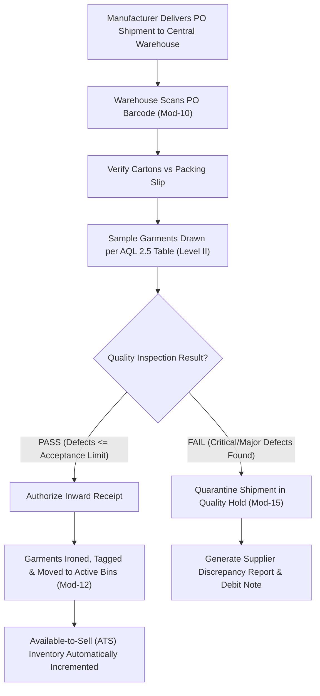
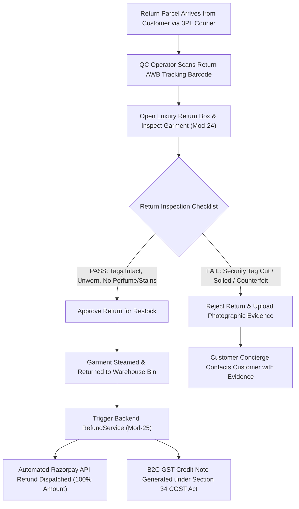

# ATEEVRA First-Party Fashion Brand — Internal Admin Panel Blueprint

**Document ID:** `BLU-ATEEVRA-ADMIN-V1`  
**Classification:** `INTERNAL MANAGEMENT CONSOLE BLUEPRINT`  
**Parent Blueprint:** [`ATEEVRA-BRAND-MASTER-BLUEPRINT.md`](ATEEVRA-BRAND-MASTER-BLUEPRINT.md)  
**Target Route Scope:** `apps/storefront/src/app/admin`  
**Backend API Scope:** Medusa Admin API (`apps/backend/src/api/admin`)  
**Effective Date:** 2026-11-05  

---

## 1. Executive Summary & Purpose

The ATEEVRA Admin Panel is the centralized, enterprise-grade internal management console utilized exclusively by ATEEVRA corporate employees, merchandisers, warehouse operators, finance controllers, and customer concierge agents.

Unlike a multi-vendor marketplace which requires distributed merchant onboarding, self-service seller dashboards, and commission payout ledgers, the ATEEVRA Admin Panel is engineered for **centralized brand governance, operational precision, inventory integrity, and high-touch customer service**.

```mermaid
mindmap
  root((ATEEVRA Internal Admin))
    Merchandising & Catalog
      Collection Builder
      Variant Matrix & Sizing
      Pricing & Landed Cost
      Lookbook & Media Sync
    Supply Chain & Warehouse
      Purchase Order (PO) Management
      Inward AQL Inspection
      Bin Management & Safety Stock
      Pick, Pack & Luxury Dispatch
    Customer Experience
      Omnichannel Order Manager
      Concierge Return & Exchange
      Defect & QC Inspection
      Direct Refund Authorization
    Corporate Governance
      Role-Based Access Control (RBAC)
      Mandatory TOTP MFA
      Immutable Audit Logging
      GST & Financial Telemetry
```

---

## 2. Admin Architecture, Authentication & Security Gates

```mermaid
sequenceDiagram
    autonumber
    actor Staff as ATEEVRA Employee
    participant AdminUI as Next.js Admin UI (/admin)
    participant AuthBFF as Admin Auth Route Handler
    participant MedusaAuth as Medusa Auth Module
    participant DB as PostgreSQL (medusa_db)

    Staff->>AdminUI: Submit Work Email & Master Password
    AdminUI->>AuthBFF: POST /api/admin/auth/login
    AuthBFF->>MedusaAuth: Verify Argon2id Credentials
    MedusaAuth-->>AuthBFF: Credentials Valid; MFA Required
    AuthBFF-->>AdminUI: HTTP 200 (Requires MFA Challenge)
    Staff->>AdminUI: Enter 6-Digit TOTP Authenticator Code
    AdminUI->>AuthBFF: POST /api/admin/auth/mfa-verify
    AuthBFF->>MedusaAuth: Verify RFC 6238 TOTP Token
    MedusaAuth->>DB: Log Audit Event: ADMIN_LOGIN_SUCCESS
    MedusaAuth-->>AuthBFF: Issue HttpOnly Encrypted Session Cookie
    AuthBFF-->>AdminUI: Redirect to Dashboard based on Role
```

### 2.1 Security Controls & Invariants
1. **Mandatory TOTP MFA:** All internal administrative accounts require two-factor authentication via Google Authenticator, 1Password, or YubiKey prior to session generation.
2. **Session Idle Timeout:** Administrative sessions automatically terminate after 30 minutes of inactivity.
3. **Sensitive Action Step-Up Authentication:** High-risk operations (refunds $> ₹5,000$, inventory manual write-offs $> ₹25,000$, user role modifications, and customer PII exports) require secondary biometric or TOTP re-authentication.
4. **Immutable Audit Trail:** Every administrative database mutation records `staff_id`, `staff_email`, `action_type`, `target_entity_id`, `before_state_snapshot`, `after_state_snapshot`, and `ip_address` in `admin_audit_log`.

---

## 3. Core Administrative Functional Modules

The ATEEVRA Admin Panel encompasses 34 specialized operational modules grouped into six functional suites:

```
┌─────────────────────────────────────────────────────────────────────────────┐
│                       ATEEVRA ADMIN MODULE TAXONOMY                         │
├─────────────────────────────────────────────────────────────────────────────┤
│ 1. MERCHANDISING & CATALOG SUITE                                            │
│    - Mod-01: Product Master & SKU Generator                                 │
│    - Mod-02: Variant Matrix (Size, Color, Material)                         │
│    - Mod-03: Luxury Digital Asset Manager (Ghost Mannequin, Model Video)    │
│    - Mod-04: Collection & Category Taxonomy                                 │
│    - Mod-05: Pricing, Landed Costing & Markdown Scheduler                   │
│    - Mod-06: Size & Fit Specification Manager                               │
│                                                                             │
│ 2. SUPPLY CHAIN & PROCUREMENT SUITE                                         │
│    - Mod-07: Supplier & Manufacturer Directory                              │
│    - Mod-08: Purchase Order (PO) Authorisation & Lifecycle                  │
│    - Mod-09: Raw Material & Fabric Tracking                                 │
│    - Mod-10: Inward Goods Receipt & AQL Quality Inspection Sign-off         │
│    - Mod-11: Manufacturing Defect Claim Logging                             │
│                                                                             │
│ 3. INVENTORY & WAREHOUSE OPERATIONS SUITE                                   │
│    - Mod-12: Central Warehouse Bin & Rack Management                        │
│    - Mod-13: Real-Time Available-to-Sell (ATS) Stock Telemetry              │
│    - Mod-14: Safety Stock & Reorder Point Alerts                            │
│    - Mod-15: Stock Transfer & Quarantine Holds                              │
│    - Mod-16: Physical Stock Audit & Cycle Counting                          │
│                                                                             │
│ 4. ORDER FULFILLMENT & LOGISTICS SUITE                                      │
│    - Mod-17: Omnichannel Order Orchestration & Processing                   │
│    - Mod-18: Pick-List & Batch Wave Packing                                 │
│    - Mod-19: Luxury Packaging & Tissue Wrap Inspection Verification        │
│    - Mod-20: 3PL Courier Manifest Generation & Thermal Label Printing       │
│    - Mod-21: Outward Tracking & Delivery Exception Dashboard                │
│                                                                             │
│ 5. CUSTOMER CONCIERGE & RETURNS SUITE                                       │
│    - Mod-22: Unified Customer Master Profile & VIP Tagging                  │
│    - Mod-23: Concierge Return & Exchange Authorization                     │
│    - Mod-24: Inward Return Warehouse Inspection & Restocking                │
│    - Mod-25: Direct Customer Refund Management                              │
│    - Mod-26: Customer Support Inquiries & WhatsApp Communications           │
│                                                                             │
│ 6. FINANCE, COMPLIANCE & PLATFORM GOVERNANCE SUITE                          │
│    - Mod-27: Razorpay Payment Capture & Gateway Fee Reconciliation          │
│    - Mod-28: B2C GST Tax Invoicing & Credit Note Ledger                     │
│    - Mod-29: Landed Margin & Unit Contribution Reporting                    │
│    - Mod-30: Strapi CMS Content Preview & Publishing Pipeline               │
│    - Mod-31: Staff Account Directory & Granular RBAC Permissions            │
│    - Mod-32: Security Monitoring, TOTP Management & Session Revocation      │
│    - Mod-33: Immutable Administrative Audit Logs                            │
│    - Mod-34: Storefront Feature Flags & Maintenance Configuration           │
└─────────────────────────────────────────────────────────────────────────────┘
```

---

## 4. Key Administrative Operational Workflows

### 4.1 Inward Goods Receipt & AQL Quality Inspection Workflow


### 4.2 Concierge Return Receipt & Refund Execution Workflow


---

## 5. Staff Role-Based Access Control (RBAC) Matrix

| Administrative Module Suite | Super Admin | Merchandiser | Warehouse Ops | Customer Concierge | Finance Controller | Content Editor |
| :--- | :---: | :---: | :---: | :---: | :---: | :---: |
| **Catalog & Pricing Master** | Full | Read / Write | Read Only | Read Only | Read Only | None |
| **Procurement & PO Ledger** | Full | Read Only | Inward Sign-off | None | Read / Approve | None |
| **Inventory & Bin Stock** | Full | Read Only | Full | Read Only | Read Only | None |
| **Orders & Fulfillment** | Full | Read Only | Pick/Pack/Ship | Read / Cancel | Read Only | None |
| **Returns & Inspections** | Full | Read Only | Inspect / Restock | Authorize / Review | Read Only | None |
| **Refunds & Financials** | Full | None | None | Initiate ($< ₹5k$) | Authorize All | None |
| **GST Invoices & Reports** | Full | None | None | Read Invoices | Full | None |
| **Strapi CMS Content** | Full | Read Only | None | None | None | Full |
| **Staff & Security Settings**| Full | None | None | None | None | None |
| **Audit Log Viewing** | Full | None | None | None | Read Only | None |
