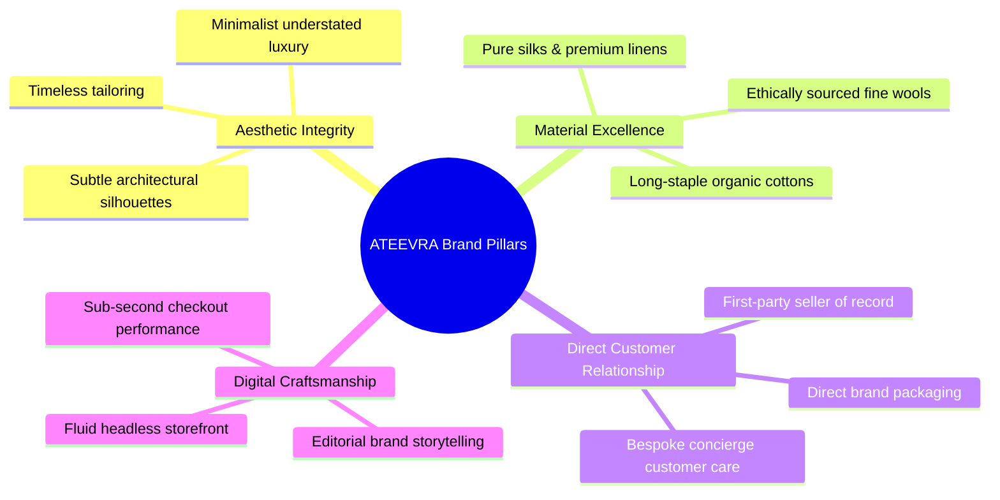
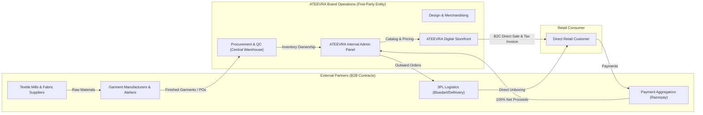
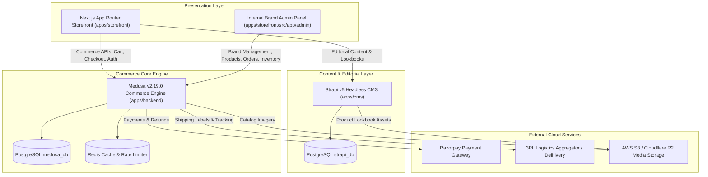

# ATEEVRA First-Party Luxury Brand — Master Blueprint

**Blueprint ID:** `BLU-ATEEVRA-BRAND-MASTER`  
**Document Classification:** `EXECUTIVE MASTER BLUEPRINT`  
**Brand Entity:** ATEEVRA (First-Party D2C Luxury/Premium Fashion Label)  
**Governance Authority:** Platform Owner / Board of Directors  
**Version:** `1.0.0-DRAFT`  
**Effective Date:** 2026-11-05 (Subject to Owner Ratification)  
**Parent Framework:** [`README.md`](README.md)  

---

## 1. Brand Vision, Mission & Aesthetic Philosophy

ATEEVRA is an Indian contemporary premium and luxury fashion house established to create timeless, sculptural silhouettes, masterfully tailored garments, and an elevated digital customer journey.



### 1.1 Strategic Positioning
ATEEVRA occupies the **Accessible Luxury to High-End Contemporary** space—competing with global design-led brands such as *Massimo Dutti, COS, Ralph Lauren, Hugo Boss*, and Indian luxury modernists. The brand emphasizes:
- **Quiet Luxury:** Minimalist branding, zero loud logos, refined texture-led appeal.
- **Craftsmanship over Fast Fashion:** Small-batch limited-run collections, high AQL quality standards, zero planned obsolescence.
- **Price-to-Value Proposition:** Eliminating traditional wholesale and department store markups by selling directly to consumers (D2C).

---

## 2. Commercial & Legal Operating Model

ATEEVRA operates as a **First-Party Direct-to-Consumer (D2C) Brand**:



### 2.1 Essential Business Model Attributes
1. **Seller of Record:** ATEEVRA is the sole entity on customer B2C tax invoices (issued under ATEEVRA's GSTIN pursuant to Section 31 of the CGST Act, 2017).
2. **Title in Goods:** ATEEVRA owns 100% of finished inventory upon warehouse receipt and inspection. Inventory risk and holding costs rest entirely with ATEEVRA.
3. **No Marketplace Merchants:** Suppliers, contract manufacturers, and job workers are B2B vendors managed via Purchase Orders (POs) and corporate accounts payable. They do not have access to a merchant portal or consumer orders.
4. **Unified Customer Care:** All customer interactions, return inspections, and warranty claims are handled directly by ATEEVRA's internal support concierge.

---

## 3. Technology & System Architecture Overview

The technical architecture reuses the monorepo's established enterprise foundation while streamlining domain boundaries for first-party commerce:



### 3.1 Key Architectural Decoupling
- **Decoupling Marketplace Primitives:** The first-party brand eliminates `merchant_id` filters on catalog listings, cart checkout, and fulfillment routing.
- **Strapi v5 Editorial Authority:** Strapi manages lookbooks, runway collection storytelling, designer notes, care guides, and homepage curation.
- **Medusa v2 Commerce Authority:** Medusa remains the immutable system of record for inventory units, order state machines, payment captures, customer accounts, and refunds.

---

## 4. Brand Operations Lifecycle

```
[Design & Curation] ──> [Sampling & Tech Pack] ──> [Purchase Order Issued]
                                                           │
                                                           ▼
[Customer Unboxing] <── [Order Fulfilled] <── [AQL 2.5 Warehouse Receipt]
        │
        ├── Customer Keeps Item ──> Lifecycle Complete
        └── Customer Returns Item ──> [7-Day Concierge Return & Restock]
```

1. **Product Development:** In-house tech pack creation, fabric testing, fit evaluation, and sample sign-off.
2. **Procurement:** Issue Purchase Orders to vetted contract manufacturers with strict delivery milestones and payment credit terms.
3. **Quality Control:** Inward inspection at ATEEVRA's central fulfillment facility using ISO 2859-1 (AQL 2.5 General Inspection Level II).
4. **Publishing & Curation:** Product imagery (ghost mannequin, lookbook styling), video clips, and fabric composition uploaded via Admin Panel.
5. **Customer Experience:** Instant OTP / guest checkout, custom branded unboxing box, tissue wrapping, return card.
6. **Post-Purchase Care:** Dedicated 7-day return concierge, direct refund to original source, garment care guidance.

---

## 5. Decision Governance & Implementation Phasing

All business and technical parameters are governed by the **28 ATEEVRA Owner Decisions** (`ATEEVRA-OD-001` to `ATEEVRA-OD-028`) cataloged in [`owner-decisions/OWNER-DECISION-REGISTER.md`](owner-decisions/OWNER-DECISION-REGISTER.md).

Implementation proceeds across four sequential phases:
- **Phase 1: Foundational D2C Brand Launch:** Core catalog, single warehouse, prepaid/COD checkout, branded unboxing, 7-day return concierge.
- **Phase 2: Operational Rigor & Automation:** Automated 3PL carrier routing, warehouse barcode scanning, supplier PO ledger, Strapi lookbook workflows.
- **Phase 3: VIP Clienteling & Concierge:** WhatsApp VIP concierge, garment alteration services, limited-run drop scheduling.
- **Phase 4: Omnichannel & Global Expansion:** International shipping, multi-currency checkout, flagship pop-up retail integration.
