# ATEEVRA First-Party Fashion Brand — Commerce Operating Model

**Document ID:** `OP-ATEEVRA-COMMERCE-MODEL-V1`  
**Classification:** `END-TO-END OPERATING MODEL & STANDARD PROCEDURES`  
**Parent Blueprint:** [`ATEEVRA-BRAND-MASTER-BLUEPRINT.md`](ATEEVRA-BRAND-MASTER-BLUEPRINT.md)  
**Effective Date:** 2026-11-05  

---

## 1. Operating Model Overview

The ATEEVRA Commerce Operating Model governs the end-to-end execution lifecycle of the first-party luxury fashion brand—from raw material sourcing and garment production to warehouse fulfillment, luxury packaging, and customer concierge post-purchase care.

```mermaid
flowchart LR
    subgraph "Stage 1: Production & Inward"
        A1["PO Issued to Factory"] --> A2["Factory Production & Shipment"]
        A2 --> A3["Warehouse Dock Inward"]
        A3 --> A4["AQL 2.5 Quality Inspection"]
        A4 --> A5["Ironing, Tagging & Binning"]
    end

    subgraph "Stage 2: Merchandising & Sale"
        A5 --> B1["Catalog Sync & Lookbook Publish"]
        B1 --> B2["Customer Places Order"]
        B2 --> B3["Instant Payment Capture"]
    end

    subgraph "Stage 3: Outward Fulfillment"
        B3 --> C1["Pick & Inspection"]
        C1 --> C2["Luxury Packaging & Unboxing Prep"]
        C2 --> C3["Courier Handover (Same-Day / 24h)"]
        C3 --> C4["Customer Delivery Confirmation"]
    end

    subgraph "Stage 4: Post-Purchase Concierge"
        C4 --> D1{"Customer Experience"}
        D1 -- "Kept" --> D2["VIP Clienteling & Feedback"]
        D1 -- "Return Initiated" --> D3["7-Day Concierge Return"]
        D3 --> D4["Inward QC & Immediate Refund"]
    end
```



---

## 2. Standard Operating Procedures (SOPs) Across the Value Chain

### SOP-01: Product Development & Sample Approval
1. **Tech Pack Release:** Lead Designer creates comprehensive digital tech pack with graded pattern measurements, seam construction details, fabric specs, button/hardware callouts, and Pantone TCX color references.
2. **Fit Prototyping:** Contract manufacturer produces initial sample (Size Medium). Garment is evaluated on a live fit model for drape, mobility, collar roll, and wash shrinkage.
3. **Pre-Production (PP) Approval:** Once measurements conform to $\pm 0.5\text{ cm}$ tolerances, Head of Merchandising signs the formal PP sample, sealing one golden sample in the brand archive.

### SOP-02: Purchase Order (PO) & Sourcing Governance
1. **PO Generation:** Issued via Admin Panel (`Mod-08`) with exact size ratios (e.g., S:2, M:4, L:4, XL:2), agreed FOB unit cost, delivery date milestone, and payment schedule.
2. **Payment Milestones:** 30% advance on PO execution; 70% balance paid net 30 days following successful warehouse receipt and quality sign-off.

### SOP-03: Warehouse Inwarding & AQL 2.5 Quality Inspection
1. **Dock Inwarding:** Shipment unloaded at central fulfillment center; cartons inspected for exterior moisture or crush damage.
2. **Statistical Sampling:** Quality inspector pulls random garments according to **ISO 2859-1 (AQL 2.5 Normal Single Sampling, Inspection Level II)**.
3. **Inspection Checklist:**
   - Measurement verification across 6 key points (Chest, Shoulders, Length, Waist, Sleeve, Neck).
   - Seam strength, stitching tension, loose thread count.
   - Button attachment strength and zipper smoothness.
   - Color shading against golden sample under D65 daylight lamp.
4. **Acceptance Gate:**
   - If defect count $\le \text{Acceptance Number } (Ac)$: Shipment accepted, ironed, barcode tagged, and binned.
   - If defect count $\ge \text{Rejection Number } (Re)$: Entire batch quarantined; manufacturer issued formal rejection notice and debit note.

### SOP-04: Outward Luxury Packaging & Unboxing Standards
Every ATEEVRA order delivers an elevated, memorable unboxing experience:

```
┌─────────────────────────────────────────────────────────────────────────────┐
│                       ATEEVRA LUXURY PACKAGING TIERS                        │
├─────────────────────────────────────────────────────────────────────────────┤
│ 1. Garment Preservation:                                                    │
│    - Garment professionally steamed to eliminate wrinkles.                  │
│    - Folded around acid-free archival cardboard forms.                      │
│    - Custom ATEEVRA branded woven fabric security loop tag attached.         │
│                                                                             │
│ 2. Primary Packaging:                                                       │
│    - Wrapped in custom translucent mulberry tissue paper with wax seal.     │
│    - Placed inside a matte charcoal rigid gift box with debossed foil logo. │
│    - Personalized calligraphed thank-you card and garment care certificate. │
│                                                                             │
│ 3. Secondary Protective Outer Carton:                                       │
│    - Moisture-resistant corrugated kraft outer shipper.                     │
│    - Tamper-evident reinforced water-activated reinforced paper tape.       │
│    - Minimalist thermal shipping label (zero commercial price tags on box). │
└─────────────────────────────────────────────────────────────────────────────┘
```

### SOP-05: Fulfillment SLAs & Logistics Routing
1. **Dispatch SLA:**
   - Orders confirmed before 14:00 IST are dispatched **same calendar day**.
   - Orders confirmed after 14:00 IST are dispatched within **24 hours**.
2. **Logistics Partner Allocation:** Air express routing via Tier-1 premium couriers (Bluedart Apex, Delhivery Express) providing guaranteed delivery:
   - Metro Cities (Mumbai, Delhi NCR, Bengaluru, Hyderabad): 24–48 hours.
   - Rest of India: 48–72 hours.
3. **Delivery Notification:** Automated WhatsApp tracking message triggered upon initial courier pickup scan with live tracking link.

### SOP-06: 7-Day Concierge Returns, Restocking & Refunds
1. **Return Window:** 7 calendar days from carrier delivery confirmation.
2. **Doorstep Pickup:** Free reverse pickup booked automatically via integrated courier partner.
3. **Warehouse Return QC:** Returned item inspected within 24 hours of warehouse arrival. Woven security loop must be intact; item must be unwashed, unworn, and free of stains/fragrances.
4. **Instant Refund:** Once QC passes, Admin Panel triggers an automated Razorpay API refund back to the customer's original payment method (or initiates UPI transfer for COD orders). Funds reflect in customer account within 2–4 banking hours for UPI, 2–3 days for cards.

---

## 3. Operational Performance Benchmarks (KPI Targets)

| Key Performance Indicator | Definition | First-Party Benchmark Target |
| :--- | :--- | :---: |
| **Order Dispatch SLA Adherence** | Orders shipped within 24 hours of placement | $> 98.5\%$ |
| **Delivery Success Rate** | Placed orders successfully delivered to customer | $> 95.0\%$ |
| **Cash on Delivery (COD) RTO Rate** | Failed COD delivery rate returning to origin | $< 8.0\%$ |
| **Return QC Turnaround Time** | Inspection completed from physical receipt | $< 24\text{ hours}$ |
| **Refund Processing Velocity** | Time from return approval to gateway refund dispatch | $< 2\text{ hours}$ |
| **Customer Support First Response** | Response time on WhatsApp Concierge | $< 15\text{ minutes}$ |
| **Inward AQL Defect Rate** | Factory manufacturing defect percentage | $< 1.5\%$ |
