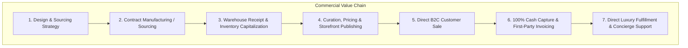

# ATEEVRA First-Party Fashion Brand — Commercial Business Model

**Document ID:** `BM-ATEEVRA-D2C-FIRST-PARTY`  
**Classification:** `AUTHORITATIVE COMMERCIAL SPECIFICATION`  
**Parent Blueprint:** [`ATEEVRA-BRAND-MASTER-BLUEPRINT.md`](ATEEVRA-BRAND-MASTER-BLUEPRINT.md)  
**Governing Status:** `READY_FOR_OWNER_REVIEW`  
**Effective Date:** 2026-11-05  

---

## 1. Executive Summary & Corporate Operating Paradigm

ATEEVRA is structured as a **First-Party Direct-to-Consumer (D2C) Luxury/Premium Fashion House**. Under this corporate model, ATEEVRA assumes end-to-end commercial, legal, inventory, and customer relationship ownership. 

The traditional intermediary marketplace layer (third-party sellers, vendor commissions, settlement reserves, and seller onboarding portals) is entirely absent from ATEEVRA's direct operational scope.

---

## 2. Core Operating Dimensions & Responsibilities

### 2.1 Brand Ownership & Intellectual Property
- **Brand Proprietor:** ATEEVRA Brand Holdings (or designated corporate operating entity) owns all registered trademarks, trade dress, garment patterns, tech packs, digital media assets, and domain names.
- **Brand Protection:** Strict anti-counterfeiting measures, custom-woven holographic security labels on garments, and brand registry enforcement across global digital channels.

### 2.2 Legal Entity & Seller of Record (SOR)
- **Direct Contracting:** When a retail customer places an order on `ateevra.com`, the customer enters into a direct contract of sale exclusively with ATEEVRA.
- **Statutory Invoicing:** ATEEVRA issues customer-facing B2C Tax Invoices in accordance with Section 31 of the Central Goods and Services Tax (CGST) Act, 2017, and Rule 46 of the CGST Rules, using ATEEVRA's own GSTIN.
- **Consumer Protection Accountability:** ATEEVRA assumes complete, non-delegable legal liability as the "Seller" under the Consumer Protection (E-Commerce) Rules, 2020 and Consumer Protection Act, 2019.

### 2.3 Product Ownership & Sourcing Models
ATEEVRA evaluates four distinct product sourcing paradigms:

| Sourcing Model | Description | Inventory Title Transfer | Production Lead Time | Gross Margin Potential | Owner Decision Reference |
| :--- | :--- | :--- | :---: | :---: | :--- |
| **Model 1: Custom Contract Manufacturing (CMT / OEM)** | ATEEVRA develops proprietary tech packs, selects custom fabrics, and contracts third-party factories for cutting, making, and trimming. | At factory dispatch or warehouse receipt | 60–90 days | **High (65%–75%)** | [`owner-decisions/ATEEVRA-OD-005`](owner-decisions/ATEEVRA-OD-005/DECISION-BLUEPRINT.md) |
| **Model 2: Private-Label Sourcing (ODM / White Label)** | Factory provides pre-designed contemporary silhouettes; ATEEVRA customizes branding, hardware, buttons, and packaging. | Upon FOB / warehouse dock receipt | 30–45 days | **Moderate (55%–65%)** | [`owner-decisions/ATEEVRA-OD-005`](owner-decisions/ATEEVRA-OD-005/DECISION-BLUEPRINT.md) |
| **Model 3: Own Atelier / Direct Manufacturing** | ATEEVRA owns physical cutting, sewing, and finishing ateliers in-house. | From raw material purchase | 14–30 days | **Very High (70%–82%)** | Future Expansion |
| **Model 4: Curated Designer Sourcing** | ATEEVRA buys finished designer collections outright and co-brands under ATEEVRA Signature. | Upon wholesale purchase order payment | 15–30 days | **Lower (45%–55%)** | Future Expansion |

*Launch Recommendation:* Hybrid launch combining **Model 1 (proprietary signature garments)** with **Model 2 (rapid-turn contemporary staples)**.

### 2.4 Pricing Authority & Margin Control
- **Full Price Discretion:** ATEEVRA holds 100% unilateral authority over customer shelf pricing ($P_{\text{sell}}$). No merchant agreements restrict promotional adjustments.
- **Legal Metrology Hard Ceiling:** ATEEVRA prints statutory Maximum Retail Price (MRP) stickers on garment tags and packaging boxes in compliance with Legal Metrology (Packaged Commodities) Rules, 2011 ($P_{\text{sell}} \le \text{MRP}$).
- **Target Commercial Economics:**
  $$\text{Target Gross Margin} = \frac{P_{\text{sell}} - \text{Landed Cost}}{P_{\text{sell}}} \ge 60\% \text{ to } 70\%$$

### 2.5 Inventory Ownership & Warehouse Responsibility
- **Balance Sheet Asset:** Inventory is capitalized as a corporate current asset on ATEEVRA's balance sheet under Ind AS 2 / AS-2 (Valued at lower of cost or net realizable value).
- **Physical Custody:** 100% centralized in ATEEVRA-operated or dedicated 3PL warehouse fulfillment centers.
- **Stockout & Shrinkage Liability:** ATEEVRA absorbs 100% of inventory carrying costs, dead stock, and transit shrinkage.

### 2.6 Customer Relationship & Support Concierge
- **Data Custody:** Customer PII (name, phone, address, purchase behavior) belongs exclusively to ATEEVRA, stored under strict encryption pursuant to the Digital Personal Data Protection (DPDP) Act, 2023.
- **Concierge Care:** High-touch customer support via WhatsApp Business API, dedicated email concierge, and phone support. No third-party merchant messaging friction.

### 2.7 Payment Collection & Banking Architecture
- **Direct Settlement:** 100% of customer checkout proceeds flow directly into ATEEVRA's corporate bank current account via Razorpay Payment Gateway.
- **Zero Marketplace Escrow Rails:** Eliminates nodal bank accounts, RBI Payment Aggregator split payouts, and merchant disbursement withholding.
- **Customer Refunds:** Initiated directly from ATEEVRA's corporate liquidity pool back to the customer's original payment source.

### 2.8 Taxation & Statutory Invoicing
- **GST Liability:** ATEEVRA accounts for outward GST liability on total product invoice value:
  - Apparel $\le ₹1,000$: **5% GST** (HSN Chapter 61/62).
  - Apparel $> ₹1,000$: **12% GST** (HSN Chapter 61/62).
  - Accessories / Leather: **18% / 28% GST** (HSN Chapter 42).
- **Input Tax Credit (ITC):** ATEEVRA claims full ITC on manufacturer invoices, fabric purchases, 3PL logistics bills, packaging materials, and payment gateway MDR under Section 16 of the CGST Act, 2017.
- **E-Way Bills:** Generated directly under ATEEVRA's GSTIN for inter-state consignment values exceeding ₹50,000.

### 2.9 Supplier Procurement & Payment Lifecycle
- **Vendor Contracts:** B2B Master Manufacturing Agreements with contract apparel factories.
- **Commercial Terms:** Standard fashion industry payment terms (e.g., 30% advance on PO confirmation, 70% upon successful AQL 2.5 factory gate inspection and warehouse delivery).
- **Vendor Access:** Suppliers interface via standard ERP purchase orders, EDI/email, or PDF statements—they **do not log into a marketplace seller dashboard**.

---

## 3. First-Party Operations vs. Marketplace Operations (Segregation Matrix)

To ensure zero architectural or conceptual confusion across the repository, the table below provides the authoritative boundary:

| Operational Dimension | ATEEVRA First-Party Brand (`docs/ateevra-brand/`) | Marketplace Platform (`docs/mvp2/m2-14/`) |
| :--- | :--- | :--- |
| **Seller of Record** | **ATEEVRA** (First-Party Corporate Entity) | **Independent Third-Party Merchants** |
| **Customer Invoice Issuer** | ATEEVRA issues B2C Tax Invoice under its GSTIN | Merchants issue B2C Invoices under merchant GSTIN |
| **Product Ownership** | ATEEVRA owns 100% of finished stock | Merchants retain title until retail sale |
| **Inventory Storage** | Central ATEEVRA Warehouse / Dedicated 3PL Hub | Decentralized across multiple merchant warehouse hubs |
| **Pricing Authority** | Unilateral ATEEVRA Brand Merchandising Team | Merchant sets price (subject to platform bounds) |
| **Revenue Stream** | **Retail Product Gross Revenue** | **Marketplace Platform Facilitation Fee (8%–10%)** |
| **Supplier / Merchant Relationship** | External B2B Contract Suppliers (POs, net credit) | Independent Sellers (Onboarding, SLA, Commission) |
| **Payment Flow** | Customer $\rightarrow$ Gateway $\rightarrow$ ATEEVRA Corporate Account | Customer $\rightarrow$ Gateway $\rightarrow$ Escrow $\rightarrow$ Merchant Settlement |
| **Merchant Panel Needed?** | **NO** (Internal Staff Admin Panel only) | **YES** (Merchant registration, catalog, orders) |
| **Reverse Logistics Allocation** | ATEEVRA absorbs or manages return freight policy | Reconciled via merchant settlement ledger debits |
| **Tax Withholding (TCS/TDS)** | **None** (ATEEVRA is principal retailer) | Mandated Section 52 GST TCS & Sec 194-O IT TDS |

---

## 4. Business Continuity & Risk Management

1. **Supply Chain Disruption:** Multi-sourcing strategy across at least two certified apparel manufacturers in Tirupur/Bengaluru/Delhi NCR to prevent single-source manufacturing bottlenecks.
2. **Inventory Obsolescence:** Structured End-of-Season Sale (EOSS) markdown schedules, archival private drops, and secondary off-price liquidation.
3. **Working Capital Protection:** Reorder triggers tied to rolling 14-day sales velocity to prevent excessive capital lockup in slow-moving SKUs.
