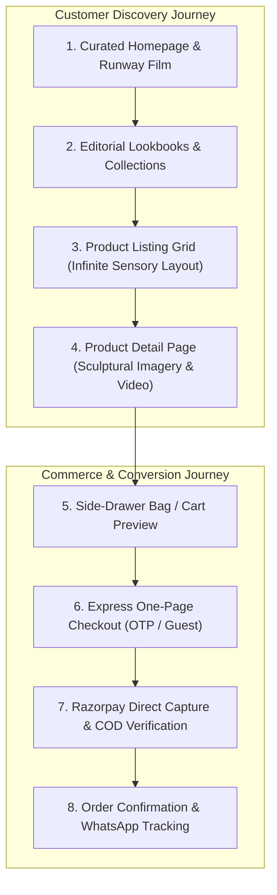

# ATEEVRA First-Party Fashion Brand — Storefront Blueprint

**Document ID:** `BLU-ATEEVRA-STOREFRONT-V1`  
**Classification:** `DIGITAL STOREFRONT & CUSTOMER EXPERIENCE BLUEPRINT`  
**Parent Blueprint:** [`ATEEVRA-BRAND-MASTER-BLUEPRINT.md`](ATEEVRA-BRAND-MASTER-BLUEPRINT.md)  
**Target Scope:** Next.js 15 App Router Storefront (`apps/storefront`)  
**Commerce Core:** Medusa v2 Store APIs (`/store/*`)  
**CMS Core:** Strapi v5 Content Delivery APIs (`/api/*`)  
**Effective Date:** 2026-11-05  

---

## 1. Executive Summary & Design Aesthetics

The ATEEVRA Storefront is the brand's digital flagship. It is engineered to embody **modernist luxury, architectural simplicity, and seamless performance**.

Every interaction—from initial homepage entry to product discovery, lookbook viewing, and one-page checkout—is crafted to evoke the refined ambiance of a luxury atelier.



### 1.1 Brand Asset Protection & Invariants
- **Preservation of Core Brand Assets:** The existing ATEEVRA logo, typography marks, and custom brand loading animation (`ATEEVRA Loader`) are preserved without mutation.
- **Aesthetic Direction:** Muted neutral color palette (Off-White `#FAFAFA`, Warm Alabaster `#F4F1EA`, Deep Charcoal `#1A1A1A`, Midnight Black `#0D0D0D`, Subtle Slate `#707070`).
- **Typography:** Refined editorial serif for collection titles paired with a clean, geometric grotesque sans-serif for functional UI and microcopy.

---

## 2. Storefront Information Architecture & Page Hierarchy

```
ateevra.com/
├── /                              # Curated Brand Homepage (Hero Runway Film, Featured Drop)
├── /collections/[slug]            # Seasonal Collection Stories (e.g., 'Monochrome Autumn')
├── /category/[category]           # Category Listings (Outerwear, Tailoring, Silks, Knits)
├── /product/[handle]              # Product Detail Page (Ghost Mannequin, Fit, Video, Fabric)
├── /lookbook                      # Full-Screen Editorial Lookbook Carousel
├── /cart                          # Shopping Bag Slide-Over & Review
├── /checkout                      # Express One-Page Checkout
├── /order/confirmed/[id]          # Order Confirmation & Live Tracking
├── /account                       # Customer Concierge Portal
│   ├── /account/orders            # Order History & Real-Time Tracking
│   ├── /account/returns           # 7-Day Self-Service Return/Exchange Initiation
│   └── /account/addresses         # Saved Delivery Address Book
├── /pages/[slug]                  # CMS Editorial Pages (The Atelier, Craftsmanship, Sustainability)
└── /policies/                     # Statutory Customer Policies (Returns, Shipping, Terms, Privacy)
```

---

## 3. Core Storefront Experiences

### 3.1 The Product Detail Page (PDP) — Sensory Luxury Presentation
The PDP is the heart of ATEEVRA's digital merchandising:
- **Hero Media Layout:** Desktop dual-column sticky layout; full-bleed vertical imagery (Aspect Ratio: 3:4, Minimum 2400x3200px); integrated 4K video clips showing fabric drape and movement.
- **Garment Architecture:** Comprehensive technical disclosures:
  - Fabric origin (e.g., *100% Giza Long-Staple Cotton, 240 GSM*).
  - Weave and construction (e.g., *Double-faced twill, French seams*).
  - Garment care requirements and drying instructions.
- **Interactive Fit & Sizing Concierge:**
  - Dynamic size recommendation calculator based on customer chest, waist, and height.
  - Model statistics (*Model is 6'1" / 185cm wearing Size Medium*).
  - Exact garment flat measurements table (chest width, shoulder width, sleeve length, garment length) to minimize size-related returns.
- **Available-to-Sell (ATS) Badge:** Real-time stock transparency (*"Only 3 pieces remaining in Size 40"*).

### 3.2 Express One-Page Luxury Checkout
Checkout friction is eliminated through streamlined design:
- **Guest Checkout Enabled:** Customers can complete purchases without pre-registering a password.
- **Mobile OTP Authentication:** Returning customers authenticate instantly via a 6-digit WhatsApp or SMS OTP.
- **Address Auto-Completion:** Integrated Google Places / Indian PIN code auto-fill (city and state resolved automatically from PIN code).
- **Payment Method Integration:**
  - One-click UPI Intent (Google Pay, PhonePe, Paytm).
  - Credit/Debit Cards with automated tokenization under RBI card storage rules.
  - Cash on Delivery (COD) with automated OTP phone verification for risk mitigation.
- **Price Transparency:** Hard guarantee of zero surprise fees at checkout. Delivery costs, GST, and final totals are visible prior to payment initiation.

---

## 4. Mobile-First Experience & Performance Benchmarks

Over 75% of Indian luxury fashion discovery occurs on mobile smartphones:
1. **Fluid Gesture Navigation:** Bottom navigation bar on mobile devices; swipeable image carousels; haptic feedback simulation on add-to-bag interactions.
2. **Core Web Vitals Engineering Invariants:**
   - **Largest Contentful Paint (LCP):** $< 1.8\text{ seconds}$ on 4G cellular networks.
   - **Cumulative Layout Shift (CLS):** $< 0.05$ (Pre-allocated image aspect-ratio containers).
   - **First Input Delay (FID) / Interaction to Next Paint (INP):** $< 100\text{ milliseconds}$.
3. **Image Optimization Pipeline:** Next.js automatic WebP/AVIF generation served via Cloudflare edge CDN with progressive blur-up placeholders.
4. **Accessibility (a11y):** Full adherence to WCAG 2.1 Level AA standards, semantic HTML5, screen-reader aria labels, and high-contrast color ratios.
