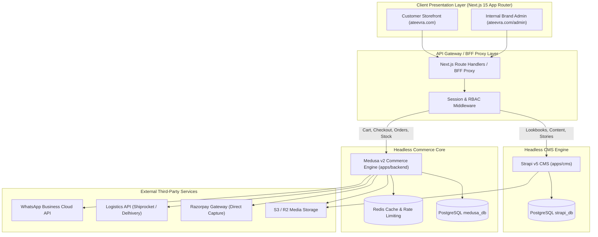
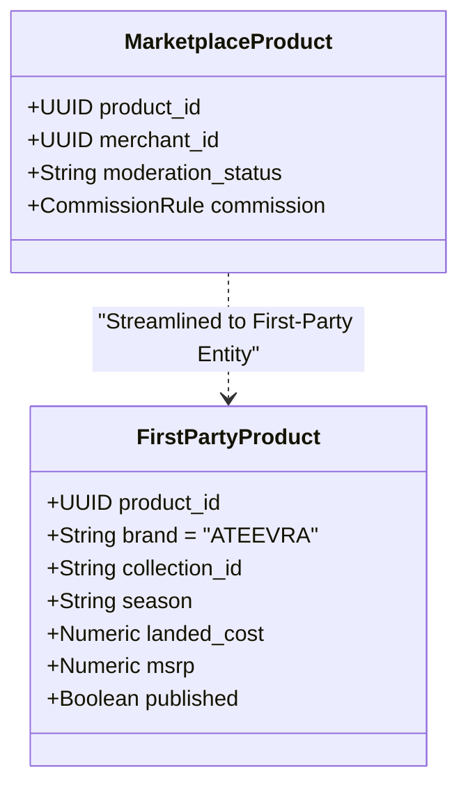
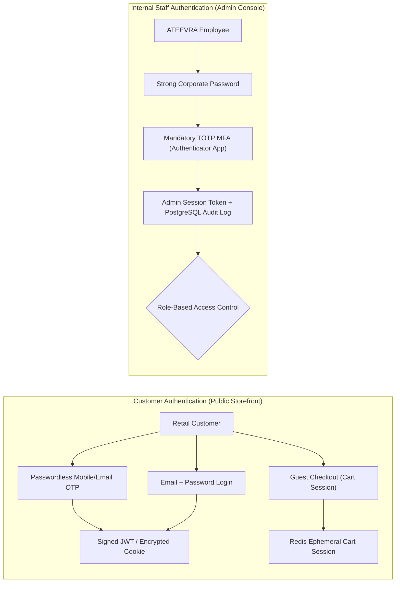

# ATEEVRA First-Party Fashion Brand — System Architecture Blueprint

**Document ID:** `ARCH-ATEEVRA-SYSTEM-V1`  
**Classification:** `TECHNICAL SYSTEM ARCHITECTURE SPECIFICATION`  
**Parent Blueprint:** [`ATEEVRA-BRAND-MASTER-BLUEPRINT.md`](ATEEVRA-BRAND-MASTER-BLUEPRINT.md)  
**Commerce Core:** Medusa v2.19.0 (`@medusajs/framework`, `@medusajs/order`, `@medusajs/payment`, `@medusajs/inventory`)  
**CMS Core:** Strapi v5.0.0 (Headless Content Management)  
**Frontend Presentation:** Next.js 15 App Router (`apps/storefront`)  
**Database & Cache:** PostgreSQL 16 (`medusa_db`, `strapi_db`), Redis 7 (`cache:*`, `ratelimit:*`, `session:*`)  
**Effective Date:** 2026-11-05  

---

## 1. Architectural Philosophy & First-Party Decoupling

The ATEEVRA technical platform is engineered for high-performance direct-to-consumer commerce, editorial brand richness, and operational simplicity.

---

## 2. Decoupling Marketplace Primitives for First-Party Commerce

The monorepo contains marketplace modules developed for multi-tenant seller isolation. In the first-party ATEEVRA brand domain, these primitives are streamlined:

### 2.1 Specific Domain Transformations
1. **Product & Catalog Ownership:**
   - *Marketplace Model:* Product linked to `merchant_product`, requiring vendor ownership validation, seller approval workflows, and commission tags.
   - *ATEEVRA First-Party Model:* All products are natively owned by `ATEEVRA`. The `merchant_id` constraint is set to a fixed internal brand entity or bypassed entirely. Publishing is controlled strictly by internal Merchandising and Creative Leads.
2. **Inventory & Warehouse Stock Locations:**
   - *Marketplace Model:* Decentralized stock scattered across hundreds of independent merchant facilities via `merchant-stock-location`.
   - *ATEEVRA First-Party Model:* Consolidated into **ATEEVRA Central Warehouse (Facility Code: `WH-ATEEVRA-01`)** with dedicated bin locations, AQL quality hold zones, and reserve stock.
3. **Order & Line Item Routing:**
   - *Marketplace Model:* Cart decomposed into multiple vendor packages; separate shipments, labels, and fulfillment SLAs.
   - *ATEEVRA First-Party Model:* Single consolidated order fulfillment. All items ship from ATEEVRA's central warehouse in an integrated, unified luxury unboxing box.
4. **Payments, Escrow & Settlements:**
   - *Marketplace Model:* Nodal escrow accounts, Section 52 GST TCS, Section 194-O IT TDS, split payouts, and vendor settlement reserves.
   - *ATEEVRA First-Party Model:* Direct corporate settlement. 100% of captured funds clear into ATEEVRA's primary bank account. Zero seller payout calculation pipelines.

---

## 3. Application Domain Boundaries & Data Ownership

| Domain Entity | Authoritative System of Record | Storage Engine | Read Access | Mutation Authority |
| :--- | :--- | :--- | :--- | :--- |
| **Product Master, SKUs, Variants** | Medusa v2 | PostgreSQL (`medusa_db`) | Storefront, Admin | Merchandising Team |
| **Product Inventory & Bin Stock** | Medusa v2 Inventory Module | PostgreSQL (`medusa_db`) | Storefront (ATS), Admin | Warehouse Operations |
| **Product Editorial, Lookbooks, Stories**| Strapi v5 CMS | PostgreSQL (`strapi_db`) | Storefront | Creative & Marketing Team |
| **Customer Accounts & Addresses** | Medusa v2 Customer Module | PostgreSQL (`medusa_db`) | Storefront (Self), Admin | Customer (Self), Support |
| **Shopping Cart & Checkout Sessions**| Medusa v2 Cart Module | PostgreSQL / Redis | Storefront | Customer Session |
| **Payment Captures & Webhooks** | Medusa v2 Payment Module | PostgreSQL (`medusa_db`) | Admin Finance | Payment Aggregator Webhook |
| **Order State Machine & History** | Medusa v2 Order Module | PostgreSQL (`medusa_db`) | Storefront, Admin | Order Lifecycle Engine |
| **Fulfillment Shipments & Tracking** | Medusa v2 Fulfillment Module | PostgreSQL (`medusa_db`) | Storefront, Admin | Logistics Coordinator |
| **Returns, Inspections & Refunds** | Medusa v2 Return Engine | PostgreSQL (`medusa_db`) | Storefront, Admin | Return Concierge & QC |

---

## 4. Authentication, Session Security & RBAC Model

ATEEVRA enforces a bifurcated authentication architecture separating retail customers from internal corporate staff:

### 4.1 Internal Staff RBAC Roles
1. **`ROLE_SUPER_ADMIN`:** Full infrastructure and financial control; user invitation and role revocation; sensitive financial export authorizer.
2. **`ROLE_BRAND_MERCHANDISER`:** Catalog CRUD; variant pricing; collection building; category assignment; publication rights.
3. **`ROLE_WAREHOUSE_OPERATOR`:** Inward stock receipt; AQL inspection sign-off; inventory bin adjustments; pick/pack/ship dispatch.
4. **`ROLE_CUSTOMER_CONCIERGE`:** Customer lookup; order tracking; order cancellation before dispatch; return authorization; support ticket management.
5. **`ROLE_FINANCE_CONTROLLER`:** Payment gateway reconciliation; refund authorization above ₹5,000; GST tax reporting; landed cost analysis.
6. **`ROLE_CONTENT_EDITOR`:** Strapi v5 editorial management; lookbook authoring; promotional banner scheduling.

---

## 5. Security Invariants & Integration Resilience

1. **ACID Financial Transactions:** All inventory reservations, payment captures, and refund ledger updates execute within explicit PostgreSQL database transactions using PostgreSQL advisory locking (`@medusajs/locking-postgres`) to prevent race conditions.
2. **Payment Webhook Idempotency:** Razorpay webhooks (`payment.captured`, `refund.processed`) must verify cryptographic HMAC signatures (`X-Razorpay-Signature`) and store processed event IDs in an immutable `payment_webhook_inbox` table to guarantee exactly-once processing.
3. **Data Protection & PII Masking:** Customer mobile numbers, email addresses, and shipping locations are encrypted at rest under AES-256 and redacted in application log streams to comply with the DPDP Act, 2023.
