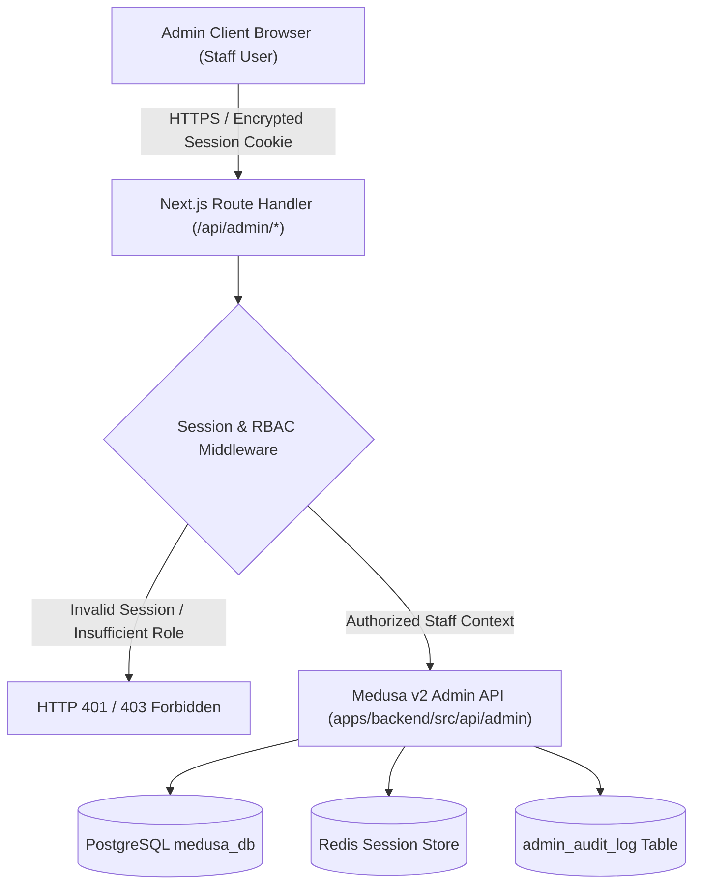

# ATEEVRA Admin Panel — Master Architecture & Specification

**Document ID:** `ADM-ATEEVRA-MASTER-V1`  
**Classification:** `INTERNAL ADMIN ARCHITECTURE SPECIFICATION`  
**Parent Framework:** [`../README.md`](../README.md)  
**Target Route Scope:** `apps/storefront/src/app/admin`  
**Backend API Scope:** Medusa Admin API (`apps/backend/src/api/admin`)  
**Effective Date:** 2026-11-05  

---

## 1. Executive Summary & Purpose

The ATEEVRA Admin Panel is the centralized internal operations console designed exclusively for ATEEVRA corporate staff.

It unifies:
1. **Catalog Merchandising:** Product creation, variant pricing, measurement specs, lookbook syncing.
2. **Supply Chain Operations:** Supplier master records, Purchase Orders (POs), inward goods receipt, AQL quality inspection logs.
3. **Warehouse & Inventory:** Bin-level stock management, safety stock thresholds, pick-pack wave lists.
4. **Order Orchestration:** Omnichannel fulfillment, courier manifest generation, delivery tracking.
5. **Customer Concierge:** Customer master profiles, 7-day return authorization, return inspection, instant gateway refund dispatch.
6. **Corporate Governance:** Fine-grained Role-Based Access Control (RBAC), mandatory TOTP MFA, immutable audit trails, and B2C GST reporting.

---

## 2. Technical Architecture & Next.js BFF Integration

The Admin Panel is hosted within the Next.js App Router (`apps/storefront/src/app/admin`) acting as a secure Backend-for-Frontend (BFF):

### 2.1 Security Controls
- **MFA Invariant:** Mandatory RFC 6238 TOTP verification required for every administrative login.
- **Session Protection:** HttpOnly, SameSite=Strict, Secure cookies with 30-minute idle expiration.
- **Cryptographic Audit:** High-risk actions (refunds $> ₹5,000$, stock write-offs $> ₹25,000$, role escalations) require step-up authentication.

---

## 3. UI/UX Design System & Layout Standards

The Admin Panel adheres to an understated, high-efficiency dark/light luxury design language:
- **Navigation:** Persistent collapsible left sidebar with grouped functional suites.
- **Header:** Global SKU/Order search bar, active environment badge (`PRODUCTION` / `STAGING`), notification drawer, staff profile with active role chip.
- **Table Density:** Compact tabular views with sortable columns, batch selection bars, and CSV/Excel export triggers.
- **Modals & Drawers:** Side-sheet drawers for order inspection, return QC photo uploads, and variant price overrides.
