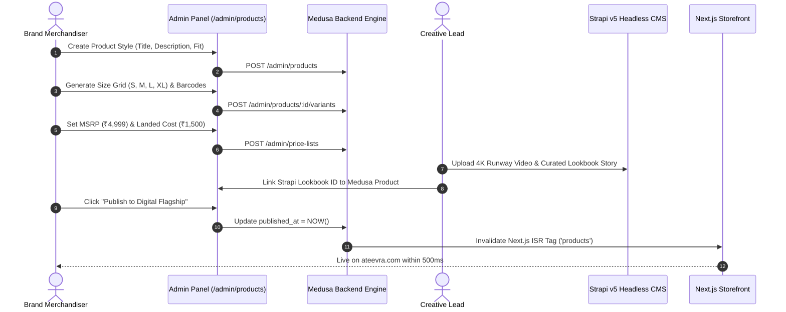
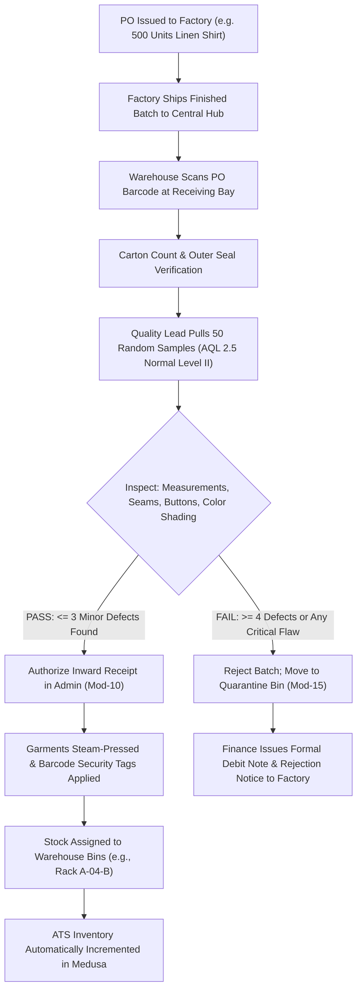
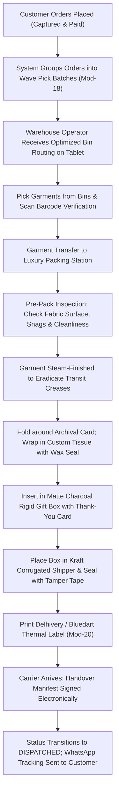

# ATEEVRA Admin Panel — Administrative Workflows Blueprint

**Document ID:** `ADM-ATEEVRA-WORKFLOWS-V1`  
**Classification:** `OPERATIONAL WORKFLOW SPECIFICATION`  
**Parent Blueprint:** [`ADMIN-PANEL-MASTER-BLUEPRINT.md`](ADMIN-PANEL-MASTER-BLUEPRINT.md)  
**Effective Date:** 2026-11-05  

---

## 1. Product Merchandising & Publishing Workflow



---

## 2. Procurement, Inward Goods & AQL 2.5 Inspection Workflow



---

## 3. Wave Picking, Luxury Packing & Courier Handover Workflow



---

## 4. Concierge Returns, Warehouse QC & Instant Refund Workflow

```mermaid
sequenceDiagram
    autonumber
    actor Customer as Retail Customer
    participant StoreUI as Customer Account (/account/orders)
    actor Concierge as Customer Concierge
    actor Courier as 3PL Express Courier
    actor QC as Warehouse QA Inspector
    participant AdminUI as Admin Console (/admin/returns)
    participant Medusa as Medusa Backend Engine
    participant Gateway as Razorpay Payment Gateway

    Customer->>StoreUI: Submit Return Request within 7 Days (Select Reason)
    StoreUI->>Medusa: POST /store/returns
    Concierge->>AdminUI: Review Request; Confirm Not Hygiene-Excluded
    Concierge->>AdminUI: Click "Approve & Book Reverse Courier"
    AdminUI->>Medusa: Trigger 3PL Reverse Pickup API (Delhivery)
    Courier->>Customer: Doorstep Package Pickup
    Courier->>QC: Deliver Return Box to Central Hub
    QC->>AdminUI: Scan Return Tracking Barcode (Mod-24)
    QC->>QC: Inspect: Security Tag Intact? Unworn? Unwashed? No Odors?
    alt Inspection PASSED
        QC->>AdminUI: Mark Return "QC_APPROVED_FOR_RESTOCK"
        AdminUI->>Medusa: Restock Garment to Warehouse Active Bin
        Medusa->>Gateway: POST /v1/payments/:id/refund (100% Amount)
        Gateway-->>Medusa: HTTP 200 Refund Success
        Medusa->>Medusa: Generate B2C GST Credit Note (Section 34 CGST Act)
        Medusa-->>Customer: WhatsApp Confirmation: "Refund of ₹X,XXX Dispatched"
    else Inspection FAILED
        QC->>AdminUI: Mark Return "QC_REJECTED" & Upload Photos
        AdminUI->>Concierge: Notification: Return Rejected for Damage/Tag Cut
        Concierge->>Customer: Contact via VIP Concierge; Garment Returned to Buyer
    end
```
