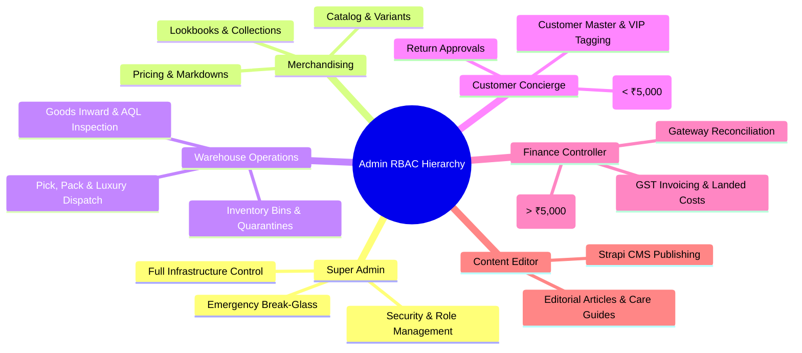

# ATEEVRA Admin Panel — Role-Based Access Control (RBAC) & Permissions

**Document ID:** `ADM-ATEEVRA-RBAC-V1`  
**Classification:** `SECURITY & PERMISSION SPECIFICATION`  
**Parent Blueprint:** [`ADMIN-PANEL-MASTER-BLUEPRINT.md`](ADMIN-PANEL-MASTER-BLUEPRINT.md)  
**Effective Date:** 2026-11-05  

---

## 1. Principles of Internal Corporate Authorization

The ATEEVRA Admin Panel implements **Strict Least Privilege (PoLP)** and **Separation of Duties (SoD)**. 

Because ATEEVRA is a first-party brand, all administrative users are authenticated employees bound by corporate NDAs and employment contracts. The architecture strictly eliminates third-party seller permissions and focuses on specialized internal operational roles:

---

## 2. Definitive Role-Permission Matrix across Operational Verbs

Permission Verbs:
- **C:** Create | **R:** Read / View | **U:** Update / Edit | **D:** Delete | **A:** Authorize / Approve | **X:** Data Export (CSV/Excel)

| Functional Domain | Super Admin | Merchandiser | Warehouse Ops | Customer Concierge | Finance Controller | Content Editor |
| :--- | :---: | :---: | :---: | :---: | :---: | :---: |
| **Product Master & SKUs** | C, R, U, D, A, X | C, R, U, A, X | R | R | R, X | R |
| **Pricing & Landed Costing** | C, R, U, D, A, X | C, R, U, A | None | R (MSRP only) | R, U, A, X | None |
| **Suppliers & Purchase Orders** | C, R, U, D, A, X | R | R, U (Inward) | None | R, A, X (Pay) | None |
| **Warehouse Inward & AQL QC** | C, R, U, D, A, X | R | C, R, U, A | None | R | None |
| **Inventory Levels & Bins** | C, R, U, D, A, X | R | C, R, U, A | R | R, X | None |
| **Orders & Fulfillment** | C, R, U, D, A, X | R | R, U, A (Dispatch)| R, U (Hold/Cancel) | R, X | None |
| **Returns & Inspections** | C, R, U, D, A, X | R | R, U, A (QC Pass) | C, R, U, A (Auth) | R, X | None |
| **Refunds ($\le ₹5,000$)** | C, R, U, D, A, X | None | None | C, R, A | C, R, A, X | None |
| **Refunds ($> ₹5,000$)** | C, R, U, D, A, X | None | None | C, R (Initiate only)| **A (Mandatory Approver)** | None |
| **GST Invoices & Credit Notes**| C, R, U, D, A, X | None | None | R (Download) | C, R, U, A, X | None |
| **Gateway Reconciliation** | C, R, U, D, A, X | None | None | None | C, R, U, A, X | None |
| **Customer PII Data Export** | **A (Requires MFA)** | None | None | None | **A (Requires MFA)** | None |
| **Strapi CMS Editorial** | C, R, U, D, A, X | R, U | None | None | None | C, R, U, A |
| **Staff & Role Management** | C, R, U, D, A | None | None | None | None | None |
| **Audit Log Viewing** | R, X | None | None | None | R | None |

---

## 3. High-Security Workflow Guards & Step-Up MFA

To prevent corporate fraud, unauthorized data exfiltration, or rogue inventory write-offs:

1. **Dual-Authorization for Refunds Exceeding ₹5,000:**
   $$\text{Refund Amount} > ₹5,000 \implies \text{Initiated by Customer Concierge} \xrightarrow{\text{Mandatory Review}} \text{Authorized by Finance Controller}$$
   Neither role can independently complete a high-value refund unilaterally.
2. **Step-Up Authentication for Bulk PII Export:**
   Attempting to export customer mailing lists, phone numbers, or sales reports triggers an automated TOTP push challenge. The export payload is watermarked with the requesting employee's ID and timestamp.
3. **Emergency Break-Glass Account:**
   A dedicated hardware-token secured `breakglass@ateevra.com` account exists strictly for production recovery. Utilization automatically sends high-priority SMS alerts to the executive leadership team and logs full session telemetry.
