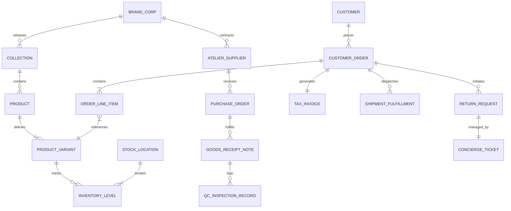

# ATEEVRA — First-Party Luxury Brand Domain Model

**Document ID:** `ATEEVRA-ARCH-DOM-001`  
**Classification:** Core Technical Architecture & Entity Model  
**Status:** DRAFT (Under Owner Review)  
**Version:** 1.0.0  

---

## 1. Executive Summary & Domain Entity Relationships

The ATEEVRA First-Party Domain Model represents an integrated luxury enterprise. Unlike a multi-sided marketplace with decoupled merchant sub-graphs, the first-party domain is unified around the central brand house (`ATEEVRA_CORP`).

---

## 2. Core Entity Definitions & Attribute Specifications

### 2.1 Catalog & Product Hierarchy
- `Collection`: Represents a seasonal or capsule release (e.g., *ATEEVRA Autumn/Winter 2026 — Monolith*). Attributes: `id`, `title`, `season`, `theme_color_hex`, `lookbook_strapi_id`, `published_at`.
- `Product`: The base commercial article. Attributes: `id`, `title`, `description`, `origin_country`, `manufacturer_details`, `net_quantity`, `material_composition`, `care_instructions`, `hsn_code`, `is_active`.
- `ProductVariant`: The purchasable SKU. Attributes: `id`, `product_id`, `sku`, `barcode_ean13`, `size`, `color_name`, `color_hex`, `dimensions_cm`, `weight_grams`, `mrp_inr`, `cost_price_inr`.

### 2.2 Supply Chain & Inventory Custody
- `AtelierSupplier`: Certified Tier-1 manufacturing partner. Attributes: `id`, `company_name`, `gstin`, `facility_city`, `quality_rating`, `audit_status`.
- `PurchaseOrder`: B2B procurement contract. Attributes: `id`, `atelier_id`, `total_amount_inr`, `advance_paid_inr`, `status` (`DRAFT`, `RELEASED`, `QC_PENDING`, `COMPLETED`), `expected_dock_date`.
- `QCInspectionRecord`: AQL 2.5 laboratory test report. Attributes: `id`, `po_id`, `sample_size`, `critical_defects`, `major_defects`, `minor_defects`, `status` (`PASSED`, `REJECTED`, `CONCESSION`).

### 2.3 Customer Orders & Invoicing
- `CustomerOrder`: Direct retail sale. Attributes: `id`, `customer_id`, `status` (`PENDING`, `CONFIRMED`, `SHIPPED`, `DELIVERED`, `CANCELLED`), `total_gmv_inr`, `payment_method`, `delivery_otp`.
- `TaxInvoice`: Section 31 CGST statutory tax invoice. Attributes: `id`, `invoice_number`, `order_id`, `cgst_inr`, `sgst_inr`, `igst_inr`, `taxable_value_inr`, `pdf_url`, `irn_hash`.
- `ShipmentFulfillment`: Physical dispatch parcel. Attributes: `id`, `order_id`, `carrier_id` (`BLUE_DART`, `DELHIVERY`), `awb_number`, `packaging_tier`, `tracking_status`, `dispatched_at`.

---
*End of Document `ATEEVRA-ARCH-DOM-001`. Authorized for Database Schema Architecture.*
