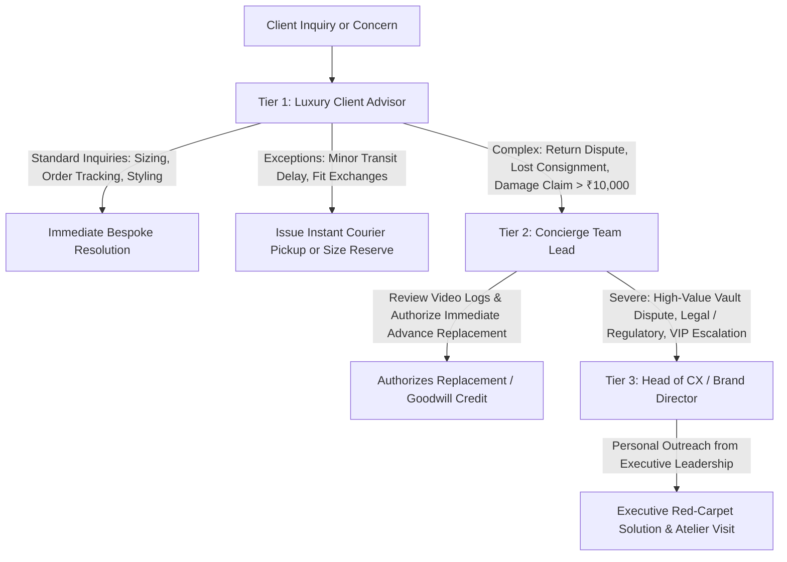

# ATEEVRA — First-Party Customer Support & Concierge Operations Blueprint

**Document ID:** `ATEEVRA-OPS-SUP-001`  
**Classification:** Operational Standard Operating Procedure (SOP) & Customer Experience Blueprint  
**Status:** DRAFT (Under Owner Review)  
**Version:** 1.0.0  

---

## 1. Executive Summary & The Luxury Concierge Philosophy

At ATEEVRA, customer service is defined as private concierge advisory. We reject transactional call-center scripts, off-shored queues, and robotic ticketing numbers. Every client touchpoint is an opportunity to reinforce brand prestige, bespoke craftsmanship, and meticulous personal attention.

### 1.1 Core Support Tenets
- **Dedicated Personal Advisors:** Returning clients are assigned a dedicated Client Advisor who maintains their style profile, fit preferences, and purchase history.
- **Immediate Human Engagement:** WhatsApp concierge queries receive a personal human response within five minutes during operational hours (09:00 to 21:00 IST, 7 days a week).
- **Graceful Resolution Priority:** Client satisfaction takes absolute precedence over procedural friction. When quality or sizing issues arise, we resolve first and arbitrate internally later.

---

## 2. Multi-Channel Concierge Architecture

```
                                 [ ATEEVRA CLIENT TOUCHPOINTS ]
                                               │
             ┌─────────────────┬───────────────┴───────────────┬──────────────────┐
             ▼                 ▼                               ▼                  ▼
    [ WhatsApp Business ] [ Dedicated Phone ]             [ Email Concierge ]  [ Private Atelier ]
    [ Direct Concierge  ] [ +91 80 ATEEVRA  ]             [ concierge@       ] [ By Appointment  ]
    [ (Primary Channel) ] [ (Priority Line) ]             [ ateevra.com      ] [ Fitting Sessions]
             │                 │                               │                  │
             └─────────────────┴───────────────┬───────────────┴──────────────────┘
                                               ▼
                              [ Unified Omnichannel CRM (Zendesk / Intercom) ]
                                               │
                      ┌────────────────────────┴────────────────────────┐
                      ▼                                                 ▼
          [ Client Style Dossier ]                           [ Medusa v2 Order & ]
          [ Fit, Prefs, Wardrobe ]                           [ Logistics Engine  ]
```

### 2.1 Channel Overview & Service Levels

| Channel | Identifier / Endpoint | Operational Hours | First Response SLA | Full Resolution SLA |
| :--- | :--- | :--- | :--- | :--- |
| **WhatsApp Concierge** | Verified Green-Badge Official | 09:00 – 21:00 IST | < 5 Minutes | < 4 Hours |
| **Priority Phone Line** | Dedicated Inbound Trunk | 10:00 – 19:00 IST | < 30 Seconds Ring | Real-time during call |
| **Email Concierge** | `concierge@ateevra.com` | 24 / 7 / 365 | < 2 Hours | < 12 Hours |
| **Private Atelier Booking** | Digital Concierge Appointment | Wed – Sun (By Appt) | Instant Booking Conf | Scheduled Slot |

---

## 3. Organizational Roles & Concierge Escalation Matrix



### 3.1 Escalation Thresholds & Authority Matrix

| Role | Financial Authority (Discretionary) | Replacement Authority | Key Scope |
| :--- | :--- | :--- | :--- |
| **Tier 1: Client Advisor** | Up to ₹1,500 goodwill credit / voucher | Same-SKU Size Exchange | Styling advisory, order status, address adjustments, basic return intake. |
| **Tier 2: Concierge Lead** | Up to ₹10,000 credit or full refund | Instant Advance Replacement (cross-shipped before return receipt) | Transit damage claims, failed deliveries, carrier investigations, custom tailoring fixes. |
| **Tier 3: Head of CX / Brand Director** | Unlimited (Full order value + compensation) | Custom Runway / Made-to-Measure Remake | VIP clients, chronic carrier failures, legal/regulatory notices, brand integrity matters. |

---

## 4. Key Concierge Operational Workflows

### 4.1 White-Glove Fit & Exchange Protocol
1. Client contacts concierge via WhatsApp stating the trousers or blazer requires an alternate size.
2. The Client Advisor checks Medusa stock in real-time. If available, the replacement unit is immediately reserved on hold.
3. Rather than making the client wait for return delivery and inspection, the Advisor schedules a **Simultaneous Swap**:
   - The courier delivers the new size in luxury packaging and takes back the original unit in the provided reusable return mailer.
4. If an altered fit is required, ATEEVRA dispatches a local master tailor in select metros (Bengaluru, Mumbai, Delhi) to execute fitting alterations at the client's residence.

### 4.2 Transit Damage or Packaging Compromise Protocol
1. If an outer shipping box arrives punctured or tampered, the client sends a photograph to the WhatsApp Concierge.
2. The Client Advisor bypasses lengthy carrier claims processes:
   - A fresh replacement unit is dispatched within 4 hours via Blue Dart Apex Priority.
   - The warehouse packaging CCTV recording is retrieved and filed internally with the carrier insurance desk.
   - The client is never subjected to third-party courier claims questionnaires.

---

## 5. Style Dossier & Private Clienteling

For clients who spend $\ge$ ₹1,00,000 annually (ATEEVRA Circle Members):
- **Digital Wardrobe Dossier:** Secure profile recording precise biometric measurements (chest, waist, inseam, shoulder width, shoe size), preferred color palettes, and allergy notes (e.g., intolerance to rough wools).
- **Pre-Collection Previews:** 48-hour early access to upcoming seasonal drops and capsule collections before public storefront indexing.
- **Dedicated WhatsApp Direct Line:** Direct 1-on-1 chat with an assigned Senior Fashion Stylist.

---

## 6. Tone of Voice and Communication Etiquette

All written and verbal communications adhere to ATEEVRA's Luxury Tone Principles:
- **Elegance & Economy of Words:** Speak with poise, quiet confidence, and clarity. Avoid excessive exclamation marks, robotic corporate jargon ("As per company policy..."), or colloquial slang.
- **Empathy Over Enforcement:** Never inform a client "that is against our policy." Instead, frame responses around what *can* be accomplished: *"Allow us to review our atelier inventory immediately to ensure your event date is perfectly honored."*
- **Discretion:** Treat client identity, orders, and addresses with utmost privacy. Never share or reference order values, prominent client names, or private styling conversations.

---
*End of Document `ATEEVRA-OPS-SUP-001`. Authorized for Customer Experience Standard Operating Procedures.*
