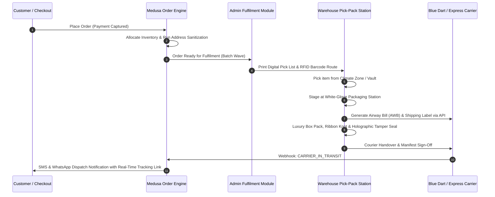
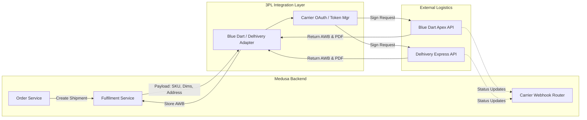

# ATEEVRA — First-Party Fulfilment and Logistics Blueprint

**Document ID:** `ATEEVRA-OPS-LOG-001`  
**Classification:** Fulfilment Standard Operating Procedure & Architecture  
**Status:** DRAFT (Under Owner Review)  
**Version:** 1.0.0  

---

## 1. Executive Summary & Brand Delivery Promise

ATEEVRA delivers high-end fashion directly to consumers with an uncompromising standard of service. Fulfilment is not merely logistics—it is the tangible first physical touchpoint between the client and the luxury house.

### 1.1 Core Delivery Commitments
- **Order Cut-Off & Dispatch SLA:** Orders placed before 14:00 IST dispatch the same business day; orders placed after 14:00 IST dispatch within 24 hours.
- **Express Transit SLA:** Metro delivery within 24–48 hours; Tier-1 & Tier-2 cities within 48–72 hours; Rest of India within 3–4 business days.
- **Dedicated Courier Partners:** Blue Dart Apex Priority (Primary Domestic), Delhivery Air Express (Secondary Domestic), DHL Express Worldwide (International Cross-Border).
- **Secure High-Value Delivery:** Mandatory 6-digit dynamic OTP verification on delivery for all shipments with invoice value exceeding ₹10,000.

---

## 2. Order Fulfilment Lifecycle & Wave Management

Fulfilment operations are managed via optimized pick waves scheduled throughout the day to balance packing station throughput and courier carrier collection windows.



### 2.1 Wave Scheduling Architecture
- **Wave 1 (Morning Expedited):** 09:30 IST — Processes previous evening's overnight orders. Carrier cutoff: 13:00 IST.
- **Wave 2 (Mid-Day Standard):** 14:30 IST — Processes morning orders up to 14:00 IST cutoff. Carrier cutoff: 17:30 IST.
- **Wave 3 (Evening Buffer):** 18:30 IST — Packages afternoon orders for next-morning 08:00 IST airport linehaul induction.

---

## 3. Luxury Packaging Architecture & Unboxing Ritual

Packaging is an essential component of the luxury product offering. All materials must reflect environmental consciousness without sacrificing tactile opulence.

```
+-----------------------------------------------------------------------------------+
|                        ATEEVRA MULTI-TIER PACKAGING SYSTEM                        |
|                                                                                   |
|  [ OUTER SHIPPING SHIPPER ]                                                       |
|  - 5-ply reinforced corrugated Kraft outer carton                                 |
|  - Zero exterior brand mentions (theft deterrent)                                 |
|  - Water-activated reinforced fiberglass kraft security tape                     |
|                                                                                   |
|    +-------------------------------------------------------------------------+    |
|    |  [ INNER PRESENTATION BOX ]                                             |    |
|    |  - 1200 GSM rigid box with magnetic closure                             |    |
|    |  - Matte-black soft-touch finish with debossed metallic silver crest   |    |
|    |                                                                         |    |
|    |    +---------------------------------------------------------------+    |    |
|    |    |  [ PROTECTIVE LAYER ]                                         |    |    |
|    |    |  - 100% Organic certified cotton dustbag with grosgrain draw |    |    |
|    |    |  - Acid-free 28 GSM tissue paper with brand monogram           |    |    |
|    |    |  - Handcrafted wax seal with embossed ATEEVRA heraldry        |    |    |
|    |    |  - Calligraphed personalized client welcome & care card        |    |    |
|    |    +---------------------------------------------------------------+    |    |
|    +-------------------------------------------------------------------------+    |
+-----------------------------------------------------------------------------------+
```

### 3.1 Packaging Tier Matrix

| Packaging Tier | Target Categories | Box Specification | Interior Accoutrements |
| :--- | :--- | :--- | :--- |
| **Tier 1: Signature Luxury** | Coats, Tailored Suits, Evening Gowns, Leather Bags | 1400 GSM Rigid Magnetic Box | Organic cotton garment bag, weighted wooden hanger, debossed tissue, wax seal, fragrance card |
| **Tier 2: Classic Tailoring** | Blazers, Trousers, Silk Shirts, Knitwear | 1100 GSM Clamshell Box | Cotton envelope dustbag, monogrammed tissue, branded grosgrain ribbon |
| **Tier 3: Petite Accoutrements** | Scarves, Belts, Wallets, Small Leather Goods | 900 GSM Drawer-Style Slide Box | Velveteen pouch, debossed gift box, authenticity certificate envelope |

---

## 4. Carrier Selection, Integrations, and Rate Cards

ATEEVRA does not use generic surface aggregators. Direct enterprise API contracts are maintained with premier tier-1 express air carriers.

### 4.1 Carrier Capabilities Matrix

| Carrier Partner | Integration Standard | Service Mode | Average Transit (Metros) | Transit Insurance Coverage |
| :--- | :--- | :--- | :--- | :--- |
| **Blue Dart Apex** | REST API v2 / Webhook | Apex Air Priority Direct | 18–30 Hours | Full Declared Value Policy up to ₹2,50,000 per consignment |
| **Delhivery Express** | REST API v3 / Webhook | Express Flash (Air Linehaul) | 24–36 Hours | Full Declared Value Policy up to ₹1,00,000 per consignment |
| **DHL Express Worldwide** | XML-PI / REST API | Express Worldwide Air | 2–4 Business Days | Global Door-to-Door Aviation Insurance |

### 4.2 Domestic Shipping Rate Structure (First-Party P&L)

*Note: Shipping is offered complimentary to the customer on all orders > ₹3,500. The below costs are internalized within ATEEVRA's COGS and Logistics P&L.*

| Zone | Destination Definition | First 500g | Additional 500g | Reverse Logistics (Clean Return) |
| :--- | :--- | :--- | :--- | :--- |
| **Zone A** | Intra-City / Intra-State (Bengaluru / Karnataka) | ₹55.00 | ₹35.00 | ₹65.00 |
| **Zone B** | Metro-to-Metro (Mumbai, Delhi-NCR, Chennai, Hyderabad) | ₹85.00 | ₹50.00 | ₹95.00 |
| **Zone C** | Tier-1 & Tier-2 Rest of India | ₹110.00 | ₹65.00 | ₹120.00 |
| **Zone D** | Special Regions (North East, Jammu & Kashmir, Islands) | ₹165.00 | ₹95.00 | ₹180.00 |

---

## 5. RTO Mitigation and Address Sanitization Engine

Return-to-Origin (RTO) represents a severe erosion of brand margin and inventory velocity. ATEEVRA implements an automated pre-dispatch risk assessment engine:

```
[ Customer Submits Address at Checkout ]
                 │
                 ▼
[ Google Maps Geocoding API + Indian Postal Directory Check ]
                 │
        ┌────────┴────────┐
        ▼                 ▼
[ Pin Verified ]    [ Ambiguous / Incomplete ]
        │                 │
        │                 ▼
        │        [ Automated WhatsApp Concierge Prompts ]
        │        "Please confirm your building/house number"
        │                 │
        ▼                 ▼
[ Fraud / RTO ML Scoring Matrix (1 to 100) ]
        │
   ┌────┴───────────────────────────┐
   ▼                                ▼
[ Score < 30 : Clean ]      [ Score >= 30 : Elevated Risk ]
   │                                │
   ▼                                ▼
[ Auto-Release to Pick Wave ]   [ Dedicated Concierge Phone Call Verification ]
```

### 5.1 Address Validation Standards
- **House / Unit Number Enforcement:** Regex verification ensuring house/apartment/building numbers are present.
- **Pincode / City Consistency:** Cross-reference pincode with city/state database to prevent misrouted air shipments.
- **High-Risk Pincode Flagging:** If pincode has historical courier non-delivery rate > 12%, automated flag alerts operations team for pre-dispatch phone verification.

---

## 6. Secure Delivery Verification Protocols

### 6.1 OTP-Secured Handover
- For all orders exceeding ₹10,000, an encrypted 6-digit one-time password (OTP) is generated by Medusa at the time of order dispatch.
- The OTP is transmitted via SMS and WhatsApp directly to the customer 2 hours prior to delivery.
- The courier delivery partner must enter this OTP into their handheld terminal to complete the delivery. Handover without OTP is legally categorized as courier breach of contract.

### 6.2 Discreet Shipping Labeling
- To mitigate package pilferage in transit, the exterior shipping label contains only:
  - **Consignee:** Customer Name, Delivery Address, Masked Phone Number.
  - **Sender / Return Address:** `Fulfilment Center 01, P.O. Box 4120, Hoodi Industrial Area, Bengaluru 560048` (Zero mentions of "ATEEVRA" or "Luxury Fashion" on the exterior label).

---

## 7. Carrier Integration Technical Architecture



### 7.1 Webhook State Mapping
- `IN_TRANSIT` $\rightarrow$ Medusa Order Status: `shipped`
- `OUT_FOR_DELIVERY` $\rightarrow$ Medusa Event: `order.out_for_delivery` (Triggers morning client alert)
- `DELIVERED` $\rightarrow$ Medusa Order Status: `delivered` (Starts 7-day return concierge window)
- `UNDELIVERED_ATTEMPT_1` $\rightarrow$ Medusa Event: `order.delivery_failed` (Concierge calls client within 30 mins)
- `RTO_INITIATED` $\rightarrow$ Medusa Event: `order.rto_initiated` (Inventory tracking updated to inbound return)

---
*End of Document `ATEEVRA-OPS-LOG-001`. Authorized for Operational Infrastructure Design.*
