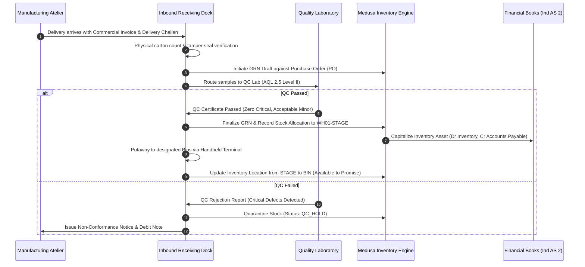
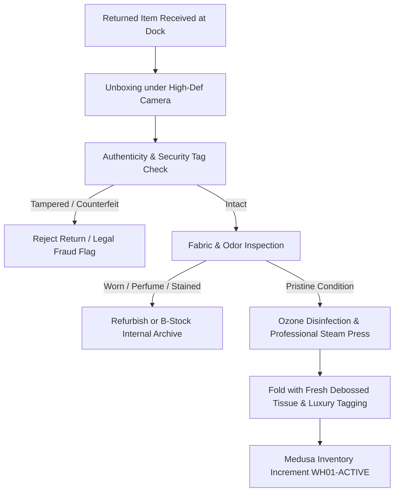

# ATEEVRA — First-Party Inventory and Warehouse Operations Blueprint

**Document ID:** `ATEEVRA-OPS-INV-001`  
**Classification:** Operational Standard Operating Procedure (SOP) & Technical Blueprint  
**Status:** DRAFT (Under Owner Review)  
**Version:** 1.0.0  

---

## 1. Executive Summary & Warehouse Topology

ATEEVRA operates as a first-party luxury fashion brand where all inventory is directly owned, capitalized, and stored in company-controlled or dedicated third-party logistics (3PL) fulfillment centers. Unlike a marketplace with distributed drop-shipping merchant locations, ATEEVRA maintains strict centralized custody of every single SKU.

### 1.1 Warehouse Facility Topology

```
+-----------------------------------------------------------------------------------+
|                        ATEEVRA CENTRAL LOGISTICS FACILITY                         |
|                                                                                   |
|  +--------------------+    +--------------------+    +-------------------------+  |
|  |  Dock Inbound &    |--->|  AQL 2.5 Quality   |--->|  Gown & Outerwear       |  |
|  |  Receiving Bay     |    |  Inspection Station|    |  Hanging Storage (GOH)  |  |
|  +--------------------+    +--------------------+    +-------------------------+  |
|                                     |                             |               |
|                                     v                             v               |
|                            +--------------------+    +-------------------------+  |
|                            |  Quarantine & RTV  |    |  Flat Fold Climate-     |  |
|                            |  Defect Holding    |    |  Controlled Shelving    |  |
|                            +--------------------+    +-------------------------+  |
|                                                                   |               |
|  +--------------------+    +--------------------+                 v               |
|  |  Outbound Carrier  |<---|  White-Glove Pack  |<---+-------------------------+  |
|  |  Staging Bays      |    |  & Sealing Station |    |  High-Value Vault &     |  |
|  +--------------------+    +--------------------+    |  Accessories Lockup     |  |
|                                                      +-------------------------+  |
+-----------------------------------------------------------------------------------+
```

1. **Inbound Receiving Dock:** Multi-dock facility for receiving containerized or palletized shipments from certified Tier-1 manufacturing ateliers.
2. **Quality Inspection Laboratory:** Standardized lighting (D65 light booths), fabric inspection tables, dimensional measurement grids, and moisture-controlled testing station.
3. **Quarantine / Return-to-Vendor (RTV) Area:** Physically partitioned wire cage with electronic access control for goods pending defect arbitration or credit notes.
4. **Garment-on-Hanger (GOH) Zone:** Overhead rail system for structured coats, jackets, and evening gowns to prevent creasing and fabric stress.
5. **Climate-Controlled Shelving:** Temperature (20°C ± 2°C) and relative humidity (45%–55%) regulated area for premium natural fibers (cashmere, mulberry silk, pima cotton).
6. **High-Value Vault:** Biometrically restricted vault for precious accessory hardware, fine leather goods, and limited runway editions.
7. **White-Glove Packaging Station:** Dedicated dust-free workstations equipped with custom box folding jigs, debossed tissue paper dispensers, hot-wax seal heaters, and ribbon tying mandrels.
8. **Outbound Dispatch Staging:** Secure pallet bays segregated by 3PL courier network (Blue Dart Apex, Delhivery Express, DHL International).

---

## 2. Bin, Rack, and Location Hierarchy

To achieve 99.98% pick accuracy and sub-millimeter tracking, ATEEVRA implements a 5-tier location addressing scheme in Medusa's Stock Location Module:

$$\text{Location Code} = \text{WH} - \text{ZONE} - \text{AISLE} - \text{RACK} - \text{SHELF} - \text{BIN}$$

### 2.1 Addressing Syntax Table

| Level | Identifier | Format | Description | Example |
| :--- | :--- | :--- | :--- | :--- |
| **Warehouse** | `WH` | `WH[0-9]{2}` | Primary facility code | `WH01` (Bengaluru Central) |
| **Zone** | `ZONE` | `[A-Z]{2}` | Physical storage zone | `GH` (Garment on Hanger), `CC` (Climate Controlled), `HV` (High Value Vault) |
| **Aisle** | `AISLE` | `A[0-9]{2}` | Physical walkway number | `A04` |
| **Rack** | `RACK` | `R[0-9]{2}` | Vertical rack frame | `R12` |
| **Shelf** | `SHELF` | `S[0-9]{1}` | Vertical tier from ground (1 to 5) | `S3` (Eye level, Golden Zone) |
| **Bin** | `BIN` | `B[0-9]{2}` | Individual tote or sub-compartment | `B02` |

*Full Location String Example:* `WH01-CC-A04-R12-S3-B02`

### 2.2 Barcoding & RFID Tracking
- **UPC / EAN-13:** Attached to product care tags during manufacturing.
- **Internal GS1-128:** Barcode printed upon GRN containing SKU, Lot/Batch ID, Serial Number, and Inbound Date.
- **UHF Gen2 RFID Inlays:** Embedded inside luxury woven brand labels for passive automated scanning at receiving portals, cycle count sweeps, and outbound packing tables.

---

## 3. Inbound Receiving & Goods Receipt Note (GRN)



### 3.1 Discrepancy Protocol
- **Shortage:** If delivered quantity < PO quantity, GRN is posted with "Partial Receipt". Medusa keeps PO line items open until backorder deadline.
- **Overage:** Any excess > 102% of PO quantity is quarantined. Supplier must authorize return or issue revised zero-cost credit/invoice.
- **Transit Damage:** Noted directly on carrier Delivery Challan (POD), photographed from 4 angles, and claimed against marine/transit transit insurance policy.

---

## 4. Cycle Counting and Perpetual Inventory Control

ATEEVRA forbids annual shutdown stocktakes. Instead, an ABC-driven perpetual cycle count strategy is enforced 365 days a year.

### 4.1 ABC Inventory Stratification

$$\text{ABC Category} = f(\text{Annual Value Usage}, \text{Unit Velocity}, \text{Scarcity})$$

| Category | Definition | SKU Proportion | Inventory Value | Count Frequency | Accuracy SLA |
| :--- | :--- | :--- | :--- | :--- | :--- |
| **Class A** | Cashmere overcoats, leather goods, limited numbered runs | 10% | 70% | Weekly (Every Monday) | 100.0% |
| **Class B** | Core tailored trousers, silk blouses, structured blazers | 20% | 20% | Bi-weekly | 99.8% |
| **Class C** | Seasonal tees, base layers, accessories, dustbags, boxes | 70% | 10% | Monthly | 99.0% |

### 4.2 Discrepancy Tolerance and Write-off Policy
- **Investigation Threshold:** Any unit discrepancy in Class A or monetary variance > ₹2,500 triggers immediate video audit of picking stations and warehouse perimeter.
- **Financial Adjustment:** Stock adjustments are authorized strictly according to the RBAC matrix:
  - *Inventory Manager:* Approvals up to ₹10,000 variance per incident.
  - *Chief Financial Officer / VP Operations:* Mandatory dual-signature approval for adjustments > ₹10,000.
  - *Accounting Journal:* Debited to *Cost of Goods Sold — Inventory Shrinkage* (`GL-5104`) and credited to *Asset — Finished Goods Inventory* (`GL-1201`).

---

## 5. Dead Stock, Aging, and Obsolescence Management

Luxury brand equity requires that unsold inventory never be liquidated on discount discount tables or unauthorized grey-market flash sales.

```
Inventory Age < 90 Days   : Full Price Luxury Active Catalogue
Inventory Age 91-180 Days : Curated VIP Private Sales (Password Protected)
Inventory Age 181-270 Days: Archives Collection / End-of-Season Private Client Outreach
Inventory Age > 270 Days : Upcycling / Sustainable Fiber Recycling / Zero-Landfill Protocol
```

### 5.1 Aging Provisions Schedule (Ind AS 2 / AS 2)
To reflect conservative net realizable value (NRV), monthly aging write-downs are accrued:
- **0–90 Days:** 0% Provision.
- **91–180 Days:** 15% Provision against landed cost.
- **181–270 Days:** 40% Provision against landed cost.
- **> 270 Days:** 80% Provision or written down to scrap value.

---

## 6. Return Restocking and Refurbishment Workflow

Customer returns undergo a surgical 5-stage triage process before being re-listed on Medusa:



1. **Unboxing under 4K CCTV:** Carrier airway bill scanned, tamper-evident tape photographed, and unboxing recorded to prevent false customer claims.
2. **Security Ribbon Verification:** The tamper-evident "Do Not Remove" luxury tag must be 100% intact with unbroken serialization code.
3. **Ozone Sanitation & Steam Finishing:** Garments are treated in an industrial ozone sanitation cabinet to neutralize odors without chemical washing, followed by professional tension steaming.
4. **Relabeling & Re-boxing:** Folded into fresh, pristine acid-free tissue paper, sealed with brand crest sticker, placed in fresh matte-black packaging box.
5. **Inventory Restoration:** Returned to Medusa inventory pool via API hook `medusa.inventory.restock_item()` with state `RESTOCKED_GRADE_A`.

---

## 7. Storage Environment and Preservation Specifications

| Material Type | Temperature Range | Humidity Range | Preservation Protocol |
| :--- | :--- | :--- | :--- |
| **Mulberry Silk & Satin** | 18°C – 21°C | 45% – 50% RH | Breathable muslin cotton garment bags; dark storage (zero UV). |
| **Grade-A Cashmere & Wool** | 16°C – 20°C | 40% – 50% RH | Natural cedarwood repellent inserts; horizontal flat storage to avoid stretch. |
| **Full-Grain Leathers** | 19°C – 22°C | 50% – 55% RH | Microfiber dustbags; silica-gel packets; no plastic wrappers (prevents dry rot). |
| **Gold/Palladium Hardware** | 18°C – 24°C | < 40% RH | Anti-tarnish micro-film wrapping; sealed nitrogen zip pouches. |

---

## 8. Warehouse Security and Loss Prevention Architecture

- **Perimeter Access:** Multi-factor biometric (fingerprint + smart card) logging at all pedestrian turnstiles and warehouse bay roll-up doors.
- **CCTV Coverage:** 100% blindspot-free video surveillance recording at 30 FPS, H.265 compression, with 90-day cold storage retention.
- **High-Value Vault Protocol:** Two-man rule (Dual Custody) required to unlock vault `ZONE-HV`. Automated alert generated if vault remains open > 180 seconds.
- **Staff Bag Policy:** Clear bag policy in all operational zones; full metal detector walkthrough screening on warehouse exit.

---

## 9. Monorepo Technical Integration Reference

| Medusa Service / Module | Function in Operations | Configuration / API Hook |
| :--- | :--- | :--- |
| `stock-location` | Defines physical facility locations | `WH01` (Bengaluru Central Hub) |
| `inventory-service` | Item-level stock balances & reservations | `inventoryItem.reserved_quantity` |
| `fulfillment-provider` | Dispatch slip generation & courier manifest | Custom `luxury-fulfillment-provider` |
| `event-bus` | Real-time low-stock & cycle count alerts | `inventory-level.updated`, `stock.reorder_point` |

---
*End of Document `ATEEVRA-OPS-INV-001`. Authorized for Internal Operations Planning.*
