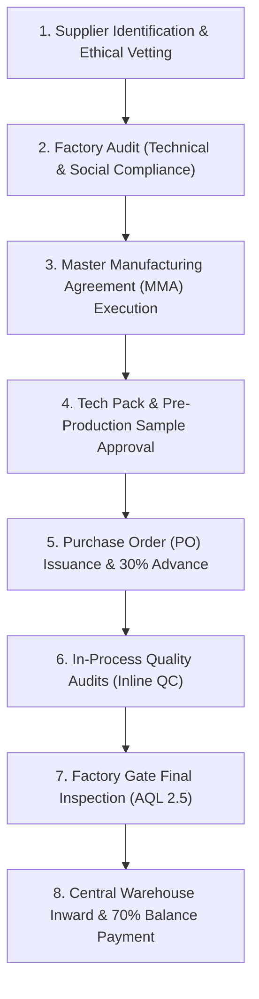

# ATEEVRA First-Party Fashion Brand — Procurement & Supplier Management

**Document ID:** `OP-ATEEVRA-PROCURE-V1`  
**Classification:** `SUPPLY CHAIN & PROCUREMENT SPECIFICATION`  
**Parent Blueprint:** [`../ATEEVRA-COMMERCE-OPERATING-MODEL.md`](../ATEEVRA-COMMERCE-OPERATING-MODEL.md)  
**Effective Date:** 2026-11-05  

---

## 1. Executive Summary & Sourcing Philosophy

As a first-party luxury fashion label, ATEEVRA curates and contracts dedicated garment manufacturing partners, fabric mills, and trim artisans.

Unlike a marketplace that permits uncontrolled third-party seller listings, ATEEVRA enforces **rigorous supplier qualification, ethical manufacturing compliance, uncompromising material testing, and structured purchase order governance**.



---

## 2. Supplier Qualification & Vetting Standards

Before issuing any Purchase Order, candidate garment factories must pass a four-pillar qualification audit:

1. **Pillar 1: Technical Capability & Machine Precision:**
   - Modern cutting, sewing, and pressing infrastructure (e.g. automated laser cutting, Juki programmable lockstitch machines).
   - Proven expertise in handling delicate natural textiles (mulberry silk, fine linen, combed cotton, merino wool).
   - In-house pattern grading and digital tech-pack translation capabilities.
2. **Pillar 2: Quality Management Systems:**
   - ISO 9001 certification or verified internal 4-point fabric inspection systems.
   - Dedicated fabric shrinkage testing baths and colorfastness crock-meters.
3. **Pillar 3: Social Compliance & Ethical Labor:**
   - Zero tolerance for child, forced, or under-minimum-wage labor.
   - Compliance with Factories Act, 1948 and Employees' Provident Funds (EPF) regulations.
   - Safe, well-ventilated, ergonomic factory floor conditions.
4. **Pillar 4: Commercial Stability & Minimum Order Quantities (MOQs):**
   - Willingness to support small-batch initial luxury drops (100–300 units per style) without sacrificing build quality.

---

## 3. Purchase Order (PO) Lifecycle & Commercial Payment Terms

```
[PO Created in Admin (Mod-08)] ──> [Executive Approval] ──> [PO Issued to Factory]
                                                                  │
                                                                  ▼
[70% Balance Paid on Net 30] <── [AQL 2.5 QC Passed] <── [30% Advance Disbursed]
```

### 3.1 Standard Contractual Terms
- **Advance Payment:** **30% advance wire** upon formal PO counter-signature to enable factory fabric and trim procurement.
- **Balance Payment:** **70% balance wire** payable Net 30 days following successful warehouse receipt and AQL 2.5 quality sign-off.
- **Lead Times:** Maximum 60–75 calendar days from PP sample approval to warehouse dock delivery.
- **Liquidated Damages for Delay:** Factory contractually agrees to a 1.0% deduction per week of unexcused manufacturing delay beyond the agreed ex-factory date (capped at 10%).

---

## 4. Defect Classification & Supplier Dispute Resolution

When incoming PO shipments arrive at ATEEVRA's central facility, defects are categorized under strict criteria:

| Defect Class | Example Flaws | Maximum Tolerated in Batch (AQL 2.5) | Commercial Remedy |
| :--- | :--- | :---: | :--- |
| **Critical Defect** | Hazardous needle fragments, sharp metal burrs, torn seams, chemical odor. | **0 (Zero Tolerance)** | Immediate batch rejection; mandatory factory recall at supplier expense. |
| **Major Defect** | Measurement deviation $> 1.5\text{ cm}$, visible color shading, skipped stitches, broken zipper. | $\le 3\text{ per } 50\text{ sample pull}$ | Batch quarantine; factory pays alteration costs or issues proportional credit note. |
| **Minor Defect** | Trimmable loose threads $< 1\text{ cm}$, slight button misalignment, removable transit dust. | $\le 7\text{ per } 50\text{ sample pull}$ | Internal warehouse finishing team trims threads; defect logged on vendor scorecard. |

### 4.1 Vendor Scorecard & Rehabilitation
Suppliers maintaining an AQL acceptance rate $> 98\%$ receive priority allocation for future seasonal drops. Suppliers failing two consecutive inspections are placed on probationary hold; repeated failure triggers immediate MMA contract termination.
