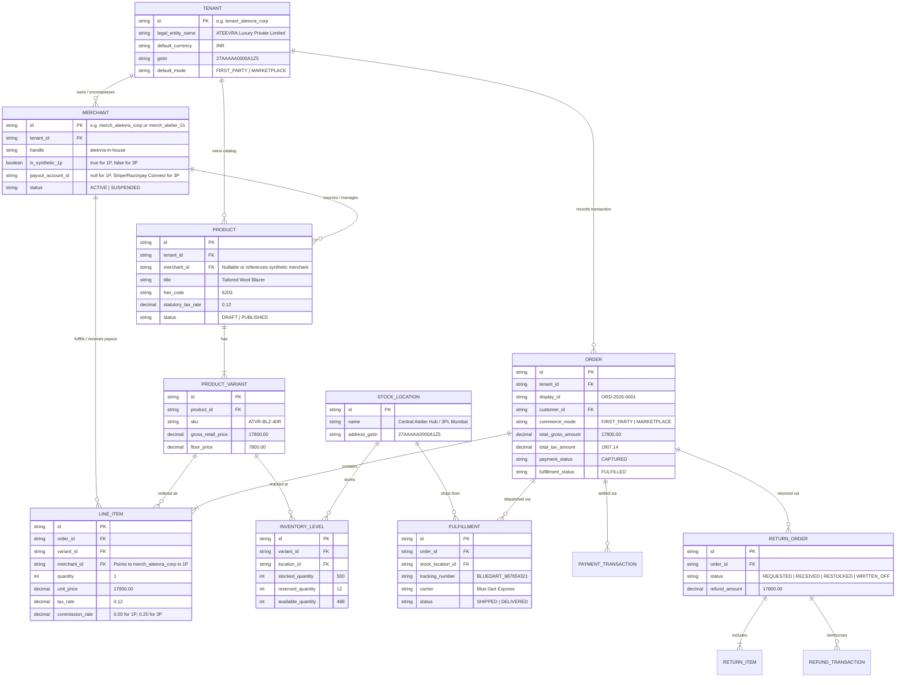
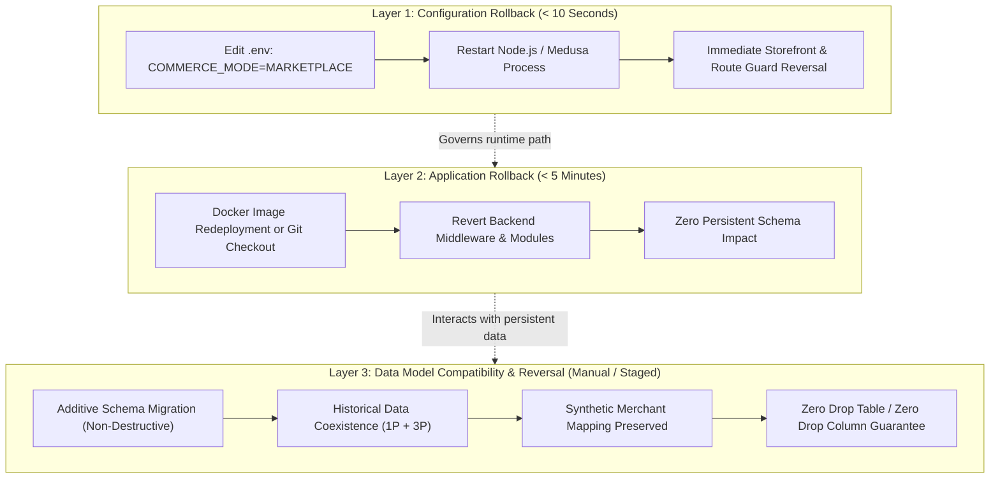

# ATEEVRA PHASE 0.5 — SYNTHETIC TENANT & ROLLBACK ARCHITECTURAL DESIGN REVIEW: OD-017
**Document ID:** `ATEEVRA-OD-017-DESIGN-REVIEW-001`  
**Classification:** Technical Architecture Specification, Entity-Relationship Design & Verification Test Suite  
**Parent Decision:** [`ATEEVRA-OD-017-OWNER-DELIBERATION-DOSSIER.md`](file:///C:/Users/Shubham/OneDrive/Desktop/ecom_mvp/docs/ateevra-brand/phase-0.5/ATEEVRA-OD-017-OWNER-DELIBERATION-DOSSIER.md)  
**Cross-References:** [`ATEEVRA-OD-017-ROLLBACK-AND-OPTION-D-ADDENDUM.md`](file:///C:/Users/Shubham/OneDrive/Desktop/ecom_mvp/docs/ateevra-brand/phase-0.5/ATEEVRA-OD-017-ROLLBACK-AND-OPTION-D-ADDENDUM.md), [`ATEEVRA-OD-017-TECHNICAL-IMPACT-AND-ROLLBACK-REVIEW.md`](file:///C:/Users/Shubham/OneDrive/Desktop/ecom_mvp/docs/ateevra-brand/phase-0.5/ATEEVRA-OD-017-TECHNICAL-IMPACT-AND-ROLLBACK-REVIEW.md)  
**Governance State:** `PROPOSED (Pending Explicit Owner Decision)`  
**Audit Date:** 2026-11-05  
**Auditor / Preparer:** Principal Enterprise Architect & Commerce Engine Data Architect  

---

## 1. Executive Summary & Architectural Scope

This design review provides the definitive, non-executable technical architecture for **OD-017 (Decoupling Marketplace Primitives & Commercial Mode Gate)**. It focuses on the data model design, entity relationships, query backwards-compatibility, and regression testing specifications required to ensure that transitioning between **Direct First-Party (1P) Brand Mode** and **Multi-Vendor Marketplace Mode** does not cause data corruption, orphan records, or runtime null pointer exceptions.

> [!IMPORTANT]
> **Strict Governance Invariant:**  
> This document is a **technical design specification only**. No application code, database migrations, schema alterations, or background workers have been implemented or altered in the repository. All test cases described herein are **PROPOSED TEST SPECIFICATIONS (UNEXECUTED)** and must not be construed as verified runtime test passes.

---

## 2. Entity and Relationship Model (ER Design)

To support both 1P Brand Mode and Multi-Vendor Marketplace Mode without destructive schema redesign, the commerce engine utilizes a **Synthetic Corporate Tenant** architecture (`ATEEVRA_CORP`).

### 2.1 Entity Relationship Diagram



### 2.2 Entity Attribute & Relationship Specifications

1. **Synthetic Corporate Tenant (`TENANT`):**  
   - Root multi-tenant isolation boundary. Stores legal entity details, primary GSTIN, and the operational default mode.
   - In 1P Brand Mode, all entities resolve to `tenant_ateevra_corp`.

2. **Merchant Entity (`MERCHANT`):**  
   - **Multi-Vendor Reality:** In marketplace mode, distinct merchant records exist for each external atelier (`merch_atelier_01`, `merch_atelier_02`).
   - **1P Brand Reality:** A single synthetic merchant record (`merch_ateevra_corp`) is provisioned with `is_synthetic_1p = TRUE` and `payout_account_id = NULL`.
   - *Crucial Value:* This guarantees that foreign keys from `PRODUCT` or `LINE_ITEM` to `MERCHANT` **never contain unexpected nulls**, preserving query integrity across all existing marketplace reporting routines.

3. **Line Item (`LINE_ITEM`):**  
   - Binds an order to a specific SKU variant and the fulfilling merchant entity.
   - In 1P mode, `commission_rate` is set to `0.0000`, and `merchant_id` references `merch_ateevra_corp`.
   - In marketplace mode, `commission_rate` is set to the contractual take-rate (e.g., `0.2000`), and `merchant_id` references the 3P atelier.

4. **Inventory & Fulfillment (`INVENTORY_LEVEL`, `FULFILLMENT`):**  
   - Inventory tracking is decoupled from merchant logic; it maps `PRODUCT_VARIANT` directly to physical `STOCK_LOCATION`.
   - 1P brand stock resides in ATEEVRA’s contracted 3PL hub (`loc_mumbai_hub`). Marketplace stock may reside in vendor warehouses (`loc_vendor_bengaluru`).

---

## 3. Query Compatibility & Workflow Behavior in Hybrid / Rollback Modes

A critical risk identified in architecture reviews is what happens when marketplace backend services execute queries against orders generated during 1P Brand Mode.

### 3.1 Resolving Foreign-Key Asymmetry

If a 1P order were created with `order.merchant_id = NULL` or `line_item.merchant_id = NULL`, legacy marketplace queries executing `INNER JOIN merchants m ON l.merchant_id = m.id` would silently drop 1P orders from reports, customer order views, or admin analytics.

**Architectural Solution: The Synthetic Tenant Binding Pattern**
1. **Never Insert Null Merchant Keys:** Every 1P product and order item is explicitly linked to `merch_ateevra_corp`.
2. **Defensive SQL Projections:** All existing and newly proposed queries must utilize `LEFT OUTER JOIN` semantics when resolving merchant entities:
   ```sql
   -- SAFE COMPATIBLE PATTERN
   SELECT 
       o.id AS order_id,
       o.display_id,
       o.total_gross_amount,
       COALESCE(m.handle, 'ateevra-in-house') AS seller_handle,
       m.is_synthetic_1p
   FROM orders o
   LEFT JOIN line_items li ON o.id = li.order_id
   LEFT JOIN merchants m ON li.merchant_id = m.id;
   ```

### 3.2 Marketplace Vendor Settlement & Escrow Isolation

In marketplace mode, a scheduled cron job (or Medusa subscriber) calculates vendor payouts:
`Vendor Payout = Gross Sales - Platform Commission (20%) - Payment Gateway MDR - Inward Shipping`.

If this job encounters a 1P order, it must not attempt to trigger an automated payout transfer via Razorpay Route or Stripe Connect to an external vendor.

**Architectural Guardrail:**
```typescript
// Proposed Settlement Guardrail (Pseudocode - Not Implemented)
function calculateMerchantPayout(lineItem: LineItem): PayoutCalculation | null {
    if (lineItem.merchant.is_synthetic_1p || lineItem.commission_rate === 0) {
        // First-party sale: Retain 100% of proceeds in corporate operating account
        return null; // Exclude from vendor disbursement batch
    }
    return executeThirdPartyPayoutLogic(lineItem);
}
```

---

## 4. Handling Historical Orders Lacking Merchant Links

During early development or migration phases, certain historical test orders may exist in the database with `NULL` or missing merchant relationships.

### 4.1 Categorization of Historical Data States

| Historical Order State | Structural Condition | Risk in Marketplace Mode | Safe Handling Strategy |
| :--- | :--- | :--- | :--- |
| **Pre-Brand Marketplace Order** | Has valid 3P `merchant_id` | Zero risk; standard marketplace behavior. | Standard processing. |
| **Brand Mode 1P Order** | Has `merchant_id = 'merch_ateevra_corp'` | High risk if payout job runs. | Handled via `is_synthetic_1p = true` filter. |
| **Legacy Orphan Order** | `merchant_id IS NULL` | Query failure in `INNER JOIN`; excluded from vendor portal. | Default fallback to `merch_ateevra_corp` in application DAL via `COALESCE`. Non-destructive backfill script proposed for Phase 1. |

### 4.2 Non-Destructive Data Compatibility Rule
Under no circumstances should database constraints (`NOT NULL` on `merchant_id`) be added retroactively without a verified, audited migration script. In Phase 0.5, database schema modifications are strictly forbidden.

---

## 5. Proposed Regression Test Suite Specifications (Unexecuted)

The following nine test specifications define the verification suite required before any commercial mode toggle or migration is authorized.

> [!WARNING]
> **Test Status: UNEXECUTED SPECIFICATIONS**  
> These test cases have **NOT been run** against the live or local database. They represent the formal engineering test protocol that must be implemented and executed in a dedicated staging environment prior to Gate G-ARCH closure.

```
+===================================================================================================================================+
|                                    PROPOSED ARCHITECTURAL REGRESSION TEST SPECIFICATIONS                                          |
+----+--------------------------------+-------------------------------------------------------------+-------------------------------+
| #  | Test Scenario                  | Test Objective & Pre-conditions                             | Expected Pass Criteria        |
+----+--------------------------------+-------------------------------------------------------------+-------------------------------+
| 1  | **Pre-Brand Marketplace Order**| Create order with 3P vendor SKU in Marketplace Mode. Switch | Order displays correctly in   |
|    |                                | mode to `FIRST_PARTY`. Query customer order history.        | customer portal; admin shows  |
|    |                                |                                                             | historic 3P merchant link.    |
+----+--------------------------------+-------------------------------------------------------------+-------------------------------+
| 2  | **1P Order Creation**          | In `FIRST_PARTY` mode, place order for Wool Blazer. Verify   | Line item links to synthetic  |
|    |                                | database insertion of order, line item, and tax.           | merchant; output GST = 12%;   |
|    |                                |                                                             | commission rate = 0.00%.      |
+----+--------------------------------+-------------------------------------------------------------+-------------------------------+
| 3  | **Brand Order Read Post-**     | Create 1P order in Brand Mode. Revert `COMMERCE_MODE` to    | Order is fully viewable in    |
|    | **Rollback**                   | `MARKETPLACE`. Query admin orders and customer dashboard.   | admin; zero null crashes;     |
|    |                                |                                                             | excluded from vendor payouts. |
+----+--------------------------------+-------------------------------------------------------------+-------------------------------+
| 4  | **Marketplace Order Read**     | Create 3P order, switch to 1P, then rollback to             | Vendor dashboard displays 3P  |
|    | **Post-Rollback**              | Marketplace mode. Query vendor settlement report.           | order with exact original fee |
|    |                                |                                                             | and commission calculations.  |
+----+--------------------------------+-------------------------------------------------------------+-------------------------------+
| 5  | **Mixed Historical Reporting** | Database populated with 50 3P orders and 50 1P orders.      | Aggregated revenue report     |
|    |                                | Run consolidated financial report across entire period.     | accurately separates 1P gross |
|    |                                |                                                             | sales from 3P platform fees.  |
+----+--------------------------------+-------------------------------------------------------------+-------------------------------+
| 6  | **Inventory Reservations**     | Run concurrent order checkouts for 1P SKU across multiple   | Zero double-allocation; locks |
|    |                                | sessions at stock threshold (e.g., last 2 units).           | execute cleanly in Postgres.  |
+----+--------------------------------+-------------------------------------------------------------+-------------------------------+
| 7  | **Fulfillment & Logistics**    | Generate fulfillment record for 1P order using central hub; | Correct tracking info logged; |
|    |                                | simulate 3P dropship order fulfillment.                     | stock decremented from proper |
|    |                                |                                                             | location ID (`loc_mumbai`).   |
+----+--------------------------------+-------------------------------------------------------------+-------------------------------+
| 8  | **Cancellations & Refunds**    | Initiate full refund on 1P order; verify gateway webhook    | Inventory restocked in hub;   |
|    |                                | processing and GST credit note calculation.                 | credit note matches Sec 34;   |
|    |                                |                                                             | zero vendor debit initiated.  |
+----+--------------------------------+-------------------------------------------------------------+-------------------------------+
| 9  | **Admin & GSTR Reconciliation**| Export GSTR-1 outward supply data from database containing   | 1P orders categorized under   |
|    |                                | both 1P transactions and marketplace commission invoices.   | B2C Table 7; 3P commissions   |
|    |                                |                                                             | categorized under B2B Table 4.|
+----+--------------------------------+-------------------------------------------------------------+-------------------------------+
```

---

## 6. Formal Separation of Rollback Layers

To prevent confusion between operational toggles and data migrations, rollback procedures are segregated into three mutually exclusive layers:



1. **Configuration Rollback:**  
   - Modifies environment variables (`COMMERCE_MODE`). Changes active routing and UI storefront display in seconds. Does not modify database rows or table definitions.
2. **Application Rollback:**  
   - Re-deploys previous stable application container or reverts application commits. Safe if and only if database changes are backwards-compatible.
3. **Data Compatibility:**  
   - Handled exclusively through **additive, non-destructive database evolution**. Tables and columns added for 1P brand support (such as `is_synthetic_1p` or tax breakdown metadata) must remain nullable or carry safe defaults so that legacy application code ignores them without breaking.

---

## 7. Governance Status & Invariants Confirmation

- **OD-017 Status:** Remains strictly `PROPOSED`.
- **Option D (Architecture Freeze & Deferral):** Remains an active, viable option for owner consideration.
- **Repository Invariant:** Zero database migrations applied, zero source code modified, zero Git commits generated. Baseline pinned to `676609f`.
