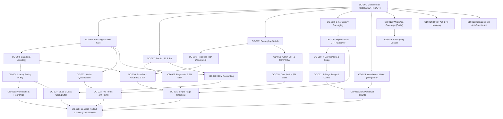

# ATEEVRA — Owner Decision Dependency Network & Critical Path Matrix

**Document ID:** `ATEEVRA-P05-DEP-001`  
**Classification:** Strategic & Technical Dependency Network & Critical Path Matrix  
**Phase Status:** ACTIVE GOVERNANCE ARTIFACT  
**Effective Date:** 2026-11-05  
**Governing Mandate:** Phase 0.5 Dependency & Sequencing Architecture  
**Decision Approval Rule:** **ALL 28 DECISIONS CURRENTLY RETAIN `PROPOSED` STATUS**  
**Author:** Principal Enterprise Architect & Policy Governance Specialist  

---

## 1. Executive Summary & Critical Path Principles

The 28 First-Party Luxury Brand Owner Decisions cannot be ratified in isolation. They form a tightly coupled, highly structured **Directed Acyclic Graph (DAG)** where foundational commercial, legal, and architectural selections dictate operational, financial, and technical parameters downstream.

Attempting to resolve downstream operational parameters (e.g., checkout page flow, warehouse bin numbering, or return triage) prior to ratifying upstream commercial models (e.g., Seller of Record, BOM absorption costing, or Section 31 tax compliance) leads to severe architectural churn.

This document establishes:
1. The **Comprehensive 28-Decision Upstream/Downstream Matrix**.
2. The **Five Critical Sequencing Paths** of the first-party brand.
3. The **Visual Mermaid Dependency Architecture**.
4. The **Tier-1 to Tier-3 Deliberation Waves**.

---

## 2. Visual Dependency Architecture (Mermaid Graph)



---

## 3. Comprehensive 28-Decision Dependency & Critical Path Register

```
+-----------------------------------------------------------------------------------------------------------------------------------------------+
|                                    MASTER OWNER DECISION DEPENDENCY & BLOCKING REGISTER                                                       |
+-----+---------------------------------------------------------------+-------------------------------+-----------------------+-----------------+
| ID  | Full Canonical Decision Title                                 | Upstream Prerequisites        | Downstream Blocked    | Deliberation    |
|     |                                                               | (Must be Ratified First)      | Decisions             | Wave & Gate     |
+-----+---------------------------------------------------------------+-------------------------------+-----------------------+-----------------+
| 001 | Direct First-Party Luxury Brand Commercial Model & SOR        | None (ROOT DECISION)          | OD-002 through OD-028 | Wave 1: G-CA/LG |
| 002 | Product Sourcing, Atelier Contracting & Private Label Strategy| OD-001                        | OD-003, 022, 023, 026 | Wave 1: G-QA    |
| 003 | Luxury Catalog Architecture, HSN Codes & Legal Metrology      | OD-001, OD-002                | OD-004, OD-020        | Wave 2: G-LG    |
| 004 | Value-Based Luxury Pricing Architecture & Price Integrity     | OD-003, OD-026                | OD-005, OD-021, OD-027| Wave 3: G-CA    |
| 005 | Promotional Discipline, VIP Previews & Floor Price Protection | OD-004                        | OD-021, OD-028        | Wave 3: G-CA    |
| 006 | Enterprise Digital Payment Instruments & Gateway Fee Absorpt. | OD-001, OD-007                | OD-021, OD-027        | Wave 2: G-CA    |
| 007 | Statutory Tax Compliance, Section 31 Invoicing & ITC Opt.    | OD-001                        | OD-006, OD-026, OD-027| Wave 1: G-CA    |
| 008 | White-Glove Packaging Architecture & Tactile Unboxing Exp.    | OD-001                        | OD-009, OD-026        | Wave 2: Internal|
| 009 | Express Air Logistics, Same-Day Dispatch & Delivery OTP Ver.  | OD-008                        | OD-010, OD-021        | Wave 2: G-LO    |
| 010 | Luxury Concierge Return Window, Size Swap & Standards         | OD-009                        | OD-011, OD-012        | Wave 3: Internal|
| 011 | Post-Return Triage, Ozone Sanitation & Restocking Governance  | OD-010, OD-024                | OD-025                | Wave 3: G-QA/LG |
| 012 | Omnichannel Luxury Concierge Advisory & 5-Minute WhatsApp SLA | OD-001, OD-010                | OD-013                | Wave 3: Internal|
| 013 | Private Client Styling Dossier & VIP Clienteling Program      | OD-012, OD-014                | OD-018, OD-020        | Wave 3: Internal|
| 014 | Client Data Protection, DPDP Act 2023 Compliance & PII Mask.  | OD-001                        | OD-018, OD-020        | Wave 2: G-LG    |
| 015 | Brand Protection, Trademark Enforcement & Grey Market Def.    | OD-001                        | OD-003, OD-020        | Wave 2: G-LG    |
| 016 | Headless Commerce Architecture: Medusa v2.19, Strapi & Next15 | OD-001, OD-017                | OD-018, OD-020, OD-021| Wave 2: G-ARCH  |
| 017 | Decoupling Marketplace Multi-Vendor Links & Commercial Gate   | OD-001                        | OD-016, OD-018        | Wave 1: G-ARCH  |
| 018 | Internal Admin Panel Architecture, 6 Corporate Roles & MFA    | OD-017                        | OD-019                | Wave 2: G-SEC   |
| 019 | Dual-Authorization Financial Thresholds & Immutable Logs      | OD-018                        | OD-023, OD-025        | Wave 2: G-SEC   |
| 020 | Luxury Storefront Visual Identity, Assets & Next.js 15 ISR    | OD-003, OD-016                | OD-021                | Wave 3: Internal|
| 021 | Frictionless Single-Page Luxury Checkout Architecture         | OD-006, OD-009, OD-020        | OD-028                | Wave 3: Internal|
| 022 | B2B Atelier Supplier Qualification, Tech Packs & Ethical Audit| OD-002                        | OD-023, OD-026        | Wave 2: G-QA    |
| 023 | Purchase Order Milestone Financing & Advance Risk Mitigation  | OD-019, OD-022                | OD-027                | Wave 3: G-CA    |
| 024 | Central Warehouse Facility Topology, 5-Tier Bin & RFID        | OD-001                        | OD-011, OD-025        | Wave 2: G-LG/Eng|
| 025 | ABC Perpetual Cycle Counting, Discrepancies & Shrink Ledgers  | OD-019, OD-024                | OD-026, OD-027        | Wave 3: G-CA    |
| 026 | Landed Cost BOM Accounting, Ind AS 2 Valuation & Multipliers  | OD-002, OD-007, OD-022        | OD-004, OD-027        | Wave 2: G-CA    |
| 027 | Working Capital Financing, Cash Conversion Cycle & Buffers    | OD-007, OD-023, OD-026        | OD-028                | Wave 3: G-CA    |
| 028 | 16-Week Phased Rollout, Quality Gates & Independent Validation | OD-001 through OD-027         | Production Launch     | Wave 4: All 5   |
+-----+---------------------------------------------------------------+-------------------------------+-----------------------+-----------------+
```

---

## 4. The Four Sequential Deliberation Waves

To make executive decision-making structured, the Project Owner should deliberate on the 28 decisions in four ordered waves:

### Wave 1: Foundational Core (Week 1, Days 1–2) — 4 Decisions
- `ATEEVRA-OD-001`: Direct First-Party Luxury Brand Commercial Model & Seller of Record
- `ATEEVRA-OD-002`: Product Sourcing, Atelier Contracting & Private Label Strategy
- `ATEEVRA-OD-007`: Statutory Tax Compliance, Section 31 Invoicing & ITC Optimization
- `ATEEVRA-OD-017`: Decoupling Marketplace Multi-Vendor Links & Commercial Mode Gate
*(These 4 foundational decisions establish the corporate entity, sourcing paradigm, tax status, and software isolation boundaries).*

### Wave 2: Operational & Architecture Framework (Week 1, Days 3–5) — 12 Decisions
- `ATEEVRA-OD-003`: Luxury Catalog Architecture, HSN Codes & Legal Metrology
- `ATEEVRA-OD-006`: Enterprise Digital Payment Instruments & Gateway Fee Absorption
- `ATEEVRA-OD-008`: White-Glove Packaging Architecture & Tactile Unboxing Experience
- `ATEEVRA-OD-009`: Express Air Logistics, Same-Day Dispatch & Delivery OTP Verification
- `ATEEVRA-OD-014`: Client Data Protection, DPDP Act 2023 Compliance & Internal PII Masking
- `ATEEVRA-OD-015`: Brand Protection, Trademark Enforcement & Grey Market Defenses
- `ATEEVRA-OD-016`: Headless Commerce Architecture: Medusa v2.19, Strapi v5 & Next.js 15
- `ATEEVRA-OD-018`: Internal Admin Panel Architecture, 6 Corporate Roles & TOTP MFA
- `ATEEVRA-OD-019`: Dual-Authorization Financial Thresholds & Immutable Audit Logs
- `ATEEVRA-OD-022`: B2B Atelier Supplier Qualification, Tech Packs & Ethical Audits
- `ATEEVRA-OD-024`: Central Warehouse Facility Topology, 5-Tier Addressing & RFID Tracking
- `ATEEVRA-OD-026`: Landed Cost BOM Accounting, Ind AS 2 Valuation & Markup Multipliers

### Wave 3: Policies, Commercials & Experience (Week 2, Days 1–3) — 11 Decisions
- `ATEEVRA-OD-004`: Value-Based Luxury Pricing Architecture & Price Integrity
- `ATEEVRA-OD-005`: Promotional Discipline, VIP Previews & Floor Price Protection
- `ATEEVRA-OD-010`: Luxury Concierge Return Window, Simultaneous Size Swap & Condition Standards
- `ATEEVRA-OD-011`: Post-Return Triage, Ozone Sanitation & Restocking Governance
- `ATEEVRA-OD-012`: Omnichannel Luxury Concierge Advisory & 5-Minute WhatsApp SLA
- `ATEEVRA-OD-013`: Private Client Styling Dossier & VIP Clienteling Program
- `ATEEVRA-OD-020`: Luxury Storefront Visual Identity, Preserved Assets & Next.js 15 ISR
- `ATEEVRA-OD-021`: Frictionless Single-Page Luxury Checkout Architecture
- `ATEEVRA-OD-023`: Purchase Order Milestone Financing & Advance Payment Risk Mitigation
- `ATEEVRA-OD-025`: ABC Perpetual Cycle Counting, Discrepancy Tolerance & Shrinkage Ledgers
- `ATEEVRA-OD-027`: Working Capital Financing, Cash Conversion Cycle & Liquidity Buffers

### Wave 4: Master Gating Capstone (Week 2, Day 4) — 1 Decision
- `ATEEVRA-OD-028`: 16-Week Phased Rollout, Quality Gates & Independent Validation

---
*End of Document `ATEEVRA-P05-DEP-001`. Formally Established for Phase 0.5 Critical Path Sequencing.*
