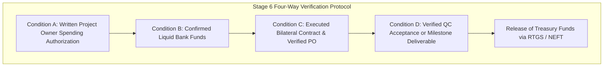

# ATEEVRA PHASE 0.5 — FUNDING AUTHORIZATION & TREASURY CONTROLS ADDENDUM
**Document ID:** `ATEEVRA-PHASE-0.5-FUND-CTRL-001`  
**Classification:** Financial Governance Safeguards, Expenditure Control Policy & Multi-Stage Approval Matrix  
**Parent Document:** [`ATEEVRA-WAVE-1-FINAL-OWNER-READINESS-MATRIX.md`](file:///C:/Users/Shubham/OneDrive/Desktop/ecom_mvp/docs/ateevra-brand/phase-0.5/ATEEVRA-WAVE-1-FINAL-OWNER-READINESS-MATRIX.md)  
**Cross-References:** [`ATEEVRA-OD-002-FREIGHT-AND-SETTLEMENT-RECONCILIATION.md`](file:///C:/Users/Shubham/OneDrive/Desktop/ecom_mvp/docs/ateevra-brand/phase-0.5/ATEEVRA-OD-002-FREIGHT-AND-SETTLEMENT-RECONCILIATION.md), [`ATEEVRA-PHASE-1-ENTRY-READINESS-CHECKLIST.md`](file:///C:/Users/Shubham/OneDrive/Desktop/ecom_mvp/docs/ateevra-brand/phase-0.5/ATEEVRA-PHASE-1-ENTRY-READINESS-CHECKLIST.md)  
**Governance State:** `AUTHORITATIVE FINANCIAL GOVERNANCE SAFEGUARD`  
**Audit Date:** 2026-11-05  
**Auditor / Preparer:** Principal Enterprise Architect, Chartered Financial Controller & Corporate Governance Specialist  

---

## 1. Governance Cardinal Rule: Selection Alone Never Authorizes Spending

> [!CRITICAL]
> **CARDINAL RULE OF CORPORATE FINANCIAL GOVERNANCE**  
> An affirmative Project Owner decision selection (e.g., selecting Option A in `OD-001` or `OD-002`) **DOES NOT** authorize:
> 1. The execution of any supplier, atelier, logistics, or lease contract.
> 2. The placement of any Purchase Order (PO) or issuance of any commercial commitment.
> 3. The disbursement of any financial advance, deposit, retainer, or milestone payment.
> 4. The commencement of software engineering, database migration, or infrastructure deployment.
>
> Commercial decision selection establishes **conceptual strategy only**. All financial outlays, liabilities, and commitments require **explicit, independent, written Project Owner Spending Authorizations** under the enhanced Stage 4 and Stage 6 controls set forth below.

---

## 2. Enhanced Stage 4 Controls: Contractual & Commitment Safeguards

Stage 4 of the six-stage commitment lifecycle is amended to eliminate blanket or delegated contracting authority.

### 2.1 Individual Contract Execution Safeguards

No contract may be executed on behalf of ATEEVRA without satisfying the following individual mandatory conditions:

1. **Individual Owner Written Authorization:**  
   Every supplier contract—including Master Manufacturing Agreements (MMAs), Fabric Procurement Contracts, Packaging Supply Agreements, 3PL Warehousing Leases, Logistics Service Level Agreements, and Marine Transit Policies—requires a standalone, written Project Owner approval document referencing the exact counterparty, legal entity, and scope.
2. **Legal Review & Statutory Gate Closure:**  
   Prior to Owner presentation, external legal counsel (`Gate G-LG`) must certify that the contract contains:
   - Explicit ownership of intellectual property and atelier exclusivity terms.
   - Quality inspection rights under ISO 2859-1 (AQL 2.5 Major / 4.0 Minor).
   - Strict remedies and indemnity for defective goods, delayed delivery, and non-genuine fabric substitution.
   - Statutory compliance warranties (Legal Metrology, Child Labour Abolition, GST e-invoicing).
3. **No Oral Commitments or Letters of Intent (LOIs):**  
   Oral promises, emails of intent, or non-binding letters of intent are strictly void and prohibited.

### 2.2 Purchase Order (PO) Financial Commitment Safeguards

Every Purchase Order generated represents a legal and balance-sheet financial liability. Therefore:
1. **Explicit PO Ceiling Caps:** Each PO must state a **Maximum Financial Commitment Ceiling** (in INR), broken down into Taxable Base Value and Applicable GST.
2. **SKU-Specific Pricing Verification:** The PO unit price must be equal to or lower than the audited cost model (e.g., ₹4,050.00 gross / ₹3,810.80 net for blazers). Any upward price variance requires prior Project Owner written ratification.
3. **Delivery Schedules & Liquidated Damages:** POs must stipulate definitive milestone delivery windows and daily liquidated damage penalties (typically 0.5% per week of delay, capped at 10%) for supplier-caused delivery failures.

---

## 3. Enhanced Stage 6 Controls: Milestone Funding & Treasury Release

Stage 6 governs the physical release of cash from ATEEVRA’s bank accounts. Disbursements are strictly gated through a **Four-Way Verification Protocol**.



### 3.1 The Four Mandatory Treasury Release Conditions

Before any bank transfer, remittance, or letter of credit is initiated, the Finance Controller must verify that all four conditions are met:

1. **Condition A — Written Funding Authorization Form (PO-SAF):**  
   A signed physical or cryptographically verified Project Owner Spending Authorization Form specifying the exact payment tranche, recipient bank account, and amount.
2. **Condition B — Confirmed Available Liquid Funds:**  
   Verification that cash balances in the designated operating account are unencumbered and sufficient to cover the disbursement plus mandatory working capital reserves (minimum ₹5.0L liquidity buffer).
3. **Condition C — Verified Contract & Active PO:**  
   A fully executed, countersigned Master Agreement and valid PO on file, with zero unresolved breach notices.
4. **Condition D — Milestone-Specific Objective Verification:**  
   Specific objective criteria must be satisfied for each milestone tranche:

```
+===================================================================================================================================+
|                                    STAGE 6 MILESTONE DISBURSEMENT VERIFICATION CRITERIA                                           |
+---------------------+-------------------+------------------+----------------------------------------------------------------------+
| Milestone Tranche   | Maximum Cap (%)   | Indicative Tranche| Mandatory Prerequisite Verification Documents                        |
+---------------------+-------------------+------------------+----------------------------------------------------------------------+
| **Milestone 1:**    | **Maximum 30%**   | **₹15.38 Lakh**  | 1. Executed Master Supply Agreement.                                 |
| **Supplier Advance**| of PO Face Value  | (500 units pool) | 2. Approved countersigned Purchase Order.                            |
|                     |                   |                  | 3. Verified Supplier GSTIN & Bank Account via cancelled cheque.      |
|                     |                   |                  | 4. Pro-forma Invoice specifying GST advance treatment.               |
+---------------------+-------------------+------------------+----------------------------------------------------------------------+
| **Milestone 2:**    | **Maximum 40%**   | **₹20.50 Lakh**  | 1. Certified Fabric Inspection Report (4-Point System pass).         |
| **Inline Cut/Sew**  | of PO Face Value  |                  | 2. Milestone 1 advance consumption statement.                        |
|                     |                   |                  | 3. Factory inline quality audit sign-off by ATEEVRA QA lead.         |
|                     |                   |                  | 4. Production progress report confirming 100% cutting complete.      |
+---------------------+-------------------+------------------+----------------------------------------------------------------------+
| **Milestone 3:**    | **Remaining 30%** | **₹15.38 Lakh**  | 1. **Final Pre-Shipment Inspection Report (AQL 2.5 Major PASS)**.    |
| **Final Delivery &**| Balance           | (Less retentions)| 2. Statutory Section 31 Tax Invoice matching GSTR-1 outward filing.  |
| **Acceptance**      |                   |                  | 3. Physical warehouse Goods Receipt Note (GRN) from 3PL hub.         |
|                     |                   |                  | 4. Certificate of Origin & Legal Metrology label verification.       |
+---------------------+-------------------+------------------+----------------------------------------------------------------------+
```

---

## 4. Comprehensive Capital Commitment & Disbursement Ceiling Table

The following table establishes the non-delegable ceiling amounts and authorization mandates across all Phase 1 capital categories:

| Expenditure Category | Total Model Budget | Max Single PO / Commitment | Mandatory Approver | Prerequisite Evidence Required Before Owner Submission | Prohibited Premature Disbursal Actions |
| :--- | :--- | :--- | :--- | :--- | :--- |
| **Atelier Garment Manufacturing (FOB / CMT)** | ₹20,25,000.00 | ₹20,25,000.00 | **Project Owner ONLY** | 3 competitive bids; factory audit; signed MMA; legal review. | Zero advance disbursement prior to contract countersignature. |
| **Luxury Mill Fabric & Trims** | ₹12,62,500.00 | ₹12,62,500.00 | **Project Owner ONLY** | Mill swatch physical approval; laboratory composition test; price freeze. | Zero payment without lab fiber composition certificate. |
| **Custom Luxury Packaging** | ₹1,10,000.00 | ₹1,10,000.00 | **Project Owner ONLY** | Physical unboxing sample approval; drop-test verification; print proof. | Zero bulk run payment without physical box approval. |
| **Inbound Cargo Transit Insurance** | ₹25,000.00 | ₹25,000.00 | **Project Owner ONLY** | Policy schedule review; coverage for full ₹32.88L cargo value. | Zero goods dispatch from atelier prior to active policy coverage. |
| **Central 3PL Warehouse Lease & Deposit** | ₹7,00,000.00 (₹5.25L dep + ₹1.75L rent) | ₹7,00,000.00 | **Project Owner ONLY** | Commercial lease agreement review (`Gate G-LG`); fire & safety cert. | Zero deposit transfer prior to registered lease execution. |
| **Performance Marketing & Launch PR** | ₹6,00,000.00 | ₹1,50,000.00 / mo | **Project Owner ONLY** | Media plan review; target CAC model validation; creative sign-off. | Zero agency retainers without defined deliverable milestones. |
| **Digital Infrastructure & Software** | ₹3,47,500.00 | ₹1,00,000.00 | **Project Owner ONLY** | Scope of work; milestone breakdown; staging environment pass. | Zero payment without verified Git commits or deployment passes. |
| **Statutory & Legal Professional Retainers** | ₹5,00,000.00 | ₹1,50,000.00 / firm | **Project Owner ONLY** | Engagement letters (`Gates G-CA, G-LG`); scope deliverables. | Zero retainer disbursement without written fee agreement. |

---

## 5. Standard Form: Project Owner Spending Authorization (PO-SAF)

To operationalize these controls, the following standardized template must be submitted to the Project Owner for each disbursement:

```
+===================================================================================================+
|                        ATEEVRA LUXURY — PROJECT OWNER SPENDING AUTHORIZATION FORM                  |
+---------------------------------------------------------------------------------------------------+
| SAF Tracking ID: SAF-2026-______                   Date of Submission: DD / MM / YYYY             |
| Department / Workstream: Sourcing / Logistics / Tech / Marketing                                   |
+---------------------------------------------------------------------------------------------------+
| 1. BENEFICIARY DETAILS:                                                                           |
|    - Legal Name: __________________________________________________________________               |
|    - Trade Name: __________________________________________________________________               |
|    - GSTIN / Tax ID: ______________________________  PAN: _________________________               |
|    - Bank Account Number: _________________________  IFSC Code: ___________________               |
+---------------------------------------------------------------------------------------------------+
| 2. COMMITMENT & PO REFERENCE:                                                                     |
|    - Master Contract ID: __________________________  Execution Date: DD / MM / YYYY               |
|    - Purchase Order (PO) ID: ______________________  PO Total Face Value: ₹ ________________      |
|    - Current Payment Tranche: Milestone 1 [ ]  Milestone 2 [ ]  Milestone 3 [ ]  Deposit [ ]      |
|    - Tranche Net Amount: ₹ ________________________  Applicable GST: ₹ _____________________      |
|    - GROSS AUTHORIZATION REQUESTED: ₹ ____________________________________________               |
+---------------------------------------------------------------------------------------------------+
| 3. MANDATORY GATEWAY PREREQUISITES VERIFICATION:                                                   |
|    [ ] Condition A: Unencumbered bank liquidity verified by Finance Controller (Date: ________)   |
|    [ ] Condition B: Bilateral contract executed & approved by Legal Counsel (Gate G-LG PASS)      |
|    [ ] Condition C: Technical / Quality milestone certified (Attach AQL 2.5 or Mill Test Report) |
|    [ ] Condition D: Statutory Section 31 Pro-forma / Tax Invoice inspected                        |
+---------------------------------------------------------------------------------------------------+
| 4. PROJECT OWNER WRITTEN DETERMINATION:                                                            |
|    [ ] APPROVED FOR DISBURSEMENT                                                                  |
|    [ ] REJECTED / RETURNED FOR DEFICIENCY                                                         |
|                                                                                                   |
|    Owner Signature: ___________________________________     Date: DD / MM / YYYY                  |
|    Owner Name: Project Owner, ATEEVRA                                                             |
+===================================================================================================+
```

---

## 6. Governance Status & Invariants Confirmation

- **OD-001, OD-002, OD-007, OD-017 Status:** Remain strictly `PROPOSED`.
- **Spending Authority:** ZERO capital spending is authorized by this document.
- **Repository Impact:** Documentation only. Zero code, database, migration, or infrastructure modifications. Baseline pinned to `676609f`.
