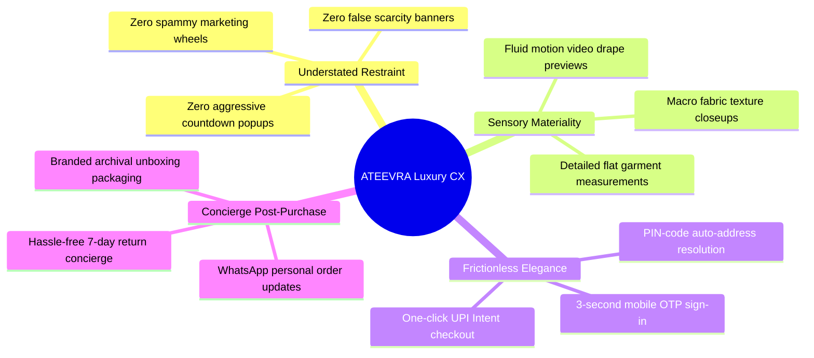

# ATEEVRA Digital Flagship — Customer Experience (CX) Blueprint

**Document ID:** `STR-ATEEVRA-CX-V1`  
**Classification:** `LUXURY SENSORY & BRAND EXPERIENCE SPECIFICATION`  
**Parent Blueprint:** [`STOREFRONT-MASTER-BLUEPRINT.md`](STOREFRONT-MASTER-BLUEPRINT.md)  
**Effective Date:** 2026-11-05  

---

## 1. Principles of Digital Luxury Customer Experience

In luxury fashion e-commerce, customer trust and brand desire are established through restraint, visual elegance, and absolute operational transparency.

---

## 2. Brand Tone of Voice & Editorial Copywriting Standards

ATEEVRA's written communication is **poetic, restrained, knowledgeable, and respectful**:
- **Tone:** Speaks with the quiet authority of an established design atelier. Avoids breathless hyperbole (*"Insane deal!", "Grab it now!"*) in favor of refined craftsmanship descriptions (*"Crafted from 240 GSM double-faced Egyptian cotton with French seam construction"*).
- **Prohibited E-Commerce Tropes:**
  - Strict prohibition against false urgency widgets (*"Hurry! 5 people are viewing this right now!"*).
  - Strict prohibition against gamified discount wheels or exit-intent popups.
  - Zero countdown timers on standard product detail pages.

---

## 3. Motion Design, Micro-Interactions & Sensory Polish

1. **Deceleration Transitions:** Page transitions utilize fluid cubic-bezier easing (`transition: all 400ms cubic-bezier(0.16, 1, 0.3, 1)`), evoking the weighted feel of physical luxury materials.
2. **Subtle Image Hover Scaling:** Product thumbnails gently scale by `1.03x` over 600ms on hover, revealing secondary model movement videos.
3. **Cart Drawer Physics:** The shopping bag slides out with momentum-based physics, instantly highlighting free shipping progress toward the ₹1,199 threshold.
4. **Haptic Feedback:** On mobile devices supporting the Web Vibration API, subtle micro-haptic pulses accompany successful bag additions.

---

## 4. Omnichannel VIP Concierge & Post-Purchase Care

The customer journey extends beyond the checkout transaction:
- **WhatsApp Concierge Service:** Customers receive high-touch order confirmations, dispatch notices with driver tracking, and instant access to a human styling concierge.
- **Bespoke Unboxing Packaging:** Products arrive in rigid charcoal boxes wrapped in custom tissue with debossed seals, eliminating standard polybag unboxing disappointment.
- **Garment Preservation Certificate:** Each shipment contains a printed archival card detailing wash temperatures, pressing recommendations, and seasonal cedar storage guidance.
