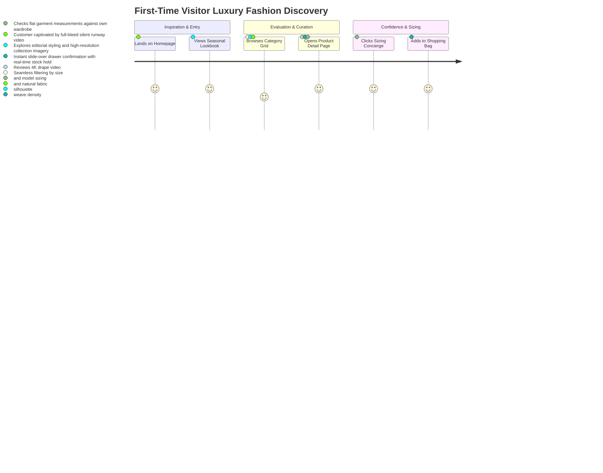
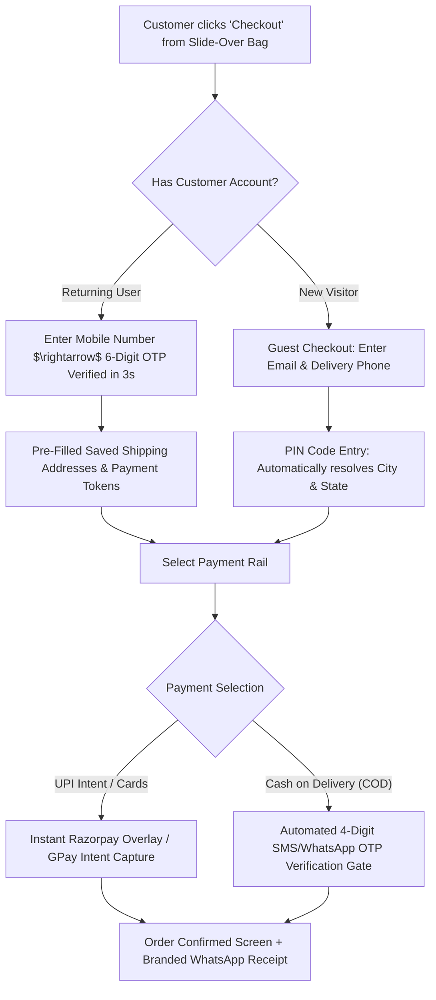

# ATEEVRA Digital Flagship — Customer Journey Blueprint

**Document ID:** `STR-ATEEVRA-JOURNEY-V1`  
**Classification:** `CUSTOMER EXPERIENCE & JOURNEY SPECIFICATION`  
**Parent Blueprint:** [`STOREFRONT-MASTER-BLUEPRINT.md`](STOREFRONT-MASTER-BLUEPRINT.md)  
**Effective Date:** 2026-11-05  

---

## 1. Journey 1: First-Time Discovery & Sensory Immersion



---

## 2. Journey 2: Frictionless One-Page Checkout



---

## 3. Journey 3: Luxury Post-Purchase & 7-Day Return Concierge

```mermaid
sequenceDiagram
    autonumber
    actor Customer as Retail Customer
    participant WhatsApp as WhatsApp Concierge API
    participant AccountUI as ateevra.com/account/orders
    participant Concierge as ATEEVRA Return Team

    WhatsApp->>Customer: "Your ATEEVRA parcel has been delivered by Bluedart."
    Note over Customer: Customer tries garment; desires alternative size
    Customer->>AccountUI: Navigate to Orders; Click "Request Size Exchange / Return"
    AccountUI->>Customer: Display 7-Day Return Countdown Badge (Day 2 of 7)
    Customer->>AccountUI: Select Reason: "Size Exchange: Request Size 42 instead of 40"
    AccountUI->>Concierge: Instant Exchange Webhook Triggered
    Concierge->>Customer: Automatic Return Label & Free Reverse Pickup Booked
    Note over Customer: 3PL Courier collects package from doorstep
    Concierge->>WhatsApp: "We have received your returned item. Replacement Size 42 dispatched!"
```
