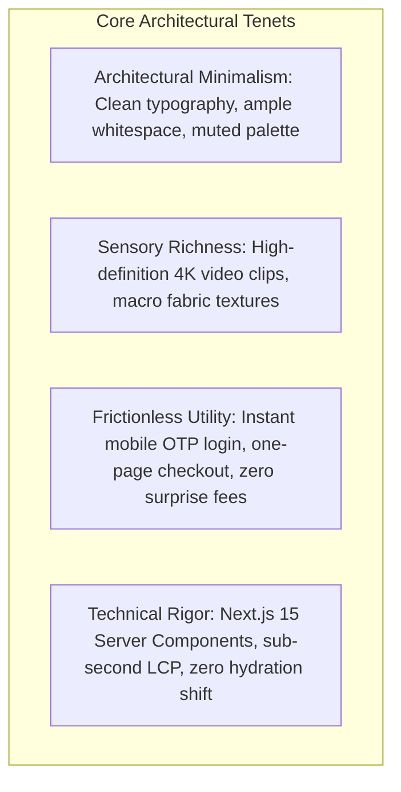
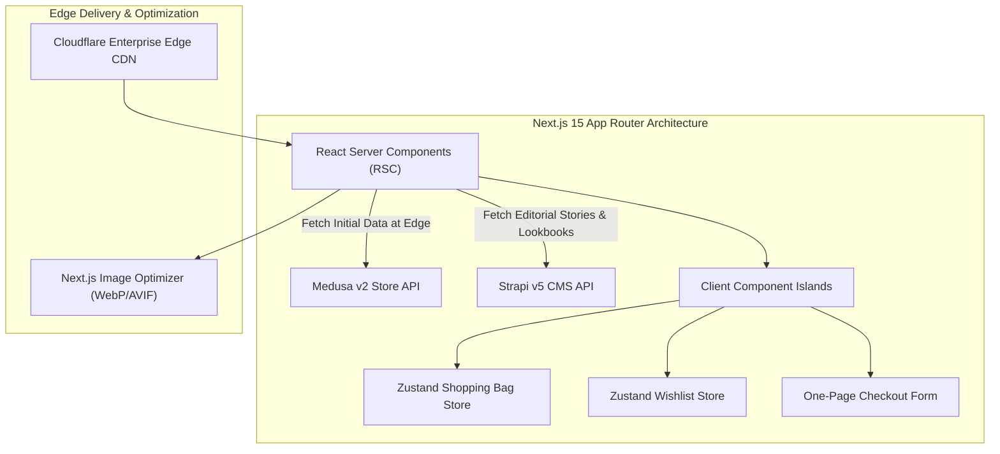

# ATEEVRA Digital Flagship — Storefront Master Blueprint

**Document ID:** `STR-ATEEVRA-STOREFRONT-MASTER-V1`  
**Classification:** `DIGITAL FLAGSHIP FRONTEND ARCHITECTURE`  
**Parent Blueprint:** [`../ATEEVRA-STOREFRONT-BLUEPRINT.md`](../ATEEVRA-STOREFRONT-BLUEPRINT.md)  
**Frontend Framework:** Next.js 15 App Router (`apps/storefront`)  
**Styling Engine:** Tailwind CSS 3.4 with Custom ATEEVRA Luxury Tokens  
**State Management:** React 19 Server Components, Zustand client stores, SWR / TanStack Query  
**Effective Date:** 2026-11-05  

---

## 1. Executive Summary & Brand Storefront Mission

The ATEEVRA Storefront serves as the digital flagship of the brand. It is engineered to translate haute horlogerie and luxury fashion sensibilities into a lightning-fast, highly responsive web application.



---

## 2. Design System & Luxury Token Architecture

```css
/* Custom ATEEVRA Brand Tokens in tailwind.config.js */
:root {
  --color-brand-offwhite: #FAFAFA;
  --color-brand-alabaster: #F4F1EA;
  --color-brand-charcoal: #1A1A1A;
  --color-brand-black: #0D0D0D;
  --color-brand-slate: #707070;
  --color-brand-gold-accent: #C5A059;

  --font-serif-luxury: 'Playfair Display', Georgia, serif;
  --font-sans-modern: 'Plus Jakarta Sans', system-ui, sans-serif;
  
  --transition-luxury: all 400ms cubic-bezier(0.16, 1, 0.3, 1);
}
```

### 2.1 Preserved Visual Invariants
- **ATEEVRA Custom Logo:** Scalable vector SVG mark preserved without modification.
- **Brand Loader:** Custom loading spinner with branded geometric easing preserved from initial MVP design.
- **Image Aspect Ratios:** Universal 3:4 vertical framing for all product listings and detail visuals.

---

## 3. Technology Stack & Component Architecture



### 3.1 Caching & Incremental Static Regeneration (ISR)
- **Product Listing Pages (PLP):** Revalidated on-demand via Next.js tag revalidation (`revalidateTag('products')`) triggered by Admin catalog webhooks.
- **Product Detail Pages (PDP):** Hybrid static shell with dynamic real-time inventory checks (ATS badge rendered via lightweight client query).
- **Cart & Checkout:** 100% dynamic server rendering with zero edge caching.
