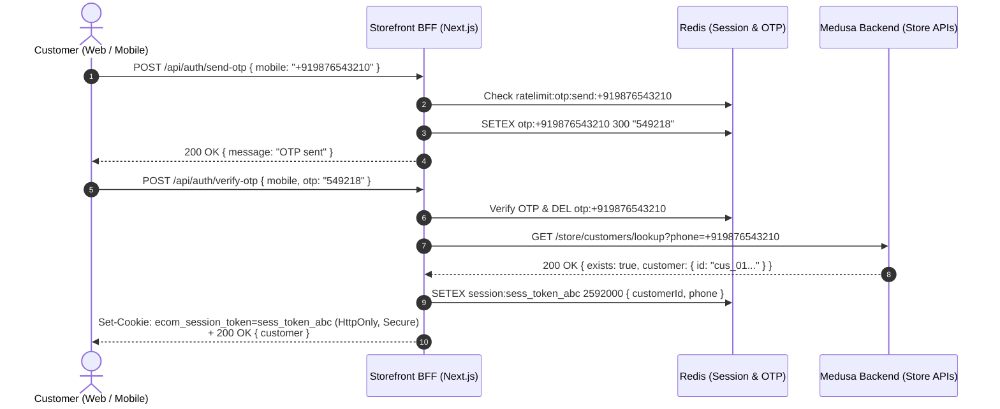
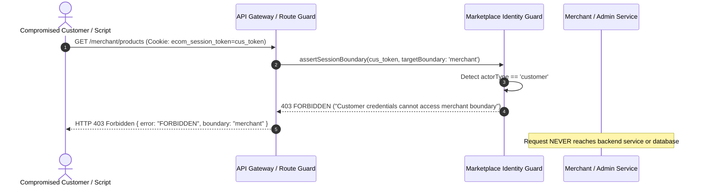

# ADR-002: Identity and Session Architecture

**Status:** APPROVED  
**Date:** 2026-10-19  
**Authors:** Ecom Engineering Team  
**Scope:** MVP-2 Identity & Session Architecture (M2-02)  
**Supersedes:** MVP-1 Single-Vendor Customer-Only Authentication Architecture  

---

## 1. Context and Problem Statement

In MVP-1, the ecommerce platform had a single primary identity type:
- **Customers:** Authenticated via Indian Mobile Phone (+91) and a 6-digit SMS OTP, issued an HTTP-only session cookie (`ecom_session_token`), and tracked in Redis (`session:${token}`).
- **Admin Access:** Relied on a default Medusa admin user with no multi-factor authentication (MFA) and no merchant separation.
- **Storefront-Medusa Direct DB Coupling:** The Next.js storefront (`apps/storefront/src/lib/auth/medusa-customer-service.ts`) bypassed API boundaries by directly connecting to Medusa's internal PostgreSQL database via the `pg` client to query and insert customer records.

MVP-2 transforms the platform into a multi-merchant marketplace requiring three strictly isolated user categories:
1. **End Customers:** Shoppers browsing the catalog, adding items to bag, checking out, paying via Razorpay/COD, and managing order history.
2. **Merchant Users (Sellers):** Vendor personnel managing products, inventory, orders, fulfillments, returns, and financial reports for their specific verified store.
3. **Super Admin (Platform Staff):** Platform operators moderating products, vetting/onboarding merchants, configuring commission rates, auditing cross-merchant transactions, and approving settlements.

We must define a comprehensive, production-grade identity and session architecture that guarantees strict boundary isolation, eliminates direct database coupling, protects against token forgery, provides CSRF/CORS defenses, specifies rate limits, and establishes compatibility with future React Native mobile apps.

---

## 2. Decision Drivers

- **Zero Boundary Bleed (Deny by Default):** Customer credentials must never grant or imply access to Merchant or Super Admin APIs. Similarly, Merchant credentials cannot access Super Admin capabilities.
- **Elimination of Direct PostgreSQL Access:** Storefront and BFF services must interact with Medusa exclusively via authenticated HTTP APIs and workflows. No direct SQL queries against commerce tables.
- **Server-Verified Tenant Membership:** A client-supplied `merchant_id` in headers, body, or cookies must never be trusted. Tenant context is derived strictly from the authenticated user session joined with an active `merchant_member` record.
- **Extensible Permission-Based RBAC:** Role-Based Access Control must support distinct merchant roles (`owner`, `admin`, `manager`, `staff`) and platform staff reviewer roles with granular permissions, avoiding rigid hardcoded checks.
- **Security Hardening (CORS, CSRF, Rate Limiting, MFA):** Production readiness requires strict CORS allowlisting, secure HTTP-only cookies, anti-CSRF protections, Redis rate-limiting against OTP abuse and credential stuffing, and mandatory MFA for Super Admin.
- **React Native Compatibility:** Customer auth must accommodate native mobile applications that cannot rely on browser cookie storage, via dual-transport token handling (`Authorization: Bearer <token>`).

---

## 3. Architectural Decisions

### 3.1 Decision 1: Three Distinct Security Boundaries & Identities

We formalize three non-overlapping identity boundaries:

```
┌────────────────────────────────────────────────────────────────────────────────────────┐
│                                SECURITY BOUNDARY MATRIX                                │
├──────────────────────────┬──────────────────────────┬──────────────────────────────────┤
│ 1. CUSTOMER BOUNDARY     │ 2. MERCHANT BOUNDARY     │ 3. SUPER ADMIN BOUNDARY          │
├──────────────────────────┼──────────────────────────┼──────────────────────────────────┤
│ Primary ID: Mobile (+91) │ Primary ID: Email        │ Primary ID: Staff Email          │
│ Auth Method: SMS OTP     │ Auth Method: Password/SSO│ Auth Method: Password + MFA/TOTP │
│ Token: ecom_session_token│ Token: ecom_merchant_sess│ Token: ecom_admin_sess           │
│ Storage: Redis           │ Storage: Medusa Auth/Sess│ Storage: Medusa Admin Session    │
│ Target APIs: /store/*    │ Target APIs: /merchant/* │ Target APIs: /admin/*            │
│ Scope: Own profile/orders│ Scope: Verified merchant │ Scope: Platform-wide governance  │
└──────────────────────────┴──────────────────────────┴──────────────────────────────────┘
```

1. **Customer Boundary (`/store/*`):**
   - Identifier: Normalized Indian mobile phone (`+91XXXXXXXXXX`).
   - Authentication: Passwordless 6-digit OTP verified against Redis (`otp:${phone}`).
   - Session: Cookie `ecom_session_token` stored in Redis (`session:${token}`).
   - Cross-Access Rule: Strictly prohibited from invoking `/merchant/*` or `/admin/*`. Any request with customer token to these prefixes returns `403 Forbidden`.

2. **Merchant Boundary (`/merchant/*`):**
   - Identifier: Corporate email address.
   - Authentication: Password verified via bcrypt/argon2 through Medusa's native Auth module.
   - Session: Cookie `ecom_merchant_sess` or Bearer token linked to `user_id`.
   - Tenant Validation: Middleware verifies `user_id` -> active `merchant_member` -> active `merchant`. If the merchant account is `suspended`, `rejected`, or `draft`, or the member status is `invited` or `suspended`, all requests are rejected with `403 Forbidden`.
   - Cross-Access Rule: Strictly prohibited from invoking `/admin/*` platform endpoints.

3. **Super Admin Boundary (`/admin/*`):**
   - Identifier: Platform staff corporate email.
   - Authentication: Strong password + Mandatory Second Factor (TOTP / RFC 6238 or WebAuthn).
   - Session: Cookie `ecom_admin_sess` with strict short TTL (8 hours maximum).
   - Operation Rule: Platform-wide scope. When performing merchant-owned mutations (e.g. creating a product on behalf of a merchant), explicit `target_merchant_id` selection is required by backend validation.

---

### 3.2 Decision 2: Separate Application Workspaces & Origins vs. Route Groups

**Decision: Separate Application Workspaces with Isolated Deployment Origins.**

Based on repository evidence:
- `apps/storefront`: Next.js 14 App Router, optimized for consumer SEO, SSR, edge caching, and mobile-first consumer performance.
- `apps/backend`: Medusa v2 headless commerce engine exposing `/store/*`, `/admin/*`, and the upcoming `/merchant/*` custom routes.
- `apps/cms`: Strapi v5 headless CMS for marketing and editorial content.

**Rationale for Separate Apps:**
1. **Bundle Isolation & Attack Surface:** Bundling merchant or platform admin panels into `apps/storefront` would bloat consumer JavaScript bundles and expose administrative route structures to consumer client bundles.
2. **Dedicated Origins & Cookie Scoping:**
   - Storefront: `https://store.domain.com` (Cookie: `ecom_session_token`, `SameSite=Lax`)
   - Merchant Portal: `https://merchant.domain.com` (Cookie: `ecom_merchant_sess`, `SameSite=Strict`)
   - Super Admin Portal: `https://admin.domain.com` (Cookie: `ecom_admin_sess`, `SameSite=Strict`)
   Isolating cookies by origin prevents browser cross-app session contamination.
3. **Independent Release Lifecycles:** Rapid storefront UX iterations do not risk destabilizing staff administration or seller workflows.

---

### 3.3 Decision 3: Session Lifecycles, Rolling Expiry, and Centralized Revocation

```
┌───────────────┬─────────────────┬─────────────────┬──────────────────────────────────┐
│ Boundary      │ Idle Timeout    │ Absolute TTL    │ Revocation Strategy              │
├───────────────┼─────────────────┼─────────────────┼──────────────────────────────────┤
│ Customer      │ 14 days sliding │ 30 days max     │ Redis DEL session:${token}       │
│ Merchant      │ 2 hours sliding │ 24 hours max    │ Redis DEL session:merch:${token} │
│ Super Admin   │ 30 mins sliding │ 8 hours max     │ Immediate session purge + audit  │
└───────────────┴─────────────────┴─────────────────┴──────────────────────────────────┘
```

- **Sliding Expiration:** Each authenticated request extends the session TTL in Redis up to the absolute maximum window.
- **Centralized Revocation via Redis:**
  - Single session logout: `DEL session:${token}` deletes the active session record immediately.
  - Global user logout: Setting `user:revoked_at:${userId} = timestamp`. Any session created before this timestamp is rejected during authorization token checks.
  - Instant Merchant Suspension: When a Super Admin suspends a merchant (`status = 'suspended'`), a pub/sub event or key flag `merchant:suspended:${merchantId}` invalidates all active sessions for that merchant's team within milliseconds.

---

### 3.4 Decision 4: Multi-Factor Authentication (MFA) & Step-Up Authentication Policy

1. **Super Admin MFA (Mandatory):**
   - Platform staff authentication requires two factors: Primary credentials (Email + Password) + Time-based One-Time Password (TOTP via Google Authenticator, Authy, or 1Password).
   - Secret seeds are encrypted at rest using AES-256-GCM.
   - Backup scratch codes (hashed via bcrypt) are generated upon enrollment and stored securely.
2. **Step-Up Authentication for Sensitive Actions:**
   - Triggered on high-risk operations:
     - Merchant status transition to `suspended` or `approved`.
     - Direct payout / settlement dispatch.
     - Changing bank payout details (IFSC, Account Number).
     - Global platform commission rate adjustments.
   - Requires re-entering TOTP code or password if the last MFA verification occurred >15 minutes prior.

> [!IMPORTANT]
> **Phase Implementation Boundary:** The MFA and step-up policies specified here are foundational architectural standards established in M2-02. Active runtime enforcement (TOTP enrollment, AES-256-GCM secret storage, and step-up route interceptors) is scheduled for implementation in Phase **M2-05 (Super Admin Authentication)** and hardened in Phase **M2-20 (Security and Audit Hardening)**. MFA is not yet enforced on active endpoints in M2-02 because administrative routes have not yet been implemented.


---

### 3.5 Decision 5: Identity Verification & Account Recovery Workflows

1. **Customer Recovery:**
   - Passwordless model: Customers verify possession of their phone number via SMS OTP on every login.
   - Lost phone number: Requires KYC identity verification through customer support via authenticated support ticket.
2. **Merchant User Recovery:**
   - Password reset via cryptographically secure, signed reset token (HMAC-SHA256, 15-minute TTL) delivered to verified corporate email.
   - Token is single-use and invalidated immediately upon password change. All active sessions are terminated upon reset.
3. **Super Admin Recovery:**
   - Self-service password reset is disabled for platform administrators.
   - Account recovery requires dual-administrator authorization or console break-glass procedures with mandatory audit logging.

---

### 3.6 Decision 6: CSRF Defenses, Restrictive CORS Allowlisting, and Cookie Hardening

1. **Cookie Configuration:**
   - `HttpOnly: true` (prevents XSS token exfiltration).
   - `Secure: true` (enforced in production; HTTPS only).
   - `SameSite: Strict` for Merchant and Admin portals.
   - `SameSite: Lax` for Customer Storefront to permit top-level navigations from promotional campaigns.
2. **Anti-CSRF Header Protection:**
   - Mutating HTTP methods (`POST`, `PUT`, `PATCH`, `DELETE`) require custom anti-CSRF headers:
     - `x-csrf-token` header matching cryptographic cookie token, OR
     - Framework origin verification (`Sec-Fetch-Site: same-origin` or explicit `Origin` validation).
3. **Strict CORS Allowlisting:**
   - Wildcard `*` origins are strictly forbidden across all API endpoints with credentials.
   - Dynamic origin verification against environment-configured lists:
     - `STORE_CORS`: `https://store.domain.com`
     - `MERCHANT_CORS`: `https://merchant.domain.com`
     - `ADMIN_CORS`: `https://admin.domain.com`

---

### 3.7 Decision 7: Multi-Layered Redis Rate Limiting

To prevent brute-force credential attacks, denial-of-service, and SMS toll fraud:

```
┌────────────────────────────────┬──────────────────────────┬──────────────────────────┐
│ Operation                      │ Rate Limit Window        │ Action upon Exceeded     │
├────────────────────────────────┼──────────────────────────┼──────────────────────────┤
│ Customer OTP Send              │ 3 requests / 15 mins     │ 429 Too Many Requests    │
│ Customer OTP Resend Cooldown   │ 60 seconds strict gap    │ 429 Cooldown active      │
│ Customer OTP Verify            │ 5 failed attempts / 15 m │ Temporary lockout (15m)  │
│ Merchant Login Attempt         │ 5 failures / 15 mins     │ Account lock + email alert│
│ Super Admin Login Attempt      │ 3 failures / 15 mins     │ IP lockout + alert       │
│ Sensitive Payout / Refund APIs │ 10 requests / minute     │ 429 Throttle             │
└────────────────────────────────┴──────────────────────────┴──────────────────────────┘
```

- Keys use structured prefixes: `ratelimit:otp:send:${phone}`, `ratelimit:otp:verify:${phone}`, `ratelimit:merchant:login:${email}`.
- Rate limiting is atomic via Redis `INCR` and `EXPIRE` Lua scripts.

---

### 3.8 Decision 8: Future React Native Mobile Customer App Dual-Transport Compatibility

While the web storefront uses secure HTTP-only cookies, future React Native mobile apps require non-cookie authorization.

**Dual-Transport Token Handling:**
1. Authentication endpoints (`POST /api/auth/verify-otp`) inspect request transport headers:
   - If `x-client-platform: mobile` or standard mobile user-agent is present, the server sets the session cookie AND returns `{ token, customer }` in the JSON response body.
   - Web browsers ignore the token body and rely on the HTTP-only cookie.
2. Inbound request middleware checks credentials in priority order:
   - Primary (Browser): `Cookie: ecom_session_token=<token>`
   - Secondary (Mobile): `Authorization: Bearer <token>`
3. Session resolution logic is 100% unified: Both transports query the identical Redis session key `session:${token}`.

---

### 3.9 Decision 9: Elimination of Storefront Direct-PostgreSQL Access & Customer API Hardening

**Previous Problem:**
In MVP-1, `apps/storefront/src/lib/auth/medusa-customer-service.ts` imported `pg` and executed raw SQL statements:
```typescript
// DEPRECATED MVP-1 PATTERN:
import pg from 'pg';
await pool.query('SELECT * FROM customer WHERE phone = $1', [phone]);
```
This violated architectural boundaries, exposed DB connection credentials to the Next.js process, bypassed Medusa data validation, and broke database connection pooling.

**MVP-2 Resolution & Security Controls:**
1. **Created Native Medusa Store Routes with Strict Boundary Defenses:**
   - `GET /store/customers/lookup?phone=+91XXXXXXXXXX`:
     - **S2S Authorization:** Requires `x-s2s-auth-token` matching server-to-server secret (`S2S_AUTH_TOKEN`). Direct unauthenticated public requests are rejected with `401 UNAUTHORIZED`.
     - **ZERO PII LEAKAGE:** Returns strictly `{ success: true, exists: boolean }`. Never returns customer names, emails, IDs, or metadata, eliminating public account enumeration and data scraping vulnerabilities.
   - `POST /store/customers`:
     - **S2S Authorization:** Requires `x-s2s-auth-token` sent from Storefront BFF only after mobile OTP verification is completed. Direct unauthenticated public mutation is rejected with `401 UNAUTHORIZED`.
     - **Account-Takeover Resistance:** Unauthenticated third parties cannot create or overwrite existing customer records.
     - **Metadata Allowlisting:** Strictly validates `gender` against `ALLOWED_GENDERS` and `date_of_birth` against `YYYY-MM-DD`. Arbitrary metadata keys (e.g. `is_admin`, `merchant_id`) are stripped.
     - **System Field Protection:** Internal system fields (`id`, `has_account`, `created_at`) are immutable.
2. **Refactored Storefront Customer Service:**
   - Removed `pg` import entirely.
   - Uses HTTP `fetch` against `${MEDUSA_URL}/store/customers/...` with `x-publishable-api-key` and `x-s2s-auth-token`.
   - Verified with `git grep "from 'pg'"`: Zero direct PostgreSQL access remaining in storefront.

---


### 3.10 Decision 10: Extensible Permission-Based RBAC & Reviewer Roles

To prevent rigid hardcoded role checks, we implement permission-based authorization:

```
┌──────────────────┬──────────────────────────────────────────────────────────────────┐
│ Role             │ Default Permission Matrix                                        │
├──────────────────┼──────────────────────────────────────────────────────────────────┤
│ Super Admin      │ * (Global access: platform moderation, all merchants, settings)  │
│ Platform Reviewer│ catalog:read, catalog:moderate, merchant:review, orders:read     │
│ Merchant Owner   │ merchant:* (Full control of own merchant catalog, stock, team)   │
│ Merchant Admin   │ catalog:write, inventory:adjust, orders:fulfill, returns:process │
│ Merchant Staff   │ catalog:read, inventory:read, orders:read, orders:fulfill        │
│ Customer         │ store:profile, store:cart, store:order, store:return             │
└──────────────────┴──────────────────────────────────────────────────────────────────┘
```

- Reviewer roles (e.g. Catalog Reviewer, KYC Reviewer) are permission-based:
  `assertPermission(session, 'catalog:moderate')` validates access without coupling to a specific role title.

---

## 4. Trust-Boundary & Authentication Flows

### 4.1 Customer Authentication Flow (SMS OTP & Session Creation)



---

### 4.2 Cross-Boundary Access Rejection Flow (Security Enforcement)



---

## 5. Security & Negative Authorization Matrix

| Actor | Active Session | Target Route / Action | Expected Result | Reason Enforced |
|---|---|---|---|---|
| Customer | `ecom_session_token` | `GET /merchant/products` | **403 FORBIDDEN** | Customer token invalid for merchant boundary |
| Customer | `ecom_session_token` | `POST /admin/merchants` | **403 FORBIDDEN** | Customer token invalid for admin boundary |
| Unauthenticated | None / Expired | `GET /merchant/orders` | **401 UNAUTHORIZED** | Missing or expired session token |
| Merchant User | Inactive Membership (`status: 'invited'`) | `GET /merchant/products` | **403 FORBIDDEN** | Membership invitation not yet accepted |
| Merchant User | Suspended Membership (`status: 'suspended'`) | `PATCH /merchant/products/:id` | **403 FORBIDDEN** | Suspended team members cannot mutate resources |
| Merchant User | Suspended Merchant (`merchant.status: 'suspended'`) | `GET /merchant/products` | **403 FORBIDDEN** | Suspended merchant account is globally frozen |
| Merchant User A | Active session for Merchant A | `GET /merchant/products/:id` (Owned by B) | **403 FORBIDDEN** | Cross-tenant access strictly blocked |
| Super Admin | Password only (MFA not completed) | `POST /admin/merchants/approve` | **401 / 403 MFA_REQUIRED** | Mandatory second factor step-up |
| Super Admin | Valid Session + Verified MFA | `POST /admin/products` (No `target_merchant_id`) | **400 BAD REQUEST** | Explicit target merchant required for creation |
| Mobile App | Valid `Authorization: Bearer <token>` | `GET /store/customer/orders` | **200 OK** | Dual-transport bearer token supported |

---

## 6. Rollback & Non-Breaking Compatibility Plan

1. **Storefront Direct DB Elimination:**
   - Storefront now speaks standard HTTP to Medusa.
   - If the custom customer lookup routes need to be updated, they reside entirely in `apps/backend/src/api/store/customers/` and can be versioned without restarting the database.
2. **Backward Compatibility for MVP-1:**
   - Existing customer session format in Redis (`session:${token}`) is 100% preserved.
   - Mobile OTP generation, cart merge, checkout, Razorpay, COD, and order history workflows continue without modification.
3. **Reversibility of Auth Boundaries:**
   - Auth boundary guards are declarative pure functions (`MarketplaceOwnershipGuard`, `MarketplaceIdentityGuard`).
   - If a rollback to single-store mode is required, bypassing the merchant guard restores default single-vendor routing with zero schema changes.

---

## 7. Conclusion

ADR-002 establishes an uncompromised, defense-in-depth identity and session architecture for MVP-2. By enforcing three strictly decoupled security boundaries, eliminating direct database coupling from the storefront, mandating server-side membership verification, and preparing for future mobile applications, the platform ensures complete security, operational safety, and auditability.
