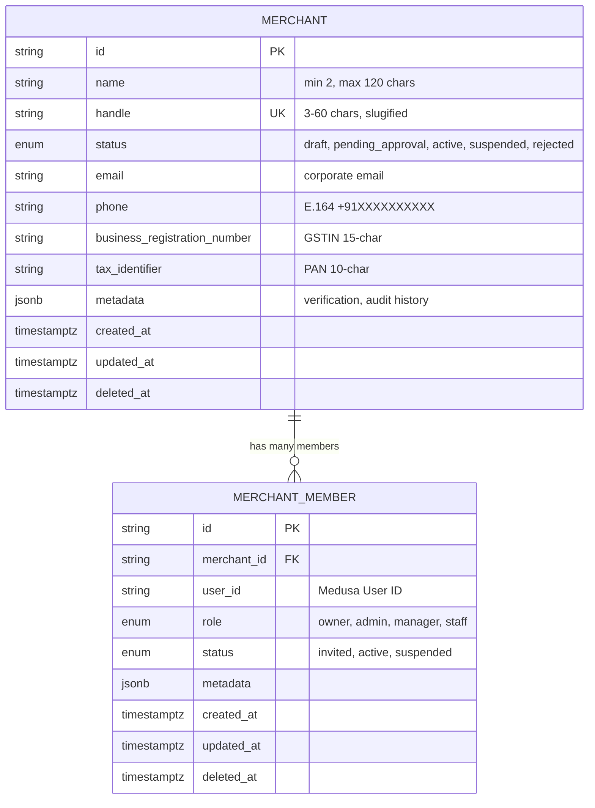
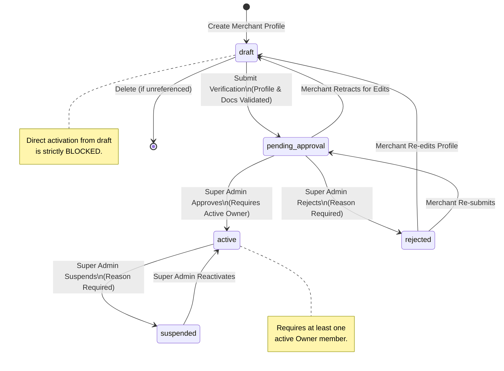

# ADR-003: Merchant Domain Foundation & Membership Lifecycle Architecture

**Status:** APPROVED  
**Date:** 2026-10-19  
**Authors:** Ecom Engineering Team  
**Scope:** MVP-2 Merchant Domain Foundation (M2-03)  
**Supersedes:** Single-Vendor Monolithic Merchant Model  

---

## 1. Context and Problem Statement

In MVP-1, all catalog, inventory, and order operations operated under an implicit single platform vendor.
In M2-01 and M2-02, we established the ownership architecture and identity boundaries across Customer, Merchant, and Super Admin.

In Phase M2-03, we formalize the **Merchant Domain Foundation**:
- Define the persistent data models for merchants and merchant team members within Medusa v2.
- Establish the merchant profile structure, Indian tax/business identifiers (GSTIN, PAN), contact information, and handle validation.
- Implement a deterministic status lifecycle state machine (`draft` -> `pending_approval` -> `active` <-> `suspended`, `rejected`).
- Capture verification metadata, audit timestamps, and lifecycle history without modifying native Medusa core tables.
- Enforce team membership constraints, unique user-merchant associations, and sole active owner protection.
- Ensure server-side verifiability of active membership without trusting client-supplied identifiers.
- Provide 100% reversible database migration compatibility.

---

## 2. Decision Drivers

1. **Zero Medusa Core Table Alterations:**
   - No `merchant_id` or tenant columns are injected into native Medusa tables (`product`, `order`, `customer`, `line_item`, `stock_location`).
   - The marketplace extension is isolated in custom module tables (`merchant`, `merchant_member`) and module links.
2. **Deterministic Lifecycle State Machine:**
   - Merchants start in `draft`.
   - Direct activation from `draft` is strictly blocked: verification submission to `pending_approval` is mandatory.
   - Only Super Admin can approve/activate, suspend, reactivate, or reject a merchant.
   - Rejection and suspension require explicit documented reasons recorded in audit metadata.
3. **Sole Active Owner Protection:**
   - An active merchant must maintain at least one member with `role === 'owner'` and `status === 'active'`.
   - Any operation attempting to demote, deactivate, or suspend the sole active owner is rejected.
4. **Server-Enforced Membership Verification:**
   - Active membership verification checks both that the member's status is `'active'` AND the merchant's account status is `'active'`.
   - Inactive merchants block all members, preventing orphaned operations.
5. **Zero Third Database:**
   - Uses Medusa's existing PostgreSQL (`medusa_db`) with MikroORM migrations, preserving the dual-DB topology (`medusa_db` + `strapi_db`).

---

## 3. Architectural Specifications

### 3.1 Entity Relationship Diagram



### 3.2 Merchant Status Lifecycle State Machine



### 3.3 Verification Metadata Schema

Stored in `merchant.metadata`:

```typescript
export interface MerchantVerificationMetadata {
  verificationSubmittedAt?: string; // ISO 8601
  approvedAt?: string;              // ISO 8601
  approvedBy?: string;              // User ID of Super Admin
  rejectionReason?: string;
  rejectedAt?: string;
  rejectedBy?: string;
  suspensionReason?: string;
  suspendedAt?: string;
  suspendedBy?: string;
  reactivatedAt?: string;
  reactivatedBy?: string;
  lifecycleHistory?: MerchantLifecycleEvent[];
}

export interface MerchantLifecycleEvent {
  fromStatus: MerchantStatus;
  toStatus: MerchantStatus;
  changedAt: string;
  changedBy: string; // Actor User ID or 'system'
  reason?: string;
  notes?: string;
}
```

---

## 4. Migration & Rollback Strategy

- **Migration File:** `apps/backend/src/modules/marketplace/migrations/Migration20261019000000.ts`
- **Framework:** `@medusajs/framework/mikro-orm/migrations`
- **`up()` Operations:**
  - Creates table `"merchant"` with primary key, timestamps, and indexes (`idx_merchant_name`, `idx_merchant_handle`, `idx_merchant_email`, `idx_merchant_status`, `IDX_merchant_deleted_at`).
  - Creates table `"merchant_member"` with primary key, timestamps, foreign key reference, and indexes (`idx_merchant_member_merchant_id`, `idx_merchant_member_user_id`, `idx_merchant_member_status`, `idx_merchant_member_unique`, `IDX_merchant_member_deleted_at`).
- **`down()` Operations (Rollback):**
  - Drops table `"merchant_member"` CASCADE.
  - Drops table `"merchant"` CASCADE.
  - Zero disruption to existing customer, product, order, or shipping data.

---

## 5. Security & Boundary Guarantees

1. **Isolation from Customers:**
   - Merchant members are associated with Medusa `user` IDs (platform staff/vendor accounts), completely isolated from customer mobile/session accounts.
2. **Active Membership Constraint:**
   - Any request by a merchant user to perform tenant-scoped operations must pass `verifyActiveMembership(userId, merchantId)`.
   - If member status is `suspended` or `invited`, or if merchant status is not `active`, the server returns `403 Forbidden`.
3. **Sole Owner Guard:**
   - Demoting or suspending the sole active owner of an active merchant is blocked server-side (`SOLE_OWNER_PROTECTION`). Ownership must be explicitly transferred to another active member first.
