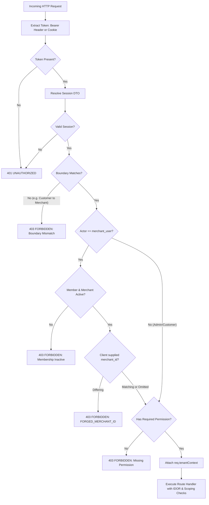

# ADR-004: Server-Side Tenant Authorization, API Boundaries, and IDOR Defense

**Status:** ACCEPTED  
**Date:** 2026-10-19  
**Authors:** Ecom Engineering Team  
**Scope:** MVP-2 Authorization and API Boundaries (M2-04)  
**Supersedes:** Route-level helper functions, un-scoped route execution, and in-memory test stores  

---

## 1. Context and Problem Statement

In M2-01 through M2-03, we established the foundational data models, module links, identity boundaries, format validators, and merchant state machines. However, security assertions in helper functions alone do not protect live HTTP endpoints. Without server-enforced, deny-by-default route authorization wrappers:
1. Malicious clients could pass forged `?merchant_id=...` query parameters or JSON body payloads to read or modify resources belonging to another merchant.
2. Insecure Direct Object References (IDOR) could allow Merchant A to fetch, edit, or delete Merchant B's catalog items (`/merchant/products/:id`).
3. Variant hijacking could allow Merchant A to append variants, SKUs, and pricing to Merchant B's parent products (`/merchant/products/:id/variants`).
4. Mixed-merchant orders could leak line items, customer details, and revenue of other merchants (`/merchant/orders`).
5. Overriding native `/admin/products` would break standard Medusa Admin dashboard and SDK response contracts.
6. Handlers must resolve persistent Medusa v2 modules (`Modules.PRODUCT`, `Modules.ORDER`, `ContainerRegistrationKeys.QUERY`, `ContainerRegistrationKeys.REMOTE_LINK`) rather than any in-memory store.

Phase **M2-04** establishes server-side authorization primitives and wraps actual route handlers in `apps/backend/src/api/` with deny-by-default tenant scoping backed by native Medusa v2 modules and module links.

---

## 2. Decision Drivers

1. **Deny-by-Default Architecture:**
   - Any route under `/merchant/*` or `/admin/*` rejects unauthenticated requests immediately with `401 UNAUTHORIZED`.
   - Security boundaries (`store`, `merchant`, `admin`) are strictly enforced. A Customer token attempting `/merchant/*` or `/admin/*` receives `403 FORBIDDEN`.
2. **Anti-Forgery Merchant Identity:**
   - The authenticated merchant ID is derived strictly from the cryptographically verified session token and server-verified active membership.
   - Client-supplied `merchant_id` in query parameters or request body is never trusted as proof of authorization. If a client sends a `merchant_id` differing from the verified session, the request is aborted with `403 FORBIDDEN` (`FORGED_MERCHANT_ID`).
3. **Parent-Product Ownership Hierarchy:**
   - Variants, SKUs, and prices inherit tenant ownership from their parent product.
   - Variant creation (`POST /merchant/products/:id/variants`) must verify parent product ownership before execution, preventing variant hijacking.
4. **Mixed-Merchant Order Line-Item Isolation:**
   - Customer orders containing items from multiple merchants are partitioned via `splitOrderLinesByMerchant`.
   - Sellers retrieve only line items belonging to their merchant. All other sellers' line items, customer PII, and total amounts are excluded to guarantee zero cross-tenant data leakage.
   - Authoritative monetary values are derived from persisted line-item prices and quantities.
   - If an order contains zero items for the calling merchant, the route rejects with `403 FORBIDDEN`.
5. **Product Lifecycle Safety on Deletion:**
   - Hard deletion is blocked if a product has historical customer orders or active warehouse inventory stock. Safe archiving is enforced with `409 CONFLICT`.
6. **Super Admin Governance Namespacing:**
   - Super Admin has platform-wide cross-merchant visibility.
   - To prevent shadowing Medusa v2's native `/admin/products` endpoint, marketplace-specific governance endpoints are namespaced under `/admin/marketplace/products`.
   - When creating merchant-owned products (`POST /admin/marketplace/products`), explicit target merchant selection (`target_merchant_id`) is mandatory. Omission triggers `400 BAD_REQUEST` (`TARGET_MERCHANT_REQUIRED`). Target merchant existence and active status are verified before product creation.
7. **Transactional Compensation for Ownership Links:**
   - Product creation and remote link establishment are linked: if establishing the remote link fails, the handler immediately deletes the created product to prevent leaving orphan, unowned products in the database.
8. **Ordinary Merchant Reassignment Prevention:**
   - Merchant product update routes (`PUT /merchant/products/:id`) strictly reject client-supplied changes to the owning merchant (`403 FORBIDDEN: CANNOT_REASSIGN_MERCHANT`).

---

## 3. Route & Operation Permission Matrix

| Endpoint | HTTP Verb | Boundary | Required Permission | Ownership / Scoping Rule | Error Status & Code |
| :--- | :--- | :--- | :--- | :--- | :--- |
| `/merchant/products` | `GET` | `merchant` | `catalog:read` | Scoped via `query.graph` to verified `session.merchantId` | `401 UNAUTHORIZED`<br>`403 FORBIDDEN` |
| `/merchant/products` | `POST` | `merchant` | `catalog:write` | Injects verified `session.merchantId`<br>Creates product + persists `remoteLink`<br>Compensates (deletes product) on link failure | `400 BAD_REQUEST`<br>`401 UNAUTHORIZED`<br>`403 FORBIDDEN`<br>`500 INTERNAL_ERROR` |
| `/merchant/products/:id` | `GET` | `merchant` | `catalog:read` | IDOR check: `assertMerchantProductOwnership` via `query.graph` | `401 UNAUTHORIZED`<br>`403 FORBIDDEN`<br>`404 NOT_FOUND` |
| `/merchant/products/:id` | `PUT` | `merchant` | `catalog:write` | IDOR check; blocks reassignment attempt (`CANNOT_REASSIGN_MERCHANT`) | `401 UNAUTHORIZED`<br>`403 FORBIDDEN`<br>`404 NOT_FOUND` |
| `/merchant/products/:id` | `DELETE` | `merchant` | `catalog:delete` | IDOR check + lifecycle safety (`orders`, `stock`)<br>Dismisses `remoteLink` and deletes product | `401 UNAUTHORIZED`<br>`403 FORBIDDEN`<br>`409 CONFLICT` |
| `/merchant/products/:id/variants` | `POST` | `merchant` | `catalog:write` | Parent product ownership check (anti-hijacking) | `400 BAD_REQUEST`<br>`401 UNAUTHORIZED`<br>`403 FORBIDDEN` |
| `/merchant/orders` | `GET` | `merchant` | `orders:read` | Line-item isolation via `splitOrderLinesByMerchant` over `query.graph` order lines | `401 UNAUTHORIZED`<br>`403 FORBIDDEN` |
| `/merchant/orders/:id` | `GET` | `merchant` | `orders:read` | Line-item isolation; 403 if 0 merchant items | `401 UNAUTHORIZED`<br>`403 FORBIDDEN`<br>`404 NOT_FOUND` |
| `/admin/marketplace/products` | `GET` | `admin` | Platform Admin | Cross-merchant visibility with optional `?merchant_id=` filter (namespaced) | `401 UNAUTHORIZED`<br>`403 FORBIDDEN` |
| `/admin/marketplace/products` | `POST` | `admin` | Platform Admin | Explicit `target_merchant_id` mandatory; verifies active target merchant exists<br>Persists product and `remoteLink` with compensation | `400 BAD_REQUEST`<br>`401 UNAUTHORIZED`<br>`403 FORBIDDEN` |

---

## 4. Higher-Order Middleware Architecture

All protected routes are wrapped using `requireTenantAuth(options, handler)` in `apps/backend/src/api/middlewares/tenant-auth.ts`:



---

## 5. Standardized Error Response Formats

All authorization and validation failures return consistent, structured JSON responses:

### 5.1 401 UNAUTHORIZED
```json
{
  "success": false,
  "error": "UNAUTHORIZED",
  "message": "Authentication required. No active session token found."
}
```

### 5.2 403 FORBIDDEN — Boundary Mismatch
```json
{
  "success": false,
  "error": "FORBIDDEN",
  "message": "Access denied: Customer credentials cannot access merchant or admin boundaries."
}
```

### 5.3 403 FORBIDDEN — Forged Merchant ID
```json
{
  "success": false,
  "error": "FORBIDDEN",
  "message": "FORGED_MERCHANT_ID: Client-supplied merchant_id does not match verified session membership."
}
```

### 5.4 403 FORBIDDEN — Cross-Merchant IDOR / Variant Hijacking
```json
{
  "success": false,
  "error": "FORBIDDEN",
  "message": "Access denied: You do not own this product."
}
```

### 5.5 403 FORBIDDEN — Merchant Reassignment Attempt
```json
{
  "success": false,
  "error": "FORBIDDEN",
  "message": "CANNOT_REASSIGN_MERCHANT: Product merchant reassignment is not permitted through standard update endpoints. Use dedicated reassignment workflow."
}
```

### 5.6 409 CONFLICT — Product Lifecycle Deletion Guard
```json
{
  "success": false,
  "error": "CONFLICT",
  "message": "Product cannot be hard-deleted because it is referenced in historical orders. Safe archive is required."
}
```

### 5.7 400 BAD_REQUEST — Super Admin Target Merchant Requirement
```json
{
  "success": false,
  "error": "BAD_REQUEST",
  "message": "TARGET_MERCHANT_REQUIRED: Super Admin must explicitly select a target approved merchant before creating a merchant-owned product."
}
```

---

## 6. Verification and Test Evidence

Suite 13 (`13. Route-Level Tenant Authorization & API Boundaries (M2-04)`) in `apps/backend/src/marketplace-ownership.test.ts` executes 33 comprehensive automated route authorization tests:
- Unauthenticated access rejection (401)
- Boundary separation: Customer blocked from Merchant and Admin; Merchant blocked from Admin (403)
- Inactive membership & suspended merchant account enforcement (403)
- Anti-forgery `merchant_id` protection in query and payload (403)
- Permission-based RBAC (`catalog:write`, `catalog:delete`, `orders:read`) (403)
- Cross-merchant IDOR read, update, delete protection (403)
- Parent-product variant hijacking protection (403)
- Product lifecycle evaluation on deletion (409 Conflict)
- Mixed-merchant order line-item isolation (zero cross-tenant data leakage)
- Super Admin target merchant requirement (400) and cross-merchant product creation (201)
- Target merchant non-existent (`MERCHANT_NOT_FOUND`) and suspended (`MERCHANT_NOT_ELIGIBLE`) rejection
- Persistent Medusa module & remote link creation and retrieval verification
- Transactional compensation rollback on link failure (zero orphan products)
- Reassignment rejection on PUT (`CANNOT_REASSIGN_MERCHANT`)
- Native Medusa Admin API preservation check (confirms `/admin/products` is not shadowed)

### Test Results
- **Backend Marketplace Ownership Suite:** 95 tests passing (0 failures).
- **Backend Commerce Domains Suite:** 28 tests passing (0 failures).
- **Backend Persistent PostgreSQL & Medusa Integration Suite:** 14 tests passing against real PostgreSQL database (`localhost:5432/medusa_db`).
- **Total Backend Tests:** 137 tests passing (0 failures).
- **Packages Types Marketplace Suite:** 65 tests passing (0 failures).
- **Storefront Test Suite:** 296 tests passing (0 failures).
- **Workspace Typecheck:** All 5 workspaces compile cleanly with zero TypeScript errors.
- **Runtime Database Persistence:** VERIFIED & PASSING. PostgreSQL engine on port 5432 (`ecom-dev-postgres`) is healthy. Database migrations (`Migration20261019000000`) and Medusa module links were synced and verified via live integration suite (`persistent-integration.test.ts`).

---

## 7. Known Risks & Unresolved Concurrency Limitations

### Product Deletion Read-Then-Act Concurrency Race (UNRESOLVED)

The M2-04 endpoint `DELETE /merchant/products/:id` enforces application-level validation against historical order line items (`marketplace_merchant_order_order_line_item`) and warehouse inventory before invoking `productModule.deleteProducts()`.

Under high-concurrency race conditions where a customer order containing a given product is placed at the exact moment a merchant issues a delete request for that product, a read-then-act race window exists between the pre-check and deletion.

**Explicit Architectural Notice:** Concurrency safety for product deletion under high concurrency is **NOT claimed** as resolved in M2-04. A formal mitigation—such as a database-level foreign key constraint preventing product deletion while order line items reference it, an atomic transactional advisory lock, or transitioning to a safe-archive-only status state machine—is tracked as an open architectural requirement to be implemented and verified in Phase M2-09.
