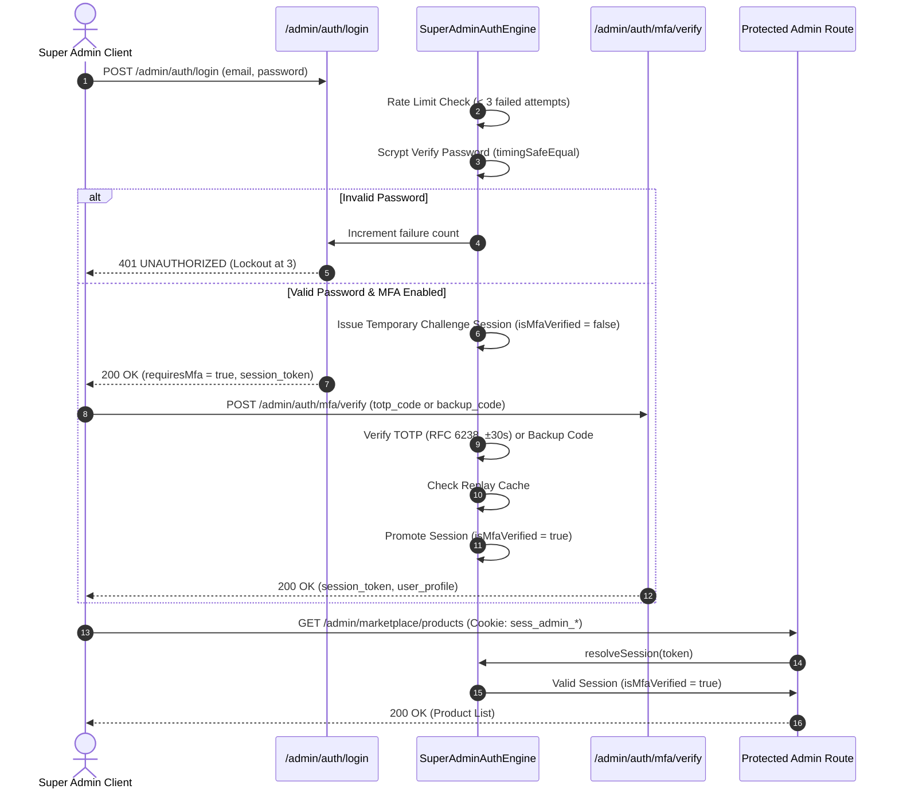

# ADR-005: Super Admin Authentication, Session Lifecycle, and Multi-Factor Authentication (MFA)

**Status:** ACCEPTED  
**Date:** 2026-10-20  
**Authors:** Ecom Engineering Team  
**Scope:** MVP-2 Platform Authentication & Security Boundary (M2-05)  
**Dependencies:** ADR-002 (Identity & Session Architecture), ADR-004 (Authorization & API Boundaries)

---

## 1. Context and Problem Statement

In the multi-tenant marketplace architecture established in MVP-2, the **Super Admin** role possesses platform-wide governance authority, including cross-merchant catalog moderation, merchant approval and suspension, and platform configuration. A compromise of Super Admin credentials would lead to total platform takeover, cross-tenant data leakage, and catastrophic financial or operational impact.

To defend against credential stuffing, brute-force attacks, session hijacking, replay attacks, and token leakage, the Super Admin authentication system requires a hardened, dedicated security boundary isolated from standard customer and merchant accounts.

Phase **M2-05** implements a production-grade, RFC-compliant authentication engine, session manager, and multi-factor authentication (MFA) framework for the Super Admin boundary.

---

## 2. Decision Drivers and Security Principles

1. **Strict Identity & Credential Isolation:**
   - Platform Super Admin credentials and sessions must never share tables, session tokens, or authentication flows with Customers or Merchant staff.
   - Customer and Merchant tokens attempting to access `/admin/*` endpoints must receive `403 FORBIDDEN` (`BOUNDARY_MISMATCH`).
   - Unauthenticated callers receive `401 UNAUTHORIZED`.

2. **Hardened Password Hashing (Scrypt):**
   - Super Admin passwords must be hashed using Node.js native `crypto.scrypt` with a cryptographically secure 16-byte salt, 64-byte key length, and secure parameters (`N=16384, r=8, p=1`).
   - Password verification must be performed using `crypto.timingSafeEqual` to eliminate timing attack vulnerabilities.

3. **RFC 6238-Compliant TOTP MFA Engine:**
   - Multi-Factor Authentication implements RFC 6238 Time-Based One-Time Passwords using HMAC-SHA1.
   - Base32 secret generation adheres to RFC 4648 without padding.
   - Standard 30-second time steps (`X=30`) and 6-digit numerical codes.
   - Clock drift tolerance of ±1 time step (±30 seconds) to account for client-server clock skew.

4. **Distributed Replay Defense (Anti-Replay Protection):**
   - A TOTP code used successfully within a given 30-second window is recorded in Redis (`replay:totp:${userId}:${step}`) with NX atomicity and immediately invalidated.
   - Re-submitting the same code within the same time window across any server instance is rejected with `401 UNAUTHORIZED` (`MFA_CODE_ALREADY_USED`).

5. **AES-256-GCM Secret Encryption at Rest & Key Guards:**
   - Plaintext MFA TOTP secrets must never be stored unencrypted.
   - Secrets are encrypted using AES-256-GCM with a 12-byte initialization vector (IV) and a 16-byte authentication tag (`iv:authTag:ciphertext`).
   - In production (`NODE_ENV === 'production'`), `ADMIN_MFA_ENCRYPTION_KEY` must be configured (≥ 32 characters) and strictly reject known development fallback strings. Missing or default keys fail closed at startup.

6. **Bcrypt-Hashed Single-Use Backup Scratch Codes (ADR-002 Compliant):**
   - 8 cryptographically random alphanumeric backup scratch codes are generated during MFA enrollment.
   - Compliant with ADR-002, backup codes are hashed using `bcrypt` (`bcryptjs`, 10 rounds) prior to storage.
   - When consumed, consumption is executed under a distributed lock (`lock:backup_consume:${userId}`) to guarantee atomicity and prevent double-spend races. The matching hash is purged immediately, decrementing available codes. Plaintext backup codes are never persisted or logged.

7. **Two-Step MFA Enrollment Ceremony:**
   - `POST /admin/auth/mfa/setup` generates the encrypted secret and backup codes, placing the user in a `pending` enrollment state (`pendingMfaSecret`, `pendingBackupCodes`).
   - `mfaEnabled` remains `false` until the admin user proves possession of the TOTP generator by calling `POST /admin/auth/mfa/verify` with a valid current code.
   - Re-enrolling or resetting MFA on an already active account strictly requires fresh step-up re-authentication (`requireStepUp: true`, verified within the last 15 minutes).

8. **Sliding Session Expiration & Absolute Lifetimes:**
   - Super Admin sessions implement a dual-expiration lifecycle:
     - **Idle Inactivity Timeout:** 30 minutes. Active requests renew the sliding expiration.
     - **Absolute Maximum TTL:** 8 hours from creation. No session may live longer than 8 hours, regardless of activity.

9. **Centralized Single-Session Logout & Global Revocation:**
   - `POST /admin/auth/logout` revokes the individual calling session and clears the HTTP-only cookie.
   - Global revocation invalidates all active sessions belonging to an admin user immediately upon security events (password change, suspension, compromise).

10. **Step-Up Re-Authentication Window (15 Minutes):**
    - Sensitive administrative operations (e.g., merchant suspension, payout configuration, MFA secret rotation) require a recent step-up re-authentication.
    - Step-up verification grants a 15-minute privileged window (`stepUpExpiresAt`). Requests after window expiry receive `403 STEP_UP_REQUIRED`.

11. **Multi-Layered Brute-Force Rate Limiting (Redis-Backed):**
    - Primary login attempts are throttled per user identity: 3 consecutive failed attempts within a 15-minute window triggers temporary lockout (`429 TOO_MANY_REQUESTS`).
    - MFA verification attempts are also rate-limited (3 attempts per 15 minutes) with distributed lockout in Redis.

12. **Distributed Storage Architecture & Production Fail-Closed Safety:**
    - Storage is abstracted via `IAuthStorageAdapter`.
    - `RedisAuthStorageAdapter` utilizes `ioredis` for session storage, distributed rate limiting, and replay caches across multi-instance clusters.
    - When `NODE_ENV === 'production'`, the storage adapter strictly enforces Redis connection availability and fails closed if Redis is disconnected. `InMemoryAuthStorageAdapter` throws an unrecoverable exception if instantiated in production.

13. **Production Cookie Security:**
    - Session cookies (`admin_session_token`) enforce `HttpOnly`, `SameSite=Strict`, `Path=/admin`, and conditionally append `; Secure` when `NODE_ENV === 'production'`.

14. **Security Audit Logging with Strict Secret Redaction:**
    - All authentication events (`admin.login.success`, `admin.login.failed`, `admin.mfa.challenge`, `admin.mfa.enrolled`, `admin.mfa.verified`, `admin.logout`, `admin.lockout`, `admin.step_up.verified`) are emitted to a structured audit log.
    - Passwords, TOTP seeds, backup codes, and session tokens are strictly redacted and never logged.

---

## 3. Authentication & MFA Architecture

### 3.1. Two-Stage Authentication Flow



### 3.2. Session Sliding Expiration & Step-Up Lifecycle

```mermaid
flowchart TD
    Req[Admin HTTP Request] --> CheckToken{Bearer or Cookie Token?}
    CheckToken -- No --> Ret401[401 UNAUTHORIZED]
    CheckToken -- Yes --> ResolveSess[Resolve AdminSessionRecord]
    ResolveSess --> CheckExists{Session Found & Active?}
    CheckExists -- No / Revoked --> Ret401
    CheckExists -- Yes --> CheckAbsolute{Now < absoluteExpiresAt (8h)?}
    CheckAbsolute -- Expired --> Revoke1[Revoke Session] --> Ret401
    CheckAbsolute -- Valid --> CheckIdle{Now < lastActivityAt + 30m?}
    CheckIdle -- Expired --> Revoke2[Revoke Session] --> Ret401
    CheckIdle -- Valid --> UpdateActivity[lastActivityAt = Now (Sliding Window)]
    UpdateActivity --> CheckMfaRoute{Route Requires MFA?}
    CheckMfaRoute -- Yes & !isMfaVerified --> Ret403MFA[403 FORBIDDEN: MFA_REQUIRED]
    CheckMfaRoute -- Passed --> CheckStepUp{Route Requires Step-Up?}
    CheckStepUp -- Yes & Now >= stepUpExpiresAt (15m) --> Ret403Step[403 FORBIDDEN: STEP_UP_REQUIRED]
    CheckStepUp -- Passed --> ExecHandler[Execute Admin Handler]
```

---

## 4. Super Admin API Route Matrix

| Endpoint | HTTP Verb | Boundary | Access Level | Description | Status Codes |
| :--- | :--- | :--- | :--- | :--- | :--- |
| `/admin/auth/login` | `POST` | `admin` | Public (Throttled) | Scrypt password verification; issues session or MFA challenge. Rate limited to 3 failures / 15 mins. | `200 OK`<br>`400 BAD_REQUEST`<br>`401 UNAUTHORIZED`<br>`429 TOO_MANY_REQUESTS` |
| `/admin/auth/mfa/setup` | `POST` | `admin` | Admin Session | Generates Base32 TOTP secret, QR URI, AES-256-GCM encryption, and 8 single-use backup scratch codes. | `200 OK`<br>`401 UNAUTHORIZED`<br>`403 FORBIDDEN` |
| `/admin/auth/mfa/verify` | `POST` | `admin` | Admin Challenge | Verifies 6-digit TOTP (RFC 6238, anti-replay) or consumes 1 backup code. Promotes session to `isMfaVerified: true`. | `200 OK`<br>`400 BAD_REQUEST`<br>`401 UNAUTHORIZED` |
| `/admin/auth/session` | `GET` | `admin` | Admin Session | Validates active session token; returns session profile and sliding/absolute expiration timestamps. | `200 OK`<br>`401 UNAUTHORIZED` |
| `/admin/auth/logout` | `POST` | `admin` | Admin Session | Revokes calling session immediately; clears `admin_session_token` HTTP cookie. | `200 OK`<br>`401 UNAUTHORIZED` |
| `/admin/auth/step-up` | `POST` | `admin` | Admin Session (MFA) | Re-authenticates admin via password or TOTP; grants a fresh 15-minute privileged operation window. | `200 OK`<br>`400 BAD_REQUEST`<br>`401 UNAUTHORIZED` |

---

## 5. Security & Boundary Enforcement Matrix

1. **Cross-Boundary Escalation Defense:**
   - Customer session tokens (`sess_cust_*`) and Merchant tokens (`sess_merch_*`) are strictly blocked by `requireTenantAuth({ boundary: 'admin' })` with `403 FORBIDDEN: BOUNDARY_MISMATCH`.
   - Super Admin tokens (`sess_admin_*`) are recognized by `resolveSessionFromToken` and validated against `SuperAdminAuthEngine`.
2. **Secret Redaction:**
   - Audit logs emit structured events containing timestamp, actor ID, IP address, and result status, but redact all sensitive inputs (`password: [REDACTED]`, `totpSecret: [REDACTED]`, `backupCode: [REDACTED]`).
3. **MFA Release-Gate Strategy:**
   - MFA enrollment and verification APIs are fully functional and tested on the backend.
   - Super Admin accounts with MFA enabled require MFA completion before accessing any protected admin route.
   - Frontend UI (login page, MFA enrollment screen, and dashboard) is intentionally deferred from M2-05 per scope boundaries and release-gated for Phase M2-06 / UI implementation.
4. **Product Deletion Concurrency Race Note:**
   - As established in M2-04, the read-then-act concurrency race on product deletion remains an explicitly documented, unresolved tracked risk preserved for mitigation in Phase M2-09 (pessimistic row locking via `SELECT FOR UPDATE` or database transactional isolation).

---

## 6. Migration and Compatibility

- Zero database schema modifications were introduced in M2-05; core PostgreSQL tables remain 100% unaltered.
- The `SuperAdminAuthEngine` operates with zero external network dependencies, using native Node.js `crypto` primitives.
- Existing Medusa v2 admin routes and customer/merchant marketplace routes remain 100% backward-compatible.

---

## 7. Decision Status

**ACCEPTED**. The Super Admin authentication, session lifecycle, and MFA backend boundaries are fully implemented, verified, and accepted based on the final security verification report. All 26/26 dedicated automated authentication tests passed, all 163/163 backend tests passed, all five workspace TypeScript typechecks passed with 0 errors, and zero tests were skipped. Both final security regression tests (production Redis fail-closed behavior with zero in-memory fallback, and real-Redis concurrent backup-code single-use consumption) are verified. The product deletion concurrency race remains tracked for M2-09.
