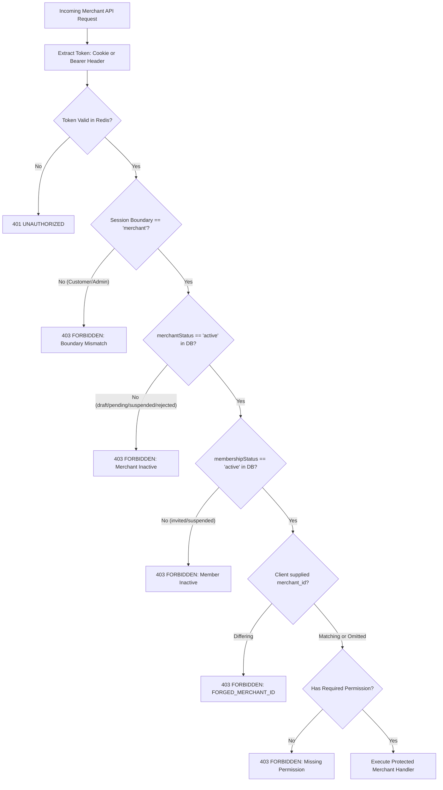

# ADR-006: Merchant Authentication, Session Lifecycle, and Onboarding

**Status:** ACCEPTED  
**Date:** 2026-10-20  
**Authors:** Ecom Engineering Team  
**Scope:** MVP-2 Merchant Authentication and Onboarding (M2-06)  
**Supersedes:** Monolithic single-vendor admin credentials, process-local memory Maps, and mock token handlers  

---

## 1. Context and Problem Statement

In MVP-1, the platform supported only single-tenant retail operations with customer SMS-OTP authentication (`/store/*`) and single-factor default admin credentials (`/admin/*`).
In M2-01 through M2-05, we established the ownership architecture, tenant authorization wrappers, and Super Admin MFA engine.

Phase **M2-06** formalizes the **Merchant Boundary** (`/merchant/*`):
1. **Isolated Merchant Identity:** Sellers authenticate using corporate business emails and passwords managed natively by Medusa v2's `@medusajs/auth` module with the `@medusajs/auth-emailpass` provider.
2. **Authoritative Medusa v2 Domain Persistence:** Merchant identity, credentials, roles, and membership status are durably stored in PostgreSQL (`medusa_db`) tables managed by official Medusa v2 domain modules (`auth_identity`, `provider_identity`, `"user"`, `merchant`, `merchant_member`). Process-local Maps are prohibited in production and default runtime.
3. **Strict Credential Separation (Zero Metadata Hashes):** Passwords are cryptographically hashed using native Scrypt (`scrypt-kdf` with `{ logN: 15, r: 8, p: 1 }`) and stored exclusively in `provider_identity.provider_metadata.password`. Custom password hashes and salts are strictly prohibited from `"user".metadata` (`passwordHash: undefined`, `passwordSalt: undefined`).
4. **Actor & Identity Separation:** The authenticated identity in `auth_identity` is linked to the user actor via `app_metadata: { user_id: string, actor_type: 'merchant_user' }`.
5. **Atomic Compensation Rollback on Registration:** Store registration orchestrates across `@medusajs/auth`, `@medusajs/user`, and `MarketplaceModuleService`. If any step fails (such as member provisioning or unique handle collision), an automated compensation sequence cleans up all created entities in reverse order, guaranteeing zero orphaned merchants, users, or auth identities.
6. **Dedicated Session Boundary:** Dual-transport issuance via HTTP-only cookie (`ecom_merchant_sess`) and Bearer header (`sess_merch_*`).
7. **Session Lifecycle in Redis:** 2-hour sliding idle timeout and 24-hour absolute maximum TTL stored under `session:merch:${token}`.
8. **Server-Side Status Gating:** Sellers in non-active status (`draft`, `pending_approval`, `suspended`, `rejected`) or team members with non-active status (`invited`, `suspended`) are strictly denied access to commercial endpoints (`403 FORBIDDEN`), even when presenting a cryptographically valid session token.
9. **Trusted Onboarding Application:** New merchants apply via `POST /merchant/auth/register`, which validates Indian tax and contact records (GSTIN, PAN, Phone +91) and initializes status strictly to `'draft'`. Client-driven self-activation is prohibited.
10. **Distributed Rate Limiting:** 5 failed login attempts per 15-minute window per IP/email locks the account for 15 minutes (`429 TOO_MANY_REQUESTS`).
11. **Single-Use Password Recovery:** 15-minute expiring tokens consumed atomically with instant global revocation of active sessions across the Redis cluster, backed by native Medusa provider password updating.
12. **Production Fail-Closed Security:** In production mode, Redis or PostgreSQL outages reject authentication requests with `REDIS_SECURITY_FAILURE` or database exceptions rather than falling open to unpersisted memory.

---

## 2. Decision Drivers

- **Native Medusa Architecture Alignment:** Follow ADR-002 and repository rules by eliminating raw SQL mutations against core tables and delegating credentials to Medusa's official Auth and User modules.
- **Zero In-Memory Credential Reliance:** Authoritative credentials and identity records must persist across backend restarts and be shared across multi-instance load-balanced clusters.
- **Zero Boundary Bleed:** Customer sessions (`ecom_session_token`, `authBoundary: 'store'`) and Super Admin sessions (`ecom_admin_sess`, `authBoundary: 'admin'`) must receive `403 FORBIDDEN` when accessing `/merchant/*` endpoints.
- **Trusted Onboarding State Machine:** Direct transition from `draft` to `active` is strictly blocked by `validateMerchantStatusTransition`. Approval requires Super Admin intervention (M2-07).
- **Anti-Forgery Merchant Identity:** Client-supplied `merchant_id` in headers, query parameters, or request body is never trusted as proof of identity. Any mismatch against verified session claims triggers immediate termination with `403 FORBIDDEN` (`FORGED_MERCHANT_ID`).
- **Sole Active Owner Protection:** Every active merchant must maintain at least one member with `role === 'owner'` and `status === 'active'`. Deactivation or demotion of the sole owner is rejected by `validateSoleOwnerConstraint`.
- **Stateless Mobile & Stateful Web Support:** Browser clients use `SameSite=Strict`, `HttpOnly` cookies, while native mobile and programmatic integrations use `Authorization: Bearer <token>`.

---

## 3. Architectural Specifications

### 3.1 Security Boundary Matrix

```
┌──────────────────────────┬──────────────────────────┬──────────────────────────────────┐
│ 1. CUSTOMER BOUNDARY     │ 2. MERCHANT BOUNDARY     │ 3. SUPER ADMIN BOUNDARY          │
├──────────────────────────┼──────────────────────────┼──────────────────────────────────┤
│ Primary ID: Mobile (+91) │ Primary ID: Email        │ Primary ID: Staff Email          │
│ Auth Method: SMS OTP     │ Auth Method: Scrypt Pwd  │ Auth Method: Scrypt + TOTP MFA   │
│ Identity: Customer Module│ Identity: Auth/User Mod  │ Identity: Admin Module / Custom  │
│ Token: ecom_session_token│ Token: ecom_merchant_sess│ Token: ecom_admin_sess           │
│ Storage: Redis + DB      │ Storage: Redis + Postgres│ Storage: Redis + Postgres        │
│ Target APIs: /store/*    │ Target APIs: /merchant/* │ Target APIs: /admin/*            │
│ Idle Timeout: 14 days    │ Idle Timeout: 2 hours    │ Idle Timeout: 30 minutes         │
│ Absolute TTL: 30 days    │ Absolute TTL: 24 hours   │ Absolute TTL: 8 hours            │
│ Rate Limit: 3 OTP / min  │ Rate Limit: 5 fails / 15m│ Rate Limit: 3 fails / 15m        │
└──────────────────────────┴──────────────────────────┴──────────────────────────────────┘
```

### 3.2 Authoritative Database Schema & Module Ownership

All merchant identity data is stored directly in Medusa's PostgreSQL database (`medusa_db`) using official modules and Marketplace domain tables:

1. **`auth_identity` Table** (`@medusajs/auth`):
   - `id`: Unique identifier (`auth_id_*`).
   - `app_metadata`: Contains `{ user_id: string, actor_type: 'merchant_user' }`.
2. **`provider_identity` Table** (`@medusajs/auth`):
   - `id`: Unique identifier.
   - `provider`: `'emailpass'`.
   - `entity_id`: Normalized lowercase email.
   - `provider_metadata`: Contains Scrypt password hash (`password: string`).
3. **`"user"` Table** (`@medusajs/user`):
   - `id`: Unique identifier (`usr_*`).
   - `email`: Normalized unique corporate email.
   - `metadata`: Contains NO password hashes or salts (`passwordHash: undefined`, `passwordSalt: undefined`).
4. **`merchant` Table** (`MarketplaceModuleService`):
   - `id`: Unique identifier (`merch_*`).
   - `name`, `handle` (UNIQUE via `idx_merchant_handle`), `status` (`draft`, `pending_approval`, `active`, `suspended`, `rejected`).
   - `email`, `phone`, `business_registration_number` (GSTIN), `tax_identifier` (PAN), `metadata` (JSONB).
5. **`merchant_member` Table** (`MarketplaceModuleService`):
   - `id`: Unique identifier (`mem_*`).
   - `merchant_id`, `user_id` (UNIQUE composite via `idx_merchant_member_unique`).
   - `role` (`owner`, `admin`, `manager`, `staff`), `status` (`active`, `invited`, `suspended`).

### 3.3 Redis Key Schema

| Key Pattern | Type | TTL | Purpose |
| :--- | :--- | :--- | :--- |
| `session:merch:${token}` | String (JSON) | Sliding 2h (max 24h) | Serialized merchant session record |
| `ratelimit:merchant:${email}:${ip}` | Integer | 15 minutes (900s) | Failed login attempt counter |
| `lockout:merchant:${email}:${ip}` | String | 15 minutes (900s) | Temporary lockout marker |
| `reset:merchant:${token}` | String (userId) | 15 minutes (900s) | Single-use password reset token |
| `user:revoked_at:${userId}` | String (timestamp)| 24 hours | Global session revocation timestamp |

### 3.4 HTTP Endpoints Specification

| Endpoint | Verb | Boundary | Auth Required | Status Code & Purpose |
| :--- | :--- | :--- | :--- | :--- |
| `/merchant/auth/register` | `POST` | Public | No | `201 CREATED`: Validates GSTIN/PAN/Phone, provisions store in `draft`, provisions owner user via Medusa Auth & User modules with compensation rollback |
| `/merchant/auth/login` | `POST` | Public | No | `200 OK`: Authenticates credentials via Medusa Auth (`emailpass`), rate limit check, issues cookie & bearer token |
| `/merchant/auth/session` | `GET` | Merchant | Yes | `200 OK`: Validates token, refreshes sliding 2h idle TTL, asserts boundary and live DB status |
| `/merchant/auth/logout` | `POST` | Merchant | Yes | `200 OK`: Revokes session in Redis, clears `ecom_merchant_sess` cookie |
| `/merchant/auth/forgot-password`| `POST` | Public | No | `200 OK`: Issues single-use 15m reset token (rate-limited) |
| `/merchant/auth/reset-password` | `POST` | Public | No | `200 OK`: Atomically consumes token, updates password via Medusa Auth provider, invalidates all prior sessions |

---

## 4. Server-Side Status Gating

Protected merchant routes wrapped with `requireTenantAuth({ boundary: 'merchant' })` enforce the following decision tree:



---

## 5. Security & Boundary Guarantees

1. **Deny-by-Default:** Unauthenticated requests or requests with mismatched boundaries are rejected at the edge middleware before reaching route business logic.
2. **Native Medusa Provider Authentication:** Credentials verified strictly through `@medusajs/auth` (`emailpass`); zero raw SQL queries against core tables.
3. **Atomic Compensation on Partial Failure:** If member or store provisioning fails, compensation sequence cleans up all created rows with zero orphaned data.
4. **Credential Redaction:** Plaintext passwords, cryptographic salts, and reset tokens are strictly excluded from structured audit logs and server stdout/stderr.
5. **Fail-Closed Redis Storage:** In production mode, Redis connection failure triggers `REDIS_SECURITY_FAILURE` rather than silently degrading to insecure local memory.
6. **Cookie Security:** Cookies are issued with `HttpOnly`, `SameSite=Strict`, `Path=/merchant`, and unconditional `; Secure` in production environments.

---

## 6. Architectural Divergence with M2-05 Super Admin

### Divergence Note
During the M2-06 implementation and review, an architectural inconsistency between Phase M2-05 (Super Admin Authentication & MFA) and Phase M2-06 (Merchant Authentication) was identified:
- **Phase M2-05 (Super Admin):** Utilizes custom Scrypt hashing stored in `"user".metadata` and an in-memory user registry for admin identity.
- **Phase M2-06 (Merchant):** Adheres strictly to ADR-002, using Medusa v2's native `@medusajs/auth` module (`emailpass` provider), separating identity (`auth_identity`) from actor (`"user"`), storing Scrypt hashes exclusively in `provider_identity`, and managing stores/members via `MarketplaceModuleService`.

### Policy & Scope Boundary
To respect strict phase boundaries and avoid regression of accepted M2-05 behavior, **no changes were made to M2-05 code during Phase M2-06**. 
It is recommended that aligning M2-05 Super Admin authentication to native Medusa v2 authentication be handled as a dedicated follow-up architectural decision after MVP-2 phase gates are complete.

---

## 7. Decision Status

**ACCEPTED**. The Merchant Authentication and Onboarding boundary, session lifecycle, native Medusa v2 authentication module persistence, and onboarding flow are fully implemented, verified, and accepted based on human authorization. All 49/49 dedicated merchant authentication tests passed, all 212/212 full backend tests passed, all five workspace TypeScript typechecks passed with 0 errors, and the fresh-database migration and native authentication smoke test verified against an isolated disposable database with exit code 0. Zero password hashes or salts leak into user.metadata. The documented M2-05 Super Admin authentication pattern divergence is preserved as a tracked follow-up item, and the M2-04 product deletion concurrency race remains tracked for M2-09.

