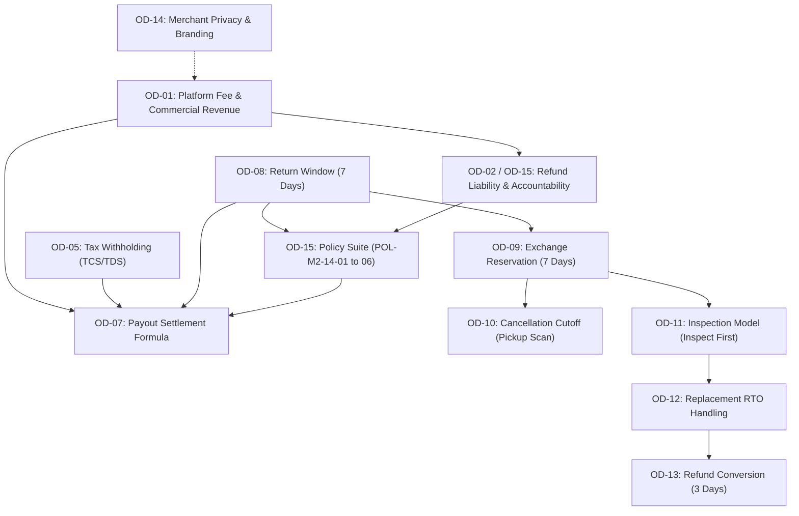

# ATEEVRA M2-14 — Complete Pending Owner Decision Questionnaire & Decision Readiness Audit

**Document Reference:** `DOC-M214-PENDING-DECISION-QUESTIONNAIRE`  
**Classification:** `AUTHORITATIVE DECISION READINESS AUDIT & QUESTIONNAIRE`  
**Phase:** Phase M2-14 (Payments, Refunds, Returns and Exchanges)  
**Parent Blueprint:** [`blueprint/ATEEVRA-MARKETPLACE-FINANCIAL-COMMERCIAL-POLICY-BLUEPRINT.md`](blueprint/ATEEVRA-MARKETPLACE-FINANCIAL-COMMERCIAL-POLICY-BLUEPRINT.md)  
**Master Decision Register:** [`M2-14-OWNER-DECISION-REGISTER.md`](M2-14-OWNER-DECISION-REGISTER.md)  
**Execution Plan Reference:** [`M2-14-EXECUTION-PLAN.md`](M2-14-EXECUTION-PLAN.md)  
**Policy Register Reference:** [`blueprint/POLICY-REGISTER.md`](blueprint/POLICY-REGISTER.md)  
**Audit Timestamp:** 2026-11-04  
**Governance Invariant:** Strictly documentation, extraction, and readiness analysis. Zero code implementation, zero policy approval, zero status modification, and zero schema changes.

---

## 1. Executive Summary & Audit Authority

This document provides the exhaustive, structured **Decision Readiness Questionnaire** for all 15 Owner Decision areas (OD-01 through OD-15) under Phase M2-14. 

The objective is to synthesize all unresolved business choices, commercial terms, operational boundaries, and statutory validation requirements into a rigorous, actionable decision frame. This empowers the Project Owner to evaluate each decision individually, understand its mathematical and operational consequences, and provide explicit direction without ambiguity.

### Key Governance Invariants
1. **Zero Silent Approvals:** No policy is treated as approved without explicit written owner authorization.
2. **Preservation of Approved Baselines:** The initial OD-02 v1.0.0 policy baseline (`POL-OD-02-01` to `06`) remains the approved baseline until formal owner ratification of the proposed v1.1.0 revision.
3. **Strict Software Invariant:** Current technical capabilities strictly isolate gross sales data (`quantity * unitPrice`), maintain equal-value financial neutrality, and display truthful transaction states (`unsettled`) without fake payouts or silent commission deductions.

---

## 2. Granular Decision Questionnaire (OD-01 through OD-15)

---

### OD-01 — Marketplace Commercial Revenue Architecture & Platform Fee Model

- **Current Status:** `OWNER DIRECTION RECORDED — PENDING FEE SELECTION & PROFESSIONAL VALIDATION`
- **Business Objective:** Establish ATEEVRA's commercial revenue engine, define merchant realization mechanics, ensure compliance with Indian marketplace FDI regulations, and prevent platform operating deficits.
- **Why This Decision is Necessary:** A multi-vendor marketplace cannot generate merchant settlement statements, calculate P&L, or issue B2B tax invoices without an approved fee structure. Furthermore, absorbing forward freight without adequate facilitation fees creates severe cash drain.
- **Existing Owner Direction:**  
  1. Merchants remain the **Sellers of Record**, selling directly to consumers and issuing customer-facing B2C GST tax invoices.
  2. ATEEVRA operates as a **Marketplace Facilitator**, earning revenue via a separately defined platform fee (+ 18% GST).
  3. ATEEVRA is **NOT a wholesale buyer** and does not buy/resell merchant inventory.
- **What Remains Undecided:**
  1. The exact platform fee structure (Percentage vs. Hybrid vs. Fixed).
  2. Forward shipping cost allocation (Shipping-neutral vs. Platform-subsidized).
  3. Multi-vendor cart shipping allocation (Extra consignment subsidy vs. Customer checkout surcharge).
  4. Final legal and CA validation of GST SAC code classification (SAC 998371 vs 998599).

#### Available Options

##### Option A: Fixed Platform Fee Per Fulfilled Order (₹50.00 Flat)
- **Description:** A flat ₹50.00 facilitation fee billed to the merchant per fulfilled order, irrespective of order value.
- **₹1,000 Order Example:** GMV: ₹1,000.00 $\rightarrow$ Platform Fee: ₹50.00 (+ ₹9.00 GST) $\rightarrow$ Net Fee: ₹50.00.
- **Financial Impact:** Highly regressive. On a ₹400 basket, ₹50 fee is 12.5% (merchant resistance). On a ₹3,000 basket, ₹50 fee is 1.67% (massive platform revenue leakage).
- **Customer Experience Impact:** Neutral (internal merchant deduction).
- **Merchant Impact:** Heavily penalizes low-ticket craft/accessory sellers; disproportionately benefits high-ticket apparel/jewelry sellers.
- **Platform Operational Impact:** Inadequate revenue to cover payment gateway MDR (₹21.24) and return reserves (₹22.61), leaving almost zero gross margin (+₹6.15) before logistics.
- **Legal/Tax Dependencies:** B2B GST tax invoice issued by ATEEVRA for ₹50.00 + ₹9.00 GST.
- **Advantages:** Simple to explain and calculate.
- **Disadvantages:** Unviable unit economics on low AOVs; fails to capture upside on luxury items.
- **Risks:** Platform operating insolvency if average basket size trends below ₹800.

##### Option B: Fixed Platform Fee Per Delivered Unit (₹25.00 Flat Per Item)
- **Description:** Flat ₹25.00 fee billed per physical item delivered.
- **₹1,000 Order Example (Single Item):** Platform Fee: ₹25.00 (+ ₹4.50 GST). (Two Items @ ₹500: ₹50.00 fee).
- **Financial Impact:** Discourages multi-item bundling. Fails to cover fixed overhead on single low-value items.
- **Customer Experience Impact:** Neutral.
- **Merchant Impact:** Strongly disincentivizes selling multi-packs or low-cost add-ons.
- **Platform Operational Impact:** Complex returns tracking on partial item cancellations.
- **Legal/Tax Dependencies:** Standard B2B GST invoicing per line item.
- **Advantages:** Scales linearly with warehouse pick/pack units.
- **Disadvantages:** Severely distorts catalog merchandising for low-ticket goods.
- **Risks:** Merchant resistance against listing entry-level accessories.

##### Option C: Percentage Platform Facilitation Fee (8.0% to 10.0% of Product GMV) — [AGY PRIMARY RECOMMENDATION]
- **Description:** A percentage fee (recommended 10.0%) charged on the merchant-declared product selling price.
- **₹1,000 Order Example:** GMV: ₹1,000.00 $\rightarrow$ Platform Fee (10%): ₹100.00 (+ ₹18.00 GST) $\rightarrow$ Merchant Payout: ₹882.00 (before TCS/TDS withholdings).
- **Financial Impact:** Dynamically scales with order value. Generates ₹100.00 revenue on ₹1,000 basket, easily covering MDR (₹21.24) and platform operating reserves, leaving **+₹57.39 net contribution** under shipping neutrality.
- **Customer Experience Impact:** High transparency; enables competitive catalog pricing.
- **Merchant Impact:** Aligns with standard Indian e-commerce marketplace expectations (Amazon, Myntra, Ajio).
- **Platform Operational Impact:** Seamless algorithmic calculation; scalable across all product categories.
- **Legal/Tax Dependencies:** Clean compliance with Indian FDI regulations (Press Note 2 of 2018) for pure marketplace models.
- **Advantages:** Robust unit economics across all basket sizes; maximizes platform revenue on high-ticket sales.
- **Disadvantages:** High nominal fee on luxury items (e.g., ₹500 fee on ₹5,000 designer dress).
- **Risks:** Merchant pushback if set higher than 12% in competitive categories.

##### Option D: Hybrid Platform Fee (₹20.00 Fixed + 5.0% Variable) — [AGY STRONG ALTERNATIVE]
- **Description:** Combines a fixed base fee of ₹20.00 per order plus 5.0% of product GMV.
- **₹1,000 Order Example:** GMV: ₹1,000.00 $\rightarrow$ Fixed: ₹20.00 + Variable (5%): ₹50.00 = Total Fee: ₹70.00 (+ ₹12.60 GST). Merchant Payout: ₹917.40.
- **Financial Impact:** Establishes a guaranteed revenue floor on cheap orders while remaining attractive to premium sellers.
- **Customer Experience Impact:** Neutral.
- **Merchant Impact:** Highly popular among premium sellers (pays only 5.4% effective fee on ₹5,000 order).
- **Platform Operational Impact:** Moderate calculation complexity in database.
- **Legal/Tax Dependencies:** Standard B2B GST invoicing.
- **Advantages:** Downside revenue protection; highly competitive for recruiting established designer brands.
- **Disadvantages:** Slightly lower platform revenue on high-value orders compared to Option C.
- **Risks:** Higher merchant calculation complexity on settlements.

##### Option E: Customer-Facing Convenience Fee (₹19.00 Flat at Checkout)
- **Description:** ₹19.00 fee billed directly to the customer at checkout on top of product price.
- **Financial Impact:** Lowers merchant fee requirement, but triggers checkout drop-off.
- **Disadvantages:** High cart abandonment; faces scrutiny under CCPA/Consumer Protection dark pattern guidelines. **NOT RECOMMENDED.**

#### Forward Shipping Allocation Models (Sub-Decision under OD-01)
- **Model 1 (Platform Subsidized Forward Shipping):** ATEEVRA absorbs the ₹65–₹70 carrier freight. **Result: Platform operates at a net contribution deficit (-₹4.24 to -₹12.61 per order) under 10% fee.**
- **Model 2 (Customer-Paid Shipping):** Customer pays ₹70 shipping (or Free over ₹1,199). **Result: Platform generates healthy +₹60.76 contribution margin.**
- **Model 3 (Merchant-Borne Shipping):** Merchant absorbs forward shipping via ₹70 deduction. **Result: Platform generates +₹60.76 margin; merchant margins compress.**

- **AGY Recommendation:**  
  *Advisory Recommendation:* Adopt **Option C (10.0% Percentage Platform Fee)** combined with **Model 2 (Customer-Paid Forward Shipping with ₹1,199 Free Shipping Threshold)**. This preserves merchant trust, conforms to Indian FDI rules, and delivers a robust +₹57.39 to +₹60.76 net contribution per ₹1,000 delivered order.
- **Exact Question for Project Owner:**  
  > *"Which commercial platform fee structure does ATEEVRA adopt: Option C (10% Percentage Fee) or Option D (₹20 Fixed + 5% Variable); and do you confirm that forward shipping must be shipping-neutral (customer-paid under ₹1,199 threshold) to prevent platform operating deficits?"*
- **Information Still Required:** Final corporate overhead budget to confirm whether 10% or 12% is required for platform break-even.
- **Dependencies:** OD-05 (Tax withholdings), OD-07 (Net payout timing).
- **Approval Requirements:** Platform Owner Approval + Written CA/Tax Opinion on SAC code classification.

---

### OD-02 — Refund Financial Liability

- **Current Status:** `OWNER APPROVED — INITIAL POLICY BASELINE (v1.0.0)` | `PROPOSED REVISION v1.1.0-PROPOSED PENDING RATIFICATION (OD-15)`
- **Business Objective:** Define the financial liability and cashflow allocation across merchants, platform, and couriers when an order is cancelled, returned, or damaged.
- **Why This Decision is Necessary:** Clarifies whether ATEEVRA or the merchant absorbs reverse freight and payment gateway friction, directly impacting platform solvency and reserve requirements.
- **Existing Owner Direction:**  
  - *v1.0.0 Approved Baseline (2026-11-03):* Platform absorbed 100% of reverse freight on remorse returns via an internal Return-Cost Reserve ($R_{\text{target}} \approx ₹22.61$). Zero merchant return debits.
  - *v1.1.0-PROPOSED Direction (2026-11-04):* Reallocates post-delivery customer return reverse shipping to the **Merchant** via weight slabs (₹30–₹165+). Reaffirms **₹0 reverse shipping to merchant on genuine RTO**. Levies provisional penalties (₹25 cancel, ₹50 late dispatch).
- **What Remains Undecided:** Formal owner ratification of the controlled policy revision (`v1.1.0-PROPOSED`) to supercede v1.0.0.

#### Available Options
- **Option 1: Retain Approved Baseline v1.0.0 (100% Platform-Absorbed Return Reserve):**  
  Platform absorbs all reverse logistics costs on remorse returns. Required platform reserve is high (₹22.61/order). Platform contribution margin is compressed (-₹5.75 blended loss per 1,000 orders under platform shipping subsidy).
- **Option 2: Ratify Proposed Revision v1.1.0-PROPOSED (Merchant Weight-Based Return Slabs):**  
  Merchant debited weight-based reverse fee (500g: ₹30, 1kg: ₹50, 2kg: ₹80, 5kg: ₹120, >5kg: ₹165+ excl. GST). Customer receives 100% full refund. Platform reserve requirement drops by 65% (to ~₹7.85/order). Platform contribution margin rises by +152% (to +₹3.00 blended margin per order). Genuine RTO reverse freight remains ₹0 for merchants.

- **AGY Recommendation:**  
  *Advisory Recommendation:* Ratify **v1.1.0-PROPOSED**. Shifting post-delivery reverse shipping to merchants eliminates severe platform cash drain, aligns seller incentives with product description accuracy, and unlocks substantial working capital.
- **Exact Question for Project Owner:**  
  > *"Do you formally ratify Policy Suite POL-M2-14-01 through POL-M2-14-06 as OD-02 Baseline v1.1.0-PROPOSED, replacing the 100% platform-absorbed return reserve with weight-based merchant reverse-shipping fees (₹30–₹165+) while keeping genuine RTO reverse shipping at ₹0 for merchants?"*
- **Information Still Required:** 3PL courier contractual reverse freight tariffs to calibrate exact weight slab break-evens.
- **Dependencies:** OD-01 (Fee model), OD-08 (Return window), OD-15 (Accountability framework).
- **Approval Requirements:** Platform Owner Formal Ratification.

---

### OD-03 — Coupon Allocation & Splitting

- **Current Status:** `PENDING OWNER DECISION`
- **Business Objective:** Establish how promotional cart discounts are funded and how partial returns are refunded in multi-vendor orders.
- **Why This Decision is Necessary:** If a customer applies a ₹400 coupon on a mixed order across two merchants and later returns one item, the platform must know whether to refund the tag price or the net discounted price, and who absorbs the coupon cost.
- **Existing Owner Direction:** None recorded.
- **What Remains Undecided:** Financing party (Platform vs. Merchants) and partial return deduction mechanics.

#### Available Options

##### Option A: Platform-Subsidized Universal Coupons (Marketing Expense) — [AGY ADVISORY RECOMMENDATION]
- **Description:** ATEEVRA funds 100% of order-level promotional codes as a marketing customer acquisition cost. Merchants receive their full realization/selling price minus standard platform fee.
- **₹1,000 Order Example:** Cart Total: ₹2,000 (Merchant A: ₹1,000, Merchant B: ₹1,000). Coupon: ₹400 (`SAVE20`). Customer Pays: ₹1,600.  
  - *Merchant Settlement:* Merchant A credited ₹1,000 gross (net ₹882 after 10% fee). Merchant B credited ₹1,000 gross. ATEEVRA absorbs the ₹400 discount from marketing budget.  
  - *Partial Return:* Customer returns Merchant A item. Customer refund = $\text{Line Price} - \text{Pro-Rata Discount} = ₹1,000 - ₹200 = \mathbf{₹800.00}$. Merchant A realization debited ₹882; platform recovers ₹200 pro-rata coupon portion. Customer cannot game the coupon threshold.
- **Financial Impact:** Predictable platform marketing outlay; merchants never suffer unapproved discount cuts.
- **Customer Experience Impact:** Excellent; high conversion campaigns (`WELCOME10`, `FESTIVE20`).
- **Merchant Impact:** Highly attractive; merchants join promotions without margin compression.
- **Platform Operational Impact:** Clean accounting separation between marketplace commerce and marketing P&L.
- **Legal/Tax Dependencies:** GST calculated on actual post-discount customer invoice value.
- **Advantages:** Eliminates merchant disputes over coupon deductions; prevents coupon threshold gaming on returns.
- **Disadvantages:** Direct platform cash burn.
- **Risks:** Budget overrun if marketing coupon redemption caps are not configured.

##### Option B: Pro-Rata Merchant-Funded Cart Coupons
- **Description:** Cart discount is apportioned proportionally across merchant line items based on value. Merchants receive the discounted net price.
- **₹1,000 Order Example:** Merchant A receives ₹800 gross (₹1,000 minus ₹200 coupon share). Platform fee (10%) = ₹80. Net Payout: ₹704.00.
- **Financial Impact:** Zero platform discount expense.
- **Customer Experience Impact:** Good at checkout, but customer confuses partial refund amounts.
- **Merchant Impact:** High merchant resistance; unconsented margin erosion.
- **Disadvantages:** Complex merchant agreements required; potential legal challenges under Section 73 Indian Contract Act if discounts are forced.

##### Option C: Seller-Funded Product Promotions Only
- **Description:** Platform-wide universal cart coupons are disabled. Discounts apply strictly to individual items funded voluntarily by that seller.
- **Disadvantages:** Destroys platform-level marketing campaigns and festive sales events.

##### Option D: Hybrid Co-Funded Model
- **Description:** Platform funds universal onboarding codes (`WELCOME10`); merchants fund category promotions (`DIWALI20`).
- **Disadvantages:** Complex schema configuration (`coupon.funded_by`).

- **AGY Recommendation:**  
  *Advisory Recommendation:* Adopt **Option A for MVP-2**. Platform funds universal coupons with strict pro-rata net refund calculation on partial returns. Defer complex multi-tier merchant co-funding schemas to MVP-3.
- **Exact Question for Project Owner:**  
  > *"Who finances order-level promotional coupons in mixed-merchant carts (Platform universal marketing vs. Merchants pro-rata), and do you confirm that partial returns must refund the net discounted price (tag price minus pro-rata discount) to prevent coupon exploitation?"*
- **Information Still Required:** MVP-2 quarterly marketing discount budget ceiling.
- **Dependencies:** OD-01 (Fee calculated on pre-discount or post-discount price), OD-02 (Refund calculation).
- **Approval Requirements:** Platform Owner Approval.

---

### OD-04 — Shipping Revenue Allocation

- **Current Status:** `PENDING OWNER DECISION`
- **Business Objective:** Define whether shipping fees collected from customers are retained by ATEEVRA or distributed to merchants, and establish who bears multi-origin shipping deficits.
- **Why This Decision is Necessary:** In mixed-merchant orders, each merchant ships from a separate warehouse. If a customer pays ₹100 flat shipping for an order containing 3 items from 3 different cities, ATEEVRA pays couriers $3 \times ₹70 = ₹210$, losing -₹110 on freight.
- **Existing Owner Direction:** None formally recorded. (Provisional stress-testing direction was shipping neutrality).
- **What Remains Undecided:** Retaining vs. distributing customer shipping revenue; multi-origin deficit absorption.

#### Available Options

##### Option A: Platform Retains Shipping Revenue & Centrally Aggregates 3PL Couriers — [AGY ADVISORY RECOMMENDATION]
- **Description:** ATEEVRA centrally contracts with 3PL logistics (Delhivery/Shiprocket), provides electronic shipping labels to merchants, charges customers a standardized shipping fee (e.g., ₹99 flat, or Free over ₹1,199), and retains 100% of shipping collections to offset aggregate logistics bills.
- **₹1,000 Order Example (Single Vendor):** Customer pays ₹1,000 + ₹70 shipping = ₹1,070. ATEEVRA pays carrier ₹70. ATEEVRA retains ₹70. Merchant payout based strictly on ₹1,000 product. Freight cost is 100% neutral.
- **Financial Impact:** Highly predictable for single-vendor orders. Requires an extra ₹50 surcharge on mixed-vendor carts or a ₹1,199 threshold to prevent multi-origin losses.
- **Customer Experience Impact:** Clean, unified checkout; standard Amazon-like tracking experience.
- **Merchant Impact:** Merchants do not negotiate individual courier rate cards; simply print ATEEVRA labels.
- **Platform Operational Impact:** Requires central carrier API integration (manifest generation, tracking webhooks).
- **Legal/Tax Dependencies:** ATEEVRA invoices customer for logistics service (+ 18% GST).
- **Advantages:** Consistent customer delivery SLA; central tracking data; unified customer support.
- **Disadvantages:** Platform absorbs freight shortfall if multi-vendor surcharges are under-calibrated.
- **Risks:** Uncontrolled logistics cash burn on low-ticket multi-vendor carts.

##### Option B: Shipping Fee Split Pro-Rata Across Merchants
- **Description:** Customer shipping fee is divided among merchants. Merchants book their own couriers.
- **Disadvantages:** Severe customer experience failure; wildly inconsistent tracking; fragmented delivery dates.

##### Option C: Multi-Vendor Individual Shipping Fees Stacked at Checkout
- **Description:** Customer charged separate shipping per merchant (e.g., ₹50 Seller A + ₹50 Seller B = ₹100).
- **Disadvantages:** High cart abandonment due to stacked shipping fees.

##### Option D: Merchant-Absorbed Free Shipping Platform-Wide
- **Description:** Free shipping to all customers; merchants must bake shipping costs into product listing prices.
- **Disadvantages:** High product tag prices; merchants resist unbacked fulfillment cost absorption.

- **AGY Recommendation:**  
  *Advisory Recommendation:* Adopt **Option A**. ATEEVRA retains shipping revenue and centrally controls 3PL logistics, paired with a ₹1,199 Free Shipping basket threshold to protect contribution margins.
- **Exact Question for Project Owner:**  
  > *"Shall ATEEVRA retain customer shipping fees and centrally manage 3PL courier integrations (Option A), and do you approve a ₹1,199 Free Shipping threshold with a ₹50 multi-vendor surcharge on mixed-origin carts to eliminate logistics deficits?"*
- **Information Still Required:** 3PL carrier master rate card (surface vs air).
- **Dependencies:** OD-01 (Forward freight model), OD-02 / OD-15 (Reverse logistics allocation).
- **Approval Requirements:** Platform Owner Approval + Logistics Head Sign-off.

---

### OD-05 — Statutory Tax Withholding (TCS / TDS)

- **Current Status:** `PENDING TAX/CA REVIEW`
- **Business Objective:** Ensure strict compliance with Section 52 of the Central Goods and Services Tax (CGST) Act, 2017 (GST TCS) and Section 194-O of the Income Tax Act, 1961 (IT TDS).
- **Why This Decision is Necessary:** Electronic Commerce Operators (ECOs) in India are legally mandated to deduct statutory tax withholdings and remit them to the government by the 10th and 7th of each month. Failure to withhold attracts severe interest and penalties.
- **Existing Owner Direction:** None recorded.
- **What Remains Undecided:** Software calculation vs. External CA batch calculation; threshold exemptions.

#### Verified Statutory Tax Rates (As of 2024/2025/2026 Baseline)
1. **GST TCS (Section 52 CGST Act):** **0.50% total** (0.25% CGST + 0.25% SGST, or 0.50% IGST) on net taxable supplies pursuant to **CBIC Notification No. 15/2024–Central Tax (effective 10 July 2024)**.
2. **Income Tax TDS (Section 194-O):** **0.10%** on gross sales pursuant to the **Finance (No. 2) Act, 2024 (effective 1 October 2024)**. (Applies to individual/HUF merchants if gross annual sales exceed ₹5,00,000; applies to corporate sellers from ₹0).

#### Available Options

##### Option A: External Accounting & CA Batch Deduction (MVP-2 Baseline) — [AGY ADVISORY RECOMMENDATION]
- **Description:** The marketplace software tracks gross sales data and displays gross figures. Statutory 0.50% GST TCS and 0.10% IT TDS are calculated externally by ATEEVRA's Chartered Accountant / Finance Team during offline batch payout runs prior to bank disbursement.
- **₹1,000 Order Example:** Software displays: Merchant Gross Sales: ₹1,000.00 | Platform Fee: ₹100.00 (+ ₹18 GST). Payout Ledger: ₹882.00. CA payout sheet deducts: GST TCS (0.5% on ₹847.46 net taxable base) = ₹4.24; IT TDS (0.1% on ₹1,000) = ₹1.00. Actual Bank Transfer = ₹876.76.
- **Financial Impact:** Legally compliant; zero tax withholding calculation bugs in software.
- **Merchant Impact:** Merchant receives net wire payout with monthly Form 26Q / GSTR-8 tax credit certificates.
- **Platform Operational Impact:** Low software development cost; slight manual spreadsheet reconciliation for finance.
- **Legal/Tax Dependencies:** Requires qualified Indian CA to handle monthly filing.
- **Advantages:** Eliminates tax compliance bugs during MVP-2; conforms to Master Plan deferral.
- **Disadvantages:** Finance team must maintain monthly reconciliation spreadsheets.
- **Risks:** Manual spreadsheet human error.

##### Option B: Full Programmatic Dual Tax Withholding Engine in Software
- **Description:** Medusa backend automatically computes intra-state (CGST+SGST) vs inter-state (IGST) TCS and Section 194-O TDS upon order capture and stores records in PostgreSQL.
- **Disadvantages:** High software complexity; PAN/GSTIN verification overhead; high defect risk if tax laws change.

- **AGY Recommendation:**  
  *Advisory Recommendation:* Adopt **Option A for MVP-2**. Software maintains truthful gross data; statutory withholdings are calculated externally by the CA team during batch payout runs. Implement automated programmatic withholding in MVP-3.
- **Exact Question for Project Owner:**  
  > *"Shall statutory 0.50% GST TCS and 0.10% Income Tax TDS be computed externally by ATEEVRA's Chartered Accountant during offline batch settlements for MVP-2 (Option A), or do you require a fully automated programmatic tax withholding engine built into the Medusa database immediately?"*
- **Information Still Required:** Confirmation of ATEEVRA's ECO GSTIN registration and TAN number.
- **Dependencies:** OD-01 (Gross sales base), OD-07 (Net payout timing).
- **Approval Requirements:** Qualified Indian Chartered Accountant Written Confirmation.

---

### OD-06 — Exchange Scope & Price Differences

- **Current Status:** `PENDING OWNER DECISION`
- **Business Objective:** Define the operational and financial boundaries of customer product exchanges (size/color swaps).
- **Why This Decision is Necessary:** If a customer exchanges Size M (₹1,000) for Size XL (₹1,200), the platform must either collect the ₹200 delta via payment link or reject the exchange and mandate return-and-rebuy.
- **Existing Owner Direction:** None recorded.
- **What Remains Undecided:** Scope of exchanges (Equal-value only vs. Automated price-delta billing).

#### Available Options

##### Option A: Strictly Equal-Value Variant Exchanges Only — [AGY ADVISORY RECOMMENDATION]
- **Description:** Exchanges are permitted strictly for replacement variants of identical price (`replacement_price == original_price`, e.g., standard size swaps). Price-delta exchanges are blocked in UI; customer is directed to return for refund and place a new order.
- **₹1,000 Order Example:** Customer swaps Size S (₹1,000) for Size M (₹1,000). Financial transaction status: `none`. Replacement variant reserved in stock; zero payment gateways involved; zero tax adjustments.
- **Financial Impact:** 100% financially neutral. Zero transaction fees, zero partial invoices.
- **Customer Experience Impact:** Seamless and fast for standard size swaps (90% of apparel exchanges). Minor friction if customer wants a different priced variant.
- **Merchant Impact:** Simple inventory swap; zero settlement complications.
- **Platform Operational Impact:** Clean, robust, bug-free implementation in MVP-2.
- **Legal/Tax Dependencies:** No credit note or revised tax invoice required (same value replacement).
- **Advantages:** Eliminates payment link timeouts, downward refund calculations, and gateway fee leakage.
- **Disadvantages:** Customer cannot directly upgrade to a higher-priced variant.
- **Risks:** Zero financial risk.

##### Option B: Automated Price-Delta Billing Engine
- **Description:** Generates Razorpay payment link for upward price differences; triggers automated gateway refund for downward price differences.
- **Disadvantages:** High failure rate: if customer fails to pay link in 24 hours, stock reservation must be voided; complex tax credit note issuance for price deltas.

- **AGY Recommendation:**  
  *Advisory Recommendation:* Adopt **Option A for MVP-2**. Restrict exchanges strictly to equal-value variants. Defer price-delta payment link billing to MVP-3.
- **Exact Question for Project Owner:**  
  > *"Shall ATEEVRA restrict exchanges strictly to equal-value variants (same price, e.g., size swaps) for MVP-2, requiring customers to use standard return-and-rebuy for price differences (Option A)?"*
- **Information Still Required:** None.
- **Dependencies:** OD-08 (Return window), OD-09 (Reservation hold timing).
- **Approval Requirements:** Platform Owner Approval.

---

### OD-07 — Merchant Settlement & Payout Rails

- **Current Status:** `PENDING OWNER DECISION`
- **Business Objective:** Establish how and when merchants receive their sales proceeds, define payout hold durations, and manage banking rail integrations.
- **Why This Decision is Necessary:** Paying merchants prematurely (e.g., T+2 days) exposes ATEEVRA to 100% uncollectible debt if the customer returns the product on T+5.
- **Existing Owner Direction:** Master Plan explicitly defers automated banking rails to MVP-3.
- **What Remains Undecided:** Settlement escrow hold duration (T+7 vs T+14 post-delivery); batch payout schedule.

#### Available Options

##### Option A: Manual Corporate Banking Batch Payouts on T+7 Post-Delivery — [AGY ADVISORY RECOMMENDATION]
- **Description:** Automated banking APIs remain deferred to MVP-3 per Master Plan. Medusa tracks truthful `unsettled` transaction status. Once carrier confirms delivery and the 7-day return window expires (T+7 days post-delivery), the order transitions to `eligible_for_payout`. Finance team exports weekly CSV reports and executes NEFT/RTGS batch transfers via corporate net banking.
- **₹1,000 Order Example:** Order Delivered: Day 1 $\rightarrow$ Return Window Closes: Day 8 $\rightarrow$ Payout Processed in Next Weekly Batch: Day 10. Net wire: ₹876.76.
- **Financial Impact:** Zero risk of uncollectible return deficits; full cashflow visibility.
- **Customer Experience Impact:** Completely isolated from customer.
- **Merchant Impact:** Predictable weekly settlement schedule; transparent payout statements.
- **Platform Operational Impact:** Complies 100% with Master Plan MVP-3 deferral.
- **Legal/Tax Dependencies:** Conforms to RBI Payment Aggregator escrow guidelines (Clause 8.5).
- **Advantages:** 100% risk-free; zero API integration failures; eliminates premature disbursement losses.
- **Disadvantages:** Manual corporate banking upload by finance team once a week.
- **Risks:** Delayed batch upload during public holidays.

##### Option B: Razorpay Route Automated Split Payments
- **Description:** Automated split at transaction capture into merchant linked accounts.
- **Disadvantages:** Extremely dangerous for returnable goods: splitting funds at checkout makes recovering money on returns almost impossible without direct bank clawbacks.

- **AGY Recommendation:**  
  *Advisory Recommendation:* Adopt **Option A**. Maintain automated banking rails deferred to MVP-3. Payouts become eligible **7 calendar days post-delivery** (matching OD-08 return window) and are disbursed via weekly corporate banking batch transfers.
- **Exact Question for Project Owner:**  
  > *"Do you confirm that automated banking rails remain deferred to MVP-3, and that merchants shall be settled via weekly corporate banking batch transfers for orders where delivery occurred at least 7 calendar days prior (T+7 Escrow Window)?"*
- **Information Still Required:** Corporate bank account details for settlement operations.
- **Dependencies:** OD-01 (Fee deduction), OD-02 (Return deductions), OD-05 (Tax withholdings), OD-08 (Return window).
- **Approval Requirements:** Platform Owner Approval + Head of Finance Sign-off.

---

### OD-08 — Return Window Duration

- **Current Status:** `OWNER DIRECTION RECORDED: 7-DAY DEFAULT RETURN WINDOW (POL-M2-14-01) — PENDING FORMAL RATIFICATION`
- **Business Objective:** Establish the official timeframe during which customers can request product returns and exchanges.
- **Why This Decision is Necessary:** Directly governs the merchant settlement escrow hold duration (OD-07), reverse logistics exposure, and customer satisfaction benchmarks.
- **Existing Owner Direction:**  
  The Project Owner explicitly directed: **7-calendar-day default return window from verified carrier delivery confirmation**.
- **What Remains Undecided:** Formal ratification of the 7-day default; category-specific hygiene exceptions (e.g., innerwear, personal care non-returnable).

#### Available Options
- **Option A (Strict 7 Calendar Days from Carrier Delivery) — [OWNER DIRECTED & AGY RECOMMENDED]:** Customer may request return/exchange within 7 calendar days of verified carrier delivery timestamp.
- **Option B (14 Calendar Days):** Increases return volume by 3–5%; delays merchant payouts by 14 days.
- **Option C (Category-Specific Windows):** 7 days for apparel/footwear; non-returnable for personal care/earrings.

- **AGY Recommendation:**  
  *Advisory Recommendation:* Formally ratify **Option A (7 Calendar Days from Delivery)** with standard statutory hygiene exceptions for intimate apparel and personal care.
- **Exact Question for Project Owner:**  
  > *"Do you formally ratify a uniform 7-calendar-day customer return window starting from verified carrier delivery confirmation, with standard hygiene non-returnable exceptions for intimate apparel and personal care products?"*
- **Information Still Required:** None.
- **Dependencies:** OD-07 (Escrow hold duration), OD-09 (Exchange reservation timing), OD-15 (`POL-M2-14-01`).
- **Approval Requirements:** Platform Owner Formal Ratification.

---

### OD-09 — Exchange Reservation Timing & Expiration Schedule

- **Current Status:** `PENDING OWNER DECISION`
- **Business Objective:** Prevent merchant inventory from being locked indefinitely when a customer requests an exchange but fails to hand over the original package to the courier.
- **Why This Decision is Necessary:** Without an automated auto-expiry timer, replacement inventory reserved under PostgreSQL lock would remain unavailable for sale indefinitely.
- **Existing Owner Direction:** None recorded.
- **What Remains Undecided:** Reservation duration (3 vs. 7 days); auto-release trigger condition.

#### Available Options

##### Option A: Immediate Reservation with 7-Day Auto-Expiry — [AGY ADVISORY RECOMMENDATION]
- **Description:** Replacement item is reserved immediately upon customer exchange submission. If the 3PL courier does not register a physical reverse-pickup scan (`PICKED_UP`) within **7 calendar days**, the reservation is automatically deleted and the exchange claim marked `released`.
- **Financial Impact:** Protects merchant stock from indefinite lockup while allowing couriers 3 pickup attempts over 5 days.
- **Customer Experience Impact:** Fair; customer receives SMS reminders on Day 3 and Day 5.
- **Merchant Impact:** Maximum inventory lockup capped at 7 days.
- **Platform Operational Impact:** Automated background cron job executing ownership-safe cleanup under advisory lock.
- **Advantages:** Balances 3PL courier pickup retry schedules with merchant inventory velocity.
- **Disadvantages:** Stock held for 7 days if buyer is non-serious.
- **Risks:** Courier scan delay triggering accidental release (prevented by 48h webhook grace period).

##### Option B: Immediate Reservation with Strict 3-Day Auto-Expiry
- **Disadvantages:** Too short; couriers often take 3 days just to attempt first reverse pickup, causing premature cancellations.

##### Option C: Delayed Reservation on Pickup Scan
- **Disadvantages:** High risk replacement SKU sells out while old item is in transit, frustrating the customer.

- **AGY Recommendation:**  
  *Advisory Recommendation:* Adopt **Option A**. Reserve replacement stock immediately upon customer exchange request, with automatic release if no courier pickup scan occurs within **7 calendar days**.
- **Exact Question for Project Owner:**  
  > *"Shall replacement inventory be reserved immediately upon exchange request and held for 7 calendar days, auto-releasing if the 3PL courier does not register a physical pickup scan within that window (Option A)?"*
- **Information Still Required:** None.
- **Dependencies:** OD-08 (Return window), OD-11 (Inspection model).
- **Approval Requirements:** Platform Owner Approval.

---

### OD-10 — Exchange Cancellation Rights

- **Current Status:** `PENDING OWNER DECISION`
- **Business Objective:** Establish the exact operational milestone at which a customer loses the right to cancel an exchange request online.
- **Why This Decision is Necessary:** Permitting customer cancellations after courier handover causes logistics chaos and doubles shipping costs.
- **Existing Owner Direction:** None recorded.
- **What Remains Undecided:** Operational cutoff milestone (Pickup scan vs Warehouse receipt).

#### Available Options

##### Option A: Self-Service Cancellation Disabled at First Courier Pickup Scan — [AGY ADVISORY RECOMMENDATION]
- **Description:** Customer retains self-service cancellation rights via storefront UI strictly until the 3PL courier performs the first physical reverse-pickup scan (`PICKED_UP`). Once scanned, online cancellation is disabled.
- **Financial Impact:** Zero wasted transit rerouting fees.
- **Customer Experience Impact:** Clear, intuitive boundary displayed on order tracking screen.
- **Merchant Impact:** Protects warehouse receiving dock from unexpected package rerouting.
- **Platform Operational Impact:** Webhook listener locks cancellation button upon carrier pickup webhook.
- **Advantages:** Clean, enforceable cutoff aligning with 3PL carrier API capabilities.
- **Disadvantages:** Customer changing their mind after handover must await warehouse delivery and request new return.
- **Risks:** Zero operational risk.

##### Option B: Cancellation Permitted Until Warehouse Receipt
- **Disadvantages:** Requires carrier in-transit rerouting, incurring double freight charges (~₹150).

- **AGY Recommendation:**  
  *Advisory Recommendation:* Adopt **Option A**. Disable customer self-service cancellation the instant the 3PL courier registers the first physical reverse-pickup scan.
- **Exact Question for Project Owner:**  
  > *"Shall customer self-service cancellation rights for an exchange terminate immediately upon the 3PL courier performing the first physical reverse-pickup scan (Option A)?"*
- **Information Still Required:** None.
- **Dependencies:** OD-09 (Reservation timing), OD-13 (Refund conversion).
- **Approval Requirements:** Platform Owner Approval.

---

### OD-11 — Non-Returned Original Item Handling & Fulfillment Models

- **Current Status:** `PENDING OWNER DECISION`
- **Business Objective:** Determine when the merchant is authorized to dispatch the replacement exchange item.
- **Why This Decision is Necessary:** Balances fraud prevention against customer delivery speed.
- **Existing Owner Direction:** None recorded.
- **What Remains Undecided:** Selection between Receive-and-Inspect first vs. Dispatch-on-pickup-scan vs. Doorstep swap.

#### Available Options

##### Option A: Receive & Inspect First at Merchant Warehouse (Safe Fulfillment) — [AGY ADVISORY RECOMMENDATION]
- **Description:** Merchant dispatches the replacement item ONLY after the original package arrives at the merchant's warehouse dock and passes physical inspection (tags intact, unworn, correct item).
- **₹1,000 Order Example:** Total turnaround time: 7–10 days. Merchant inspects item $\rightarrow$ Clicks "Approve Exchange" $\rightarrow$ Replacement dispatched. If customer sent empty box, merchant rejects and zero stock is lost.
- **Financial Impact:** 100% fraud-proof; zero merchant stock loss.
- **Customer Experience Impact:** Slower turnaround (7–10 days), but standard across high-value fashion e-commerce.
- **Merchant Impact:** Complete inventory protection.
- **Platform Operational Impact:** Clean, unambiguous state transitions in merchant portal (`received` $\rightarrow$ `inspected` $\rightarrow$ `fulfilled`).
- **Advantages:** Completely protects artisan/designer merchants from return fraud.
- **Disadvantages:** Slower than instant doorstep swap.
- **Risks:** Merchant taking too long to inspect (mitigated by 48h auto-approval SLA).

##### Option B: Dispatch Upon Courier Pickup Scan (Fast Fulfillment)
- **Disadvantages:** Severe merchant fraud risk (customers handing over empty boxes or worn items; merchant loses replacement item).

##### Option C: Doorstep Reverse-QC Courier Swap
- **Disadvantages:** Requires premium specialized 3PL couriers; increases shipping tariff by ~₹40 per shipment; unavailable in tier-2/tier-3 pin codes. (Candidate for MVP-3).

- **AGY Recommendation:**  
  *Advisory Recommendation:* Adopt **Option A for MVP-2**. Require physical warehouse receipt and inspection before replacement dispatch. Evaluate Option C (Doorstep QC Swap) in MVP-3.
- **Exact Question for Project Owner:**  
  > *"Which exchange fulfillment workflow shall ATEEVRA enforce for MVP-2: Option A (Merchant inspects original item at warehouse before dispatching replacement) or Option B (Dispatch replacement immediately upon courier doorstep pickup scan)?"*
- **Information Still Required:** None.
- **Dependencies:** OD-09 (Reservation hold), OD-12 (Fulfillment failure).
- **Approval Requirements:** Platform Owner Approval.

---

### OD-12 — Repeated Replacement Fulfillment Failures

- **Current Status:** `PENDING OWNER DECISION`
- **Business Objective:** Establish policy when a replacement exchange shipment fails delivery and returns to the merchant as RTO.
- **Why This Decision is Necessary:** Prevents endless logistics loops where a replacement item is repeatedly shipped and returned.
- **Existing Owner Direction:** None recorded.
- **What Remains Undecided:** Re-attempting dispatch vs. immediate exchange termination and refund conversion.

#### Available Options

##### Option A: Immediate Exchange Termination & Conversion to Monetary Refund on First Replacement RTO — [AGY ADVISORY RECOMMENDATION]
- **Description:** If a replacement exchange parcel cannot be delivered and returns to origin (RTO), the exchange workflow immediately terminates. The merchant restocks the replacement unit, and the transaction automatically converts to a full monetary refund (OD-13) to the customer.
- **Financial Impact:** Caps logistics losses at one forward/reverse cycle; prevents dead freight burn.
- **Customer Experience Impact:** Fast financial resolution; customer receives funds back rather than waiting for endless re-shipments.
- **Merchant Impact:** Restores inventory to available stock immediately.
- **Platform Operational Impact:** Clean automated webhook trigger on carrier `RTO_DELIVERED`.
- **Advantages:** Eliminates zombie exchange loops; conforms to industry best practice.
- **Disadvantages:** Customer who genuinely wanted the item must place a new order.
- **Risks:** Courier fake door-knock (mitigated by NDR OTP verification).

##### Option B: Single Re-Dispatch Attempt Before Termination
- **Disadvantages:** Doubles logistics freight loss; merchant must re-pack and pay courier again.

- **AGY Recommendation:**  
  *Advisory Recommendation:* Adopt **Option A**. Automatically terminate the exchange and convert to a monetary refund upon the first replacement shipment RTO.
- **Exact Question for Project Owner:**  
  > *"When a replacement exchange shipment fails delivery and is returned to origin (RTO), shall the exchange immediately terminate and convert to a full monetary refund (Option A), or should a second dispatch attempt be permitted?"*
- **Information Still Required:** None.
- **Dependencies:** OD-02 (Refund liability), OD-13 (Refund conversion).
- **Approval Requirements:** Platform Owner Approval.

---

### OD-13 — Failed Exchange-to-Refund Conversion

- **Current Status:** `PENDING OWNER DECISION`
- **Business Objective:** Establish automated rules for refunding a customer when an approved exchange cannot be fulfilled by the merchant (e.g., replacement SKU out of stock, damaged in warehouse, or delivery failed).
- **Why This Decision is Necessary:** Equal-value exchanges carry zero refund metadata. When an exchange fails, the system must lawfully convert the claim into a cash refund without creating duplicate refund transactions.
- **Existing Owner Direction:** None recorded.
- **What Remains Undecided:** Automated conversion vs. Manual Super Admin review; timing SLA (3 business days).

#### Available Options

##### Option A: Automated Monetary Refund Conversion After 3 Business Days — [AGY ADVISORY RECOMMENDATION]
- **Description:** If a merchant confirms return receipt but fails to dispatch the replacement SKU within **3 business days** (or marks it out of stock), the system automatically releases the stock reservation, converts the exchange into a standard monetary refund (`financial_status = 'refund_pending'`), and initiates refund dispatch (via Razorpay API for prepaid, or prompts UPI/Bank details for COD).
- **₹1,000 Order Example:** Original item returned $\rightarrow$ Replacement out of stock $\rightarrow$ System automatically pushes ₹1,000 refund to customer's original credit card via Razorpay API. Merchant settlement payable cancelled.
- **Financial Impact:** 100% full customer refund; zero duplicate payout leakage.
- **Customer Experience Impact:** Excellent; prevents customers from being trapped in limbo.
- **Merchant Impact:** Relieves merchant of unfulfillable backorder obligation.
- **Platform Operational Impact:** Automated background cron job linked to backend `RefundService`.
- **Legal/Tax Dependencies:** Complies with Consumer Protection (E-Commerce) Rules, 2020 refund turnaround mandates.
- **Advantages:** Fully automated; eliminates customer support bottlenecks; prevents consumer complaints.
- **Disadvantages:** Merchant loses the sale automatically if they fail to fulfill within 3 days.
- **Risks:** Race condition where merchant ships parcel right as auto-refund triggers (prevented by mandatory reservation release lock).

##### Option B: Manual Super Admin Review & Click-to-Refund Only
- **Disadvantages:** Severe customer support ticket backlog; angry customers waiting weeks for manual intervention.

- **AGY Recommendation:**  
  *Advisory Recommendation:* Adopt **Option A**. Enforce an automated **3-business-day fulfillment SLA**, converting unfulfilled exchanges into full monetary refunds automatically.
- **Exact Question for Project Owner:**  
  > *"Shall the platform automatically convert an exchange into a full monetary refund if the merchant fails to dispatch the replacement SKU within 3 business days of return receipt (Option A), or should it remain locked pending manual Super Admin review?"*
- **Information Still Required:** None.
- **Dependencies:** OD-02 (Refund liability), OD-03 (Coupon threshold treatment), OD-12 (RTO triggers).
- **Approval Requirements:** Platform Owner Approval.

---

### OD-14 — Merchant Identity Privacy & Customer-Facing Branding Policy

- **Current Status:** `OWNER DIRECTION RECORDED — FORMAL OD-14 APPROVAL PENDING`
- **Business Objective:** Conceal merchant proprietors' personal mobile numbers, personal email addresses, and residential studio addresses from retail buyers, while fulfilling statutory seller disclosure rules and centralizing customer support via ATEEVRA.
- **Why This Decision is Necessary:** Protects independent artisans and MSMEs from consumer harassment, stalking, and off-platform disintermediation, while creating a cohesive, premium platform brand.
- **Existing Owner Direction:**  
  - Strictly hide merchants' personal phone numbers, emails, and home addresses across all customer touchpoints.
  - Display only statutory business details (Legal Entity Name, Registered Commercial City/State, GSTIN) on B2C tax invoices under Section 31 CGST Act.
  - Route all customer inquiries through ATEEVRA's centralized helpline (`{{ATEEVRA_HELPLINE}}`) and support email (`{{ATEEVRA_SUPPORT_EMAIL}}`).
  - Standardize packaging slips and customer notifications under ATEEVRA branding.
  - Restrict full operational contact details internally under role-based access control (RBAC).
- **What Remains Undecided:** Formal owner sign-off on the 6-document OD-14 blueprint suite; confirmation of thermal shipping label masking protocols with 3PL courier partners.

#### Available Options
- **Option 1: Formally Approve OD-14 Blueprint Suite (`POL-OD-14-01`) — [OWNER DIRECTED & AGY RECOMMENDED]:**  
  Enforces centralized customer care, personal PII masking on storefront and thermal labels, unified ATEEVRA packaging, and statutory merchant seller-of-record disclosures on tax invoices.
- **Option 2: Direct Merchant Contact Model:**  
  Exposes merchant personal phone numbers directly on invoices and PDPs. **REJECTED BY OWNER DUE TO PRIVACY AND HARASSMENT RISKS.**

- **AGY Recommendation:**  
  *Advisory Recommendation:* Formally sign off on **Option 1 (OD-14 Blueprint Suite)**.
- **Exact Question for Project Owner:**  
  > *"Shall ATEEVRA formally approve Policy Suite POL-OD-14-01 establishing centralized customer care, complete customer-facing masking of merchant personal phone numbers, emails, and residential addresses, and ATEEVRA-branded packaging, while preserving statutory merchant supplier details on B2C tax invoices?"*
- **Information Still Required:** ATEEVRA official customer care phone number and registered corporate support email address.
- **Dependencies:** M2-13 Merchant Onboarding, Order Invoicing, Support Routing.
- **Approval Requirements:** Platform Owner Formal Approval.

---

### OD-15 — Cancellation, Return, RTO & Merchant Accountability Policy Framework

- **Current Status:** `OWNER DIRECTION RECORDED — PROPOSED POLICY REVISION (PENDING OWNER RATIFICATION)`
- **Business Objective:** Establish a comprehensive, legally compliant, and financially audited operational framework governing failed deliveries, customer returns, merchant cancellations, late dispatches, and account health enforcement.
- **Why This Decision is Necessary:** Unifies all order exception rules into a single cohesive policy suite, eliminating operational ambiguity and protecting marketplace contribution margins.
- **Existing Owner Direction:**  
  The Project Owner explicitly directed the formulation of:
  1. Weight-dependent merchant reverse-shipping fees (₹30, ₹50, ₹80, ₹120, ₹165+).
  2. Zero merchant reverse-shipping fee on genuine failed deliveries (RTO).
  3. Provisional ₹25.00 merchant-initiated cancellation penalty.
  4. Provisional ₹50.00 merchant late dispatch penalty (dispatch strictly evidenced by first physical carrier pickup scan).
  5. Zero fee / zero penalty on customer pre-dispatch cancellations.
  6. 5-stage progressive merchant account health enforcement framework.
  7. 7-calendar-day default return window.
  8. 100% full customer refund guarantee with zero deductions.
- **What Remains Undecided:** Formal owner ratification of Policy Suite `POL-M2-14-01` through `POL-M2-14-06`, adopting the OD-02 Baseline v1.1.0-PROPOSED.

#### Core Policy Elements Summary
| Policy ID | Title | Core Rule | Financial Realization |
| :--- | :--- | :--- | :--- |
| **POL-M2-14-01** | Customer Returns After Delivery | Merchant debited weight fee (₹30–₹165+); 100% customer refund | Reverse freight recovered from merchant; platform reserve target lowered to ₹7.85 |
| **POL-M2-14-02** | RTO & Failed Delivery Allocation | Merchant pays ₹0 reverse fee; platform absorbs via COD fee/reserve | Merchant absorbs packaging drag (₹39–₹79); platform absorbs reverse freight |
| **POL-M2-14-03** | Merchant Cancellation Penalty | Provisional ₹25 debit per merchant cancellation; ₹0 platform fee earned | ₹25 penalty offsets platform payment gateway refund leakage (MDR) |
| **POL-M2-14-04** | Late Dispatch SLA Penalty | Provisional ₹50 debit for late dispatch past SLA (24–48h) | First physical carrier pickup scan halts SLA timer; missed pickup exception |
| **POL-M2-14-05** | Customer Pre-Dispatch Cancellation | ₹0 merchant penalty, ₹0 reverse shipping; 100% customer refund | Packaging drag tracked internally; zero account health impact |
| **POL-M2-14-06** | Progressive Account Health | 8 KPIs tracked across 5 progressive stages | Warning $\rightarrow$ Reserve Hold $\rightarrow$ Suppression $\rightarrow$ Order Cap $\rightarrow$ Deboarding |

- **AGY Recommendation:**  
  *Advisory Recommendation:* Formally ratify **OD-15 Policy Suite (`POL-M2-14-01` to `06`)** and adopt **OD-02 Baseline v1.1.0-PROPOSED**.
- **Exact Question for Project Owner:**  
  > *"Shall ATEEVRA formally ratify Policy Suite POL-M2-14-01 through POL-M2-14-06 as OD-15, adopting the OD-02 Baseline v1.1.0-PROPOSED to establish weight-based merchant return fees, ₹0 merchant RTO fees, provisional cancellation (₹25) and late dispatch (₹50) penalties, and the 5-stage progressive enforcement framework?"*
- **Information Still Required:** Written CA sign-off on CBIC Circular 178/10/2022-GST confirming liquidated damages classification (0% GST vs 18% GST).
- **Dependencies:** OD-01 (Fee base), OD-02 (Refund baseline), OD-07 (Settlement netting), OD-08 (Return window & dispatch SLA).
- **Approval Requirements:** Platform Owner Formal Ratification.

---

## 3. Cross-Decision Dependency Analysis



### Dependency Categories:
1. **Independent Decisions (Can be decided immediately without preconditions):**
   - **OD-08 (Return Window Duration):** Foundational parameter (7 days).
   - **OD-06 (Exchange Scope):** Decides whether MVP-2 allows equal-value swaps only.
   - **OD-14 (Merchant Identity Privacy):** Standalone data governance policy.
2. **Sequential / Hierarchical Decisions (Require preceding OD):**
   - **OD-01 $\rightarrow$ OD-07:** Merchant settlement formula cannot be computed without the platform facilitation fee rate.
   - **OD-08 $\rightarrow$ OD-07:** Settlement escrow hold duration (T+7) depends on the customer return window.
   - **OD-09 $\rightarrow$ OD-10 $\rightarrow$ OD-11 $\rightarrow$ OD-12 $\rightarrow$ OD-13:** The exchange lifecycle forms a rigid operational chain.
3. **Decisions Sharing Financial Assumptions:**
   - **OD-01, OD-02, OD-04, and OD-15:** All share logistics tariffs (₹65–₹70 forward freight, ₹50 RTO freight, ₹30–₹165 return slabs) and payment gateway MDR (2.124%).
4. **Decisions Required Before MVP-2 Implementation (Blockers):**
   - **OD-01:** Platform fee model selection.
   - **OD-02 / OD-15:** Ratification of reverse logistics and penalty framework.
   - **OD-05:** Confirmation of CA batch tax calculation for MVP-2.
   - **OD-07:** Confirmation of T+7 batch bank transfer settlement schedule.
   - **OD-08:** Ratification of 7-day return window.
   - **OD-14:** Approval of privacy masking rules for storefront and invoices.
5. **Decisions Deferrable to MVP-3:**
   - Automated split banking rails (OD-07).
   - Programmatic database dual tax withholding engine (OD-05).
   - Automated price-delta payment link surcharge billing (OD-06).
   - Doorstep reverse-QC courier exchange swaps (OD-11).

---

## 4. Financial Decision Comparison (₹1,000 Order Baseline)

The table below contrasts the financial line items for a ₹1,000 product order across the key operational scenarios under the proposed v1.1.0 model (assuming Option C 10% fee and Customer-Paid Forward Shipping):

| Financial Element | Delivered (Prepaid) | Customer Return (500g) | Customer Return (1kg) | RTO Failed Delivery | Merchant Cancelled | Late Dispatch Delivered | Customer Pre-Dispatch Cancel | Basis / Accounting Class |
| :--- | :---: | :---: | :---: | :---: | :---: | :---: | :---: | :--- |
| **Gross Customer Payment** | ₹1,070.00 | ₹1,070.00 | ₹1,070.00 | ₹1,070.00 | ₹1,070.00 | ₹1,070.00 | ₹1,070.00 | Incl. ₹70 shipping |
| **Customer Refund** | ₹0.00 | **-₹1,000.00** | **-₹1,000.00** | **-₹1,070.00** | **-₹1,070.00** | ₹0.00 | **-₹1,070.00** | 100% full refund |
| **Platform Fee Realized** | +₹100.00 | ₹0.00 | ₹0.00 | ₹0.00 | ₹0.00 | +₹100.00 | ₹0.00 | 10% platform fee |
| **Platform GST (18%)** | -₹18.00 | ₹0.00 | ₹0.00 | ₹0.00 | ₹0.00 | -₹18.00 | ₹0.00 | Remitted to tax authority |
| **Forward Freight Outlay** | -₹70.00 | -₹70.00 | -₹70.00 | -₹70.00 | ₹0.00 | -₹70.00 | ₹0.00 | Paid to 3PL courier |
| **Customer Shipping Retained**| +₹70.00 | +₹70.00 | +₹70.00 | ₹0.00 | ₹0.00 | +₹70.00 | ₹0.00 | Retained under OD-04 |
| **Reverse Freight Outlay** | ₹0.00 | -₹35.40 | -₹59.00 | -₹50.00 | ₹0.00 | ₹0.00 | ₹0.00 | Paid to 3PL courier |
| **Merchant Reverse Fee Recovery**| ₹0.00 | **+₹35.40** | **+₹59.00** | **₹0.00** | ₹0.00 | ₹0.00 | ₹0.00 | Billed to merchant (OD-15) |
| **Merchant Penalty Levied** | ₹0.00 | ₹0.00 | ₹0.00 | ₹0.00 | **+₹25.00** | **+₹50.00** | ₹0.00 | Debited to merchant (OD-15) |
| **Payment Gateway MDR** | -₹21.24 | -₹21.24 | -₹21.24 | -₹21.24 | -₹21.24 | -₹21.24 | -₹21.24 | Sunk gateway friction |
| **Net Platform Contribution** | **+₹60.76** | **-₹21.24** | **-₹21.24** | **-₹141.24** | **+₹3.76** | **+₹110.76** | **-₹21.24** | Platform P&L Realization |
| **Merchant Net Settlement** | **₹882.00** | **-₹35.40** | **-₹59.00** | **₹0.00** | **-₹25.00** | **₹832.00** | **₹0.00** | Before statutory TCS/TDS |

*Disclosures: Forward freight (₹70), reverse freight (₹35.40/₹59/₹50), packaging drag (₹45), and gateway fee (₹21.24) are calibrated baseline figures. Final values are subject to 3PL contract execution.*

---

## 5. Consolidated Master Pending Decision Summary Table

| OD ID | Decision Title | Current Status | Exact Unresolved Choices | External Validation Required | Direct Dependencies | Owner Action Required |
| :---: | :--- | :--- | :--- | :--- | :--- | :--- |
| **OD-01** | Marketplace Revenue Architecture & Fee Model | `OWNER DIRECTION RECORDED — PENDING FEE SELECTION` | Fee Model: Option C (10%) vs Option D (₹20+5%); Forward shipping neutrality. | Legal Counsel (FDI Press Note 2) & CA (SAC code). | OD-05, OD-07 | **Select Fee Option & Confirm Shipping Neutrality** |
| **OD-02** | Refund Financial Liability | `OWNER APPROVED (v1.0.0)` | Ratify Proposed Revision v1.1.0 (Merchant reverse fees) vs Retain v1.0.0 (Platform absorbed). | CA & Legal Counsel. | OD-01, OD-07, OD-15 | **Ratify v1.1.0 Revision** |
| **OD-03** | Coupon Allocation & Splitting | `PENDING OWNER DECISION` | Option A (Platform universal coupon) vs Option B (Merchant pro-rata); Net partial refund rule. | CA (Invoice discounting). | OD-01, OD-02 | **Select Coupon Option (A recommended)** |
| **OD-04** | Shipping Revenue Allocation | `PENDING OWNER DECISION` | Option A (Platform retains fee & manages 3PL) vs Option C (Stacked fees); ₹1,199 Free threshold. | Head of Logistics. | OD-01, OD-02, OD-07 | **Select Shipping Allocation Option (A recommended)** |
| **OD-05** | Statutory Tax Withholding (TCS/TDS) | `PENDING TAX/CA REVIEW` | Option A (External CA batch calculation) vs Option B (Software engine); TAN/ECO confirmation. | **Mandatory Indian Chartered Accountant Sign-Off.** | OD-01, OD-07 | **Approve Option A (External CA) pending CA memo** |
| **OD-06** | Exchange Scope & Price Differences | `PENDING OWNER DECISION` | Option A (Strictly equal-value swaps) vs Option B (Price-delta payment link engine). | None (Commercial). | OD-08, OD-09 | **Select Option A (Equal-value only for MVP-2)** |
| **OD-07** | Merchant Settlement & Payout Rails | `PENDING OWNER DECISION` | Option A (Weekly corporate banking batch on T+7) vs Option B (Automated split payments); Confirm MVP-3 deferral. | Head of Finance & Bank. | OD-01, OD-02, OD-05, OD-08 | **Confirm MVP-3 Deferral & T+7 Batch Payouts** |
| **OD-08** | Return Window Duration | `OWNER DIRECTION RECORDED: 7-DAY DEFAULT` | Formally ratify 7-day default; approve intimate hygiene non-returnable categories. | Legal (Consumer Protection). | OD-07, OD-09, OD-15 | **Formally Ratify 7-Day Window** |
| **OD-09** | Exchange Reservation Timing | `PENDING OWNER DECISION` | Option A (Immediate reservation with 7-day auto-expiry) vs Option B (3-day expiry). | 3PL Carrier SLA. | OD-08, OD-11 | **Select Reservation Expiry Schedule (Option A)** |
| **OD-10** | Exchange Cancellation Rights | `PENDING OWNER DECISION` | Option A (Customer cancels self-service until first courier pickup scan) vs Option B (Warehouse receipt). | 3PL Carrier API. | OD-09, OD-13 | **Select Cancellation Cutoff (Option A)** |
| **OD-11** | Non-Returned Original Item Handling | `PENDING OWNER DECISION` | Option A (Inspect original item at warehouse first) vs Option B (Dispatch on courier pickup scan). | None (Risk Policy). | OD-09, OD-12 | **Select Fulfillment Model (Option A for MVP-2)** |
| **OD-12** | Repeated Replacement Failures | `PENDING OWNER DECISION` | Option A (Terminate exchange on 1st replacement RTO & refund) vs Option B (Re-dispatch attempt). | 3PL Carrier. | OD-02, OD-13 | **Select RTO Policy (Option A recommended)** |
| **OD-13** | Failed Exchange-to-Refund Conversion | `PENDING OWNER DECISION` | Option A (Auto-convert to monetary refund after 3 business days) vs Option B (Manual Admin review). | Payment Gateway (Refund SLA).| OD-02, OD-12 | **Select Refund Conversion SLA (Option A)** |
| **OD-14** | Merchant Identity Privacy & Branding | `OWNER DIRECTION RECORDED — APPROVAL PENDING`| Formally approve POL-OD-14-01 suite; confirm 3PL label masking feasibility. | Legal Counsel (Consumer Protection). | M2-13 Onboarding | **Formally Approve OD-14 Blueprint Suite** |
| **OD-15** | Cancellation, Return, RTO & Accountability | `OWNER DIRECTION RECORDED — PROPOSED REVISION`| Formally ratify POL-M2-14-01 to 06; approve weight slabs (₹30–₹165+) and penalties (₹25/₹50). | CA (Circular 178 GST) & 3PL. | OD-01, OD-02, OD-07, OD-08 | **Formally Ratify OD-15 Policy Suite** |

---

## 6. Authoritative Statistical Accounting & Status Breakdown

### Counting Methodology (No Double-Counting)
Each of the 15 registered decisions is categorized strictly by its **primary governance milestone**:
1. **Approved Baseline:** Formally approved by owner with signed policy documents.
2. **Owner Direction Recorded (Pending Ratification/Approval):** Owner has explicitly chosen a direction, but formal policy ratification or suite approval is pending.
3. **Pending Owner Decision:** Awaiting owner selection among competing commercial/operational options.
4. **Pending Professional/External Validation:** Blocker is external legal/CA sign-off rather than commercial selection.

### Statistical Accounting
```
┌─────────────────────────────────────────────────────────────────────────────┐
│                   M2-14 OWNER DECISION READINESS CENSUS                     │
├─────────────────────────────────────────────────────────────────────────────┤
│  1. Total Registered Owner Decision Areas:               15 Decisions       │
│  2. Formally Approved Baseline Policies:                  1 Decision (OD-02)│
│  3. Owner Direction Recorded (Awaiting Ratification):     4 Decisions       │
│     - OD-01 (Marketplace Revenue Architecture)                              │
│     - OD-08 (7-Day Default Return Window)                                   │
│     - OD-14 (Merchant Identity Privacy & Branding)                          │
│     - OD-15 (Cancellation, Return, RTO Policy Suite)                        │
│  4. Awaiting Owner Decision / Selection:                 9 Decisions       │
│     - OD-03 (Coupons), OD-04 (Shipping Revenue), OD-06 (Exchanges),         │
│     - OD-07 (Settlement), OD-09 (Reservation), OD-10 (Cancellation Cutoff), │
│     - OD-11 (Inspection), OD-12 (Replacement RTO), OD-13 (Refund SLA)       │
│  5. Awaiting Mandatory External CA/Legal Sign-off:        1 Decision (OD-05)│
│  6. Proposed Controlled Policy Revisions:                 1 Revision        │
│     - OD-02 v1.1.0-PROPOSED (Governed under OD-15)                          │
├─────────────────────────────────────────────────────────────────────────────┤
│  7. Implementation Blockers for MVP-2:                    6 Decisions       │
│     - OD-01 (Fee), OD-02/15 (Refunds), OD-05 (Taxes),                       │
│     - OD-07 (Settlement), OD-08 (Window), OD-14 (Privacy)                   │
│  8. Legitimately Deferrable to MVP-3:                     4 Sub-Features    │
│     - Automated split banking rails (OD-07)                                 │
│     - Automated software tax engine (OD-05)                                 │
│     - Upward/downward price-delta exchange payment links (OD-06)            │
│     - Doorstep reverse-QC exchange swaps (OD-11)                            │
└─────────────────────────────────────────────────────────────────────────────┘
```

---

## 7. Governance Stop & Explicit Next Steps

In strict accordance with platform governance rules:
- Zero application code, database migrations, or runtime configurations have been written.
- The approved OD-02 v1.0.0 baseline remains fully active and unmutated.
- The working tree is preserved intact (`apps/storefront/tsconfig.tsbuildinfo` preserved; zero git commits).

**The questionnaire above is complete and ready for the Project Owner's step-by-step review and explicit decision selections.**
