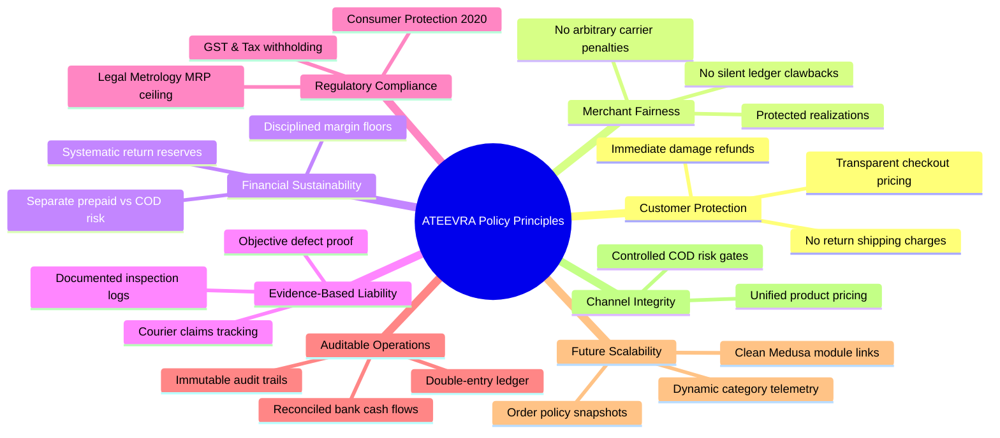
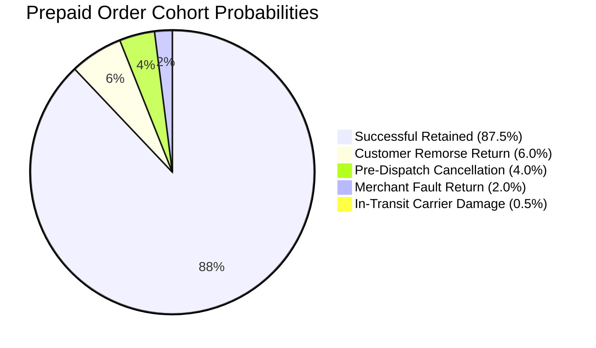
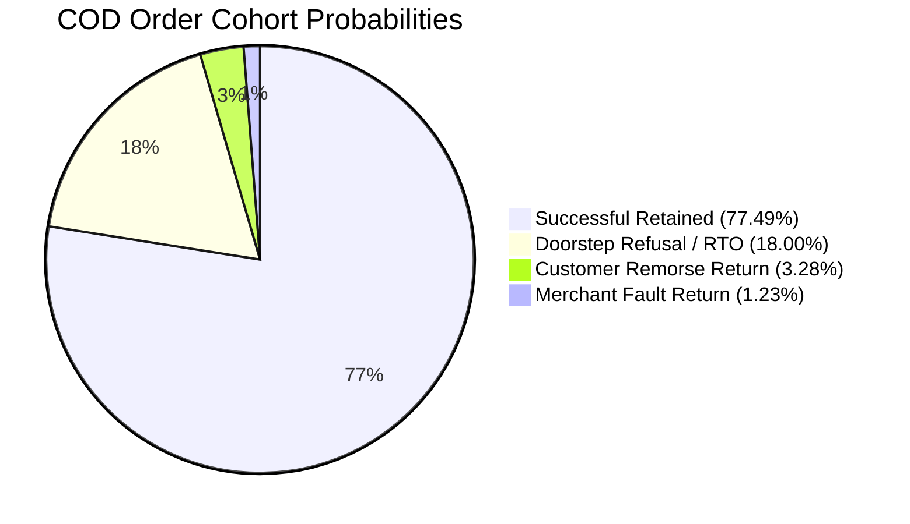
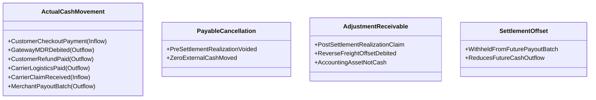

# ATEEVRA Marketplace — Central Financial & Commercial Policy Blueprint

**Document ID:** `BLU-M2-14-CENTRAL`  
**Governance Authority:** Platform Owner Approved Initial Baseline  
**Active Phase:** Phase M2-14 (Payments, Refunds, Returns and Exchanges)  
**Implementation Authorization Status:** `PLANNING ONLY — IMPLEMENTATION NOT AUTHORIZED`  
**Current Master Policy Version:** `1.0.0`  
**Effective Date:** 2026-11-03 (Mandatory Validation Gates Apply Before Production)  
**Parent Decision Register:** [`../M2-14-OWNER-DECISION-REGISTER.md`](../M2-14-OWNER-DECISION-REGISTER.md)  
**Supporting Analysis:** [`../decisions/M2-14-OD-02-REFUND-FINANCIAL-LIABILITY-ANALYSIS.md`](../decisions/M2-14-OD-02-REFUND-FINANCIAL-LIABILITY-ANALYSIS.md)  
**Master Audit & Completion Roadmap:**
- Master Inventory Audit: [`M2-14-OD-01-TO-OD-13-INVENTORY-AUDIT.md`](M2-14-OD-01-TO-OD-13-INVENTORY-AUDIT.md)
- Cross-Decision Dependency Map: [`M2-14-DEPENDENCY-MAP.md`](M2-14-DEPENDENCY-MAP.md)
- Master Documentation Status Matrix: [`M2-14-DOCUMENTATION-STATUS-MATRIX.md`](M2-14-DOCUMENTATION-STATUS-MATRIX.md)
- Completion Roadmap & Integration Architecture: [`M2-14-DOCUMENTATION-COMPLETION-ROADMAP.md`](M2-14-DOCUMENTATION-COMPLETION-ROADMAP.md)
- OD-01 Platform Fee Comparison: [`M2-14-OD-01-MARKETPLACE-PLATFORM-FEE-COMPARISON.md`](M2-14-OD-01-MARKETPLACE-PLATFORM-FEE-COMPARISON.md)
- OD-01 Financial Scenario Model: [`M2-14-OD-01-FINANCIAL-SCENARIO-MODEL.md`](M2-14-OD-01-FINANCIAL-SCENARIO-MODEL.md)
- OD-01 Legal & Tax Validation Checklist: [`M2-14-OD-01-LEGAL-ACCOUNTING-VALIDATION-CHECKLIST.md`](M2-14-OD-01-LEGAL-ACCOUNTING-VALIDATION-CHECKLIST.md)
- OD-14 Merchant Identity Privacy Policy: [`M2-14-OD-14-CUSTOMER-FACING-BRANDING-POLICY.md`](M2-14-OD-14-CUSTOMER-FACING-BRANDING-POLICY.md)
- OD-14 Legal Compliance Matrix: [`M2-14-OD-14-LEGAL-DISCLOSURE-AND-COMPLIANCE-MATRIX.md`](M2-14-OD-14-LEGAL-DISCLOSURE-AND-COMPLIANCE-MATRIX.md)
- OD-14 Information Access & RBAC Matrix: [`M2-14-OD-14-INFORMATION-ACCESS-AND-DISCLOSURE-MATRIX.md`](M2-14-OD-14-INFORMATION-ACCESS-AND-DISCLOSURE-MATRIX.md)
- OD-14 Implementation Traceability: [`M2-14-OD-14-IMPLEMENTATION-TRACEABILITY.md`](M2-14-OD-14-IMPLEMENTATION-TRACEABILITY.md)
- OD-14 Master Decision & Acceptance Report: [`M2-14-OD-14-OWNER-DECISION-AND-ACCEPTANCE-REPORT.md`](M2-14-OD-14-OWNER-DECISION-AND-ACCEPTANCE-REPORT.md)
- OD-15 Classification Matrix: [`M2-14-CANCELLATION-RETURN-RTO-CLASSIFICATION-MATRIX.md`](M2-14-CANCELLATION-RETURN-RTO-CLASSIFICATION-MATRIX.md)
- OD-02 Controlled Revision v1.1.0-PROPOSED: [`M2-14-OD-02-REVISED-POLICY-BASELINE-V1-1-0.md`](M2-14-OD-02-REVISED-POLICY-BASELINE-V1-1-0.md)
- OD-15 Revised Financial Model: [`M2-14-REVISED-FINANCIAL-MODEL-AND-UNIT-ECONOMICS.md`](M2-14-REVISED-FINANCIAL-MODEL-AND-UNIT-ECONOMICS.md)
- Policy Suite `POL-M2-14-01` to `POL-M2-14-06`: [`policies/`](policies/)

---

## 1. Executive Summary & Document Authority

This document constitutes the centralized, enterprise-grade **Master Financial and Commercial Policy Blueprint** for ATEEVRA's multi-merchant marketplace.

It establishes the binding source of truth for:
1. The **six initial owner-approved business policies** derived from Owner Decision OD-02 (`POL-OD-02-01` through `POL-OD-02-06`).
2. The **reconciled mathematical unit-economics and financial-reserve model** governing catalog pricing, cancellations, returns, courier damage, and cash collection.
3. The **double-entry ledger and financial recordkeeping requirements** separating actual cash movements from accounting receivables and settlement offsets.
4. The **immutable policy versioning and existing-order transition protection engine**.
5. The **technical implementation architecture boundaries** ensuring Medusa, Strapi, Next.js, PostgreSQL, and Redis maintain strict segregation of duties.
6. The **testing, validation, and professional gating framework** required before any production deployment.

### Document Authority & Conflict Resolution Invariant
This blueprint is the authoritative operational and commercial specification for all approved financial policies. Where conflicting statements exist across older advisory notes or draft handoffs, **this Blueprint and its dedicated policy documents govern absolutely**.

---

## 2. Core Business Objectives & Operating Principles

The ATEEVRA commercial policy architecture is constructed upon eight non-negotiable principles:



1. **Customer Protection:** Customers are never charged separate return-shipping fees for eligible returns. Immediate refunds or replacements are provided for transit damage.
2. **Merchant Fairness:** Merchant realization ($P_{\text{realization}}$) is honored for compliant fulfillments. Merchants are never arbitrarily debited for courier mishandling or banking charges without proven non-compliance.
3. **Platform Financial Sustainability:** All return, cancellation, and failed-delivery outlays are systematically budgeted into gross platform markup via category-specific risk reserves.
4. **Transparent Pricing & Refunds:** Product selling prices are unified across prepaid and COD payment methods. No surprise checkout surcharges.
5. **Evidence-Based Liability:** Financial chargebacks and settlement offsets require verifiable photographic, telephony, or weight evidence.
6. **Regulatory & Contractual Compliance:** Absolute adherence to Indian Legal Metrology (MRP hard ceiling), Consumer Protection (E-Commerce) Rules, 2020 (prohibition of price manipulation), and CGST Act, 2017.
7. **Auditable Financial Operations:** Complete separation of cash movements, merchant payable cancellations, adjustment receivables, and settlement offsets.
8. **Future Scalability:** Decoupled modular design allowing dynamic parameter recalibration without breaking historical order contracts.

---

## 3. Master Policy Register & Approval Status Summary

The platform owner has formally approved the following six initial policies as ATEEVRA's commercial baseline:

```
OWNER APPROVED — INITIAL POLICY BASELINE
```

| Policy ID | Policy Title | Approved Initial Policy Direction | Dedicated Specification File |
| :--- | :--- | :--- | :--- |
| **POL-OD-02-01** | Return-Cost Reserve Calibration | **Category-Specific Reserve:** Separate prepaid vs COD risk modeling; category-level reserve buffers; Day 1 telemetry; periodic actuarial reviews; no premature merchant risk penalties. | [`policies/OD-02-01-RETURN-COST-RESERVE.md`](policies/OD-02-01-RETURN-COST-RESERVE.md) |
| **POL-OD-02-02** | Prepaid vs COD Pricing | **Same Product Selling Price:** Identical $P_{\text{sell}}$ across payment rails; platform initially absorbs COD collection friction; no automatic customer COD fee; separate channel reporting. | [`policies/OD-02-02-PREPAID-COD-PRICING.md`](policies/OD-02-02-PREPAID-COD-PRICING.md) |
| **POL-OD-02-03** | Gateway Fee Allocation | **ATEEVRA Absorbs Gateway MDR Initially:** Platform absorbs non-refundable gateway fee on merchant-fault returns; zero seller MDR debits; realization kept separate from banking fees. | [`policies/OD-02-03-GATEWAY-FEE-ALLOCATION.md`](policies/OD-02-03-GATEWAY-FEE-ALLOCATION.md) |
| **POL-OD-02-04** | Courier Damage Liability | **Customer Protection with Evidence-Based Liability:** Customer refunded immediately; platform absorbs unresolved claims; no auto-seller debit on 3PL claim rejection; 6-milestone recovery lifecycle. | [`policies/OD-02-04-COURIER-DAMAGE-LIABILITY.md`](policies/OD-02-04-COURIER-DAMAGE-LIABILITY.md) |
| **POL-OD-02-05** | COD RTO Funding | **ATEEVRA Funds COD RTO Initially:** Platform absorbs -₹170 failed delivery expense; zero customer penalty; mandatory OTP verification, ₹5,000 order cap, and repeat-RTO safeguard. | [`policies/OD-02-05-COD-RTO-FUNDING.md`](policies/OD-02-05-COD-RTO-FUNDING.md) |
| **POL-OD-02-06** | Pricing-Bound Conflicts | **Never Silently Violate Merchant Pricing Limits:** Mandatory 4-step resolution order: (1) Compress markup, (2) Renegotiate realization, (3) Renegotiate $P_{\max}$, (4) Suspend SKU. Hard MRP ceiling. | [`policies/OD-02-06-PRICING-BOUND-CONFLICTS.md`](policies/OD-02-06-PRICING-BOUND-CONFLICTS.md) |

### Gating Conditions & Invariants
- **Initial Directional Approval Only:** Approval establishes business policy direction. Mandatory professional validations (Legal, Statutory CA, GST, Logistics SLAs) remain required before implementation.
- **Implementation NOT Authorized:** This document does NOT authorize writing application code, database migrations, or altering runtime configurations.
- **Preservation of Other OD Decisions:** OD-01 (Commercial Revenue Architecture) records the Project Owner's business model direction as a Marketplace Facilitation Platform (merchants as direct sellers of record; zero wholesale inventory buy-sell; platform fee structure pending selection and professional validation). Decisions OD-03 through OD-13 remain `PENDING OWNER DECISION` / `PENDING TAX/CA REVIEW`.

---

### 3.1 Proposed Policy Suite & Controlled Revision (OD-15 & OD-02 Baseline v1.1.0-PROPOSED)

```
OWNER DIRECTION RECORDED — PROPOSED POLICY REVISION (PENDING OWNER RATIFICATION)
```

Pursuant to Project Owner directions on Cancellation, Returns, RTO, and Merchant Accountability, the following master policy suite has been formulated and is pending formal owner ratification:

| Policy ID | Policy Title | Proposed Policy Directive | Dedicated Specification File |
| :--- | :--- | :--- | :--- |
| **POL-M2-14-01** | Customer Returns & Weight Reverse Shipping | Weight-dependent merchant reverse-shipping fee (₹30–₹165+); 100% full customer refund; 7-day default window; reweighing dispute SLA. | [`policies/POL-M2-14-01-CUSTOMER-RETURNS-AND-REVERSE-SHIPPING.md`](policies/POL-M2-14-01-CUSTOMER-RETURNS-AND-REVERSE-SHIPPING.md) |
| **POL-M2-14-02** | RTO & Failed Delivery Liability | Merchant pays ₹0 reverse shipping on genuine RTO; platform absorbs reverse freight via COD fees/reserve; packaging drag tracked internally. | [`policies/POL-M2-14-02-RTO-AND-FAILED-DELIVERY.md`](policies/POL-M2-14-02-RTO-AND-FAILED-DELIVERY.md) |
| **POL-M2-14-03** | Merchant Cancellation Penalty | Provisional ₹25 penalty per merchant cancellation; ₹0 platform facilitation fee earned; OCR metric impact; exception appeals. | [`policies/POL-M2-14-03-MERCHANT-CANCELLATION-PENALTY.md`](policies/POL-M2-14-03-MERCHANT-CANCELLATION-PENALTY.md) |
| **POL-M2-14-04** | Late Dispatch SLA & Penalty | Provisional ₹50 penalty for late dispatch; dispatch strictly verified by carrier electronic pickup scan; carrier delay exception. | [`policies/POL-M2-14-04-MERCHANT-DISPATCH-SLA-LATE-PENALTY.md`](policies/POL-M2-14-04-MERCHANT-DISPATCH-SLA-LATE-PENALTY.md) |
| **POL-M2-14-05** | Customer Pre-Dispatch Cancellation | Zero merchant penalty (₹0), zero reverse shipping (₹0); 100% full customer refund; zero account health impact. | [`policies/POL-M2-14-05-CUSTOMER-PRE-DISPATCH-CANCELLATION.md`](policies/POL-M2-14-05-CUSTOMER-PRE-DISPATCH-CANCELLATION.md) |
| **POL-M2-14-06** | Account Health & Progressive Enforcement | 8 KPIs tracked across 5 progressive stages (Warning -> Reserve Hold -> Suppression -> Order Cap -> Deboarding); 5-day appeal window. | [`policies/POL-M2-14-06-MERCHANT-ACCOUNT-HEALTH-AND-ENFORCEMENT.md`](policies/POL-M2-14-06-MERCHANT-ACCOUNT-HEALTH-AND-ENFORCEMENT.md) |

- **Controlled Revision Document:** [`M2-14-OD-02-REVISED-POLICY-BASELINE-V1-1-0.md`](M2-14-OD-02-REVISED-POLICY-BASELINE-V1-1-0.md)
- **Classification Matrix:** [`M2-14-CANCELLATION-RETURN-RTO-CLASSIFICATION-MATRIX.md`](M2-14-CANCELLATION-RETURN-RTO-CLASSIFICATION-MATRIX.md)
- **Revised Unit Economics:** [`M2-14-REVISED-FINANCIAL-MODEL-AND-UNIT-ECONOMICS.md`](M2-14-REVISED-FINANCIAL-MODEL-AND-UNIT-ECONOMICS.md)

---

## 4. Reconciled Financial Calculation & Unit Economics Engine

To maintain mathematical precision and prevent double-counting across financial projections, the pricing and risk engine enforces strict definitions.

### A. Core Mathematical Variables & Baseline Assumptions

| Parameter / Variable | Mathematical Symbol | Prepaid Channel Baseline | Cash on Delivery (COD) Baseline | Verified Status / Basis |
| :--- | :---: | :---: | :---: | :--- |
| **Customer Shelf Selling Price** | $P_{\text{sell}}$ | **₹1,000.00** | **₹1,000.00** | Unified shelf price invariant |
| **Fixed Merchant Realization** | $P_{\text{realization}}$ | **₹800.00** | **₹800.00** | Proposed OD-01 Mode 1 contract |
| **Gross Platform Markup** | $M_{\text{gross}}$ | **+₹200.00** | **+₹200.00** | $P_{\text{sell}} - P_{\text{realization}}$ |
| **Payment Gateway MDR (~2% + GST)** | $C_{\text{gateway}}$ | **₹23.60** | **₹0.00** | Sunk upon electronic capture |
| **3PL Forward Shipping Freight** | $F$ | **₹70.00** | **₹70.00** | Standard 500g surface express |
| **3PL COD Cash Collection Fee** | $C_{\text{cod}}$ | **₹0.00** | **₹40.00** | Waived on doorstep RTO |
| **3PL Doorstep Delivery Attempt Fee** | $A_{\text{attempt}}$ | **₹0.00** | **₹30.00** | Incurred on failed doorstep delivery |
| **3PL RTO Return Freight** | $R_{\text{rto}}$ | **₹0.00** | **₹70.00** | Incurred on failed delivery return |
| **3PL Reverse Return Freight** | $R$ | **₹90.00** | **₹90.00** | Customer post-delivery return |
| **Electronic IMPS Payout Rail Fee** | $C_{\text{rail}}$ | **₹0.00** | **₹3.40** (base) | Alt 1: ₹3.40 gross; Alt 2: ₹4.012 gross |
| **Direct Variable Operating Costs** | $C_{\text{variable}}$ | **₹93.60** | **₹110.00** | Retained successful delivery |
| **Baseline Retained Contribution** | $C_{\text{successful}}$ | **+₹106.40** | **+₹90.00** | $M_{\text{gross}} - C_{\text{variable}}$ |

### B. Mutually Exclusive Probability Trees & Unit Outcomes

#### 1. Prepaid Probability Tree (Sum of Probabilities = 1.0000 / 100.0%)



- **Node 1: Successful Retained Order ($P = 0.8750$ / 87.5%):**  
  $$C_1 = +1,000.00 - 800.00 - 70.00 - 23.60 = \mathbf{+₹106.40} \quad (\text{Weighted} = \mathbf{+₹93.1000})$$
- **Node 2: Pre-Dispatch Cancellation ($P = 0.0400$ / 4.0%):**  
  $$C_2 = +1,000.00 - 1,000.00 - 16.52 = \mathbf{-₹16.52} \quad (\text{Weighted} = \mathbf{-₹0.6608})$$  
  *(Customer refunded ₹1,000; merchant payable canceled; shipping saved; Razorpay retains ₹14 base fee + 18% GST = ₹16.52 sunk).*
- **Node 3: In-Transit Courier Damage — Case 3.B.2 ($P = 0.0050$ / 0.5%):**  
  $C_3 = +1,000.00 - 1,000.00 - 70.00 - 23.60 - 800.00 - 90.00 + 360.00 = \mathbf{-₹623.60} \quad (\text{Weighted} = \mathbf{-₹3.1180})$  
  *(Customer refunded ₹1,000; compliant merchant protected & paid ₹800; forward shipping ₹70 & MDR ₹23.60 sunk; reverse salvage freight ₹90 paid; carrier reimburses 60% expected claim = +₹360; Net cash impact = -₹623.60 before original payment).*
- **Node 4: Post-Delivery Merchant-Fault Return ($P = 0.0200$ / 2.0%):**  
  $$C_4 = +1,000.00 - 1,000.00 - 70.00 - 23.60 - 90.00 + 81.00 = \mathbf{-₹102.60} \quad (\text{Weighted} = \mathbf{-₹2.0520})$$  
  *(Customer refunded ₹1,000; merchant payable canceled; forward freight ₹70 & gateway MDR ₹23.60 absorbed by ATEEVRA; reverse freight ₹90 paid; merchant debited 90% reverse freight offset = +₹81).*
- **Node 5: Post-Delivery Remorse Return ($P = 0.0600$ / 6.0%):**  
  $$C_5 = +1,000.00 - 1,000.00 - 70.00 - 23.60 - 90.00 = \mathbf{-₹183.60} \quad (\text{Weighted} = \mathbf{-₹11.0160})$$  
  *(Customer refunded ₹1,000; merchant payable canceled; ATEEVRA absorbs forward freight ₹70, gateway MDR ₹23.60, and reverse freight ₹90).*

$\mathbb{E}[\text{Prepaid Contribution}] = +93.1000 - 0.6608 - 3.1180 - 2.0520 - 11.0160 = \mathbf{+₹76.2532 \approx +₹76.25 \text{ per placed order}}$

#### 2. Cash on Delivery (COD) Probability Tree (Sum of Probabilities = 1.0000 / 100.0%)



- **Node 1: Successful Retained Delivery ($P = 0.7749$ / 77.49%):**  
  $$C_1 = +1,000.00 - 800.00 - 70.00 - 40.00 = \mathbf{+₹90.00} \quad (\text{Weighted} = \mathbf{+₹69.7410})$$
- **Node 2: Doorstep Customer Refusal / RTO ($P = 0.1800$ / 18.00%):**  
  $$C_2 = 0 - 70.00 - 30.00 - 70.00 = \mathbf{-₹170.00} \quad (\text{Weighted} = \mathbf{-₹30.6000})$$  
  *(Zero cash collected; zero refund; merchant payable canceled; goods restocked; ATEEVRA absorbs forward freight ₹70, attempt fee ₹30, and RTO freight ₹70).*
- **Node 3: Post-Delivery Remorse Return ($P = 0.0328$ / 3.28%):**  
  $$C_3 = +1,000.00 - 1,000.00 - 70.00 - 40.00 - 90.00 - 3.40 = \mathbf{-₹203.40} \quad (\text{Weighted} = \mathbf{-₹6.6715})$$  
  *(Customer refunded ₹1,000 electronically via IMPS; merchant payable canceled; forward freight ₹70, COD collection fee ₹40, reverse freight ₹90, and payout rail fee ₹3.40 absorbed by ATEEVRA).*
- **Node 4: Post-Delivery Merchant Fault ($P = 0.0123$ / 1.23%):**  
  $$C_4 = -203.40 + 81.00 = \mathbf{-₹122.40} \quad (\text{Weighted} = \mathbf{-₹1.5055})$$  
  *(Outlays identical to Node 3; merchant debited 90% reverse freight offset = +₹81).*

$$\mathbb{E}[\text{COD Contribution}] = +69.7410 - 30.6000 - 6.6715 - 1.5055 = \mathbf{+₹30.96 \text{ per placed order}}$$

### C. The Three Distinct Measurement Metrics (No Double-Counting)

1. **Measurement A: Net Incremental Incident Expense:**  
   Out-of-pocket costs that would NOT have occurred had the order completed successfully (gross incident outlays minus avoided forward freight):
   - *Prepaid Model:*  
     $\begin{aligned}
     \text{Net Incremental Incident Expense} &= [0.06 \times ₹90.00 \text{ (remorse)} + 0.02 \times ₹9.00 \text{ (merchant-fault freight uncollected)} \\
     &\quad + 0.005 \times ₹530.00 \text{ (net damage outlay: ₹800 payout + ₹90 salvage - ₹360 recovery)}] \\
     &\quad - [0.04 \times ₹70.00 \text{ (cancellation avoided forward freight)}] \\
     &= ₹8.2300 - ₹2.8000 = \mathbf{+₹5.4300 \approx +₹5.43 \text{ per placed order}}
     \end{aligned}$  
     *(Decomposition: Gross incident outlays = ₹8.23; Avoided forward freight = ₹2.80; Net incremental incident expense = ₹5.43. Cancellation retained MDR is excluded here because it is already captured within baseline fulfillment MDR and Measurement B lost contribution).*  
   - *COD Model:* $0.18(100.00) + 0.0328(93.40) + 0.0123(12.40) = \mathbf{₹21.22 \text{ per placed order}}$.
2. **Probability-Weighted Gross Cash Drain:**  
   Total cash flowing out across all failed orders, bundling sunk forward baseline fulfillment:
   - *Prepaid Model:* $0.04(16.52) + 0.005(623.60) + 0.02(102.60) + 0.06(183.60) = \mathbf{₹16.85 \text{ per placed order}}$.  
     *(Reconciled difference of ₹11.42 represents sunk baseline fulfillment costs: cancellation gateway MDR ₹0.66, avoided forward freight ₹2.80, and delivered-order baseline costs ₹7.96).*
   - *COD Model:* $0.18(170.00) + 0.0328(203.40) + 0.0123(122.40) = \mathbf{₹38.78 \text{ per placed order}}$.  
     *(Reconciled difference of ₹17.56 represents baseline fulfillment costs: $0.18 \times 70 + 0.0451 \times 110 = ₹17.561$).*
3. **Measurement B: Expected Lost Contribution:**  
   Reduction from baseline retained contribution:
   - *Prepaid Model:* $0.04(122.92) + 0.005(730.00) + 0.02(209.00) + 0.06(290.00) = \mathbf{₹30.15 \text{ per placed order}}$.
   - *COD Model:* $0.18(260.00) + 0.0328(293.40) + 0.0123(212.40) = \mathbf{₹59.04 \text{ per placed order}}$.

### D. Expected Contribution Equivalence Invariant
The pricing model verifies that Method A and Method B produce identical results to the exact penny:
$$\mathbb{E}[\text{Contribution}] \equiv C_{\text{successful}} - \mathbb{E}[\text{Lost Contribution}]$$
- *Prepaid:* $+106.40 - 30.15 = \mathbf{+₹76.25 \text{ per placed order}}$.
- *COD:* $+90.00 - 59.04 = \mathbf{+₹30.96 \text{ per placed order}}$.

---

## 5. Comprehensive Tax Treatment & GST Sensitivity of COD Refund-Rail Fees

To ensure complete accounting and tax transparency, electronic refund fees for COD customers (via IMPS/UPI payout rails) are analyzed across all four statutory combinations:

| Dimension / Case | Alt 1, Case A (Inclusive Fee, Sunk GST — Baseline) | Alt 1, Case B (Inclusive Fee, Recoverable ITC — Upside) | Alt 2, Case A (Exclusive Fee, Recoverable ITC — Baseline Model) | Alt 2, Case B (Exclusive Fee, Sunk GST — Downside) |
| :--- | :---: | :---: | :---: | :---: |
| **Contractual Fee Basis** | Inclusive of GST | Inclusive of GST | Pre-GST Base Fee | Pre-GST Base Fee |
| **Base Service Fee** | ₹2.881 | ₹2.881 | ₹3.400 | ₹3.400 |
| **GST Charged (18%)** | ₹0.519 *(embedded)* | ₹0.519 *(embedded)* | ₹0.612 *(billed on top)* | ₹0.612 *(billed on top)* |
| **Gross Cash Outflow** | **₹3.400** | **₹3.400** | **₹4.012** | **₹4.012** |
| **Eligible Recoverable ITC** | ₹0.000 *(sunk)* | **₹0.519** *(eligible)* | **₹0.612** *(eligible)* | ₹0.000 *(sunk)* |
| **Net Economic Expense** | **₹3.400** | **₹2.881** | **₹3.400** | **₹4.012** |
| **Expected COD Contribution** | **+₹30.96396 $\approx$ +₹30.96** | **+₹30.98737 $\approx$ +₹30.99** | **+₹30.96396 $\approx$ +₹30.96** | **+₹30.93636 $\approx$ +₹30.94** |
| **Portfolio Delta to Baseline**| Baseline ($\pm$₹0.000) | **+₹0.0234** per order | Baseline ($\pm$₹0.000) | **-₹0.0276** per order |

> [!WARNING]
> **Input Tax Credit Statutory Requirement:**  
> ITC is never automatically available. It requires a valid Section 31 tax invoice bearing ATEEVRA's GSTIN, reflection in GSTR-2B under Section 16(2), non-applicability of Section 17(5) blocked credit rules, and formal sign-off by ATEEVRA's statutory auditors and tax counsel.

---

## 6. Financial Recordkeeping & Ledger Requirements

To prevent commingling of cash and accounting accruals, the future settlement engine must enforce double-entry bookkeeping across four distinct ledger categories:



### Mandatory Rules of Financial Distinction:
1. **Actual Cash Movement:** Real cash transfers through banking/gateway rails.
2. **Merchant Payable Cancellation:** Internal database ledger voidance of pending $P_{\text{realization}}$. **Zero cash moves.**
3. **Merchant Adjustment Receivable:** Accounting ledger asset logging funds owed to ATEEVRA. **This is NOT cash.**
4. **Successful Future Settlement Offset:** Operational withholding of an existing receivable from future earned settlement batches. **Offsets strictly reduce future cash payout outflows; they are NEVER immediate cash inflows.**
5. **Uncollectible Bad Debt Write-Off:** Permanent economic derecognition of a receivable when a merchant has zero future sales or defaults.

---

## 7. Policy Lifecycle, Versioning & Change Control Governance

The marketplace enforces an 11-stage policy lifecycle:

$$\text{DRAFT} \longrightarrow \text{OWNER REVIEW} \longrightarrow \text{OWNER APPROVED} \longrightarrow \text{VALIDATION} \longrightarrow \text{IMPLEMENTATION AUTHORIZED} \longrightarrow \text{IMPLEMENTED} \longrightarrow \text{TESTED} \longrightarrow \text{RELEASED} \longrightarrow \text{ACTIVE} \longrightarrow \text{UNDER REVIEW} \longrightarrow \text{REVISED / RETIRED}$$

### Governance Invariants:
1. **Semantic Versioning (`vMAJOR.MINOR.PATCH`):**  
   - MAJOR: Structural liability shifts (e.g. customer COD fees).
   - MINOR: Parameter recalibrations (e.g. reserve % adjustments).
   - PATCH: Textual/drafting clarifications.
2. **Immutable Historical Versions:**  
   Superseded policy files are never overwritten. Historical versions are durably archived.
3. **Formal Change Request (CR) Protocol:**  
   Revising an active policy requires a documented CR with business justification, financial impact modeling, legal/tax sign-offs, and platform owner approval.

---

## 8. Existing-Order & Transition Protection Engine

To guarantee legal compliance under the Indian Contract Act and protect consumer rights:

### The Order Placement Snapshot Rule
- When an order is placed, an immutable JSON snapshot of all active policy versions and pricing parameters is permanently serialized into the order record in PostgreSQL.
- **Evaluation Rule:** All subsequent returns, cancellations, refunds, seller adjustments, and courier claims for that order MUST be evaluated strictly against the order's historical policy snapshot.
- **No Retroactive Mutation:** Deploying a newer policy version (e.g. Policy v2.0.0) never mutates the rules governing orders placed under Policy v1.0.0.

---

## 9. Technical Implementation Blueprint & System Boundaries

### Strict Architectural Responsibilities:

| System / Layer | Primary Architectural Role | Financial & Commercial Policy Responsibilities | Prohibited Actions |
| :--- | :--- | :--- | :--- |
| **Medusa Commerce Engine** (`apps/backend`) | Authoritative commerce system of record. | Owns carts, orders, line items, fulfillments, returns, refunds, payment sessions, and module links (`merchant_order_item`, `merchant_product`). | Never delegate commerce state or payment authorizations to Strapi or Redis. |
| **Strapi Headless CMS** (`apps/cms`) | Editorial and marketing content layer. | Serves marketing landing pages, policy FAQs, return guidelines, and SEO copy. | **Never store orders, transactions, pricing math, or merchant settlement data.** |
| **Storefront & Portals** (`apps/storefront`) | Presentation and selective BFF proxy. | Next.js App Router renders customer checkout, merchant portal, and Super Admin dashboards. Enforces UI price invariant. | Never execute direct database queries (`no pg in storefront`). |
| **PostgreSQL Database** (`medusa_db`) | Durable ACID persistence layer. | Stores tables for orders, line items, policy snapshots, settlement ledgers, carrier claims, and advisory locks. | Never allow unindexed cross-merchant table scans. |
| **Redis Cache** | Ephemeral runtime infrastructure. | Session caching (`cache:*`), API rate limiting (`ratelimit:*`), and temporary OTP verification (`otp:*`). | **NEVER treat Redis as a durable financial ledger or transaction source of truth.** |

---

## 10. Testing, Quality Assurance & Acceptance Framework

Before Phase M2-14 can be released to production, the engineering and QA teams must execute the following test suites (detailed in [`POLICY-VALIDATION-AND-ACCEPTANCE.md`](POLICY-VALIDATION-AND-ACCEPTANCE.md)):

1. **Financial Arithmetic Suite:** Reconciles $+₹106.40$ (Prepaid) and $+₹90.00$ (COD) baseline retained contributions; verifies Expected Contribution of **+₹76.25** (Prepaid) and **+₹30.96** (COD) across both Method A and Method B.
2. **Pricing-Bound & Hard Ceiling Suite:** Verifies $P_{\text{sell}} \le P_{\max} \le \text{MRP}$ in 100% of synthetic test cases; validates 4-step resolution hierarchy.
3. **Policy Snapshot Transition Suite:** Validates that Order 1 placed under Policy v1.0.0 continues using v1.0.0 rules after Policy v2.0.0 is activated.
4. **Idempotency & Concurrency Suite:** Tests duplicate Razorpay refund webhooks and PostgreSQL advisory locks on settlement batch creation.

---

## 11. Professional Validation Dependencies & Sign-Off Gates

Phase M2-14 remains in **`PLANNING ONLY`** status until the following external sign-offs are formally executed and filed:

- [ ] **Gate 1: Legal Counsel Opinion Filed** (Consumer Protection Rules, Rule 5(3)(b) price manipulation, Legal Metrology MRP compliance, Merchant Agreement terms).
- [ ] **Gate 2: Statutory Auditor / CA Memorandum Signed** (Managerial reserve accounting, bad-debt write-offs, payable cancellations).
- [ ] **Gate 3: Tax & GST Advisory Opinion Filed** (Payment gateway MDR SAC 997159, Input Tax Credit eligibility under Section 16(2) and Section 31, GST TCS / IT TDS coordination).
- [ ] **Gate 4: 3PL & Payment Aggregator MSAs Countersigned** (Carrier transit damage caps, RTO billing rates, Razorpay refund terms).

---

## 12. Requirement Completeness Matrix

This matrix verifies that all requirements stipulated in the master prompt are comprehensively addressed:

| Master Instruction Requirement | Blueprint Section / Dedicated Document | Compliance Status |
| :--- | :--- | :---: |
| **1. Inspect Existing Documentation** | Section 1, Section 9; Section 1.1 of Traceability | **COMPLETED** |
| **2. Record 6 Owner-Approved Policies** | Section 3; Dedicated files `POL-OD-02-01` to `POL-OD-02-06` | **COMPLETED** |
| **3. Approval Status & Governance Conditions** | Section 3, Section 7; `POLICY-REGISTER.md` | **COMPLETED** |
| **4. Central Blueprint Directory Structure** | `docs/mvp2/m2-14/blueprint/` (6 policies + 5 core docs) | **COMPLETED** |
| **5.A. Business Objectives & Principles** | Section 2 (8 core principles documented & diagrammed) | **COMPLETED** |
| **5.B. Complete Policy Definitions** | `policies/OD-02-01` through `OD-02-06` (All 18 fields per doc) | **COMPLETED** |
| **5.C. Financial Calculation Model** | Section 4, Section 5; OD-02 Reconciled Scenarios 1–6 | **COMPLETED** |
| **5.D. Financial Recordkeeping & Ledger** | Section 6; Section 4 of Traceability | **COMPLETED** |
| **5.E. Policy Lifecycle & Versioning** | Section 7; `POLICY-CHANGELOG.md` | **COMPLETED** |
| **5.F. Existing-Order & Transition Protection** | Section 8; Section 3 of `POLICY-CHANGELOG.md` | **COMPLETED** |
| **5.G. Technical Implementation Blueprint** | Section 9; `POLICY-IMPLEMENTATION-TRACEABILITY.md` | **COMPLETED** |
| **5.H. Testing & Acceptance Blueprint** | Section 10; `POLICY-VALIDATION-AND-ACCEPTANCE.md` | **COMPLETED** |
| **6. Source-of-Truth Hierarchy Rules** | Section 1; Section 5 of `POLICY-REGISTER.md` | **COMPLETED** |
| **7. Completeness & Quality Audit** | Section 11, Section 12; Final Report Matrix | **COMPLETED** |
| **8. Git & Repository Safety** | Clean Git status, preserved `tsconfig.tsbuildinfo`, no commits | **COMPLETED** |
