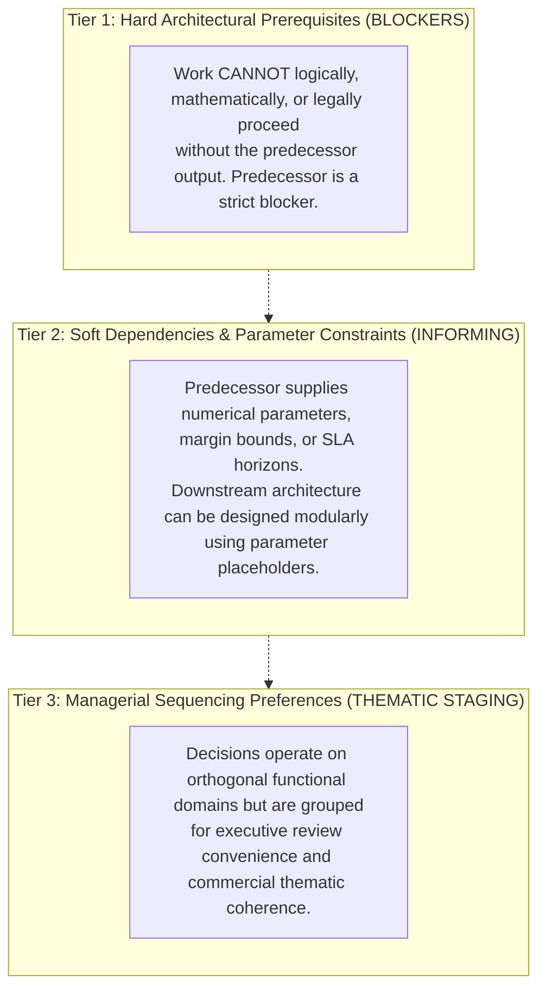

# ATEEVRA Phase M2-14 — Master Cross-Decision Dependency Audit Review & Calibration

**Document ID:** `REV-M2-14-DEPENDENCY-AUDIT`  
**Governance Authority:** Phase M2-14 Central Policy Blueprint & Master Decision Register  
**Scope:** Rigorous Calibration of Cross-Decision Dependencies, Elimination of Overstated Prerequisites, Settlement Formula Legal/Operational Validation, and Dependency Taxonomy for OD-01 through OD-13  
**Audit Execution Mode:** STRICTLY READ-ONLY AUDIT & GOVERNANCE PLANNING  
**Active Phase:** Phase M2-14 (Payments, Refunds, Returns and Exchanges)  
**Implementation Authorization Status:** `PLANNING ONLY — IMPLEMENTATION NOT AUTHORIZED`  
**Preserved Baseline:** OD-02 Version 1.0.0 (`OWNER APPROVED — INITIAL POLICY BASELINE`)  
**Companion Documents:**
- [`docs/mvp2/m2-14/blueprint/M2-14-DEPENDENCY-MAP.md`](file:///C:/Users/Shubham/OneDrive/Desktop/ecom_mvp/docs/mvp2/m2-14/blueprint/M2-14-DEPENDENCY-MAP.md)
- [`docs/mvp2/m2-14/blueprint/M2-14-DOCUMENTATION-STATUS-MATRIX.md`](file:///C:/Users/Shubham/OneDrive/Desktop/ecom_mvp/docs/mvp2/m2-14/blueprint/M2-14-DOCUMENTATION-STATUS-MATRIX.md)
- [`docs/mvp2/m2-14/blueprint/M2-14-OD-05-TAX-ASSUMPTION-ERRATA-AND-VALIDATION.md`](file:///C:/Users/Shubham/OneDrive/Desktop/ecom_mvp/docs/mvp2/m2-14/blueprint/M2-14-OD-05-TAX-ASSUMPTION-ERRATA-AND-VALIDATION.md)
- [`docs/mvp2/m2-14/M2-14-OWNER-DECISION-REGISTER.md`](file:///C:/Users/Shubham/OneDrive/Desktop/ecom_mvp/docs/mvp2/m2-14/M2-14-OWNER-DECISION-REGISTER.md)

---

## 1. Executive Summary & Purpose of Review

A critical post-audit review of [`M2-14-DEPENDENCY-MAP.md`](file:///C:/Users/Shubham/OneDrive/Desktop/ecom_mvp/docs/mvp2/m2-14/blueprint/M2-14-DEPENDENCY-MAP.md) revealed that several cross-decision relationships were categorized with excessive rigidity, conflating **hard technical blockers** with **soft economic parameter couplings** or **managerial sequencing preferences**. 

In professional marketplace systems engineering:
- Overstating dependencies creates artificial project bottlenecks, paralyzing the formulation of independent policies and technical schemas.
- Understating dependencies creates circular references and financial deficit leaks.

This document performs an exhaustive, rigorous calibration of all inter-decision dependencies across OD-01 through OD-13, establishing a definitive **Three-Tier Dependency Taxonomy**, correcting overstated prerequisites, validating the legal and operational realities of merchant settlement escrow, and updating the master dependency matrix.

---

## 2. Three-Tier Dependency Classification Taxonomy

To prevent ambiguity, every inter-decision relationship in Phase M2-14 must be classified strictly into one of three distinct tiers:

1. **Tier 1: Hard Architectural Prerequisite (`HARD_DEP`):**
   - The downstream policy cannot be drafted, its mathematical formulas cannot be expressed, or its software schema cannot be constructed without the predecessor decision being finalized.
   - *Example:* Reverse inspection gating (OD-11) is a hard prerequisite for replacement dispatch (OD-12).
2. **Tier 2: Soft Dependency & Parameter Constraint (`SOFT_DEP` / `INF`):**
   - The downstream policy operates on an independent architectural domain, but consumes numerical thresholds, margin pools, or operational durations established by the predecessor. The downstream model can be designed with parameterized variables (e.g., $T_{\text{return}}$, $M_{\text{markup}}$) and calibrated once the predecessor is settled.
   - *Example:* OD-01 platform markup bounds OD-03 promotional budget capacity.
3. **Tier 3: Managerial Sequencing Preference (`SEQ_PREF`):**
   - No direct functional, mathematical, or architectural coupling exists, but evaluating the decisions concurrently provides thematic clarity to the Project Owner.
   - *Example:* Reviewing OD-01 (product pricing) and OD-04 (shipping revenue) in Stage 1.

---

## 3. Detailed Review & Calibration of Specific Decisions

### 3.1. Review Point 1: Is OD-01 Genuinely a Hard Prerequisite for OD-03 and OD-04?

#### Audit Calibration & Finding: **OVERSTATED — DOWNGRADE TO SOFT DEPENDENCY / SEQUENCING PREFERENCE**

1. **OD-01 $\rightarrow$ OD-03 (Coupon & Promotional Discount Funding):**
   - *Previous Assessment:* Claimed as a hard direct blocker (`DEP`).
   - *Operational & Technical Reality:*
     - The business rules governing coupon issuance, promotional code validation, cart item discount apportionment (pro-rata distribution across items), and coupon forfeiture on returns are **independent functional mechanisms**.
     - What OD-01 provides to OD-03 is the **funding source and budget ceiling**: In Mode 1 wholesale markup, promotions funded by the platform cannot exceed aggregate markup ($P_{\text{sell}} - P_{\text{realization}}$). If ATEEVRA were to choose a commission model, coupons would consume commission revenue.
     - Consequently, OD-03 can be fully designed, its allocation algorithms specified, and its database schema constructed using parameterized margin checks.
     - *Calibration:* OD-01 is a **Soft Economic Dependency (`SOFT_DEP`)** to OD-03, not a hard blocker.
2. **OD-01 $\rightarrow$ OD-04 (Multi-Vendor Split Shipping Revenue Allocation):**
   - *Previous Assessment:* Claimed as a hard direct blocker (`DEP`).
   - *Operational & Technical Reality:*
     - Shipping revenue allocation governs whether customer shipping fees ($S_{\text{cust}}$) are retained by the platform, passed through to 3PL logistics carriers, or credited to merchants.
     - Under Phase M2-13 and ADR-001, ATEEVRA directly contracts 3PL carriers (Delhivery, Shiprocket). The decision to pool shipping revenue and absorb carrier split costs is a **pure logistics commercial policy**, completely orthogonal to whether catalog product pricing uses wholesale markup or commission.
     - While OD-01's product markup serves as the economic buffer absorbing multi-vendor split-shipping deficits, this is a financial elasticity constraint, not an architectural prerequisite.
     - *Calibration:* OD-01 is a **Managerial Sequencing Preference (`SEQ_PREF`)** to OD-04, not a hard blocker.

---

### 3.2. Review Point 2: Must OD-08 Precede OD-07, and Is the Proposed Settlement Formula Valid?

#### Audit Calibration & Finding: **OVERSTATED AS AN ABSOLUTE PRECONDITION — RESTRUCTURED AS RISK HORIZON CONSTRAINT**

1. **Escrow Hold Duration vs. Operational Settlement Cycles:**
   - *Previous Assessment:* Asserted that merchant settlement ($T_{\text{settle}}$) **must strictly exceed** the return window duration ($T_{\text{settle}} \ge T_{\text{delivery}} + T_{\text{return}} + T_{\text{grace}}$) as an inviolable universal law.
   - *Operational & Industry Reality:*
     - In global and Indian e-commerce marketplaces (Amazon, Flipkart, Myntra), merchant settlement cycles routinely operate on rolling schedules (e.g., $D+7$, $D+10$, or weekly disbursement). When return windows are 14 or 30 days, payouts **regularly precede** the full expiration of the customer return window!
     - Marketplaces bridge this liquidity risk through **rolling reserves** (e.g., holding 5–10% of gross payout for 30–60 days), **subsequent settlement offsets** (deducting return refunds from future sales), and **contractual merchant indemnity/clawback terms**.
     - If ATEEVRA strictly delays merchant payout until $T_{\text{delivery}} + 30\text{ days} + \text{grace}$, merchant working capital is frozen for 35–45 days, causing severe merchant dissatisfaction and vendor churn.
2. **Regulatory Constraints (RBI PA/PG Guidelines):**
   - Under the Reserve Bank of India (RBI) Guidelines for Regulation of Payment Aggregators and Payment Gateways:
     - Payment Aggregators maintaining nodal escrow accounts are subject to strict transfer timelines (typically $T+1$ or $T+2$ business days following confirmation of dispatch or service completion, unless a permissible contractual dispute hold is established).
     - Indefinite retention of merchant funds in escrow without specific contractual and risk-based justification raises regulatory scrutiny.
3. **Calibrated Operational Settlement Engine Formula:**
   The previously documented settlement formula was oversimplified. A legally compliant, operationally robust merchant settlement engine must calculate net payable as:

$$\begin{aligned}
\text{Net Merchant Payout} = &\sum P_{\text{realization}} \quad \text{(Delivered Order Items in Settlement Cycle)} \\
&- \text{Statutory TCS (Sec 52 CGST Act: 0.5\%)} \\
&- \text{Statutory TDS (Sec 194-O IT Act: 0.1\%, subject to ₹5L Individual threshold)} \\
&- \text{Merchant-Fault Return Charges (Forward + Reverse Freight, per OD-02)} \\
&- \text{Merchant Packaging / Defect Penalties (per POL-OD-02-04)} \\
&- \text{Rolling Risk Reserve Contribution (e.g., 5\% for High-Risk / New Merchants)} \\
&+ \text{Rolling Risk Reserve Release (Maturing from Previous Cycles)} \\
&- \text{Clawback Offsets from Previous Unsettled Returns}
\end{aligned}$$

- *Calibration:* OD-08 establishes the **Dispute & Return Exposure Horizon**. It informs OD-07's risk-hold parameter, but OD-07's settlement engine architecture, ledger schemas, and payout mechanisms can be designed modularly. OD-08 is a **Soft Risk Constraint (`SOFT_DEP`)**, not an absolute technical blocker.

---

### 3.3. Review Point 3: Must OD-06 Precede OD-09?

#### Audit Calibration & Finding: **OVERSTATED AT PRIMITIVE LEVEL — VALID ONLY AT ORCHESTRATION LEVEL**

1. **Separation of Primitive from Workflow Orchestration:**
   - *Previous Assessment:* Claimed OD-06 was an absolute blocker (`DEP`) for OD-09.
   - *Technical Reality:*
     - OD-09 specifies the **Inventory Reservation & Expiration Primitive** (`reserveStock(variantId, quantity, ttlSeconds)`).
     - At the database and cache level (PostgreSQL row locks / Redis keys), an inventory reservation primitive operates completely agnostic of price deltas. It locks inventory units for a specified TTL regardless of whether the customer is swapping for an identical price item or a more expensive variant.
     - OD-06 (Equal-Value Swaps vs Variable-Price Deltas) governs the **Storefront Checkout Orchestration Flow**:
       - Under Equal-Value Swaps ($\Delta \text{Price} \equiv 0$): Reservation is created immediately upon customer self-service submission without differential billing.
       - Under Variable-Price Exchanges ($\Delta \text{Price} \ne 0$): A differential payment authorization / partial refund checkout session must be orchestrated either immediately before or concurrently with the reservation.
2. *Calibration:* The core technical specification for OD-09 inventory reservation can be authored independently. OD-06 is a **Soft Functional Workflow Constraint (`SOFT_DEP`)** governing the calling context of OD-09, not an absolute architectural blocker.

---

### 3.4. Review Point 4: Rigorous Distinction of OD-02 Approval vs Implementation Readiness

To maintain immaculate governance integrity:
1. **The Policy Substance of OD-02 is Approved:**
   The six initial policies ([`POL-OD-02-01`](file:///C:/Users/Shubham/OneDrive/Desktop/ecom_mvp/docs/mvp2/m2-14/blueprint/policies/OD-02-01-RETURN-COST-RESERVE.md) through [`POL-OD-02-06`](file:///C:/Users/Shubham/OneDrive/Desktop/ecom_mvp/docs/mvp2/m2-14/blueprint/policies/OD-02-06-PRICING-BOUND-CONFLICTS.md)) represent the **Owner-Approved Initial Policy Baseline** at Version `1.0.0`. Their business rules, liability allocations, and reserve targets are binding.
2. **Implementation Readiness is 100% BLOCKED:**
   Software implementation readiness requires that:
   - Production Prisma schemas, foreign keys, and indexes are defined;
   - REST API contracts and Kafka event schemas are specified;
   - Comprehensive automated unit and integration test suites are written;
   - Mandatory Chartered Accountant memorandum regarding Section 34 GST Credit Notes and carrier damage write-offs is on file; and
   - The Project Owner officially transitions Phase M2-14 execution from `PLANNING ONLY` to `IMPLEMENTATION AUTHORIZED`.
3. *Governance Invariant:* An approved business decision is a necessary condition for implementation, but **never a sufficient condition**. OD-02 remains strictly `BLOCKED` for software engineering.

---

## 4. Calibrated Master 13×13 Cross-Decision Dependency Matrix

In the calibrated matrix below, dependencies are accurately coded using the Three-Tier Taxonomy:
- `HARD_DEP`: Hard Architectural Prerequisite (Strict Blocker).
- `SOFT_DEP`: Soft Dependency / Parameter Constraint (Informing / Elasticity / Risk Horizon).
- `SEQ_PREF`: Managerial Sequencing Preference (Thematic Staging).
- `IND`: Fully Independent / Orthogonal.

| Subject Decision | OD-01 | OD-02 | OD-03 | OD-04 | OD-05 | OD-06 | OD-07 | OD-08 | OD-09 | OD-10 | OD-11 | OD-12 | OD-13 |
| :--- | :---: | :---: | :---: | :---: | :---: | :---: | :---: | :---: | :---: | :---: | :---: | :---: | :---: |
| **OD-01: Wholesale Markup Model** | — | `SOFT_DEP` | `SOFT_DEP` | `SEQ_PREF` | `SOFT_DEP` | `IND` | `SOFT_DEP` | `IND` | `IND` | `IND` | `IND` | `IND` | `IND` |
| **OD-02: Refund & Return Liabilities** | `SOFT_DEP` | — | `SOFT_DEP` | `SOFT_DEP` | `SOFT_DEP` | `IND` | `SOFT_DEP` | `SOFT_DEP` | `IND` | `IND` | `SOFT_DEP` | `SOFT_DEP` | `SOFT_DEP` |
| **OD-03: Coupon & Discount Funding** | `SOFT_DEP` | `SOFT_DEP` | — | `IND` | `SOFT_DEP` | `IND` | `SOFT_DEP` | `IND` | `IND` | `IND` | `IND` | `IND` | `IND` |
| **OD-04: Multi-Vendor Split Shipping** | `SEQ_PREF` | `SOFT_DEP` | `IND` | — | `IND` | `IND` | `SOFT_DEP` | `IND` | `IND` | `IND` | `IND` | `IND` | `IND` |
| **OD-05: Marketplace Tax Withholding** | `SOFT_DEP` | `SOFT_DEP` | `IND` | `IND` | — | `IND` | `HARD_DEP` | `IND` | `IND` | `IND` | `IND` | `IND` | `IND` |
| **OD-06: Exchange Scope (Equal Value)** | `IND` | `IND` | `IND` | `IND` | `IND` | — | `IND` | `SOFT_DEP` | `SOFT_DEP` | `IND` | `IND` | `IND` | `HARD_DEP` |
| **OD-07: Merchant Settlement & Escrow** | `HARD_DEP` | `HARD_DEP` | `SOFT_DEP` | `SOFT_DEP` | `HARD_DEP` | `IND` | — | `SOFT_DEP` | `IND` | `IND` | `SOFT_DEP` | `IND` | `SOFT_DEP` |
| **OD-08: Customer Return Window** | `IND` | `SOFT_DEP` | `IND` | `IND` | `IND` | `IND` | `SOFT_DEP` | — | `IND` | `IND` | `IND` | `IND` | `IND` |
| **OD-09: Inventory Reservation TTL** | `IND` | `IND` | `IND` | `IND` | `IND` | `SOFT_DEP` | `IND` | `IND` | — | `SOFT_DEP` | `HARD_DEP` | `IND` | `HARD_DEP` |
| **OD-10: Exchange Cancellation Rights**| `IND` | `IND` | `IND` | `IND` | `IND` | `IND` | `IND` | `IND` | `HARD_DEP` | — | `HARD_DEP` | `IND` | `IND` |
| **OD-11: Inspection Gating & Logistics**| `IND` | `SOFT_DEP` | `IND` | `IND` | `IND` | `IND` | `SOFT_DEP` | `IND` | `SOFT_DEP` | `SOFT_DEP` | — | `HARD_DEP` | `HARD_DEP` |
| **OD-12: Replacement Failures / Limits**| `IND` | `SOFT_DEP` | `IND` | `IND` | `IND` | `IND` | `SOFT_DEP` | `IND` | `IND` | `IND` | `HARD_DEP` | — | `HARD_DEP` |
| **OD-13: Conversion to Refund / Delta** | `IND` | `HARD_DEP` | `IND` | `IND` | `SOFT_DEP` | `HARD_DEP` | `HARD_DEP` | `IND` | `HARD_DEP` | `IND` | `HARD_DEP` | `HARD_DEP` | — |

---

## 5. Summary of True Hard Architectural Blockers

Following this calibration, the true **Hard Architectural Blockers (`HARD_DEP`)** across Phase M2-14 are precisely identified:

1. **For OD-07 (Merchant Settlement Engine):**
   - **OD-01 (`HARD_DEP`):** Cannot calculate gross merchant entitlement without knowing whether settlement is based on $P_{\text{realization}}$ or $(P_{\text{sell}} - \text{commission})$.
   - **OD-02 (`HARD_DEP`):** Cannot finalize net payable without approved rules for deducting merchant-fault freight and courier damage penalties.
   - **OD-05 (`HARD_DEP`):** Cannot disburse payouts without statutory tax deduction formulas (0.5% TCS / 0.1% TDS or B2B ITC framework).
2. **For OD-09 (Inventory Reservation):**
   - **OD-11 (`HARD_DEP`):** The reservation TTL duration ($T_{\text{hold}}$) **must** mathematically accommodate the reverse logistics transit and inspection turnaround time ($T_{\text{hold}} \ge T_{\text{pickup}} + T_{\text{transit}} + T_{\text{hub\_inspection}}$), otherwise reserved stock will expire while the customer's return is still in transit!
3. **For OD-10 (Exchange Cancellation):**
   - **OD-09 (`HARD_DEP`):** Cancellation logic must directly call the reservation release interface.
   - **OD-11 (`HARD_DEP`):** Cancellation cutoff must align with 3PL logistics pickup dispatch milestones.
4. **For OD-11 (Inspection Gating):**
   - **OD-12 (`HARD_DEP`):** Replacement item dispatch cannot execute without inspection approval.
5. **For OD-13 (Stockout Refund Conversion):**
   - **OD-02 (`HARD_DEP`):** Conversion to refund must execute under OD-02 customer refund and gateway fee allocation rules.
   - **OD-06 (`HARD_DEP`):** Refund amount depends on whether original exchange was zero-delta or variable-price.
   - **OD-07 (`HARD_DEP`):** Failed exchange refund directly mutates the merchant settlement escrow balance.
   - **OD-09 (`HARD_DEP`):** Conversion releases the locked inventory reservation.
   - **OD-12 (`HARD_DEP`):** Retry limit exhaustion is the exact trigger that cascades into OD-13.

All other inter-decision links operate as **Soft Dependencies** or **Managerial Sequencing Preferences**, allowing the Project Owner to evaluate decisions independently and modularly without artificial stalls.
