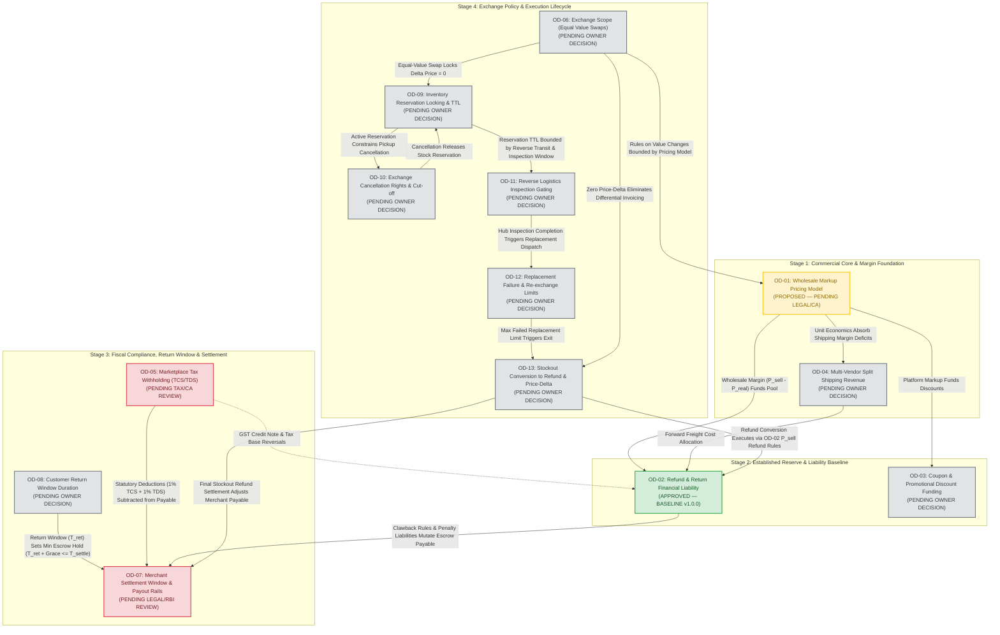
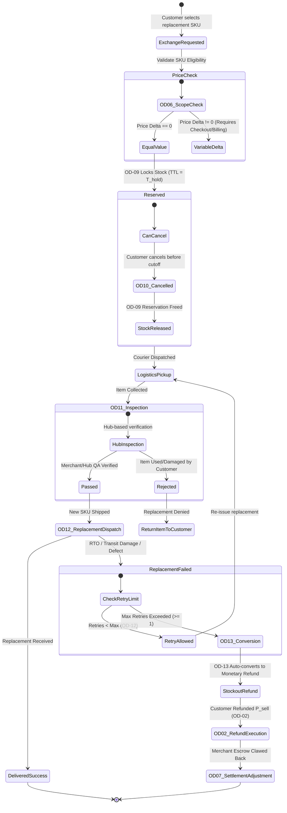
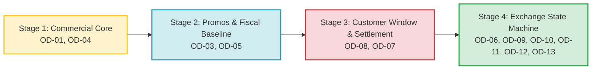

# ATEEVRA Phase M2-14 — Master Cross-Decision Dependency Map (OD-01 to OD-13)

**Document ID:** `MAP-M2-14-DEPENDENCIES`  
**Governance Authority:** Phase M2-14 Central Policy Blueprint & Master Decision Register  
**Scope:** Complete Cross-Decision Structural, Financial, Operational, and Technical Dependency Analysis for OD-01 through OD-13  
**Audit Execution Mode:** STRICTLY READ-ONLY AUDIT & GOVERNANCE PLANNING  
**Active Phase:** Phase M2-14 (Payments, Refunds, Returns and Exchanges)  
**Implementation Authorization Status:** `PLANNING ONLY — IMPLEMENTATION NOT AUTHORIZED`  
**Preserved Baseline:** OD-02 Version 1.0.0 (`OWNER APPROVED — INITIAL POLICY BASELINE`)  
**Companion Documents:**
- [`docs/mvp2/m2-14/blueprint/M2-14-OD-01-TO-OD-13-INVENTORY-AUDIT.md`](file:///C:/Users/Shubham/OneDrive/Desktop/ecom_mvp/docs/mvp2/m2-14/blueprint/M2-14-OD-01-TO-OD-13-INVENTORY-AUDIT.md)
- [`docs/mvp2/m2-14/blueprint/M2-14-DOCUMENTATION-STATUS-MATRIX.md`](file:///C:/Users/Shubham/OneDrive/Desktop/ecom_mvp/docs/mvp2/m2-14/blueprint/M2-14-DOCUMENTATION-STATUS-MATRIX.md)
- [`docs/mvp2/m2-14/blueprint/M2-14-DOCUMENTATION-COMPLETION-ROADMAP.md`](file:///C:/Users/Shubham/OneDrive/Desktop/ecom_mvp/docs/mvp2/m2-14/blueprint/M2-14-DOCUMENTATION-COMPLETION-ROADMAP.md)
- [`docs/mvp2/m2-14/M2-14-OWNER-DECISION-REGISTER.md`](file:///C:/Users/Shubham/OneDrive/Desktop/ecom_mvp/docs/mvp2/m2-14/M2-14-OWNER-DECISION-REGISTER.md)
- [`docs/mvp2/m2-14/blueprint/ATEEVRA-MARKETPLACE-FINANCIAL-COMMERCIAL-POLICY-BLUEPRINT.md`](file:///C:/Users/Shubham/OneDrive/Desktop/ecom_mvp/docs/mvp2/m2-14/blueprint/ATEEVRA-MARKETPLACE-FINANCIAL-COMMERCIAL-POLICY-BLUEPRINT.md)

---

## 1. Executive Summary & Purpose

The ATEEVRA Phase M2-14 lifecycle governs critical monetary transactions, customer protections, merchant liabilities, and physical logistics across payments, returns, refunds, and exchanges. 

A critical finding of the comprehensive M2-14 audit ([`M2-14-OD-01-TO-OD-13-INVENTORY-AUDIT.md`](file:///C:/Users/Shubham/OneDrive/Desktop/ecom_mvp/docs/mvp2/m2-14/blueprint/M2-14-OD-01-TO-OD-13-INVENTORY-AUDIT.md)) is that **the numerical ordering of Owner Decisions (OD-01 through OD-13) does NOT represent their operational, financial, or technical dependency sequence**. 

Attempting to evaluate or implement these decisions linearly (e.g., implementing OD-07 before OD-08, or implementing OD-09 before OD-06) introduces severe circular dependencies, financial deficit risks, and state-machine invalidations:
1. **The Commercial Root (OD-01 & OD-04):** The marketplace pricing and margin structure dictates whether the platform has positive unit margin to fund the return reserve ([POL-OD-02-01](file:///C:/Users/Shubham/OneDrive/Desktop/ecom_mvp/docs/mvp2/m2-14/blueprint/policies/OD-02-01-RETURN-COST-RESERVE.md)), absorb coupon promotions (OD-03), and cover multi-vendor split shipping deficits (OD-04).
2. **The Settlement Horizon Constraint (OD-08 & OD-07):** The merchant settlement payout escrow hold duration (OD-07) is strictly bounded by the customer return window duration (OD-08). Releasing merchant payouts before the customer return window closes creates unsecured merchant debt and unrecoverable negative ledger balances.
3. **Statutory Fiscal Withholding (OD-05 & OD-07):** Tax Collected at Source (TCS u/s 52) and Tax Deducted at Source (TDS u/s 194-O) directly mutate the net payable equation in the merchant settlement engine (OD-07), while GST credit note reversal rules interact directly with refund financial models (OD-02).
4. **The Exchange State Machine (OD-06 & OD-09 through OD-13):** The exchange workflow is an indivisible, tightly coupled finite state machine. Deciding whether exchanges permit variable price deltas (OD-06) determines whether the entire checkout and differential billing pipeline must be invoked prior to inventory reservation locking (OD-09), inspection gating (OD-11), replacement logistics (OD-12), and failure conversion to refund (OD-13).

This document establishes the authoritative dependency topography across all 13 Owner Decisions, providing visual diagrams, an exhaustive 13×13 interaction matrix, in-depth architectural relationship narratives, and functional classification breakdowns.

---

## 2. Visual Master Dependency Graph

The following Mermaid diagram maps the structural flow of authority, financial margin, operational preconditions, and state-machine transitions across all 13 Owner Decisions.

---

## 3. Comprehensive 13×13 Cross-Decision Dependency Matrix

In the matrix below:
- **Rows (Subject Decision):** The decision whose policy, financial model, or technical specification is being established.
- **Columns (Affecting Decision):** The related decision that exerts influence on the row decision.
- **Dependency Codes:**
  - `DEP` (**Direct Hard Dependency**): The Subject Decision **cannot** be finalized, calculated, or implemented without the prior or concurrent finalization of the Affecting Decision.
  - `INF` (**Informs / Constrains**): The Affecting Decision establishes operational thresholds, mathematical parameters, or governance constraints on the Subject Decision.
  - `IND` (**Independent / Orthogonal**): No functional, financial, or operational coupling exists between the two decisions.

| Subject Decision | OD-01 | OD-02 | OD-03 | OD-04 | OD-05 | OD-06 | OD-07 | OD-08 | OD-09 | OD-10 | OD-11 | OD-12 | OD-13 |
| :--- | :---: | :---: | :---: | :---: | :---: | :---: | :---: | :---: | :---: | :---: | :---: | :---: | :---: |
| **OD-01: Wholesale Markup Model** | — | `INF` | `INF` | `INF` | `INF` | `INF` | `INF` | `IND` | `IND` | `IND` | `IND` | `IND` | `IND` |
| **OD-02: Refund & Return Liabilities** | `DEP` | — | `INF` | `DEP` | `INF` | `IND` | `INF` | `DEP` | `IND` | `IND` | `INF` | `INF` | `INF` |
| **OD-03: Coupon & Discount Funding** | `DEP` | `INF` | — | `IND` | `INF` | `IND` | `INF` | `IND` | `IND` | `IND` | `IND` | `IND` | `IND` |
| **OD-04: Multi-Vendor Split Shipping** | `DEP` | `INF` | `IND` | — | `INF` | `IND` | `INF` | `IND` | `IND` | `IND` | `IND` | `IND` | `IND` |
| **OD-05: Marketplace Tax Withholding** | `DEP` | `INF` | `INF` | `INF` | — | `IND` | `DEP` | `IND` | `IND` | `IND` | `IND` | `IND` | `IND` |
| **OD-06: Exchange Scope (Equal Value)** | `INF` | `IND` | `IND` | `IND` | `IND` | — | `IND` | `DEP` | `INF` | `IND` | `IND` | `IND` | `INF` |
| **OD-07: Merchant Settlement & Escrow** | `DEP` | `DEP` | `INF` | `DEP` | `DEP` | `IND` | — | `DEP` | `IND` | `IND` | `INF` | `IND` | `INF` |
| **OD-08: Customer Return Window** | `IND` | `DEP` | `IND` | `IND` | `IND` | `INF` | `INF` | — | `IND` | `IND` | `IND` | `IND` | `IND` |
| **OD-09: Inventory Reservation Locking**| `IND` | `IND` | `IND` | `IND` | `IND` | `DEP` | `IND` | `IND` | — | `INF` | `DEP` | `INF` | `DEP` |
| **OD-10: Exchange Cancellation Rights**| `IND` | `IND` | `IND` | `IND` | `IND` | `INF` | `IND` | `IND` | `DEP` | — | `DEP` | `IND` | `IND` |
| **OD-11: Inspection Gating & Logistics**| `IND` | `INF` | `IND` | `IND` | `IND` | `INF` | `INF` | `IND` | `INF` | `INF` | — | `DEP` | `DEP` |
| **OD-12: Replacement Failures / Limits**| `IND` | `INF` | `IND` | `IND` | `IND` | `INF` | `INF` | `IND` | `INF` | `IND` | `DEP` | — | `DEP` |
| **OD-13: Conversion to Refund / Delta** | `INF` | `DEP` | `IND` | `IND` | `INF` | `DEP` | `DEP` | `IND` | `DEP` | `IND` | `DEP` | `DEP` | — |

---

## 4. In-Depth Narrative of Critical Inter-Decision Relationships

### 4.1. Relationship Cluster 1: The Commercial Core & Loss-Absorption Hierarchy
*(OD-01, OD-02, OD-03, OD-04)*

The economic solvency of ATEEVRA hinges upon the markup generated in OD-01. Under the wholesale realization model proposed in OD-01:
$$\text{Gross Margin} = P_{\text{sell}} - P_{\text{realization}}$$
This margin represents the sole commercial fund available to the platform to absorb operational overhead, friction, and incentives.
- **OD-01 $\rightarrow$ OD-02:** OD-02 establishes that customer returns and courier damages generate platform cash drains (e.g., ₹5.43 expected incremental incident expense on prepaid orders; ₹28.52852 on COD orders). In [`POL-OD-02-01`](file:///C:/Users/Shubham/OneDrive/Desktop/ecom_mvp/docs/mvp2/m2-14/blueprint/policies/OD-02-01-RETURN-COST-RESERVE.md), ATEEVRA mandates a managerial Return-Cost Reserve ($R_{\text{target}} \approx ₹22.61$ across payment methods). This reserve allocation is **not** an incremental cash fee billed to the customer; it is an internal profit earmark funded **directly from the OD-01 markup**. If the OD-01 markup on a product category is less than $R_{\text{target}} + \text{Gateway Fee}$, that product operates at an expected negative contribution margin.
- **OD-01 $\rightarrow$ OD-03:** When ATEEVRA issues platform coupons (OD-03), the promotional discount cannot be funded by reducing the merchant's contractually guaranteed $P_{\text{realization}}$. It directly consumes ATEEVRA's OD-01 markup. Furthermore, OD-03 must establish the non-negotiable rule that **in remorse returns under OD-02, platform promotional discounts are non-refundable**, ensuring customers receive refunds based strictly on net paid amounts, preserving platform funds.
- **OD-01 $\rightarrow$ OD-04:** In multi-vendor checkouts, customers are charged a unified checkout shipping fee ($S_{\text{cust}}$), but ATEEVRA must contract separate forward logistics carriers for each individual vendor package ($\sum S_{\text{carrier}, v}$). When $\sum S_{\text{carrier}, v} > S_{\text{cust}}$, the resulting split-shipping deficit represents a direct platform expense that must be absorbed by the aggregate OD-01 product markups across that multi-vendor order.

### 4.2. Relationship Cluster 2: The Fiscal, Return Window & Settlement Boundary
*(OD-05, OD-07, OD-08)*

This cluster governs the statutory legality of funds disbursement and protects the marketplace against merchant default.
- **OD-08 $\rightarrow$ OD-07 (The Hard Settlement Horizon Invariant):** 
  - OD-08 establishes the customer return eligibility window ($T_{\text{return}}$, e.g., 7 days post-delivery).
  - OD-07 establishes the merchant settlement disbursement timeline ($T_{\text{settle}}$, e.g., $D + 10$ business days).
  - **Fundamental Architectural Invariant:** Under no circumstances can $T_{\text{settle}}$ occur before the customer return window has fully expired and all reverse logistics inspection buffers have elapsed:
  $$T_{\text{settle}} \ge T_{\text{delivery}} + T_{\text{return}} + T_{\text{inspection\_grace}}$$
  - **Failure Mode if Violated:** If ATEEVRA pays a merchant on day $D+3$, and the customer legitimately initiates a remorse return on day $D+6$, ATEEVRA has already disbursed the customer's funds to the merchant. ATEEVRA must then issue a full refund to the customer while attempting to "claw back" funds from the merchant. If the merchant ceases trading or has zero future order volume, ATEEVRA suffers an unrecoverable 100% loss of $P_{\text{realization}}$.
- **OD-05 $\rightarrow$ OD-07 (Statutory Withholding Integration):**
  - Section 52 of the CGST Act mandates 1% Tax Collected at Source (TCS) on net taxable supplies.
  - Section 194-O of the Income Tax Act mandates 1% Tax Deducted at Source (TDS) on gross e-commerce sales.
  - OD-07's settlement ledger engine must programmatically withhold these statutory deductions from the merchant's gross entitlement before generating the net bank transfer payout instruction:
  $$\text{Net Payout} = P_{\text{realization}} - \text{TCS} - \text{TDS} - \text{Damage Penalties (OD-02)} \pm \text{Adjustments}$$
- **OD-05 $\rightarrow$ OD-02 (GST Credit Note Synchronization):**
  - When a customer return occurs under OD-02, the original tax invoice issued by the merchant must be counterbalanced by a statutory GST Credit Note under Section 34 of the CGST Act to reverse the outward tax liability and adjust TCS previously reported in Form GSTR-8.

### 4.3. Relationship Cluster 3: The Exchange Lifecycle Finite State Machine
*(OD-06, OD-09, OD-10, OD-11, OD-12, OD-13)*

Exchange operations represent the most technically intricate state machine in e-commerce, linking inventory reservation, reverse logistics, forward fulfillment, and financial reconciliation.

- **OD-06 $\rightarrow$ OD-09 & OD-13 (The Equal-Value Simplification Anchor):**
  - OD-06 evaluates whether exchanges are restricted to **strictly equal-value items** (e.g., size/color variants of identical price) or whether variable-price cross-product exchanges are permitted.
  - If equal-value swaps are enforced (recommended by advisory register), $\Delta \text{Price} \equiv 0$. This eliminates the requirement to build an immediate intermediate differential payment gateway checkout session or partial refund pipeline prior to reserving stock under OD-09.
  - If the replacement item subsequently suffers a stockout or failure, OD-13 converts the transaction directly into a full refund of $P_{\text{sell}}$ under OD-02 without complex fractional debit/credit adjustments.
- **OD-09 $\rightarrow$ OD-11 (The Reservation TTL vs Inspection Latency Constraint):**
  - Under OD-09, inventory for the replacement item must be locked in the database with an expiration Time-To-Live (TTL).
  - Under OD-11, inspection gating may occur at the customer doorstep (immediate) or at a centralized logistics hub (deferred 5–8 days).
  - **Critical Technical Coupling:** If OD-11 mandates hub-based inspection, OD-09's reservation TTL cannot be set to a standard 24–48 hour cart hold. Setting a 48-hour TTL on a hub-inspection workflow causes the inventory reservation to expire while the return package is still in transit, releasing the replacement item to public stock and guaranteeing stockout failure upon inspection approval! The reservation TTL must equal:
  $$\text{TTL}_{\text{reserve}} = T_{\text{pickup\_buffer}} + T_{\text{reverse\_transit}} + T_{\text{hub\_inspection}} + T_{\text{safety\_margin}} \approx 7\text{ to }10\text{ days}$$
- **OD-10 $\rightarrow$ OD-09 & OD-11 (Cancellation Cutoff Synchronization):**
  - OD-10 defines when a customer may cancel an active exchange request. Once reverse logistics initiates (or courier arrives), cancellation must be prohibited. If cancelled before cutoff, an asynchronous event (`exchange.cancelled`) must immediately trigger OD-09 to release the soft-reserved stock.
- **OD-12 $\rightarrow$ OD-13 $\rightarrow$ OD-02 (Replacement Failure Loop Termination):**
  - If a replacement shipment is lost in transit, delivered damaged, or returned due to doorstep RTO, OD-12 restricts endless recursive replacement loops (advisory: maximum 1 replacement).
  - When the retry ceiling is hit, the transaction forcibly cascades to OD-13.
  - OD-13 converts the failed exchange into a full monetary refund executed under OD-02 rules, closing the logistics loop and signaling OD-07 to zero out or adjust the merchant's payable balance.

---

## 5. Functional Classification & Dependency Groupings

### 5.1. Decisions That Must Precede Others (Hard Prerequisites)

The following three decisions form the immovable foundation of Phase M2-14:
1. **OD-01 (Wholesale Markup vs Commission Pricing Model):** Must precede OD-02, OD-03, OD-04, OD-05, and OD-07. Pricing calculation formulas, margin ceilings, and financial reserve absorption depend entirely on whether ATEEVRA operates on a wholesale markup or a commission percentage.
2. **OD-08 (Customer Return Window Duration):** Must precede OD-07. The legal and contractual customer return window ($T_{\text{return}}$) sets the mathematical minimum floor for merchant settlement escrow release ($T_{\text{settle}}$).
3. **OD-06 (Exchange Scope - Equal Value Swaps vs Variable Delta):** Must precede OD-09, OD-10, OD-11, OD-12, and OD-13. The structural complexity of exchange inventory reservation, cart checkout, payment capture, and refund reconciliation is dictated by whether price deltas are allowed.

### 5.2. Decisions That Can Be Evaluated Independently

While constrained by foundational margin and state rules, the following decisions can have their business policy parameters formulated with minimal cross-blocking:
1. **OD-03 (Coupon & Promotional Discount Funding):** Can be drafted independently once OD-01's platform-funded markup rule is understood. Its primary policy choice is whether coupons re-activate upon customer return.
2. **OD-10 (Exchange Cancellation Rights & Cut-off Points):** Can be evaluated independently based on logistics partner operational capabilities (e.g., whether the carrier API supports real-time reverse pickup cancellation webhooks).

### 5.3. Decisions Requiring External Professional Validation

The following decisions involve statutory compliance, tax liabilities, contractual enforceability, and banking regulations, and **cannot be marked fully validated without formal Legal Counsel or Chartered Accountant sign-off**:
1. **OD-01 (Pricing Model & Resale Terms):** Legal and CA review of the Merchant Master Services Agreement (MSA) regarding title transfer, wholesale realization guarantee, and billing disclosure under Indian Consumer Protection (E-Commerce) Rules, 2020.
2. **OD-02 (Return & Refund Liability Allocation):** Legal validation of merchant clawbacks, courier liability limits (₹1,500 vs invoice value), and GST credit note generation timelines under CGST Act Section 34.
3. **OD-05 (Marketplace Tax Withholding):** Mandatory Chartered Accountant verification of 1% TCS under CGST Act Section 52, 1% TDS under Income Tax Act Section 194-O, Form GSTR-8 reporting, and exemption thresholds for individual merchants.
4. **OD-07 (Merchant Settlement Rails & Escrow Accounts):** Legal and banking compliance review under Reserve Bank of India (RBI) Guidelines for Regulation of Payment Aggregators and Payment Gateways (PA/PG Guidelines), specifically governing nodal escrow account retention periods, payout limits, and dispute reserves.

### 5.4. Decisions Influencing Financial Ledgers and Settlement Logic

The following decisions directly specify mathematical formulas and debit/credit ledger journal entries:
- **OD-01:** Defines gross GMV, wholesale cost payable, platform markup, and gateway deduction base.
- **OD-02:** Defines the ₹22.61 return reserve allocation, courier damage claim loss absorption, and gateway fee sunk costs.
- **OD-03:** Defines promotional discount ledger debits against platform marketing accounts.
- **OD-04:** Defines shipping revenue allocation, shipping deficit ledger debits, and vendor freight credits.
- **OD-05:** Defines statutory withholding ledger entries (`TCS_WITHHELD_PAYABLE`, `TDS_WITHHELD_PAYABLE`).
- **OD-07:** Formulates the final net merchant settlement equation and handles debit clawbacks for returns and damage penalties.
- **OD-13:** Governs price-delta financial reconciliation and conversion from exchange liabilities to refund accounts payable.

### 5.5. Decisions Affecting Customer Experience and Merchant Contracts

The following decisions directly impact public-facing storefront UI/UX, customer checkout terms, and merchant onboarding agreements:
- **OD-01 & OD-04:** Display of transparent pricing, itemized shipping at checkout, and merchant pricing transparency in vendor portal.
- **OD-02 & OD-08:** Public return policy displayed on product pages (e.g., "7-day return policy"), return shipping fee disclosures, and merchant SLA agreements for return acceptance.
- **OD-03:** Promotional coupon terms and conditions regarding non-refundability upon partial return.
- **OD-06, OD-10, OD-12:** Storefront exchange self-service workflow, variant picker, cancellation cut-off warnings, and policy limit disclosures (e.g., "Only 1 replacement permitted per order").

### 5.6. Decisions Affecting Data Models, Schemas, Events, and APIs

The following table summarizes the technical entities and integration touchpoints impacted by each decision:

| Decision | Impacted Database Entities | Proposed Events / Kafka Topics | Key API Endpoints |
| :--- | :--- | :--- | :--- |
| **OD-01** | `ProductVariant` (`realizationPriceCents`, `markupMarginCents`), `OrderItem` | `order.pricing_computed` | `GET /api/v1/merchant/pricing` |
| **OD-02** | `Refund`, `ReturnRequest`, `ReturnCostReserveLedger`, `CourierClaim` | `refund.initiated`, `return.delivered`, `claim.adjudicated` | `POST /api/v1/returns`, `POST /api/v1/claims` |
| **OD-03** | `Coupon`, `DiscountAllocation`, `OrderCouponUsage` | `coupon.applied`, `coupon.voided` | `POST /api/v1/coupons/apply` |
| **OD-04** | `ShippingConsignment`, `VendorShippingAllocationLedger` | `shipping.allocated` | `GET /api/v1/orders/{id}/consignments` |
| **OD-05** | `TaxWithholdingLedger` (`tcsCents`, `tdsCents`), `GstCreditNote` | `tax.withheld`, `credit_note.generated` | `GET /api/v1/merchant/tax-reports` |
| **OD-06** | `ExchangeRequest` (`originalVariantId`, `targetVariantId`, `deltaPriceCents`) | `exchange.requested` | `POST /api/v1/exchanges` |
| **OD-07** | `MerchantSettlement`, `MerchantPayoutLedger`, `EscrowTransaction` | `settlement.calculated`, `payout.dispatched` | `GET /api/v1/merchant/settlements` |
| **OD-08** | `Order` (`returnWindowExpiresAt`), `ProductCategoryPolicy` | `order.return_window_expired` | `GET /api/v1/orders/{id}/eligibility` |
| **OD-09** | `InventoryReservation` (`reservationExpiresAt`, `status`), `InventoryStock` | `inventory.exchange_reserved`, `reservation.expired`| `POST /api/v1/inventory/reserve-exchange` |
| **OD-10** | `ExchangeRequest` (`cancellationCutoffAt`, `status`) | `exchange.cancelled` | `POST /api/v1/exchanges/{id}/cancel` |
| **OD-11** | `ReturnInspection`, `ConsignmentVerification` | `inspection.passed`, `inspection.rejected` | `POST /api/v1/inspections/submit` |
| **OD-12** | `ExchangeCycleTracker` (`attemptCount`, `maxAllowed`) | `exchange.max_retries_exceeded` | `GET /api/v1/exchanges/{id}/history` |
| **OD-13** | `ExchangeRefundConversion`, `PaymentTransaction` | `exchange.converted_to_refund` | `POST /api/v1/exchanges/{id}/convert-to-refund` |

---

## 6. Synthesis: Recommended Decision Progression Order

Based upon the structural, mathematical, and operational constraints mapped above, Owner Decisions cannot be completed in numerical sequence. The optimal, dependency-free completion trajectory must proceed in **Four Dedicated Stages**:

1. **Stage 1 — The Commercial Core (OD-01, OD-04):** Finalizes the marketplace wholesale pricing model and multi-vendor shipping revenue allocation. These establish the unit economic margin baseline for all subsequent phases.
2. **Stage 2 — Platform Promotions & Fiscal Baseline (OD-03, OD-05):** Finalizes coupon promotional subsidy funding (consuming OD-01 margin) and formalizes statutory TCS/TDS withholding rules with Chartered Accountants.
3. **Stage 3 — Customer Post-Purchase Eligibility & Settlement Boundary (OD-08, OD-07):** Establishes the customer return window duration (OD-08), which unlocks the final calculation of the merchant escrow hold period and payout engine (OD-07), incorporating OD-05 tax deductions and OD-02 damage clawbacks.
4. **Stage 4 — The Exchange Execution Lifecycle (OD-06, OD-09, OD-10, OD-11, OD-12, OD-13):** Begins with OD-06 to lock the equal-value swap boundary, followed sequentially by inventory reservation locking (OD-09), cancellation cutoffs (OD-10), inspection gating (OD-11), replacement limits (OD-12), and stockout refund conversions (OD-13).

This sequence guarantees that every decision is evaluated with all predecessor constraints fully solved and established, preventing rework and structural contradictions.
