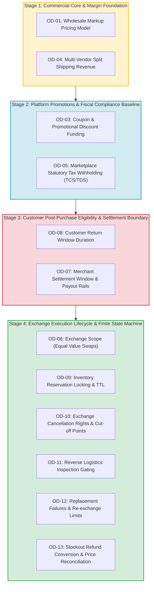

# ATEEVRA Phase M2-14 — Master Documentation Completion Roadmap & Blueprint Integration Architecture (OD-01 to OD-13)

**Document ID:** `RDM-M2-14-ROADMAP`  
**Governance Authority:** Phase M2-14 Central Policy Blueprint & Master Decision Register  
**Scope:** 4-Stage Dependency-Based Completion Trajectory and Master Blueprint Integration Architecture for Owner Decisions OD-01 through OD-13  
**Audit Execution Mode:** STRICTLY READ-ONLY AUDIT & GOVERNANCE PLANNING  
**Active Phase:** Phase M2-14 (Payments, Refunds, Returns and Exchanges)  
**Implementation Authorization Status:** `PLANNING ONLY — IMPLEMENTATION NOT AUTHORIZED`  
**Preserved Baseline:** OD-02 Version 1.0.0 (`OWNER APPROVED — INITIAL POLICY BASELINE`)  
**Companion Documents:**
- [`docs/mvp2/m2-14/blueprint/M2-14-OD-01-TO-OD-13-INVENTORY-AUDIT.md`](file:///C:/Users/Shubham/OneDrive/Desktop/ecom_mvp/docs/mvp2/m2-14/blueprint/M2-14-OD-01-TO-OD-13-INVENTORY-AUDIT.md)
- [`docs/mvp2/m2-14/blueprint/M2-14-DEPENDENCY-MAP.md`](file:///C:/Users/Shubham/OneDrive/Desktop/ecom_mvp/docs/mvp2/m2-14/blueprint/M2-14-DEPENDENCY-MAP.md)
- [`docs/mvp2/m2-14/blueprint/M2-14-DOCUMENTATION-STATUS-MATRIX.md`](file:///C:/Users/Shubham/OneDrive/Desktop/ecom_mvp/docs/mvp2/m2-14/blueprint/M2-14-DOCUMENTATION-STATUS-MATRIX.md)
- [`docs/mvp2/m2-14/M2-14-OWNER-DECISION-REGISTER.md`](file:///C:/Users/Shubham/OneDrive/Desktop/ecom_mvp/docs/mvp2/m2-14/M2-14-OWNER-DECISION-REGISTER.md)
- [`docs/mvp2/m2-14/blueprint/ATEEVRA-MARKETPLACE-FINANCIAL-COMMERCIAL-POLICY-BLUEPRINT.md`](file:///C:/Users/Shubham/OneDrive/Desktop/ecom_mvp/docs/mvp2/m2-14/blueprint/ATEEVRA-MARKETPLACE-FINANCIAL-COMMERCIAL-POLICY-BLUEPRINT.md)

---

## 1. Executive Summary & Purpose

Phase M2-14 governs the most financially sensitive and operationally critical domain of the ATEEVRA marketplace: payment capture, merchant payout settlement, customer returns, courier damage liability, reverse logistics, and replacement exchanges.

The Master Documentation Inventory Audit ([`M2-14-OD-01-TO-OD-13-INVENTORY-AUDIT.md`](file:///C:/Users/Shubham/OneDrive/Desktop/ecom_mvp/docs/mvp2/m2-14/blueprint/M2-14-OD-01-TO-OD-13-INVENTORY-AUDIT.md)) and Status Matrix ([`M2-14-DOCUMENTATION-STATUS-MATRIX.md`](file:///C:/Users/Shubham/OneDrive/Desktop/ecom_mvp/docs/mvp2/m2-14/blueprint/M2-14-DOCUMENTATION-STATUS-MATRIX.md)) established that:
1. Only OD-02 is currently approved as a business policy baseline (Version 1.0.0).
2. All 13 decisions remain **100% BLOCKED from software implementation** because underlying mathematical models, standalone decision analysis files, statutory tax/legal opinions, and technical schema/event blueprints remain pending.
3. Decisions cannot be finalized in arbitrary or linear numerical order due to hard cross-domain dependencies (mapped in [`M2-14-DEPENDENCY-MAP.md`](file:///C:/Users/Shubham/OneDrive/Desktop/ecom_mvp/docs/mvp2/m2-14/blueprint/M2-14-DEPENDENCY-MAP.md)).

This document establishes the definitive **4-Stage Completion Roadmap** to systematically complete all 13 decision blueprints before engineering begins, while enabling the Project Owner to evaluate and approve decisions **one at a time**. Furthermore, it defines the **Master Blueprint Integration Architecture** to guarantee that newly approved policies integrate seamlessly into the Central Blueprint without creating duplicate or conflicting sources of truth.

---

## 2. The 4-Stage Dependency-Based Completion Trajectory

The completion sequence is structured into four sequential stages, where each stage establishes the foundational parameters required by succeeding stages.



---

### 2.1. Stage 1 — Commercial Core & Margin Foundation
**Decisions Included:** OD-01 (Pricing Model & Resale Terms), OD-04 (Multi-Vendor Split Shipping Revenue Allocation)

#### Rationale & Why It Belongs at Stage 1
Every downstream financial calculation in ATEEVRA—including the Return-Cost Reserve ([POL-OD-02-01](file:///C:/Users/Shubham/OneDrive/Desktop/ecom_mvp/docs/mvp2/m2-14/blueprint/policies/OD-02-01-RETURN-COST-RESERVE.md)), marketing promotions (OD-03), and split shipping subsidies (OD-04)—relies on the platform's unit economic markup:
$$\text{Platform Markup} = P_{\text{sell}} - P_{\text{realization}}$$
Until the wholesale realization pricing model (OD-01) is formally approved with resolved legal resale boundaries, and the multi-vendor shipping deficit absorption model (OD-04) is finalized, the platform's net order contribution margin cannot be mathematically determined.

#### Dependencies
- Depends on: Baseline marketplace catalog structure (Phase M2-03, M2-04).
- Feeds into: OD-02 (reserve funding), OD-03 (coupon funding pool), OD-04 (deficit absorption), OD-05 (tax base calculation), OD-07 (gross merchant payable).

#### Inputs Needed
- Vendor agreement realization price structures.
- Carrier 3PL forward shipping rate cards (Delhivery, Shiprocket, BlueDart).
- Average basket size and multi-vendor order frequency projections.

#### Financial Modeling Requirements
- Mathematical formulation of gross vs net margin per product category.
- Sensitivity model of multi-vendor shipping deficits ($\sum S_{\text{carrier}} - S_{\text{customer}}$) absorbed by aggregate product markup.
- Dynamic pricing upper bound conflict thresholds ([POL-OD-02-06](file:///C:/Users/Shubham/OneDrive/Desktop/ecom_mvp/docs/mvp2/m2-14/blueprint/policies/OD-02-06-PRICING-BOUND-CONFLICTS.md)).

#### Professional Validation Requirements
- Mandatory Legal Counsel review of the Merchant Master Services Agreement (MSA) regarding title transfer, wholesale realization guarantee, and compliance with the Consumer Protection (E-Commerce) Rules, 2020.
- Chartered Accountant review of merchant billing statements and platform invoicing.

#### Expected Deliverables
1. `docs/mvp2/m2-14/decisions/M2-14-OD-01-PRICING-MODEL-ANALYSIS.md` (Update to v1.1.0 with legal review and pricing guardrail rules).
2. `docs/mvp2/m2-14/decisions/M2-14-OD-04-SHIPPING-ALLOCATION-ANALYSIS.md` (New standalone analysis document).
3. Codified Blueprint Policies:
   - `docs/mvp2/m2-14/blueprint/policies/OD-01-01-WHOLESALE-MARKUP-MODEL.md`
   - `docs/mvp2/m2-14/blueprint/policies/OD-04-01-SPLIT-SHIPPING-ALLOCATION.md`
4. Formal Owner Approval Submissions in `M2-14-OWNER-DECISION-REGISTER.md`.

---

### 2.2. Stage 2 — Platform Promotions & Fiscal Compliance Baseline
**Decisions Included:** OD-03 (Coupon & Promotional Discount Funding), OD-05 (Marketplace Tax Withholding: TCS u/s 52 & TDS u/s 194-O)

#### Rationale & Why It Belongs at Stage 2
Once the commercial margin foundation (OD-01) is approved, platform promotional incentives (OD-03) can be sized to guarantee that discounts never exceed platform markup. Concurrently, statutory marketplace tax withholding (OD-05) must be formally established with tax counsel because it dictates mandatory legal deductions from the merchant settlement equation (OD-07) and governs GST credit note reversals on returns (OD-02).

#### Dependencies
- Depends on: OD-01 (markup funding pool), OD-02 (refund baseline).
- Feeds into: OD-07 (settlement deduction engine), Storefront checkout pricing.

#### Inputs Needed
- Annual marketing promotional budget allocations.
- Statutory tax guidelines: Section 52 of the CGST Act (1% TCS), Section 194-O of the Income Tax Act (1% TDS).
- GST Portal GSTR-8 reporting specifications.

#### Financial Modeling Requirements
- Promotional margin erosion matrix across varying discount tiers (e.g., 5%, 10%, 20%).
- Non-refundability model: Proof of zero platform cash leakage when coupons are voided on remorse returns.
- Exact algebraic ledger formulas for net merchant payable after 1% TCS and 1% TDS.

#### Professional Validation Requirements
- **Mandatory Chartered Accountant Written Opinion:**
  - Legality of platform-funded discounts reducing customer invoice value vs merchant taxable supply.
  - Verification of 1% TCS under CGST Sec 52 and 1% TDS under IT Act Sec 194-O deduction timing, filing deadlines, and threshold exemptions.
  - Credit note issuance timelines under CGST Act Section 34.

#### Expected Deliverables
1. `docs/mvp2/m2-14/decisions/M2-14-OD-03-COUPON-FUNDING-ANALYSIS.md` (New standalone analysis document).
2. `docs/mvp2/m2-14/decisions/M2-14-OD-05-TAX-WITHHOLDING-ANALYSIS.md` (New standalone analysis document with attached CA memorandum).
3. Codified Blueprint Policies:
   - `docs/mvp2/m2-14/blueprint/policies/OD-03-01-COUPON-DISCOUNT-FUNDING.md`
   - `docs/mvp2/m2-14/blueprint/policies/OD-05-01-MARKETPLACE-TAX-WITHHOLDING.md`
4. Formal Owner Approval Submissions in `M2-14-OWNER-DECISION-REGISTER.md`.

---

### 2.3. Stage 3 — Customer Post-Purchase Eligibility & Settlement Boundary
**Decisions Included:** OD-08 (Customer Return Window Duration), OD-07 (Merchant Settlement Window & Payout Rails)

#### Rationale & Why It Belongs at Stage 3
OD-08 and OD-07 represent the critical financial boundary between customer protection and merchant liquidity. As proven in [`M2-14-DEPENDENCY-MAP.md`](file:///C:/Users/Shubham/OneDrive/Desktop/ecom_mvp/docs/mvp2/m2-14/blueprint/M2-14-DEPENDENCY-MAP.md), the merchant payout escrow hold duration ($T_{\text{settle}}$) **must strictly exceed** the customer return window duration plus reverse inspection latency:
$$T_{\text{settle}} \ge T_{\text{delivery}} + T_{\text{return}} + T_{\text{inspection\_grace}}$$
Therefore, OD-08 must be established before OD-07 can finalize the merchant payout release schedule. Once established, OD-07 integrates OD-01 realization entitlements, OD-05 tax deductions, and OD-02 damage clawbacks into the production settlement engine.

#### Dependencies
- Depends on: OD-01 (payable entitlement), OD-02 (clawbacks & reserves), OD-05 (TCS/TDS deductions).
- OD-07 directly depends on OD-08 (return window horizon).
- Feeds into: Merchant banking payout rails, automated escrow hold cron jobs, customer service SLAs.

#### Inputs Needed
- Category return volume benchmarks (apparel remorse vs electronics defects).
- Reserve Bank of India (RBI) Guidelines for Regulation of Payment Aggregators and Payment Gateways (PA/PG Guidelines).
- Commercial banking partner nodal escrow account agreements (e.g., RazorpayX / Cashfree Escrow).

#### Financial Modeling Requirements
- Customer return rate elasticity model across 7-day, 14-day, and 30-day windows.
- Escrow working capital float simulations and merchant cash-flow velocity impact.
- Merchant clawback default risk exposure model under varying settlement delay horizons.

#### Professional Validation Requirements
- Mandatory Banking & Regulatory Legal Review of nodal escrow account compliance under RBI PA/PG norms.
- Consumer Protection Legal Review regarding statutory disclosure of return windows on product display pages (PDPs) and tax invoices.

#### Expected Deliverables
1. `docs/mvp2/m2-14/decisions/M2-14-OD-08-RETURN-WINDOW-ANALYSIS.md` (New standalone analysis document).
2. `docs/mvp2/m2-14/decisions/M2-14-OD-07-MERCHANT-SETTLEMENT-ANALYSIS.md` (New standalone analysis document with RBI escrow compliance review).
3. Codified Blueprint Policies:
   - `docs/mvp2/m2-14/blueprint/policies/OD-08-01-CUSTOMER-RETURN-WINDOW.md`
   - `docs/mvp2/m2-14/blueprint/policies/OD-07-01-MERCHANT-SETTLEMENT-ESCROW.md`
4. Formal Owner Approval Submissions in `M2-14-OWNER-DECISION-REGISTER.md`.

---

### 2.4. Stage 4 — Exchange Execution Lifecycle & Finite State Machine
**Decisions Included:** OD-06 (Exchange Scope: Equal-Value Swaps), OD-09 (Inventory Reservation Locking & TTL), OD-10 (Exchange Cancellation Rights & Cut-off Points), OD-11 (Reverse Logistics Inspection Gating), OD-12 (Repeated Replacement Failures & Re-exchange Limits), OD-13 (Failed Exchange Conversion to Refund & Price-Delta Reconciliation)

#### Rationale & Why It Belongs at Stage 4
Exchange operations represent a unified, highly synchronized finite state machine. By addressing this cluster in Stage 4:
1. Stage 1 has established pricing and margin rules;
2. Stage 2 has established promotional discount non-refundability and tax credit note rules;
3. Stage 3 has established the return eligibility window bounding exchange initiation.

Within Stage 4, **OD-06 acts as the master gatekeeper**: Approving the advisory recommendation (Option A: Strictly Equal-Value Swaps only) fixes $\Delta \text{Price} \equiv 0$, permanently eliminating the need to construct an immediate intermediate differential billing and checkout pipeline. This massively simplifies the downstream engineering for OD-09 (reservation), OD-10 (cancellation), OD-11 (inspection), OD-12 (replacement limits), and OD-13 (stockout refund conversion).

#### Dependencies
- Depends on: OD-01, OD-02, OD-03, OD-05, OD-07, OD-08.
- Intra-stage sequential flow: OD-06 $\rightarrow$ OD-09 $\rightarrow$ OD-10 $\rightarrow$ OD-11 $\rightarrow$ OD-12 $\rightarrow$ OD-13.

#### Inputs Needed
- 3PL reverse logistics API technical capabilities (real-time tracking, webhook latencies, cancellation support).
- Central hub QA inspection operational throughput and transit SLA matrices.
- Inventory concurrency architecture (PostgreSQL row-level locking vs Redis TTL keys).

#### Financial Modeling Requirements
- Multi-hop reverse and forward logistics cost accumulation models.
- Reverse logistics dead-mileage fee allocation on late cancellation (OD-10).
- Automated stockout refund conversion cash drain models (OD-13 executing under OD-02 rules).

#### Professional Validation Requirements
- Operational review with 3PL logistics partners (Delhivery / Shiprocket) regarding doorstep vs hub inspection SLA feasibility.
- CA validation of replacement invoice generation vs credit note issuance under GST rules for equal-value swaps.

#### Expected Deliverables
1. Six standalone analysis documents in `docs/mvp2/m2-14/decisions/`:
   - `M2-14-OD-06-EXCHANGE-SCOPE-ANALYSIS.md`
   - `M2-14-OD-09-INVENTORY-RESERVATION-ANALYSIS.md`
   - `M2-14-OD-10-EXCHANGE-CANCELLATION-ANALYSIS.md`
   - `M2-14-OD-11-INSPECTION-GATING-ANALYSIS.md`
   - `M2-14-OD-12-REPLACEMENT-FAILURE-ANALYSIS.md`
   - `M2-14-OD-13-STOCKOUT-CONVERSION-ANALYSIS.md`
2. Codified Blueprint Policies:
   - `docs/mvp2/m2-14/blueprint/policies/OD-06-01-EXCHANGE-SCOPE.md`
   - `docs/mvp2/m2-14/blueprint/policies/OD-09-01-INVENTORY-RESERVATION-TTL.md`
   - `docs/mvp2/m2-14/blueprint/policies/OD-10-01-EXCHANGE-CANCELLATION-RIGHTS.md`
   - `docs/mvp2/m2-14/blueprint/policies/OD-11-01-INSPECTION-GATING-LOGISTICS.md`
   - `docs/mvp2/m2-14/blueprint/policies/OD-12-01-REPLACEMENT-FAILURE-LIMITS.md`
   - `docs/mvp2/m2-14/blueprint/policies/OD-13-01-STOCKOUT-REFUND-CONVERSION.md`
3. Comprehensive Unified State Machine Blueprint:
   - `docs/mvp2/m2-14/blueprint/M2-14-EXCHANGE-STATE-MACHINE-SPEC.md`
4. Formal Owner Approval Submissions in `M2-14-OWNER-DECISION-REGISTER.md`.

---

## 3. Master Blueprint Integration Architecture

To maintain enterprise governance integrity, ATEEVRA enforces a strict **Single Source of Truth (SSOT)** hierarchy. Under no circumstances may policy statements be duplicated across disparate files, which inevitably breeds stale or contradictory documentation.

### 3.1. Authoritative Repository Hierarchy

```
docs/mvp2/m2-14/
│
├── M2-14-OWNER-DECISION-REGISTER.md  <── [TIER 1: EXECUTIVE GOVERNANCE & APPROVAL INDEX]
│                                         Authoritative master index tracking the exact approval status, 
│                                         executive summaries, and approval question for every OD.
│
├── blueprint/                        <── [TIER 2: CODIFIED OPERATIONAL POLICY BLUEPRINT]
│   │
│   ├── ATEEVRA-MARKETPLACE-FINANCIAL-COMMERCIAL-POLICY-BLUEPRINT.md
│   │                                 Consolidated master policy document synthesizing all approved 
│   │                                 operational rules, financial models, and business boundaries.
│   │
│   ├── POLICY-REGISTER.md            Comprehensive policy index listing every codified POL-OD-xx rule.
│   ├── POLICY-CHANGELOG.md           Formal audit log tracking every version bump, edit, and ratification.
│   ├── POLICY-IMPLEMENTATION-TRACEABILITY.md
│   │                                 Traceability matrix linking policies to code, DB schemas, APIs.
│   ├── POLICY-VALIDATION-AND-ACCEPTANCE.md
│   │                                 Acceptance test suites and verification criteria.
│   │
│   └── policies/                     Individual, standalone codified policy specifications:
│       ├── OD-01-xx (Wholesale Pricing)
│       ├── OD-02-01 through 06 (Approved Initial Baseline v1.0.0)
│       ├── OD-03-xx through OD-13-xx (Sequentially added upon owner approval)
│
├── decisions/                        <── [TIER 3: STANDALONE DECISION ANALYSIS & HISTORY]
│   ├── M2-14-OD-01-PRICING-MODEL-ANALYSIS.md
│   ├── M2-14-OD-02-REFUND-FINANCIAL-LIABILITY-ANALYSIS.md
│   ├── M2-14-OD-03-COUPON-FUNDING-ANALYSIS.md (To be authored in Stage 2)
│   └── ... (OD-04 through OD-13 standalone analysis files)
│
├── ADRs (docs/architecture/decisions/) <── [TIER 4: TECHNICAL ARCHITECTURE DECISION RECORDS]
│                                         Binding technical designs, database schemas, and protocols.
│
├── M2-14-EXECUTION-PLAN.md           <── [TIER 5: ENGINEERING WORK & SPRINT SEQUENCING]
│                                         Implementation breakdown, tasks, and dependency schedules.
│
└── Acceptance Reports                <── [TIER 6: VERIFICATION & AUDIT EVIDENCE]
                                          Physical proof of test execution, audit compliance, and delivery.
```

### 3.2. Integration Protocol for Newly Approved Decisions

When the Project Owner evaluates and approves a pending decision (e.g., OD-01):
1. **Step 1 (Standalone Analysis Update):** Finalize the standalone analysis file in `docs/mvp2/m2-14/decisions/` with complete financial models and attached professional validation records.
2. **Step 2 (Codify Standalone Policy File):** Create the dedicated codified policy document in `docs/mvp2/m2-14/blueprint/policies/` (e.g., `OD-01-01-WHOLESALE-MARKUP-MODEL.md`) following the exact standard policy schema (Policy ID, Scope, Effective Date, Business Rules, Numerical Formulas, Operational Workflows, Non-Compliance Penalties).
3. **Step 3 (Central Blueprint Integration):** Insert the policy section into `ATEEVRA-MARKETPLACE-FINANCIAL-COMMERCIAL-POLICY-BLUEPRINT.md` referencing the codified policy file. **Do not modify the six established OD-02 policies.**
4. **Step 4 (Register Update & Version Bump):** Update `M2-14-OWNER-DECISION-REGISTER.md` to transition the status from `PENDING` to `OWNER APPROVED — INITIAL POLICY BASELINE`. Record the transaction in `POLICY-CHANGELOG.md` with an incremented blueprint version (e.g., v1.1.0).
5. **Step 5 (Traceability & Acceptance Update):** Update `POLICY-IMPLEMENTATION-TRACEABILITY.md` and `POLICY-VALIDATION-AND-ACCEPTANCE.md` to map the new policy to its corresponding database entities, events, API endpoints, and automated test cases.

---

## 4. Immediate Recommended Action: Stage 1 Initiation (OD-01)

### 4.1. The Proposed Next Step
The immediate next task recommended to the Project Owner is the formal advancement and resolution of **Owner Decision 01 (OD-01: Pricing Model & Resale Terms)**.

### 4.2. Concrete Justification for Prioritizing OD-01
1. **The Commercial Keystone:** As proven across all audit findings, OD-01 is the commercial root of ATEEVRA. The wholesale markup ($P_{\text{sell}} - P_{\text{realization}}$) is the financial engine that funds the OD-02 Return-Cost Reserve (₹22.61), absorbs courier damage liabilities, funds promotional coupon discounts (OD-03), and offsets multi-vendor split shipping deficits (OD-04).
2. **Advanced Documentation Maturity:** Unlike OD-03 through OD-13, OD-01 already has an extensive standalone analysis document ([`M2-14-OD-01-PRICING-MODEL-ANALYSIS.md`](file:///C:/Users/Shubham/OneDrive/Desktop/ecom_mvp/docs/mvp2/m2-14/decisions/M2-14-OD-01-PRICING-MODEL-ANALYSIS.md)) and full mathematical unit economic models.
3. **Unresolved Legal & Pricing Bound Conflict:** OD-01 is currently held at `OWNER PROPOSED` pending legal counsel review of merchant title transfer and resolution of the dynamic pricing upper bound conflict documented in [`POL-OD-02-06`](file:///C:/Users/Shubham/OneDrive/Desktop/ecom_mvp/docs/mvp2/m2-14/blueprint/policies/OD-02-06-PRICING-BOUND-CONFLICTS.md). Resolving these two specific items allows OD-01 to immediately achieve formal Owner Approval, unlocking the remainder of Stage 1 and Stage 2.

---

## 5. Summary Table: Decision Completion Milestones

| Decision | Proposed Stage | Target Standalone Analysis File | Mandatory Professional Validation | Prerequisite Decisions | Implementation Gate Status |
| :--- | :---: | :--- | :--- | :--- | :---: |
| **OD-01** | **Stage 1** | `M2-14-OD-01-PRICING-MODEL-ANALYSIS.md` (Update) | Legal Counsel (Title transfer / MSA) | None | `BLOCKED` |
| **OD-04** | **Stage 1** | `M2-14-OD-04-SHIPPING-ALLOCATION-ANALYSIS.md` (New) | None (Internal commercial policy) | OD-01 | `BLOCKED` |
| **OD-03** | **Stage 2** | `M2-14-OD-03-COUPON-FUNDING-ANALYSIS.md` (New) | Tax Counsel / CA (Discount tax base) | OD-01, OD-02 | `BLOCKED` |
| **OD-05** | **Stage 2** | `M2-14-OD-05-TAX-WITHHOLDING-ANALYSIS.md` (New) | Mandatory CA Sign-off (TCS/TDS) | OD-01, OD-02 | `BLOCKED` |
| **OD-08** | **Stage 3** | `M2-14-OD-08-RETURN-WINDOW-ANALYSIS.md` (New) | Legal Counsel (Consumer Protection) | None | `BLOCKED` |
| **OD-07** | **Stage 3** | `M2-14-OD-07-MERCHANT-SETTLEMENT-ANALYSIS.md` (New) | Legal & Banking Partner (RBI PA/PG) | OD-01, OD-02, OD-05, OD-08 | `BLOCKED` |
| **OD-06** | **Stage 4** | `M2-14-OD-06-EXCHANGE-SCOPE-ANALYSIS.md` (New) | CA Review (Zero-delta invoicing) | OD-01, OD-08 | `BLOCKED` |
| **OD-09** | **Stage 4** | `M2-14-OD-09-INVENTORY-RESERVATION-ANALYSIS.md` (New)| None (Technical concurrency) | OD-06 | `BLOCKED` |
| **OD-10** | **Stage 4** | `M2-14-OD-10-EXCHANGE-CANCELLATION-ANALYSIS.md` (New)| 3PL Partner Review (Webhook SLA) | OD-06, OD-09 | `BLOCKED` |
| **OD-11** | **Stage 4** | `M2-14-OD-11-INSPECTION-GATING-ANALYSIS.md` (New) | 3PL / Logistics QA Partner Review | OD-06, OD-09, OD-10 | `BLOCKED` |
| **OD-12** | **Stage 4** | `M2-14-OD-12-REPLACEMENT-FAILURE-ANALYSIS.md` (New) | None (Internal fraud/abuse policy) | OD-06, OD-11 | `BLOCKED` |
| **OD-13** | **Stage 4** | `M2-14-OD-13-STOCKOUT-CONVERSION-ANALYSIS.md` (New) | CA Review (Stockout credit note) | OD-02, OD-06, OD-07, OD-12 | `BLOCKED` |
| **OD-02** | *Baseline* | `M2-14-OD-02-REFUND-FINANCIAL-LIABILITY-ANALYSIS.md` | Mandatory CA Sign-off (Credit notes) | None (Approved v1.0.0 Baseline) | `BLOCKED` |
