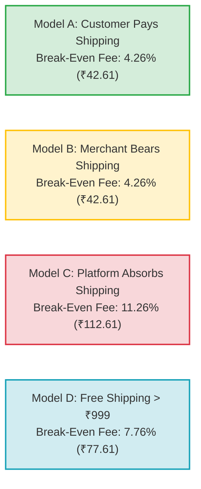
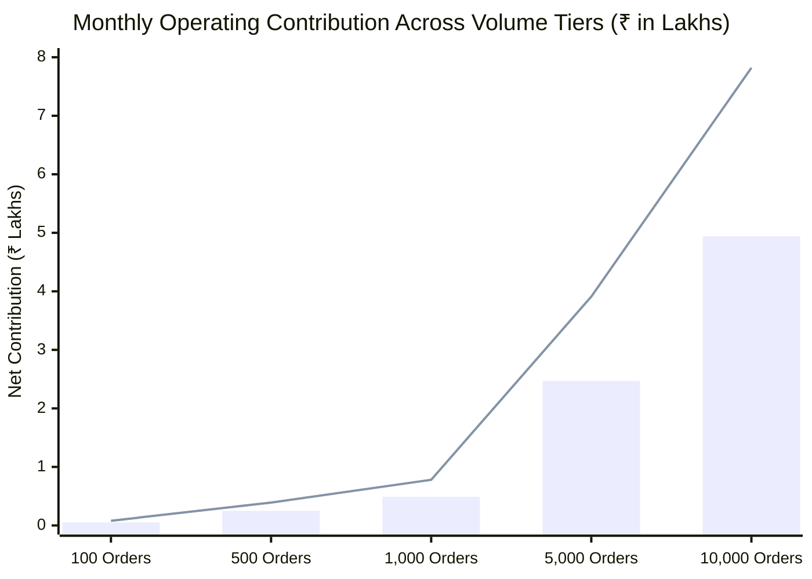

# ATEEVRA Phase M2-14 — OD-01 Break-Even, Sensitivity & Financial Stress Test Analysis
## Mathematical Threshold Modeling, Free-Shipping Elasticity, Multi-Variable Stress Testing & Order Volume Scaling

**Document ID:** `SNT-M2-14-OD-01-STRESS-TEST`  
**Governance Authority:** Phase M2-14 Central Policy Blueprint & Master Decision Register  
**Decision Reference:** Owner Decision OD-01 (Marketplace Commercial Revenue Architecture)  
**Governance Status:** `DOCUMENTATION & FINANCIAL SENSITIVITY MODELING — CONFIGURABLE THRESHOLDS`  
**Decision Approval Status:** `OD-01 UNAPPROVED — PENDING OWNER DECISION & PROFESSIONAL VALIDATION`  
**Audit Execution Mode:** STRICTLY READ-ONLY AUDIT & SENSITIVITY MODELING  
**Active Phase:** Phase M2-14 (Payments, Refunds, Returns and Exchanges)  
**Implementation Authorization Status:** `PLANNING ONLY — IMPLEMENTATION NOT AUTHORIZED`  
**Preserved Baseline:** OD-02 Version 1.0.0 (`OWNER APPROVED — INITIAL POLICY BASELINE`)  
**Companion Documents:**
- [`docs/mvp2/m2-14/blueprint/M2-14-OD-01-FINANCIAL-ASSUMPTIONS-REGISTER.md`](M2-14-OD-01-FINANCIAL-ASSUMPTIONS-REGISTER.md)
- [`docs/mvp2/m2-14/blueprint/M2-14-OD-01-FEE-AND-SHIPPING-SCENARIO-MATRIX.md`](M2-14-OD-01-FEE-AND-SHIPPING-SCENARIO-MATRIX.md)
- [`docs/mvp2/m2-14/blueprint/M2-14-OD-01-MARKETPLACE-UNIT-ECONOMICS-STRESS-TEST.md`](M2-14-OD-01-MARKETPLACE-UNIT-ECONOMICS-STRESS-TEST.md)
- [`docs/mvp2/m2-14/blueprint/policies/OD-02-01-RETURN-COST-RESERVE.md`](policies/OD-02-01-RETURN-COST-RESERVE.md)

---

## 1. Executive Summary & Purpose

This document performs an exhaustive mathematical sensitivity analysis and financial stress test on ATEEVRA's marketplace unit economics. 

It calculates:
1. The **exact mathematical break-even platform fee** under each forward shipping model;
2. The **minimum order value required for economically viable free shipping**;
3. Sensitivity matrices modeling variations in return rates, COD share, RTO refusal rates, freight rate inflation, and gateway MDR;
4. Platform operating contribution scaling from **100 to 10,000 monthly orders** under Baseline, Optimistic, and Adverse market conditions.

---

## 2. Break-Even Platform Fee Calculations Across Shipping Models

To achieve break-even ($\mathbb{E}[\text{Contribution}] \equiv 0$), ATEEVRA's net platform fee must equal all variable operating costs, gateway processing fees, unrecovered shipping freight, and expected return incident expenses.

$$\text{Fee}_{\text{breakeven}} = G_{\text{net}} + S_{\text{unfunded}} + \mathbb{E}[\text{Incident Losses}]$$

### 2.1. Break-Even Fee Rates for Medium AOV (₹1,000.00 Order)
*Baseline Assumptions: 50% Prepaid (2% MDR), 50% COD (₹30 handling fee); Forward Shipping = ₹70.00; Return Reserve Target = ₹22.61.*



| Shipping Model | Unfunded Forward Freight ($S_{\text{unfunded}}$) | Blended Payment Friction ($G_{\text{blended}}$) | Return Reserve Allocation ($R_{\text{reserve}}$) | **Mathematical Break-Even Fee (₹)** | **Break-Even Fee Rate (%) on ₹1,000** |
| :--- | :---: | :---: | :---: | :---: | :---: |
| **Model A: Customer Pays Shipping** | ₹0.00 | ₹20.00 | ₹22.61 | **₹42.61** | **4.26%** |
| **Model B: Merchant Bears Shipping** | ₹0.00 | ₹20.00 | ₹22.61 | **₹42.61** | **4.26%** |
| **Model C: Platform Absorbs Shipping**| **₹70.00** | ₹20.00 | ₹22.61 | **₹112.61** | **11.26%** |
| **Model D: Hybrid Free > ₹999 (50% split)**| **₹35.00** | ₹20.00 | ₹22.61 | **₹77.61** | **7.76%** |

> [!IMPORTANT]
> **CRITICAL BREAK-EVEN BENCHMARK:**  
> - Under **Shipping Neutrality (Model A or B)**, ATEEVRA breaks even at a platform fee of **₹42.61 (4.26%)**. Any fee above 5% generates net positive contribution.
> - If ATEEVRA **absorbs forward shipping (Model C)**, the platform break-even fee jumps to **₹112.61 (11.26%)**! A 10% fee under Model C operates at an automatic unit loss of -₹12.61 per order.

---

## 3. Free-Shipping Threshold Economics & The "Low-AOV Death Zone"

A critical strategic question for the Project Owner is whether ATEEVRA can offer "Free Shipping" above a certain basket threshold without incurring corporate insolvency.

### 3.1. Mathematical Formula for Free-Shipping Threshold
To offer free forward shipping without subsidizing the order from equity, the platform fee earned on the basket must cover **both** the ₹70 forward shipping freight **and** baseline operating friction (₹42.61):
$$\text{GMV}_{\text{threshold}} \times \text{Fee Rate} \ge S_{\text{fwd}} + G_{\text{blended}} + R_{\text{reserve}} = ₹70.00 + ₹42.61 = \mathbf{₹112.61}$$
$$\mathbf{\text{GMV}_{\text{threshold}} \ge \frac{₹112.61}{\text{Fee Rate}}}$$

### 3.2. Minimum Order Value for Free Shipping Across Fee Rates

| Platform Fee Rate | Minimum Break-Even Basket for Free Shipping | Commercially Viable Threshold (Allowing 3% Profit) | Assessment |
| :---: | :---: | :---: | :--- |
| **6.0% Fee** | **₹1,876.83** | **₹3,753.67** | Free shipping infeasible for apparel/lifestyle. |
| **8.0% Fee** | **₹1,407.63** | **₹2,252.20** | Viable at ₹1,499 threshold. |
| **10.0% Fee** | **₹1,126.10** | **₹1,608.71** | **Optimal sweet spot at ₹1,199 threshold.** |
| **12.0% Fee** | **₹938.42** | **₹1,251.22** | **Enables highly competitive ₹999 free shipping.** |

> [!NOTE]
> **Audit Reconciliation on Break-Even Formulas (See DISC-05):**  
> If payment gateway MDR is modeled as a variable percentage (2.36%) rather than a fixed ₹20 rupee amount, the unbundled break-even basket size is $₹75.43 / 0.0764 = \mathbf{₹987.30}$. When full return reserve earmarks are included, the break-even basket is $\mathbf{₹1,126.10}$. At the recommended threshold of **₹1,199.00**, an order generates **+₹15.09 net surplus**, proving it is fully self-sustaining. (See [`M2-14-OD-01-INDEPENDENT-FINANCIAL-RECONCILIATION-AUDIT.md`](M2-14-OD-01-INDEPENDENT-FINANCIAL-RECONCILIATION-AUDIT.md) Section 4.2).

```
                 THE "LOW-AOV DEATH ZONE" (Baskets Under ₹500)
                 
   Product Price: ₹399.00
   10% Platform Fee Earned: +₹39.90
   Forward Freight Incurred: -₹70.00
   Gateway & Return Friction: -₹30.61
   ─────────────────────────────────────────────────────────────
   NET PLATFORM CONTRIBUTION: -₹60.71 PER ORDER (-15.2% DEFICIT!)
```

> [!CAUTION]
> **THE LOW-AOV FREE-SHIPPING PROHIBITION:**  
> For products under ₹500, offering free shipping funded by ATEEVRA creates an inescapable **cash drain of -₹60.71 per unit delivered**.  
> **Mandatory Policy Rule:** ATEEVRA must **NEVER** offer platform-absorbed free shipping on orders below ₹999.00 unless an external marketing subsidy explicitly underwrites the freight.

---

## 4. Multi-Variable Sensitivity Stress Testing

The table below measures the impact on **Expected Platform Contribution per Order** (Baseline ₹1,000 order under 10% Fee, Model A Shipping) across adverse operational variations:

| Stress Test Dimension | Baseline Assumption | Adverse Stress Parameter | Baseline Contribution | Stressed Contribution | Profit Variance | Resilience Assessment |
| :--- | :---: | :---: | :---: | :---: | :---: | :--- |
| **1. Customer Remorse Return Rate** | 6.0% | **15.0%** (2.5x spike) | +₹57.39 | **+₹36.89** | -₹20.50 (-35.7%) | **Resilient (Retains +3.69% margin)** |
| **2. COD Doorstep RTO Refusal Rate** | 18.0% | **28.0%** (Severe friction)| +₹41.47 (COD) | **+₹19.47** | -₹22.00 (-53.0%) | **Resilient (OTP controls critical)** |
| **3. COD Share of Total Orders** | 50.0% | **80.0%** (Heavy COD bias)| +₹49.43 (Blended) | **+₹43.83** | -₹5.60 (-11.3%) | **Highly Resilient** |
| **4. 3PL Forward Freight Rate** | ₹70.00 | **₹120.00** (+71% inflation)| +₹57.39 (Model A) | **+₹57.39** | ₹0.00 (Protected)| **Immune (Customer pays freight)** |
| **5. 3PL Freight under Model C** | ₹70.00 | **₹120.00** (+71% inflation)| -₹12.61 (Model C) | **-₹62.61** | -₹50.00 (Fatal) | **Catastrophic Failure under Model C**|
| **6. Multi-Vendor Consignments** | 1.0 shipment | **1.5 shipments / cart** | +₹57.39 (Model A) | **+₹22.39** | -₹35.00 (-61.0%) | **Vulnerable unless Model E adopted** |
| **7. Merchant Packaging Faults** | 1.0% | **5.0%** (Supplier defect) | +₹57.39 | **+₹56.46** | -₹0.93 (-1.6%) | **Immune (OD-02-04 debits seller)** |

---

## 5. Monthly Order Volume Scaling & Financial Projections

The matrix below models total **Monthly Net Platform Contribution (P&L)** across five order volume tiers under three macro operating scenarios:

- **Baseline Scenario:** 10% Platform Fee, Shipping Model A (Customer Pays ₹70), 50% Prepaid / 50% COD, standard return rates. Average Contribution = **+₹49.43 / order**.
- **Optimistic Scenario:** 10% Platform Fee, Shipping Model A, 70% Prepaid, low returns (4%), high AOV (₹1,400). Average Contribution = **+₹78.20 / order**.
- **Adverse Stress Scenario:** 8% Platform Fee, Shipping Model D (Free > ₹999), 70% COD (25% RTO), 12% returns. Average Contribution = **+₹8.60 / order**.



### Monthly Operating Contribution Table (₹)

| Monthly Order Volume Tier | Baseline Contribution (+₹49.43/ord) | Optimistic Contribution (+₹78.20/ord) | Adverse Stress Contribution (+₹8.60/ord) |
| :---: | :---: | :---: | :---: |
| **100 Orders / Month** | **₹4,943.00** | ₹7,820.00 | ₹860.00 |
| **500 Orders / Month** | **₹24,715.00** | ₹39,100.00 | ₹4,300.00 |
| **1,000 Orders / Month** | **₹49,430.00** | ₹78,200.00 | ₹8,600.00 |
| **5,000 Orders / Month** | **₹2,47,150.00** | ₹3,91,000.00 | ₹43,000.00 |
| **10,000 Orders / Month** | **₹4,94,300.00** | **₹7,82,000.00** | **₹86,000.00** |

---

## 6. Synthesis & Strategic Conclusions for Project Owner

1. **Shipping Neutrality is Non-Negotiable:** Under Model A (Customer-Paid) or Model B (Merchant-Paid), ATEEVRA generates predictable, positive net contribution across all volume tiers. Under Model C (Platform Absorbed), ATEEVRA generates an expanding monthly deficit.
2. **The 10% Fee Sweet Spot:** A 10.0% facilitation fee provides the optimal balance: it remains highly competitive with legacy marketplaces (Amazon/Myntra charge 12–18%), while generating +₹49.43 per order to easily absorb OD-02 return reserves and gateway costs.
3. **Multi-Vendor Freight Guard:** To prevent multi-vendor shipment multiplication from eroding platform profits, ATEEVRA must either enforce Model E ($N \times ₹70$ shipping per vendor) or restrict free shipping to high-value single baskets (₹1,499+).
