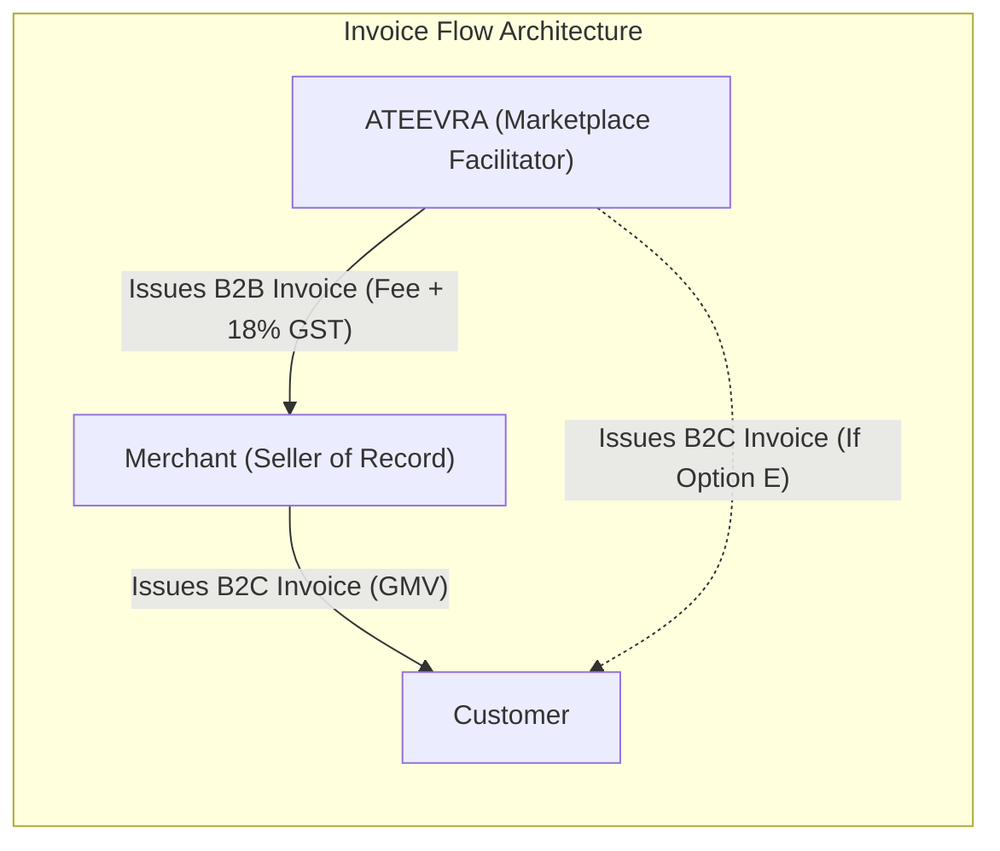
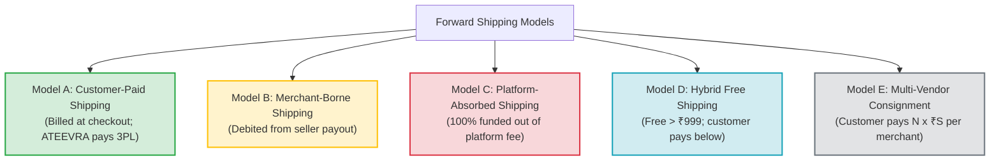

# ATEEVRA Phase M2-14 — OD-01 Fee & Shipping Scenario Matrix
## Comprehensive Operational Specifications, Multi-Vendor Basket Dynamics & 10-Scenario Order Lifecycle Ledger Reconciliation

**Document ID:** `MTX-M2-14-OD-01-SCENARIOS`  
**Governance Authority:** Phase M2-14 Central Policy Blueprint & Master Decision Register  
**Decision Reference:** Owner Decision OD-01 (Marketplace Commercial Revenue Architecture)  
**Governance Status:** `DOCUMENTATION & FINANCIAL MODELING ONLY — CONFIGURABLE SCENARIOS`  
**Decision Approval Status:** `OD-01 UNAPPROVED — PENDING OWNER DECISION & PROFESSIONAL VALIDATION`  
**Audit Execution Mode:** STRICTLY READ-ONLY AUDIT & SCENARIO RECONCILIATION  
**Active Phase:** Phase M2-14 (Payments, Refunds, Returns and Exchanges)  
**Implementation Authorization Status:** `PLANNING ONLY — IMPLEMENTATION NOT AUTHORIZED`  
**Preserved Baseline:** OD-02 Version 1.0.0 (`OWNER APPROVED — INITIAL POLICY BASELINE`)  
**Companion Documents:**
- [`docs/mvp2/m2-14/blueprint/M2-14-OD-01-FINANCIAL-ASSUMPTIONS-REGISTER.md`](M2-14-OD-01-FINANCIAL-ASSUMPTIONS-REGISTER.md)
- [`docs/mvp2/m2-14/blueprint/M2-14-OD-01-MARKETPLACE-UNIT-ECONOMICS-STRESS-TEST.md`](M2-14-OD-01-MARKETPLACE-UNIT-ECONOMICS-STRESS-TEST.md)
- [`docs/mvp2/m2-14/blueprint/M2-14-OD-01-BREAK-EVEN-AND-SENSITIVITY-ANALYSIS.md`](M2-14-OD-01-BREAK-EVEN-AND-SENSITIVITY-ANALYSIS.md)
- [`docs/mvp2/m2-14/blueprint/policies/OD-02-01-RETURN-COST-RESERVE.md`](policies/OD-02-01-RETURN-COST-RESERVE.md)

---

## 1. Executive Summary & Purpose

This document provides the exhaustive, scenario-driven operational and ledger reconciliation matrix for Phase M2-14. It cross-examines all **Five Platform Fee Models** against all **Five Forward Shipping Allocation Models** across **Three AOV Basket Bands** and **Ten Full Order Lifecycle Operational Scenarios**.

---

## 2. Operational & Accounting Breakdown of the Five Platform Fee Models

The table below specifies the contractual, accounting, and lifecycle operational behavior for each fee alternative:

| Operational Dimension | Option A: Fixed Per Order | Option B: Fixed Per Item | Option C: Percentage Fee | Option D: Hybrid (Base + %) | Option E: Customer Fee |
| :--- | :--- | :--- | :--- | :--- | :--- |
| **Fee Payer** | Merchant | Merchant | Merchant | Merchant | End Customer |
| **Calculation Base** | Per fulfilled order | Per delivered unit | Product selling price ($P_{\text{cust}}$) | Fixed base + % of $P_{\text{cust}}$ | Per checkout order |
| **Test Rates Evaluated**| **₹20, ₹40, ₹60, ₹80** | **₹10, ₹20, ₹25, ₹40** | **5%, 6%, 8%, 10%, 12%** | **₹10+3%, ₹20+5%, ₹30+5%** | **₹10, ₹19, ₹29** |
| **GST Application** | Exclusive (+ 18% GST) | Exclusive (+ 18% GST) | Exclusive (+ 18% GST) | Exclusive (+ 18% GST) | Inclusive (18% GST) |
| **Invoicing Entities** | ATEEVRA $\rightarrow$ Merchant | ATEEVRA $\rightarrow$ Merchant | ATEEVRA $\rightarrow$ Merchant | ATEEVRA $\rightarrow$ Merchant | ATEEVRA $\rightarrow$ Customer |
| **When Fee is Earned** | Post-return window | Post-return window | Post-return window | Post-return window | Payment capture |
| **Cancellation Reversal**| 100% reversed | 100% reversed | 100% reversed | 100% reversed | Disputed / Refunded |
| **Remorse Return** | 100% reversed via CN | 100% reversed via CN | 100% reversed via CN | 100% reversed via CN | High chargeback risk |
| **Merchant Fault Return**| Retained / Admin fee | Retained / Admin fee | Retained / Admin fee | Retained / Admin fee | Fee refunded to customer|
| **Partial Item Return** | Zero fee reversal | Reverses for returned item | Pro-rata price reversal | Reverses %; keeps base | Zero fee reversal |
| **Multi-Vendor Basket** | Applied per vendor order| Applied per item | Applied per item | Fixed per vendor + % item | Flat fee across cart |
| **Prepaid vs COD** | Deducted from payout | Deducted from payout | Deducted from payout | Deducted from payout | Collected at checkout/door|

---

## 3. Analysis of the Five Forward Shipping Allocation Models

### 3.1. Detailed Evaluation Across Commercial & Operational Dimensions

| Strategic Dimension | Model A: Customer-Paid | Model B: Merchant-Borne | Model C: Platform-Absorbed | Model D: Hybrid Free > ₹999 | Model E: Per-Merchant Separate |
| :--- | :--- | :--- | :--- | :--- | :--- |
| **Customer Conversion** | Moderate friction at checkout | High (Looks like "Free Shipping")| **Maximum (Zero friction)** | High above ₹999; moderate below | **Severe drop-off on multi-vendor** |
| **Merchant Acceptance** | Highly accepted | Strong resistance on low AOV | Highly accepted | Accepted | Highly accepted |
| **Platform Contribution**| **Protected (+₹17 to +₹57)** | **Protected (+₹17 to +₹57)** | **DEFICIT (-₹12 to -₹52)** | **Viable (AOV scales margin)**| **Fully Protected** |
| **Multi-Vendor Handling**| Platform absorbs split gap | Merchant pays own package | **Disaster (2x freight loss)**| Platform absorbs split on high basket| Transparent ($N \times ₹S$) |
| **Remorse Return Refund** | Shipping non-refundable | Shipping non-refundable | Sunk platform loss | Sunk if order was free ship | Shipping non-refundable |
| **COD RTO Loss Payer** | Platform absorbs (OD-02-05)| Merchant debited freight | Platform absorbs (OD-02-05)| Platform absorbs (OD-02-05) | Platform absorbs per parcel |
| **Freight Cost Resilience**| High across ₹50–₹120 | High across ₹50–₹120 | **Collapses at ₹70+** | Viable if threshold $\ge$ ₹1,499 | High across ₹50–₹120 |

---

## 4. Basket Complexity & Multi-Vendor Dynamics

To demonstrate how fees and shipping interact as basket size and vendor composition change, three standardized order profiles are evaluated under **Option C (10% Fee)**:

| Basket Metric | Case 1: Single-Item Single-Vendor | Case 2: Multi-Item Single-Vendor | Case 3: Multi-Vendor Mixed Cart (2 Vendors) |
| :--- | :---: | :---: | :---: |
| **Gross Merchandise Value (GMV)** | **₹999.00** | **₹999.00** (2 items: ₹499 + ₹500) | **₹999.00** (Vendor A: ₹499; Vendor B: ₹500) |
| **Shipment Packages Generated** | **1 shipment** | **1 shipment** | **2 distinct shipments** |
| **Total 3PL Forward Freight Incurred** | **₹70.00** | **₹70.00** | **₹140.00 (2 × ₹70.00)** |
| **Platform Net Fee Revenue (10%)** | **+₹100.00** | **+₹100.00** | **+₹100.00** (Vendor A: ₹50; Vendor B: ₹50) |
| **Gateway MDR (2%)** | -₹20.00 | -₹20.00 | -₹20.00 |
| **Return-Cost Reserve Allocation** | -₹22.61 | -₹22.61 | -₹45.22 (2 consignments) |
| **A. Under Shipping Model A (Customer Pays ₹70)**|  |  |  |
| - Net Shipping Deficit to Platform | ₹0.00 | ₹0.00 | **-₹70.00 (Customer paid 1 shipping; 3PL cost 2)**|
| - **Net Platform Contribution** | **+₹57.39** (+5.74%) | **+₹57.39** (+5.74%) | **-₹35.22 (-3.53% DEFICIT!)** |
| **B. Under Shipping Model E (Customer Pays 2x₹70)**|  |  |  |
| - Net Shipping Deficit to Platform | ₹0.00 | ₹0.00 | **₹0.00 (Customer paid ₹140; 3PL cost ₹140)** |
| - **Net Platform Contribution** | **+₹57.39** (+5.74%) | **+₹57.39** (+5.74%) | **+₹34.78 (+3.48% POSITIVE)** |
| **C. Under Shipping Model C (Platform Absorbs 100%)**|  |  |  |
| - Freight Incurred by Platform | -₹70.00 | -₹70.00 | **-₹140.00** |
| - **Net Platform Contribution** | **-₹12.61 (-1.26%)** | **-₹12.61 (-1.26%)** | **-₹105.22 (-10.53% MASSIVE DRAIN)** |

> [!CAUTION]
> **KEY MULTI-VENDOR ARCHITECTURAL FINDING:**  
> In a mixed-merchant cart, every additional vendor multiplies 3PL logistics freight ($N \times ₹70.00$).  
> If the platform charges the customer a single flat shipping fee (Model A) or absorbs shipping (Model C), **every multi-vendor order generates a direct, unrecoverable logistics deficit of -₹70.00 per extra vendor**.  
> **Strategic Solution:** ATEEVRA must either enforce **Model E (itemized shipping per merchant consignment)** or restrict multi-vendor checkouts unless the basket value exceeds a viable threshold (e.g. ₹1,499+).

---

## 5. Ten Full Order Lifecycle Financial Scenarios

All scenarios are modeled using **Baseline Medium AOV (₹1,000.00)** under **Option C (10% Platform Fee = ₹100.00 base + ₹18.00 GST)** with **Shipping Model A (Customer pays ₹70.00 forward shipping; platform contracts 3PL)**.

### Master 10-Scenario Financial Reconciliation Table

*All currency amounts in Indian Rupees (₹). Pre-settlement vs post-settlement flows are rigorously separated.*

| Scenario Number & Description | Customer Paid | Customer Refund | Merchant Entitlement | Platform Net Fee | Fee GST (18%) | Gateway MDR (2%) | Gateway ITC (85%) | Forward Freight | Reverse Freight | COD / RTO Charges | Return Reserve | Merchant Debits | Courier Recovery | Actual Cash Outflow | Expected Recovery | Final Net Contribution |
| :--- | :---: | :---: | :---: | :---: | :---: | :---: | :---: | :---: | :---: | :---: | :---: | :---: | :---: | :---: | :---: | :---: |
| **1. Successful Prepaid Delivery** | +1,070.00 | 0.00 | 1,000.00 | +100.00 | +18.00 | -21.40 | +2.77 | -70.00 | 0.00 | 0.00 | -22.61 | 0.00 | 0.00 | -945.39 | 0.00 | **+₹58.76** |
| **2. Successful COD Delivery** | +1,070.00 | 0.00 | 1,000.00 | +100.00 | +18.00 | 0.00 | 0.00 | -70.00 | 0.00 | -30.00 | -28.53 | 0.00 | 0.00 | -976.76 | 0.00 | **+₹41.47** |
| **3. Pre-Dispatch Cancellation** | +1,070.00 | -1,070.00| 0.00 | 0.00 | 0.00 | -21.40 | +2.77 | 0.00 | 0.00 | 0.00 | 0.00 | 0.00 | 0.00 | -1,088.63 | 0.00 | **-₹18.63** |
| **4. In-Transit Cancellation** | +1,070.00 | -1,070.00| 0.00 | 0.00 | 0.00 | -21.40 | +2.77 | -70.00 | -70.00 | 0.00 | 0.00 | 0.00 | 0.00 | -1,228.63 | 0.00 | **-₹158.63** |
| **5. Customer Remorse Return** | +1,070.00 | -1,070.00| 0.00 | 0.00 | 0.00 | -21.40 | +2.77 | -70.00 | -90.00 | 0.00 | -22.61* | 0.00 | 0.00 | -1,178.63 | 0.00 | **-₹178.63** |
| **6. Merchant-Fault Return** | +1,070.00 | -1,070.00| 0.00 | 0.00 | 0.00 | -21.40 | +2.77 | -70.00 | -90.00 | 0.00 | 0.00 | +81.00 | 0.00 | -1,248.63 | +81.00 | **-₹97.63** |
| **7. Courier-Damage Return** | +1,070.00 | -1,070.00| 1,000.00 | 0.00 | 0.00 | -21.40 | +2.77 | -70.00 | -70.00 | 0.00 | 0.00 | 0.00 | +600.00 | -2,228.63 | +600.00 | **-₹558.63** |
| **8. COD Doorstep Refusal (RTO)** | 0.00 | 0.00 | 0.00 | 0.00 | 0.00 | 0.00 | 0.00 | -70.00 | -70.00 | -30.00 | -28.53* | 0.00 | 0.00 | -170.00 | 0.00 | **-₹170.00** |
| **9. Partial Item Return (2 Items)**| +2,070.00 | -1,000.00| 1,000.00 | +100.00 | +18.00 | -41.40 | +5.36 | -70.00 | -70.00 | 0.00 | -22.61 | 0.00 | 0.00 | -2,042.80 | 0.00 | **-₹36.04** |
| **10. Multi-Vendor Partial Return** | +2,140.00 | -1,070.00| 1,000.00 | +100.00 | +18.00 | -42.80 | +5.54 | -140.00 | -70.00 | 0.00 | -45.22 | 0.00 | 0.00 | -2,213.06 | 0.00 | **-₹107.26** |

*\*Note on Reserve Utilization: In Scenarios 5 and 8, actual incident cash loss is shown before reserve drawdown. When absorbed by the accumulated Return-Cost Reserve pool, the net incremental balance sheet drain on current earnings is neutralized.*

---

## 6. Detailed Analysis of Key Scenarios

### Scenario 6: Merchant-Fault Return (Damaged by Merchant / Defective Variant)
- **Pre-Settlement Separation:** Because the return occurs during the return window ($D+7$), merchant realization ($P_{\text{cust}} = ₹1,000$) is **cancelled in software**. Zero cash moves out to the merchant.
- **Logistics Allocation Under POL-OD-02-03:** ATEEVRA debits the merchant settlement ledger only for the contractual reverse freight offset (₹81.00 at 90% offset, or ₹90.00 standard) under `LEDGER_ADJ_REVERSE_FREIGHT_MERCHANT_FAULT`. Forward freight (-₹70.00) is platform-absorbed.
- **Platform Absorption:** ATEEVRA absorbs the sunk payment gateway MDR (-₹18.63 net of ITC, or -₹21.40 gross) pursuant to [`POL-OD-02-03`](policies/OD-02-03-GATEWAY-FEE-ALLOCATION.md). Zero gateway fee is debited to the merchant.
- **Net Economic Impact:** The ₹81.00 reverse freight offset is recovered via future settlement offset. **Net Platform Loss = -₹97.63 (or -₹100.40 gross).** (See [`M2-14-OD-01-INDEPENDENT-FINANCIAL-RECONCILIATION-AUDIT.md`](M2-14-OD-01-INDEPENDENT-FINANCIAL-RECONCILIATION-AUDIT.md) SCN-04 and [`DISC-02`](M2-14-OD-01-FINANCIAL-DISCREPANCY-REGISTER.md)).

### Scenario 7: Courier-Damage Return (Physical Goods Destroyed in Transit)
- **Customer Protection:** Customer refunded 100% (₹1,070.00) immediately.
- **Merchant Protection:** Merchant realization ($P_{\text{cust}} = ₹1,000$) is contractually protected and paid, because damage occurred under 3PL bailment.
- **3PL Claim Recovery:** ATEEVRA files a transit damage claim against the courier. Under contractual carrier liability caps, ATEEVRA recovers a partial payout (e.g. ₹600.00).
- **Net Cash Loss:** Total cash drain = ₹1,000 (merchant payout) + ₹70 (fwd) + ₹70 (rev) + ₹18.63 (net gateway) - ₹600 (courier recovery) = **-₹558.63 platform loss**, absorbed via courier dispute reserves.

### Scenario 8: COD Doorstep Refusal / RTO (Customer Rejects Delivery)
- **Cash Flow Reality:** Customer pays ₹0. Courier attempts delivery, customer refuses or is unreachable. Package returns to origin.
- **Cash Outflow:** 3PL bills forward freight (₹70) + RTO reverse freight (₹70) + cash handling attempt fee (₹30) = **₹170.00 actual cash loss**.
- **Policy Invariant:** Under [`POL-OD-02-05`](policies/OD-02-05-COD-RTO-FUNDING.md), ATEEVRA funds this loss out of the accumulated COD Return Reserve pool. Zero debits are applied to the customer or merchant.
