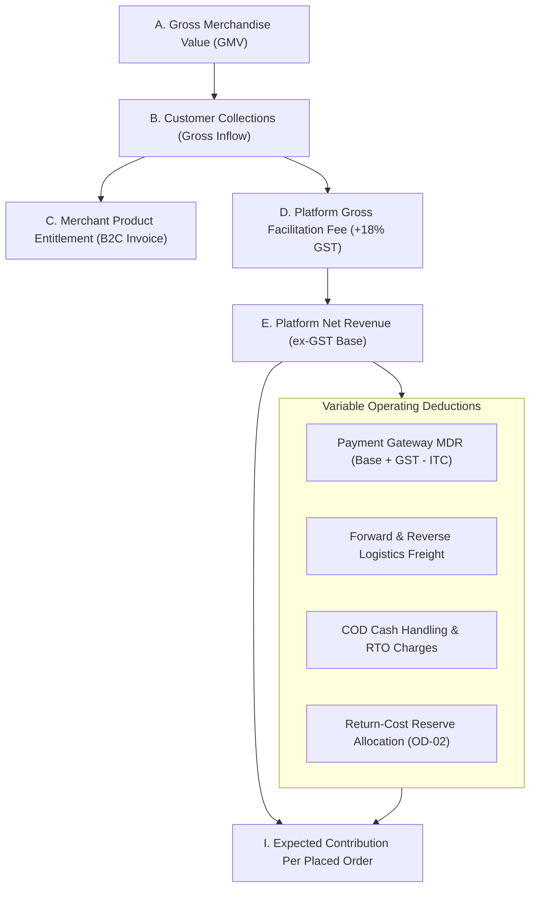

# ATEEVRA Phase M2-14 — OD-01 Financial Assumptions & Methodology Register
## Definitional Hierarchy, Baseline Parameters, Sensitivity Ranges & Reconciliation Formulas

**Document ID:** `REG-M2-14-OD-01-ASSUMPTIONS`  
**Governance Authority:** Phase M2-14 Central Policy Blueprint & Master Decision Register  
**Decision Reference:** Owner Decision OD-01 (Marketplace Commercial Revenue Architecture)  
**Governance Status:** `DOCUMENTATION & FINANCIAL MODELING ONLY — CONFIGURABLE PARAMETERS`  
**Decision Approval Status:** `OD-01 UNAPPROVED — PENDING OWNER DECISION & PROFESSIONAL VALIDATION`  
**Audit Execution Mode:** STRICTLY READ-ONLY AUDIT & FINANCIAL MODELING  
**Active Phase:** Phase M2-14 (Payments, Refunds, Returns and Exchanges)  
**Implementation Authorization Status:** `PLANNING ONLY — IMPLEMENTATION NOT AUTHORIZED`  
**Preserved Baseline:** OD-02 Version 1.0.0 (`OWNER APPROVED — INITIAL POLICY BASELINE`)  
**Companion Documents:**
- [`docs/mvp2/m2-14/blueprint/M2-14-OD-01-MARKETPLACE-UNIT-ECONOMICS-STRESS-TEST.md`](M2-14-OD-01-MARKETPLACE-UNIT-ECONOMICS-STRESS-TEST.md)
- [`docs/mvp2/m2-14/blueprint/M2-14-OD-01-FEE-AND-SHIPPING-SCENARIO-MATRIX.md`](M2-14-OD-01-FEE-AND-SHIPPING-SCENARIO-MATRIX.md)
- [`docs/mvp2/m2-14/blueprint/M2-14-OD-01-BREAK-EVEN-AND-SENSITIVITY-ANALYSIS.md`](M2-14-OD-01-BREAK-EVEN-AND-SENSITIVITY-ANALYSIS.md)
- [`docs/mvp2/m2-14/blueprint/policies/OD-02-01-RETURN-COST-RESERVE.md`](policies/OD-02-01-RETURN-COST-RESERVE.md)

---

## 1. Executive Summary & Governance Guide

This document establishes the single source of truth for all mathematical formulas, financial definitions, parameter baselines, sensitivity test ranges, and accounting reconciliation rules used throughout the Phase M2-14 financial stress tests.

### 1.1. Core Governance Invariants
1. **Hypothetical & Configurable Parameters:** All numerical figures, fee rates, freight costs, and incident probabilities documented herein are **illustrative stress-testing parameters**. They do **NOT** represent actual production telemetry or final owner-approved policies.
2. **OD-01 Status Unchanged:** Owner Decision OD-01 remains strictly **UNAPPROVED**.
3. **Preservation of OD-02 Baseline:** The six approved initial policies of OD-02 ([`POL-OD-02-01`](policies/OD-02-01-RETURN-COST-RESERVE.md) through [`POL-OD-02-06`](policies/OD-02-06-PRICING-BOUND-CONFLICTS.md)) are preserved at Version `1.0.0`.
4. **Zero Implementation Changes:** Zero code, schemas, database migrations, APIs, configuration, or runtime changes are authorized.

---

## 2. Definitional Hierarchy & Financial Terminology

To prevent double-counting and eliminate accounting ambiguity, twelve standardized financial measures are defined:

### Metric A: Gross Merchandise Value (GMV)
- **Definition:** The aggregate retail selling price of all product items placed in customer orders, inclusive of item-level product GST, but **excluding** customer-paid shipping charges, customer convenience fees, and post-order cancellations.
- **Formula:**
  $$\text{GMV} = \sum_{i=1}^{n} (\text{Quantity}_i \times P_{\text{cust}, i})$$

### Metric B: Customer Collections (Gross Inflow)
- **Definition:** The total cash collected from the customer via payment gateway capture (prepaid) or 3PL courier doorstep collection (COD).
- **Formula:**
  $$\text{Customer Collections} = \text{GMV} + \text{Shipping Fee}_{\text{cust}} + \text{Platform Fee}_{\text{cust}} - \text{Discounts}_{\text{order}}$$
- **Invariant:** Customer collections represent **escrow custodial cash inflows**, NOT platform revenue.

### Metric C: Merchant Product Entitlement
- **Definition:** The gross sales revenue recognized by the merchant as the seller of record on their customer-facing B2C GST tax invoice, before contractual marketplace fee deductions and statutory tax withholdings.
- **Formula:**
  $$\text{Merchant Entitlement} = \sum_{i=1}^{n} (\text{Quantity}_i \times P_{\text{cust}, i}) - \text{Discounts}_{\text{merchant}}$$

### Metric D: Platform Gross Fee Revenue
- **Definition:** The total contractual facilitation fee invoiced by ATEEVRA to the merchant (or customer), **inclusive of 18% GST**.
- **Formula:**
  $$\text{Platform Gross Fee} = \text{Platform Net Fee} \times (1 + \text{GST}_{\text{rate}})$$

### Metric E: Platform Net Revenue (ex-GST Base)
- **Definition:** ATEEVRA's recognized top-line service revenue under SAC 998371, **excluding GST collected on behalf of the Government**.
- **Formula:**
  $$\text{Platform Net Revenue} = \frac{\text{Platform Gross Fee}}{1 + \text{GST}_{\text{rate}}}$$
- **Invariant:** GST collected on platform fees is an output tax liability payable to the Government via GSTR-3B; it is **NEVER platform revenue**.

### Metric F: Platform Variable Operating Costs
- **Definition:** Direct cash outflows incurred by ATEEVRA to process, fulfill, and collect payments on an order.
- **Components:**
  1. **Gateway MDR ($G_{\text{net}}$):** Gateway processing charge less eligible Input Tax Credit (ITC).
  2. **Logistics Freight ($S_{\text{fwd}}, S_{\text{rev}}$):** Actual 3PL carrier charges incurred by the platform.
  3. **COD Handling Charges ($G_{\text{cod}}$):** 3PL fee for cash collection at doorstep.
  4. **RTO Friction Charges ($C_{\text{rto}}$):** Reverse transit and return-to-origin processing fees.

### Metric G: Return-Cost Reserve Allocation
- **Definition:** An internal managerial profit earmark allocated per delivered order pursuant to [`POL-OD-02-01`](policies/OD-02-01-RETURN-COST-RESERVE.md) to fund future return friction.
- **Baseline:** $R_{\text{target}} \approx ₹22.61$ across payment methods (₹16.85 prepaid weight; ₹28.53 COD weight).
- **Accounting Distinction:** A reserve allocation is an **internal equity/margin appropriation**, NOT an actual cash outflow. Actual cash drain occurs only when physical returns or damage incidents materialize.

### Metric H: Actual Incident Cash Expenditure
- **Definition:** The physical cash outflow incurred when a specific cancellation, return, or courier damage incident occurs:
  $$\text{Actual Incident Cash} = S_{\text{fwd}} + S_{\text{rev}} + G_{\text{sunk}} - \text{Courier Recovery}$$
- **Reconciliation Invariant:** In expected contribution modeling, one must model **EITHER** (a) the reserve allocation $R_{\text{target}}$ as a proxy for expected loss, **OR** (b) the weighted probability of actual incident expenditures ($\sum p_i \times \text{Loss}_i$). Combining both without netting reserve releases results in double-counting return expenses!

### Metric I: Expected Contribution Per Placed Order ($\mathbb{E}[\text{Contribution}]$)
- **Definition:** The probability-weighted economic profit retained by ATEEVRA across all potential lifecycle outcomes of a placed order.
- **Formula:**
  $$\mathbb{E}[\text{Contribution}] = \sum_{k \in \text{Outcomes}} \Big( \text{Probability}_k \times \text{Net Platform Contribution}_k \Big)$$

### Metric J: Contribution Per Successfully Delivered Order
- **Definition:** The net margin generated on an order that is successfully delivered, accepted, and retained by the customer through the return window:
  $$\text{Contribution}_{\text{delivered}} = \text{Platform Net Fee} - G_{\text{net}} - S_{\text{unfunded}} - R_{\text{reserve}}$$

### Metric K: Contribution Margin (%)
- **Definition:** The ratio of platform net contribution to gross order merchandise value:
  $$\text{Contribution Margin} = \frac{\mathbb{E}[\text{Contribution}]}{\text{GMV}} \times 100\%$$

### Metric L: Monthly Operating Contribution
- **Definition:** Total platform contribution generated across a given monthly order volume ($N_{\text{orders}}$):
  $$\text{Monthly Operating Contribution} = N_{\text{orders}} \times \mathbb{E}[\text{Contribution}]$$

---

## 3. Standardized Testing Parameters & Sensitivity Ranges

The stress test evaluates five core parameter sets:

### 3.1. Basket Order Value Bands (AOV)

| AOV Band | Representative GMV | Item Count | Merchant Count | Illustrative Products |
| :--- | :---: | :---: | :---: | :--- |
| **Low AOV** | **₹399.00** (Range: ₹299–₹499) | 1 item | 1 merchant | Accessories, tees, socks, beauty basics |
| **Medium AOV** | **₹999.00** (Range: ₹799–₹1,199) | 1–2 items | 1 merchant | Casual apparel, footwear, home decor |
| **High AOV** | **₹2,499.00** (Range: ₹1,999–₹2,999) | 2–3 items | 1–2 merchants | Designer wear, premium leather, jackets |

---

### 3.2. Platform Fee Structure Sensitivity Test Ranges

| Fee Structure | Illustrative Test Rates | Calculation Base | GST Application | Invoicing Flow |
| :--- | :---: | :--- | :--- | :--- |
| **Option A: Fixed Fee Per Order** | **₹20, ₹40, ₹60, ₹80** | Per fulfilled order | Exclusive (+ 18% GST) | ATEEVRA $\rightarrow$ Merchant (B2B) |
| **Option B: Fixed Fee Per Item** | **₹10, ₹20, ₹25, ₹40** | Per delivered unit | Exclusive (+ 18% GST) | ATEEVRA $\rightarrow$ Merchant (B2B) |
| **Option C: Percentage Fee** | **5%, 6%, 8%, 10%, 12%** | Product selling price | Exclusive (+ 18% GST) | ATEEVRA $\rightarrow$ Merchant (B2B) |
| **Option D: Hybrid Fee** | **₹10 + 3%, ₹20 + 5%, ₹30 + 5%** | Base + % of price | Exclusive (+ 18% GST) | ATEEVRA $\rightarrow$ Merchant (B2B) |
| **Option E: Customer Convenience Fee**| **₹10, ₹19, ₹29** | Per checkout order | Inclusive of 18% GST | ATEEVRA $\rightarrow$ Customer (B2C) |

---

### 3.3. Forward Shipping Cost Allocation Models

| Shipping Model | Description | Commercial Mechanism | Freight Expense Payer |
| :--- | :--- | :--- | :--- |
| **Model A: Customer-Paid Shipping** | Customer pays actual/flat shipping fee at checkout. | Billed to customer; platform retains to pay 3PL. | **Customer** (Platform neutral) |
| **Model B: Merchant-Paid Shipping** | Merchant bears shipping expense. | Debited from merchant settlement payout. | **Merchant** (Platform neutral) |
| **Model C: Platform-Absorbed Shipping**| ATEEVRA absorbs 100% of forward freight. | Funded entirely out of platform facilitation fee. | **ATEEVRA** (High platform risk) |
| **Model D: Hybrid Free Shipping** | Free shipping above threshold (₹999/₹1,499); customer pays below. | Platform absorbs above threshold; customer pays below. | **Shared / Contingent** |
| **Model E: Multi-Vendor Consignment**| Shipping charged separately per merchant package in cart. | Customer pays $N \times ₹S$; platform pays carriers. | **Customer** (Multi-vendor neutral)|

- **Freight Cost Test Points:** **₹50.00**, **₹70.00** (Baseline), **₹90.00**, and **₹120.00** per shipment.

---

### 3.4. Payment Processing & Statutory Tax Parameters

| Parameter | Baseline Value | Test Range | Primary Source & Regulatory Citation |
| :--- | :---: | :---: | :--- |
| **Payment Gateway MDR (Prepaid)** | **2.00%** | 1.75%, 2.00%, 2.36% | Commercial aggregator card (Razorpay / Cashfree). Inclusive of GST. |
| **Gateway GST ITC Recovery** | **85.0%** | 0.0%, 85.0%, 100.0% | Conditional ITC eligibility under CGST Act Section 16(2) and Section 31. |
| **COD Cash Handling Fee** | **₹30.00** | ₹25.00, ₹30.00, ₹40.00 | 3PL courier contractual doorstep collection surcharge. |
| **GST Section 52 TCS Rate** | **0.50%** | Fixed Statutory | **CBIC Notification No. 15/2024–Central Tax (effective 10 July 2024)**. |
| **Income Tax Section 194-O TDS Rate**| **0.10%** | Fixed Statutory | **Finance (No. 2) Act, 2024 (effective 1 October 2024)**. |
| **Platform Fee GST Rate** | **18.00%** | Fixed Statutory | SAC 998371 (Electronic commerce facilitation services). |

---

### 3.5. Order Lifecycle Incident Probability Assumptions

| Operational Lifecycle Outcome | Prepaid Baseline Prob ($p_{\text{prep}}$) | COD Baseline Prob ($p_{\text{cod}}$) | Adverse Stress Prob ($p_{\text{stress}}$) | Financial Loss Mechanics |
| :--- | :---: | :---: | :---: | :--- |
| **1. Successful Delivery (Kept)** | **88.0%** | **68.0%** | **55.0%** | Full platform fee earned; gateway & logistics incurred. |
| **2. Pre-Dispatch Cancellation** | **4.0%** | **3.0%** | **6.0%** | Sunk gateway MDR on prepaid; zero shipping; fee waived. |
| **3. In-Transit Cancellation** | **0.5%** | **1.0%** | **2.0%** | Forward freight + RTO freight incurred; fee waived. |
| **4. Customer Remorse Return** | **6.0%** | **7.0%** | **12.0%** | Fwd + Rev freight incurred; gateway sunk; fee credited. |
| **5. Merchant-Fault Return** | **1.0%** | **2.0%** | **4.0%** | Fwd + Rev freight debited to merchant; gateway sunk. |
| **6. Courier Damage Return** | **0.5%** | **1.0%** | **2.0%** | Net loss after partial 3PL claim recovery (OD-02-04). |
| **7. COD Doorstep Refusal (RTO)** | **0.0%** (N/A) | **18.0%** | **25.0%** | Fwd + Rev freight incurred; zero revenue collected. |

---

## 4. Master Mathematical Reconciliation Equations

### Equation 1: Net Merchant Settlement Equation
$$\begin{aligned}
\text{Net Settlement} = &\sum P_{\text{cust}} \\
&- \text{Platform Gross Fee} \quad \Big(\text{Base Fee} \times (1 + \text{GST}_{\text{rate}})\Big) \\
&- \text{Statutory TCS} \quad \Big(0.50\% \times \text{Net Taxable Supply}\Big) \\
&- \text{Statutory TDS} \quad \Big(0.10\% \times \text{Gross Facilitated Sales}\Big) \\
&- \text{Merchant-Fault Freight Debits} \quad \Big((S_{\text{fwd}} + S_{\text{rev}}) \text{ on defect returns}\Big) \\
&- \text{Merchant-Borne Forward Freight} \quad \Big(\text{if Shipping Model B}\Big) \\
&\pm \text{Rolling Reserve Allocation / Release} \\
&- \text{Authorized Past Adjustment Receivables}
\end{aligned}$$

### Equation 2: Net Platform Contribution Equation (Per Order)
$$\begin{aligned}
\text{Contribution} = &\text{Platform Net Fee} \quad (\text{ex-GST}) \\
&+ \text{Shipping Fee}_{\text{cust}} \quad (\text{if collected from customer}) \\
&- \text{Effective Gateway MDR} \quad \Big(G_{\text{gross}} - \text{Recoverable ITC}\Big) \\
&- \text{COD Handling Fee} \quad (\text{if COD order}) \\
&- S_{\text{fwd}} \quad (\text{Actual 3PL forward freight}) \\
&- \mathbb{E}[\text{Incident Friction Loss}] \quad (\text{or } R_{\text{reserve}} \text{ under managerial reserve method})
\end{aligned}$$

### Equation 3: Break-Even Platform Fee Equation (Under Shipping Model C)
To achieve zero net contribution ($\text{Contribution} \equiv 0$) when ATEEVRA absorbs forward shipping:
$$\text{Fee}_{\text{breakeven}} = \frac{S_{\text{fwd}} + \mathbb{E}[\text{Gateway MDR}] + \mathbb{E}[\text{COD Fee}] + \mathbb{E}[\text{Return Friction}]}{1 - \text{Discount Rate}}$$
This establishes the mathematical floor below which platform operations generate permanent cash drain.
