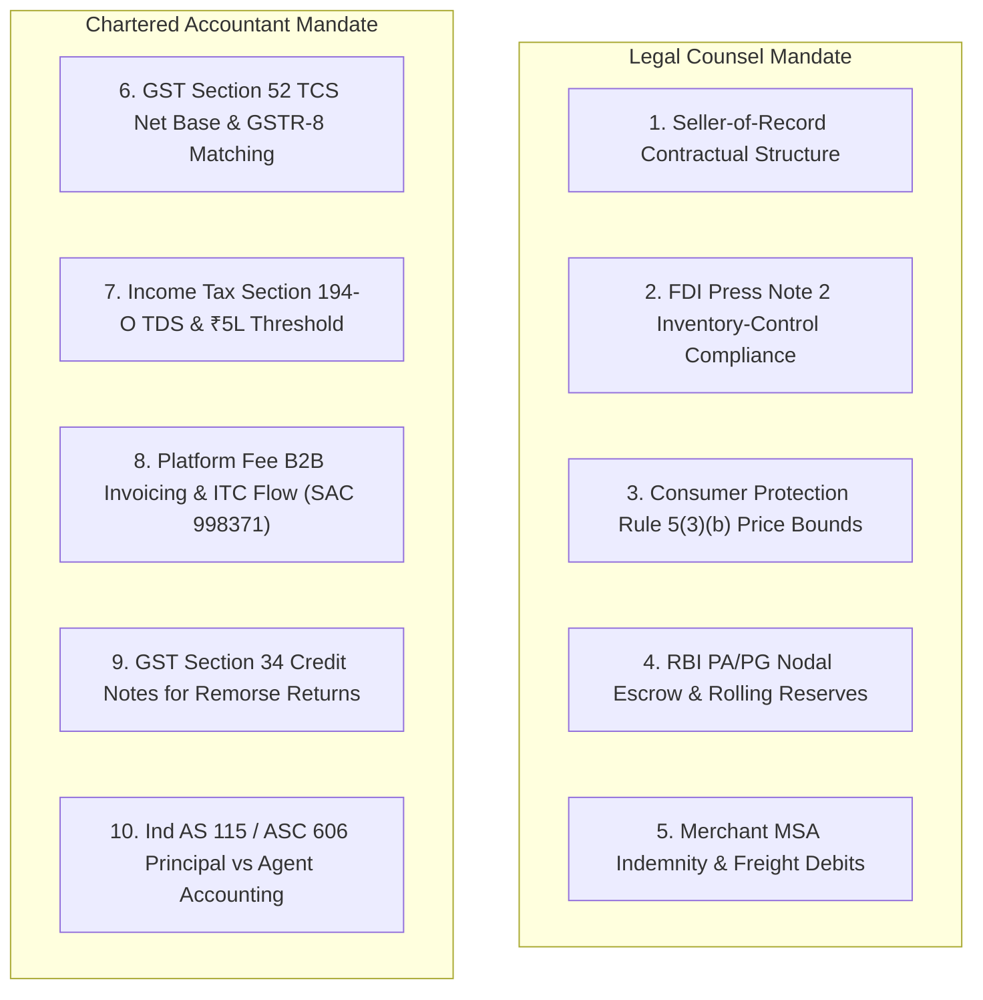

# ATEEVRA Phase M2-14 — OD-01 Statutory Legal, Tax & Accounting Validation Checklist
## Comprehensive Regulatory Framework, Primary Sources, Invoicing Flows & Professional Advisory Register

**Document ID:** `CHK-M2-14-OD-01-LEGAL-TAX`  
**Governance Authority:** Phase M2-14 Central Policy Blueprint & Master Decision Register  
**Decision Reference:** Owner Decision OD-01  
**Scope:** Exhaustive Legal, Tax, Accounting, FDI, Consumer Protection, and Banking Validation Checklist for the Clarified Marketplace Fee Model  
**Audit Execution Mode:** STRICTLY READ-ONLY AUDIT & REGULATORY MAPPING  
**Active Phase:** Phase M2-14 (Payments, Refunds, Returns and Exchanges)  
**Implementation Authorization Status:** `PLANNING ONLY — IMPLEMENTATION NOT AUTHORIZED`  
**Companion Documents:**
- [`docs/mvp2/m2-14/blueprint/M2-14-OD-01-MARKETPLACE-PLATFORM-FEE-COMPARISON.md`](file:///C:/Users/Shubham/OneDrive/Desktop/ecom_mvp/docs/mvp2/m2-14/blueprint/M2-14-OD-01-MARKETPLACE-PLATFORM-FEE-COMPARISON.md)
- [`docs/mvp2/m2-14/blueprint/M2-14-OD-01-FINANCIAL-SCENARIO-MODEL.md`](file:///C:/Users/Shubham/OneDrive/Desktop/ecom_mvp/docs/mvp2/m2-14/blueprint/M2-14-OD-01-FINANCIAL-SCENARIO-MODEL.md)
- [`docs/mvp2/m2-14/blueprint/M2-14-OD-05-TAX-ASSUMPTION-ERRATA-AND-VALIDATION.md`](file:///C:/Users/Shubham/OneDrive/Desktop/ecom_mvp/docs/mvp2/m2-14/blueprint/M2-14-OD-05-TAX-ASSUMPTION-ERRATA-AND-VALIDATION.md)
- [`docs/mvp2/m2-14/M2-14-OWNER-DECISION-REGISTER.md#od-01`](../M2-14-OWNER-DECISION-REGISTER.md#od-01)

---

## 1. Executive Summary & Purpose

Following the Project Owner's clarification that ATEEVRA operates strictly as an **Electronic Commerce Operator (ECO) / Marketplace Facilitation Platform** (with merchants acting as direct sellers of record), this document establishes the binding **Legal, Tax, and Accounting Validation Checklist**.

This document:
1. Synthesizes current, primary official Indian statutory sources (Acts, Gazette Notifications, CBDT/CBIC Circulars, RBI Regulations);
2. Formally distinguishes between **Verified Statutory Law**, **Commercial Platform Interpretation**, and **Unresolved Legal/Tax Questions** requiring external professional sign-off;
3. Catalogs the exact questions that must be submitted to qualified Indian Legal Counsel and Chartered Accountants before any software engineering, database migrations, or financial ledgers are authorized for Phase M2-14.

---

## 2. Official Primary Sources & Verified Statutory Framework

The table below catalogs the primary statutory authorities governing ATEEVRA's marketplace operations:

| Regulatory Domain | Governing Statute & Primary Legal Authority | Specific Provisions & Gazette Notifications | Verified Legal Rule / Threshold | Status Classification |
| :--- | :--- | :--- | :--- | :---: |
| **ECO Definition** | Central Goods and Services Tax (CGST) Act, 2017 | **Section 2(44) & Section 2(45)** | "Electronic Commerce" means supply of goods or services over digital network. "Electronic Commerce Operator" (ECO) means any person who owns, operates or manages digital or electronic facility or platform for electronic commerce. | `VERIFIED LAW` |
| **GST Tax Collected at Source (TCS)** | CGST Act, 2017 / IGST Act, 2017 | **Section 52(1)**; **CBIC Notification No. 15/2024–Central Tax** (dated 10 July 2024), amending Notification No. 52/2018–Central Tax | ECO must collect TCS at **0.50% total** (**0.25% CGST + 0.25% SGST/UTGST** for intra-state; **0.50% IGST** for inter-state) on the **net value of taxable supplies**. Effective **10 July 2024**. Monthly **Form GSTR-8** by 10th. | `VERIFIED LAW` |
| **Income Tax TDS on E-Commerce** | Income-tax Act, 1961 | **Section 194-O(1)**; **Finance (No. 2) Act, 2024** (Act No. 15 of 2024, enacted August 2024, Clause 62) | ECO facilitating sale of goods/services must deduct TDS at **0.10%** of gross sales. Effective **1 October 2024**. **Exemption:** Individuals/HUFs exempt if gross sales $\le$ **₹5,00,000** and PAN/Aadhaar furnished. Non-PAN = 5% (Sec 206AA). | `VERIFIED LAW` |
| **Platform Fee Invoicing & GST** | CGST Act, 2017; GST Tariff Rules | **SAC 998371** (Advertising and sales promotion services / e-commerce facilitation) | ATEEVRA's platform facilitation fee billed to merchants attracts **18% GST**. ATEEVRA issues B2B Tax Invoice; registered merchant avails Input Tax Credit (ITC) under Section 16(2). | `VERIFIED LAW` |
| **GST Credit Notes for Returns** | CGST Act, 2017 | **Section 34(1) & Section 34(2)** | When goods are returned or supply is deficient, merchant issues GST Credit Note to customer/platform. Must be declared in monthly return by 30th November following the end of the financial year. | `VERIFIED LAW` |
| **Foreign Direct Investment (FDI)** | Foreign Exchange Management Act (FEMA); Consolidated FDI Policy, 2020 | **FDI Policy Para 5.2.15.2; Press Note 2 (2018 Series)** | 100% FDI permitted under automatic route in **Marketplace Model of E-Commerce**. FDI **prohibited in Inventory-Based Model**. Platform cannot own or control inventory. Vendor sales capped at 25% on platform. Platform cannot mandate vendor pricing. | `VERIFIED LAW` |
| **Price Manipulation Prohibition** | Consumer Protection Act, 2019; E-Commerce Rules, 2020 | **Rule 5(3)(b)**, Consumer Protection (E-Commerce) Rules, 2020 | No marketplace e-commerce entity shall manipulate the price of the goods or services offered on its platform in such a manner as to gain unreasonable profit or harm consumers. | `VERIFIED LAW` |
| **Seller Transparency & PDP Disclosures** | Consumer Protection (E-Commerce) Rules, 2020 | **Rule 6(1) to Rule 6(5)** | Marketplace must display legal merchant name, geographic address, customer care number, rating, country of origin, return/exchange terms, and grievance officer details on product pages. | `VERIFIED LAW` |
| **Statutory Package MRP Ceilings** | Legal Metrology Act, 2009; Packaged Commodities Rules, 2011 | **Rule 2(m) & Rule 6(1)(e)**, Legal Metrology (Packaged Commodities) Rules, 2011 | Selling price cannot exceed Maximum Retail Price (MRP) printed on packaging. Breaching MRP is a statutory offense. E-commerce platforms must display declared MRP. | `VERIFIED LAW` |
| **Payment Escrow & Payout Turnaround** | Payment and Settlement Systems Act, 2007; RBI Regulations | **RBI Guidelines for Regulation of Payment Aggregators (PA/PG)** (Circular DPSS.CO.PD.No.1810/02.14.008/2019-20) | Payment Aggregators maintain nodal/escrow accounts. Settlements to merchants must occur within **T+1 / T+2 business days** from confirmation of dispatch/delivery, unless contractual dispute retention terms apply. | `VERIFIED LAW` |

---

## 3. Categorized Legal, Tax & Accounting Questions Checklist

The following 10-part checklist must be formally submitted to qualified external advisors:

---

### Category 1: Merchant Seller-of-Record Responsibilities & Invoicing Flow
- [ ] **Q1.1 (Customer Tax Invoice):** In the marketplace model, how is the customer's B2C GST Tax Invoice physically and electronically generated? Does ATEEVRA act as the merchant's pure billing agent generating the invoice on the merchant's letterhead/GSTIN, or does the merchant upload their own invoice?
- [ ] **Q1.2 (Seller Warranty & Product Liability):** Under the Consumer Protection Act, 2019 (Section 84 - Product Liability), does direct invoicing by the merchant fully shield ATEEVRA from defective product liability, provided ATEEVRA complies with intermediary safe harbor conditions under Section 79 of the Information Technology Act, 2000?

### Category 2: Marketplace Statutory Tax Withholding (TCS & TDS)
- [ ] **Q2.1 (Section 52 GST TCS Calculation Base):** Under CBIC Notification No. 15/2024 (0.5% rate), does the "net value of taxable supplies" deduction for returned goods apply strictly to returns within the same calendar month, and how are negative monthly balances carried forward into Form GSTR-8?
- [ ] **Q2.2 (Section 194-O Income Tax TDS Base):** Under the Finance (No. 2) Act, 2024 (0.1% rate), is TDS calculated on the gross product price ($P_{\text{cust}}$) or the net settlement after deducting ATEEVRA's platform facilitation fee?
- [ ] **Q2.3 (Section 194-O ₹5,00,000 Threshold Automation):** To operationalize the exemption for Individual/HUF merchants under Section 194-O(2), what database tracking and audit evidence is required to prove gross sales remained under ₹5 Lakhs, and when must the system automatically switch to deducting 0.1%?
- [ ] **Q2.4 (Section 206AA / 206AB Higher Withholding):** If a merchant fails PAN verification or is flagged as a non-filer on the Income Tax compliance portal, what is the mandatory automated deduction rate (5% vs 20%)?

### Category 3: Platform Facilitation Fee GST & Invoicing Flow
- [ ] **Q3.1 (SAC Code & GST Invoicing):** Does ATEEVRA's platform facilitation fee correctly classify under SAC 998371 (18% GST)? Can ATEEVRA issue a consolidated monthly B2B tax invoice to each merchant summarizing all platform fees deducted during the settlement period?
- [ ] **Q3.2 (Merchant ITC Eligibility):** Can registered merchants claim 100% Input Tax Credit (ITC) on the 18% GST charged by ATEEVRA on platform facilitation fees, ensuring the fee is not a dead tax cost?
- [ ] **Q3.3 (Timing of Tax Liability):** Under Section 13 of the CGST Act (Time of Supply of Services), does ATEEVRA's tax liability for platform fees arise upon order placement, payment capture, item delivery, or settlement payout?

### Category 4: FDI & E-Commerce Policy Compliance
- [ ] **Q4.1 (Dynamic Pricing Guardrails):** If ATEEVRA implements dynamic pricing algorithms bounded by the merchant's approved floor ($P_{\text{realization}}$) and ceiling ($P_{\max}$), does this constitute "directly or indirectly influencing the sale price of goods" in violation of FDI Policy Para 5.2.15.2.4(v)?
- [ ] **Q4.2 (Safe Harbor Structuring):** How should the Merchant Master Services Agreement (MSA) be drafted to establish that all price ranges are merchant-authorized commercial bands rather than platform price manipulation?
- [ ] **Q4.3 (25% Vendor Concentration Limit):** Does ATEEVRA's backend require automated vendor sales monitoring to ensure no single vendor accounts for more than 25% of total marketplace purchases, maintaining marketplace FDI status?

### Category 5: Consumer Protection Rules & Price Transparency
- [ ] **Q5.1 (Rule 5(3)(b) Compliance):** Does charging a separately disclosed customer platform fee (Option E) expose ATEEVRA to regulatory penalties under the Consumer Protection (E-Commerce) Rules or CCPA Dark Patterns Guidelines (drip pricing prohibitions)?
- [ ] **Q5.2 (Mandatory Seller PDP Disclosures):** Does ATEEVRA's current Medusa/Next.js product detail page (PDP) schema capture all statutory seller disclosures mandated under Rule 6 of the E-Commerce Rules, 2020?

### Category 6: Return Logistics, Refund Credit Notes & Clawbacks
- [ ] **Q6.1 (Credit Note Issuance Workflow):** When a remorse return occurs under OD-02, what is the exact legally required flow: does the merchant issue a GST Credit Note to the customer, and does ATEEVRA issue a separate GST Credit Note to the merchant to reverse the platform facilitation fee?
- [ ] **Q6.2 (Merchant-Fault Freight Debits):** Is the contractual deduction of forward and reverse 3PL freight charges (₹140) from merchant settlement receivables under [`POL-OD-02-04`](file:///C:/Users/Shubham/OneDrive/Desktop/ecom_mvp/docs/mvp2/m2-14/blueprint/policies/OD-02-04-COURIER-DAMAGE-LIABILITY.md) fully enforceable under the Indian Contract Act, 1872?
- [ ] **Q6.3 (Negative Settlement Balances):** If a merchant's returns and defect penalties exceed their active sales, what legal recovery mechanisms exist beyond subsequent settlement offsets?

### Category 7: RBI Payment Aggregator Escrow & Payout Timeline Compliance
- [ ] **Q7.1 (Nodal Escrow Retention Limits):** Under RBI PA/PG Guidelines, can ATEEVRA contractually hold merchant funds in the nodal escrow account for the duration of the customer return window (e.g., $D+7$ or $D+14$ days), or does the RBI require immediate disbursement within $T+1 / T+2$ days with risk handled via rolling reserves?
- [ ] **Q7.2 (Rolling Reserve Legality):** What contractual clauses in the Merchant Agreement are required to permit ATEEVRA to retain a 5% to 10% rolling reserve for 30–60 days to cushion against return chargebacks?

---

## 4. Pre-Production Professional Sign-Off Register

Implementation of Phase M2-14 software code, database migrations, and API routes is strictly gated until the following professional sign-offs are physically executed and filed in the repository:

| Validation Gate | Responsible Professional Authority | Required Deliverable | Status |
| :--- | :--- | :--- | :---: |
| **Gate 1: Legal Counsel Opinion on Marketplace Model & FDI Compliance** | Qualified Indian Corporate / E-Commerce Legal Counsel | Formal Written Legal Opinion addressing Q1.1, Q4.1, Q4.2, Q5.1, and countersigned Merchant MSA template. | **PENDING** |
| **Gate 2: Chartered Accountant Memorandum on GST TCS & Income Tax TDS** | Statutory Auditor / Qualified Indian Chartered Accountant (FCA) | Formal Tax Memorandum certifying TCS (0.5%), TDS (0.1%), GSTR-8 reporting, and ₹5L threshold logic. | **PENDING** |
| **Gate 3: CA Memorandum on Platform Fee Invoicing & ITC** | Statutory Auditor / Qualified Indian Chartered Accountant (FCA) | Formal Written Memorandum on SAC 998371, 18% GST invoicing, and Section 34 Credit Notes on returns. | **PENDING** |
| **Gate 4: Banking Partner & Escrow Compliance Sign-Off** | Commercial Banking Partner / Payment Aggregator Legal (Razorpay / Cashfree) | Formal Countersigned Nodal Escrow Agreement approving settlement turnaround and rolling reserve schedules. | **PENDING** |
