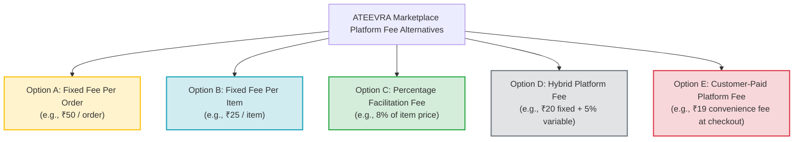

# ATEEVRA Phase M2-14 — OD-01 Marketplace Platform Fee Structure Comparison
## Architectural, Commercial, Tax and Operational Evaluation of Marketplace Revenue Models

**Document ID:** `CMP-M2-14-OD-01-FEE-MODELS`  
**Governance Authority:** Phase M2-14 Central Policy Blueprint & Master Decision Register  
**Decision Reference:** Owner Decision OD-01  
**Decision Title:** Marketplace Commercial Revenue Architecture & Platform Facilitation Fee Model  
**Owner Business Model Direction:** Marketplace Facilitation Platform (Merchants as Sellers of Record)  
**Governance Status:** `OWNER DIRECTION RECORDED — PENDING FEE SELECTION & PROFESSIONAL VALIDATION`  
**Audit Execution Mode:** STRICTLY DOCUMENTATION & COMPARATIVE FINANCIAL ANALYSIS  
**Active Phase:** Phase M2-14 (Payments, Refunds, Returns and Exchanges)  
**Implementation Authorization Status:** `PLANNING ONLY — IMPLEMENTATION NOT AUTHORIZED`  
**Parent Decision Register:** [`../M2-14-OWNER-DECISION-REGISTER.md#od-01`](../M2-14-OWNER-DECISION-REGISTER.md#od-01)  
**Companion Documents:**
- [`docs/mvp2/m2-14/blueprint/M2-14-OD-01-FINANCIAL-SCENARIO-MODEL.md`](file:///C:/Users/Shubham/OneDrive/Desktop/ecom_mvp/docs/mvp2/m2-14/blueprint/M2-14-OD-01-FINANCIAL-SCENARIO-MODEL.md)
- [`docs/mvp2/m2-14/blueprint/M2-14-OD-01-LEGAL-ACCOUNTING-VALIDATION-CHECKLIST.md`](file:///C:/Users/Shubham/OneDrive/Desktop/ecom_mvp/docs/mvp2/m2-14/blueprint/M2-14-OD-01-LEGAL-ACCOUNTING-VALIDATION-CHECKLIST.md)
- [`docs/mvp2/m2-14/blueprint/M2-14-OD-01-OWNER-REVIEW-PACKAGE.md`](file:///C:/Users/Shubham/OneDrive/Desktop/ecom_mvp/docs/mvp2/m2-14/blueprint/M2-14-OD-01-OWNER-REVIEW-PACKAGE.md)
- [`docs/mvp2/m2-14/decisions/M2-14-OD-01-PRICING-MODEL-ANALYSIS.md`](file:///C:/Users/Shubham/OneDrive/Desktop/ecom_mvp/docs/mvp2/m2-14/decisions/M2-14-OD-01-PRICING-MODEL-ANALYSIS.md)

---

## 1. Project Owner's Clarified Business Model Direction

The Project Owner has formally clarified the commercial and legal business model direction for ATEEVRA in Phase M2-14:

1. **Merchants are Sellers of Record:** Third-party merchants list and sell their products directly to retail customers on the ATEEVRA marketplace platform. The merchant is the vendor of record issuing the customer-facing tax invoice.
2. **Direct Merchant-to-Customer Sale:** The contract of sale for goods is formed directly between the merchant and the end customer.
3. **Marketplace & Technology Intermediary:** ATEEVRA operates strictly as an Electronic Commerce Operator (ECO) providing digital marketplace software, storefront discovery, payment gateway routing, and technology facilitation services.
4. **Platform Revenue via Separately Defined Facilitation Fee:** ATEEVRA earns revenue through a separately negotiated, transparently defined platform/facilitation fee charged for its marketplace services.
5. **No Wholesale Inventory Ownership / Resale:** ATEEVRA is **NOT** intended to purchase merchant inventory, take title to physical goods, or act as a wholesale buyer reselling products to consumers.

> [!IMPORTANT]
> **Governance Status Invariant:**  
> This direction records the **Project Owner's selected commercial business-model orientation**, superseding earlier wholesale buy-sell assumptions.  
> This direction does **NOT** constitute a completed legal classification, statutory tax determination, or professional sign-off. The specific platform fee structure, calculation rates, and ledger deduction algorithms remain **PENDING OWNER SELECTION AND MANDATORY LEGAL/CA VALIDATION**. Zero code or database changes are authorized.

---

## 2. Reassessment of Previous OD-01 Models Against Owner Direction

In earlier documentation drafts, OD-01 evaluated several pricing paradigms that must now be re-evaluated against the Owner's clarified direction:

### 2.1. Why Previous "Mode 1: Fixed Realization with Wholesale Markup" Fails the Clarified Model
- **Previous Premise:** Mode 1 assumed ATEEVRA guaranteed a fixed realization ($P_{\text{realization}}$) to the merchant, calculated an independent customer shelf price ($P_{\text{sell}}$), and retained the spread:
  $$\text{Wholesale Spread} = P_{\text{sell}} - P_{\text{realization}}$$
- **Fatal Contradiction with Seller-of-Record Marketplace Model:**
  1. *Invoice Contradiction:* If the merchant is the seller of record, the merchant must issue the customer's GST tax invoice for the actual price paid by the customer ($P_{\text{sell}}$). The merchant's books must recognize $P_{\text{sell}}$ as gross turnover. ATEEVRA cannot unilaterally pocket the spread $(P_{\text{sell}} - P_{\text{realization}})$ without an explicit commercial contract defining that spread as a taxable service fee.
  2. *FDI & Inventory Control Risk:* Under the Consolidated FDI Policy of India (Press Note 2 of 2018), if an e-commerce platform unilaterally sets prices and pockets wholesale spreads, regulatory authorities may reclassify the platform as an **inventory-based model** (where FDI is strictly prohibited).
  3. *Consumer Protection Rule 5(3)(b):* Marketplace entities are expressly prohibited from manipulating prices of goods listed on their platforms.
  4. *Erroneous Spread Ownership:* Treating $(P_{\text{sell}} - P_{\text{realization}})$ as "automatically belonging to ATEEVRA" is legally and commercially invalid in a seller-of-record model. ATEEVRA's revenue must be governed by a **contractually agreed Platform Facilitation Fee**.

### 2.2. Mode 2: Dynamic Revenue Sharing
- **Previous Premise:** A variable revenue share where merchant realization flexed dynamically based on the final achieved customer price.
- **Assessment:** While theoretically compatible with an agency framework, it creates extreme accounting opacity for merchants, complex multi-tier tax reconciliation on returns, and high risk of merchant disputes. It remains **DEFERRED — UNAPPROVED**.

### 2.3. Traditional Percentage Commission vs Modern Platform Fee
- **Traditional Commission:** The historical e-commerce standard (e.g., 5% to 15% of product value). Compatible with the seller-of-record model, where ATEEVRA deducts commission + 18% GST and remits the net balance.
- **Clarified Direction:** ATEEVRA seeks a modernized, transparent **Platform Facilitation Fee** structure that balances merchant adoption, predictable unit economics, and platform cost recovery.

---

## 3. Exhaustive Analysis of Five Platform Fee Structures

To support the Project Owner's decision, five distinct platform fee alternatives are evaluated across fourteen standardized operational, commercial, and financial dimensions:

---

### 3.1. Option A: Fixed Platform Fee Per Successful Order
*Illustrative Baseline: ₹50.00 per fulfilled order, regardless of item count or basket value.*

1. **Who Pays the Fee:** Merchant (deducted from gross order settlement payout).
2. **Who Invoices the Fee:** ATEEVRA issues a B2B Tax Invoice to the merchant.
3. **Calculation Base:** Per unique delivered order (or per vendor sub-order in multi-vendor carts).
4. **GST Treatment:** Service Accounting Code (SAC) **998371** (Electronic commerce facilitation services). Taxed at **18% GST** (₹50.00 base + ₹9.00 GST = ₹59.00 gross deduction). Registered merchants claim Input Tax Credit (ITC).
5. **When Earned:** Upon successful delivery and expiration of customer return window.
6. **Cancellations & Returns:**
   - Pre-dispatch cancellation: 100% reversed / not charged.
   - Remorse return: Platform fee is **waived / refunded to merchant** (or not earned) because sale did not crystallize.
   - Merchant-fault return: Platform fee is **earned and retained** as service was rendered and defect was seller-caused.
7. **COD vs Prepaid:** Identical fee structure; deducted from COD remittance or prepaid settlement.
8. **Multi-Vendor Carts:** Must be applied **per vendor consignment** (e.g., ₹50 per vendor sub-order). Charging ₹50 across a 3-vendor order creates arbitrary cross-seller fee allocation disputes.
9. **Merchant Settlement Ledger Formula:**
   $$\text{Net Payable} = \text{Gross Sales} - \text{Fixed Fee (₹50)} - \text{GST on Fee (₹9)} - \text{TCS/TDS} - \text{OD-02 Deductions}$$
10. **Discounts & Promotions:** Neutral to discounts (fee is fixed). Platform marketing coupons do not dilute the ₹50 fee.
11. **Customer Price Transparency:** 100% transparent. Customer sees pure product price; zero unexpected checkout fees.
12. **Merchant Adoption:** Highly attractive for high-AOV (Average Order Value) products (e.g. ₹5,000 product pays only 1%); highly punitive and unviable for low-AOV items (e.g. ₹200 product pays 25%).
13. **Platform Contribution:** Fails to scale with basket size; high risk of operating deficit on high-value orders requiring heavy return reserve buffers.
14. **Complexity:** Low operational and reconciliation complexity.

---

### 3.2. Option B: Fixed Platform Fee Per Item
*Illustrative Baseline: ₹25.00 per item delivered.*

1. **Who Pays the Fee:** Merchant (deducted per line item from settlement).
2. **Who Invoices the Fee:** ATEEVRA issues a B2B Tax Invoice to the merchant.
3. **Calculation Base:** Quantity of delivered units ($\text{Units} \times ₹25.00$).
4. **GST Treatment:** SAC 998371, 18% GST (₹25.00 base + ₹4.50 GST = ₹29.50 gross per item). Merchant claims ITC.
5. **When Earned:** Upon delivery and return window expiration.
6. **Cancellations & Returns:** Line-item level reversal on remorse returns; retained on merchant-fault returns.
7. **COD vs Prepaid:** Uniform across payment methods.
8. **Multi-Vendor Carts:** Seamlessly modular; directly associated with each merchant's specific line items.
9. **Merchant Settlement Ledger Formula:**
   $$\text{Net Payable} = \sum(\text{Qty} \times P_{\text{item}}) - \sum(\text{Qty} \times ₹25) - \text{GST} - \text{TCS/TDS}$$
10. **Discounts & Promotions:** Neutral to discounts.
11. **Customer Price Transparency:** 100% transparent.
12. **Merchant Adoption:** Discourages multi-item low-value catalog listings; penalizes bundling.
13. **Platform Contribution:** Scales with unit volume, but fails to capture product value upside. Low-priced items become uncompetitive.
14. **Complexity:** Moderate line-item reconciliation complexity.

---

### 3.3. Option C: Percentage-Based Merchant Facilitation Fee
*Illustrative Baseline: 8.0% or 10.0% of the customer product selling price.*

1. **Who Pays the Fee:** Merchant (deducted from gross product sales).
2. **Who Invoices the Fee:** ATEEVRA issues a B2B Tax Invoice to the merchant.
3. **Calculation Base:** Item selling price ($P_{\text{item}}$) or net merchant line subtotal.
4. **GST Treatment:** SAC 998371, 18% GST applied to the fee amount:
   $$\text{Fee Amount} = P_{\text{item}} \times 10\% = ₹100.00; \quad \text{GST (18\%)} = ₹18.00; \quad \text{Gross Fee} = ₹118.00$$
   Merchant claims ₹18.00 ITC against their outward GST liability.
5. **When Earned:** Upon successful customer delivery and expiration of return window.
6. **Cancellations & Returns:**
   - Cancellation: 100% fee reversed.
   - Remorse return: Fee reversed via GST Credit Note issued by ATEEVRA to merchant.
   - Merchant-fault return: Fee retained by ATEEVRA or charged as administrative penalty.
7. **COD vs Prepaid:** Uniform.
8. **Multi-Vendor Carts:** Inherently proportional and fair; calculated independently per vendor item without cross-subsidy.
9. **Merchant Settlement Ledger Formula:**
   $$\text{Net Payable} = \sum P_{\text{item}} - \sum(P_{\text{item}} \times \text{Fee}\%) - \text{GST on Fee} - \text{TCS (0.5\%)} - \text{TDS (0.1\%)} - \text{OD-02 Offsets}$$
10. **Discounts & Promotions:** 
    - Critical policy choice: Is fee calculated on pre-discount MRP/List Price or post-discount actual sale price? Industry standard is **actual transaction price** paid by customer.
11. **Customer Price Transparency:** Flawless. Customer pays catalog price; platform fee is strictly an internal merchant service expense.
12. **Merchant Adoption:** Maximum merchant familiarity. Matches standard industry practices (Amazon, Flipkart, Myntra, Etsy). Highly competitive for entry-level sellers.
13. **Platform Contribution:** Dynamically scales with product price. Generates substantial revenue on premium goods to fund OD-02 Return-Cost Reserves, logistics deficits, and customer service.
14. **Complexity:** Standard e-commerce accounting; supported by standard ERP and marketplace plugins.

---

### 3.4. Option D: Hybrid Platform Fee (Fixed Base + Percentage)
*Illustrative Baseline: ₹20.00 fixed order/item fee + 5.0% percentage fee.*

1. **Who Pays the Fee:** Merchant.
2. **Who Invoices the Fee:** ATEEVRA issues a B2B Tax Invoice.
3. **Calculation Base:** Combined formula: $\text{Fee} = ₹20.00 + (P_{\text{item}} \times 5\%)$.
4. **GST Treatment:** SAC 998371, 18% GST on aggregate fee amount.
5. **When Earned:** Upon delivery and return window expiration.
6. **Cancellations & Returns:** Pro-rata reversal on customer remorse.
7. **COD vs Prepaid:** Uniform.
8. **Multi-Vendor Carts:** Fixed component applied per vendor consignment; percentage applied per item.
9. **Merchant Settlement Ledger Formula:**
   $$\text{Net Payable} = \text{Gross Sales} - [₹20 + (5\% \times \text{Sales})] - \text{GST} - \text{TCS/TDS} - \text{Deductions}$$
10. **Discounts & Promotions:** Percentage applies to net sale; fixed fee remains intact.
11. **Customer Price Transparency:** 100% transparent.
12. **Merchant Adoption:** Well accepted if rates are competitive. Fixed base covers minimal gateway/logistics overhead; percentage captures scale.
13. **Platform Contribution:** Exceptional downside protection. The fixed ₹20 guarantees platform cost recovery on cheap items, while 5% captures value on expensive items.
14. **Complexity:** Slightly higher reconciliation complexity than pure percentage.

---

### 3.5. Option E: Customer-Paid Platform / Convenience Fee
*Illustrative Baseline: ₹19.00 flat convenience fee billed directly to the customer on checkout.*

1. **Who Pays the Fee:** End Customer (added to checkout order total).
2. **Who Invoices the Fee:** ATEEVRA issues a B2C Tax Invoice directly to the customer for the ₹19.00 platform fee.
3. **Calculation Base:** Per checkout transaction.
4. **GST Treatment:** SAC 998371, 18% GST (₹16.10 base + ₹2.90 GST = ₹19.00 gross). B2C invoice generated by ATEEVRA. Customer cannot claim ITC.
5. **When Earned:** At checkout payment capture / dispatch.
6. **Cancellations & Returns:**
   - Consumer litigation risk: Under Indian Consumer Protection (E-Commerce) Rules, 2020, if customer cancels or returns an order, retaining a customer-paid platform fee frequently triggers consumer forum complaints and chargebacks unless explicitly declared non-refundable in checkout terms.
7. **COD vs Prepaid:** COD customers frequently refuse to pay extra platform fees at delivery, escalating RTO rates.
8. **Multi-Vendor Carts:** Single flat fee charged to customer; does not affect merchant payouts.
9. **Merchant Settlement Ledger Formula:** Merchant receives 100% of product price (less any separate merchant fee). Customer fee flows entirely into ATEEVRA bank account.
10. **Discounts & Promotions:** Completely separate from product vouchers.
11. **Customer Price Transparency:** **POOR / FRICTION POINT**. Causes cart abandonment when unexpected fee appears at checkout. Subject to regulatory scrutiny regarding "drip pricing" and dark patterns under CCPA (Central Consumer Protection Authority) Guidelines, 2023.
12. **Merchant Adoption:** Very high merchant satisfaction (merchants pay zero fees), but merchant sales drop due to checkout cart drop-off.
13. **Platform Contribution:** Highly predictable, but low absolute volume (₹19/order cannot cover ₹70 forward shipping or ₹22.61 return reserves).
14. **Complexity:** High compliance and consumer dispute complexity.

---

## 4. Comprehensive Comparison Matrix Across All 5 Alternatives

| Evaluation Dimension | Option A: Fixed Per Order (₹50) | Option B: Fixed Per Item (₹25) | Option C: Percentage (8–10%) | Option D: Hybrid (₹20 + 5%) | Option E: Customer Fee (₹19) |
| :--- | :---: | :---: | :---: | :---: | :---: |
| **Fee Payer** | Merchant | Merchant | Merchant | Merchant | Customer |
| **Invoicing Entity** | ATEEVRA $\rightarrow$ Merchant | ATEEVRA $\rightarrow$ Merchant | ATEEVRA $\rightarrow$ Merchant | ATEEVRA $\rightarrow$ Merchant | ATEEVRA $\rightarrow$ Customer |
| **GST SAC & Rate** | SAC 998371 (18%) | SAC 998371 (18%) | SAC 998371 (18%) | SAC 998371 (18%) | SAC 998371 (18%) |
| **Merchant ITC Eligibility** | Yes (B2B) | Yes (B2B) | Yes (B2B) | Yes (B2B) | No (B2C) |
| **Checkout Transparency** | High (Zero fees) | High (Zero fees) | High (Zero fees) | High (Zero fees) | Low (Drip pricing risk) |
| **Cart Abandonment Risk** | None | None | None | None | **High** |
| **Downside Cost Recovery** | Moderate | Low on 1-item orders | Low on cheap items | **High (Guaranteed base)** | Low (Flat small sum) |
| **Upside Margin Scaling** | Zero | Zero | **High (Scales with AOV)**| **Moderate** | Zero |
| **Multi-Vendor Cart Fit** | Poor (Allocation issue)| Clean | Clean | Clean | Clean |
| **Remorse Return Handling** | Reverse fee | Reverse per item | Reverse via Credit Note| Reverse pro-rata | High consumer dispute |
| **Regulatory / Dark Pattern Risk**| Zero | Zero | Zero | Zero | **High (CCPA Guidelines)** |
| **Overall Recommendation** | Viable for niche B2B | Flawed for bundling | **PRIMARY RECOMMENDATION**| **STRONG ALTERNATIVE** | **NOT RECOMMENDED** |

---

## 5. Architectural Synthesis & Advisory Recommendation

> [!TIP]
> **Advisory Recommendation (Not Approved — For Owner Decision Only):**  
> 1. **Primary Model:** **Option C (Percentage-Based Merchant Facilitation Fee, e.g., 8.0% to 10.0%)** is recommended as the core revenue model for ATEEVRA. It aligns perfectly with the seller-of-record model, complies cleanly with Indian FDI marketplace rules, scales revenue with product value to fund OD-02 return reserves, and eliminates customer checkout friction.
> 2. **Strong Secondary Model:** **Option D (Hybrid Fee, e.g., ₹20 fixed + 5.0% percentage)** is recommended if ATEEVRA expects a high volume of low-priced items (under ₹400) where percentage fees fail to cover minimum gateway and logistics overhead.
> 3. **Option E (Customer-Paid Fee) is NOT RECOMMENDED** for initial launch due to severe cart abandonment risk and CCPA dark-pattern regulatory scrutiny in India.
