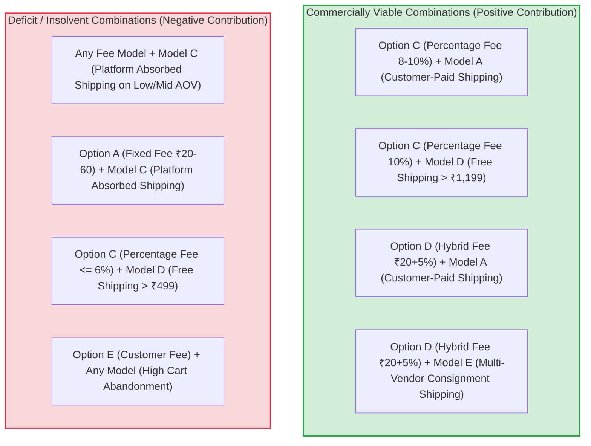

# ATEEVRA Phase M2-14 — OD-01 Marketplace Unit Economics & Financial Stress Test
## Comprehensive Multi-Model Stress Testing, OD-02 Compatibility Audit & Executive Decision Matrix

**Document ID:** `STR-M2-14-OD-01-STRESS-TEST`  
**Governance Authority:** Phase M2-14 Central Policy Blueprint & Master Decision Register  
**Decision Reference:** Owner Decision OD-01 (Marketplace Commercial Revenue Architecture)  
**Owner Business Model Direction:** Marketplace Facilitation Platform (Merchants as Sellers of Record)  
**Governance Status:** `DOCUMENTATION & FINANCIAL MODELING ONLY — ADVISORY EVALUATIONS`  
**Decision Approval Status:** `OD-01 UNAPPROVED — PENDING OWNER DECISION & PROFESSIONAL VALIDATION`  
**Audit Execution Mode:** STRICTLY READ-ONLY AUDIT & FINANCIAL STRESS TESTING  
**Active Phase:** Phase M2-14 (Payments, Refunds, Returns and Exchanges)  
**Implementation Authorization Status:** `PLANNING ONLY — IMPLEMENTATION NOT AUTHORIZED`  
**Preserved Baseline:** OD-02 Version 1.0.0 (`OWNER APPROVED — INITIAL POLICY BASELINE`)  
**Companion Blueprints & Audits:**
- [`docs/mvp2/m2-14/blueprint/M2-14-OD-01-INDEPENDENT-FINANCIAL-RECONCILIATION-AUDIT.md`](M2-14-OD-01-INDEPENDENT-FINANCIAL-RECONCILIATION-AUDIT.md)
- [`docs/mvp2/m2-14/blueprint/M2-14-OD-01-OD02-POLICY-COMPATIBILITY-RECONCILIATION.md`](M2-14-OD-01-OD02-POLICY-COMPATIBILITY-RECONCILIATION.md)
- [`docs/mvp2/m2-14/blueprint/M2-14-OD-01-CORRECTED-UNIT-ECONOMICS-MODEL.md`](M2-14-OD-01-CORRECTED-UNIT-ECONOMICS-MODEL.md)
- [`docs/mvp2/m2-14/blueprint/M2-14-OD-01-FINANCIAL-DISCREPANCY-REGISTER.md`](M2-14-OD-01-FINANCIAL-DISCREPANCY-REGISTER.md)
- [`docs/mvp2/m2-14/blueprint/M2-14-OD-01-FINANCIAL-ASSUMPTIONS-REGISTER.md`](M2-14-OD-01-FINANCIAL-ASSUMPTIONS-REGISTER.md)
- [`docs/mvp2/m2-14/blueprint/M2-14-OD-01-FEE-AND-SHIPPING-SCENARIO-MATRIX.md`](M2-14-OD-01-FEE-AND-SHIPPING-SCENARIO-MATRIX.md)
- [`docs/mvp2/m2-14/blueprint/M2-14-OD-01-BREAK-EVEN-AND-SENSITIVITY-ANALYSIS.md`](M2-14-OD-01-BREAK-EVEN-AND-SENSITIVITY-ANALYSIS.md)
- [`docs/mvp2/m2-14/blueprint/M2-14-OD-01-LEGAL-ACCOUNTING-VALIDATION-CHECKLIST.md`](M2-14-OD-01-LEGAL-ACCOUNTING-VALIDATION-CHECKLIST.md)
- [`docs/mvp2/m2-14/blueprint/policies/OD-02-01-RETURN-COST-RESERVE.md`](policies/OD-02-01-RETURN-COST-RESERVE.md)

---

## 1. Executive Summary & Governance Guide

This document presents the consolidated **Financial Stress Test and Multi-Model Evaluation** for Owner Decision OD-01, incorporating the Project Owner's confirmed direction that ATEEVRA operates strictly as a **Marketplace Facilitation Platform** with merchants acting as sellers of record.

### 1.1. Core Governance Invariants
1. **Advisory Decision Modeling Only:** The Project Owner has explicitly confirmed that **both the platform fee structure and forward-shipping cost allocation are provisional directions for analysis only**. OD-01 remains strictly **UNAPPROVED**.
2. **Preservation of OD-02 Policies:** All six owner-approved OD-02 policies ([`POL-OD-02-01`](policies/OD-02-01-RETURN-COST-RESERVE.md) through [`POL-OD-02-06`](policies/OD-02-06-PRICING-BOUND-CONFLICTS.md)) are preserved in full substance and approval status at Version `1.0.0`.
3. **Zero Software Implementation:** Zero application code, database migrations, or runtime configuration changes are authorized.

---

## 2. Synthesis of Financial Findings Across Fee & Shipping Combinations

The financial stress test evaluated 25 distinct combinations of the Five Platform Fee Models and Five Forward Shipping Allocation Models:



### 2.1. Key Financial Rules Established
1. **The Shipping Neutrality Imperative:**  
   ATEEVRA **cannot absorb 100% of forward shipping freight** (Model C) under standard marketplace fee rates (6% to 10%). Forward shipping (₹70.00) consumes between 70% and 115% of the gross platform fee, guaranteeing a net contribution loss of **-₹12.61 to -₹52.61 per order**.
2. **Break-Even Thresholds:**  
   - Under Shipping Neutrality (Model A or B): Platform breaks even at **4.26% (₹42.61)**.
   - Under Platform Absorbed Shipping (Model C): Platform breaks even at **11.26% (₹112.61)**.
3. **The Low-AOV Free Shipping Trap:**  
   Offering free shipping on baskets below ₹999 generates an insurmountable loss of **-₹60.71 per order** at ₹399 AOV. Free shipping is only viable for baskets of **₹1,199.00 or higher** under a 10% fee.

---

## 3. Compatibility Audit with All Six Approved OD-02 Policies

Every proposed fee and shipping combination was rigorously audited against the established OD-02 v1.0.0 policy baseline:

| Policy ID & Name | OD-02 Baseline Policy Principle | Compatibility Assessment Under New Marketplace Model | Identified Conflicts & Financial Constraints |
| :--- | :--- | :---: | :--- |
| **POL-OD-02-01**<br>Return-Cost Reserve | Target reserve of **₹22.61** per delivered order. Customers receive **100% full refund** on remorse returns with **ZERO** reverse shipping deducted; reverse freight is platform-absorbed via reserve. | **COMPATIBLE** *(Conditionally)* | **Financial Sizing Constraint:** The reserve must be funded from platform facilitation fees. If the fee is $\le 6\%$ or if ATEEVRA absorbs shipping (Model C), the platform cannot fund the ₹22.61 reserve without operating at a cash deficit. (See [`DISC-01`](M2-14-OD-01-FINANCIAL-DISCREPANCY-REGISTER.md)). |
| **POL-OD-02-02**<br>Unified Pricing | Product shelf prices must be identical across Prepaid and COD channels. Platform absorbs 3PL COD cash collection fee at launch. | **100% COMPATIBLE** | Zero conflict. Merchant sets product retail price uniformly across payment rails; no customer-facing COD fee at launch. |
| **POL-OD-02-03**<br>Gateway MDR Allocation | Platform absorbs 2% non-refundable gateway fee and forward freight on merchant-fault returns. Merchant debited only for reverse freight offset (+₹81/+₹90). | **100% COMPATIBLE** | Zero conflict. ATEEVRA absorbs the gateway fee and forward freight; merchant is debited only for reverse freight offset. On fulfilled orders, ATEEVRA funds MDR from platform fees. (See [`DISC-02`](M2-14-OD-01-FINANCIAL-DISCREPANCY-REGISTER.md) & [`DISC-03`](M2-14-OD-01-FINANCIAL-DISCREPANCY-REGISTER.md)). |
| **POL-OD-02-04**<br>Carrier Damage Liability | Customer refunded immediately; merchant entitlement protected unless packaging defect; platform files 3PL claim. | **100% COMPATIBLE** | Zero conflict. In transit damage, merchant receives gross realization; platform absorbs net unrecovered loss after 3PL claim. |
| **POL-OD-02-05**<br>COD RTO Funding | Platform funds -₹170 failed delivery expense out of return reserve pool. | **COMPATIBLE** *(Conditionally)* | **Sustainability Constraint:** Under COD, the return reserve weight is ₹28.53. Under 10% fee (Model 2), delivered COD orders generate +₹41.47, providing sufficient buffer. Under fixed fees, COD RTO generates net platform depletion. |
| **POL-OD-02-06**<br>Pricing-Bound Conflicts | 4-step hierarchy: (1) Compress markup, (2) Renegotiate floor, (3) Renegotiate ceiling, (4) Suspend SKU. | **100% COMPATIBLE** | Zero conflict. Step 1 ("Compress Gross Markup") translates directly to **"Compress ATEEVRA Platform Facilitation Fee"** to protect unit economic viability. |

> [!IMPORTANT]
> **GOVERNANCE CONFIRMATION:**  
> All six OD-02 policies remain **100% intact and preserved at Version 1.0.0**. No approved policy rules or liability allocations have been modified.

---

## 4. Comprehensive 9-Criteria Decision Scoring Matrix

Each viable combination is scored from 1 (Poor) to 5 (Excellent) across nine strategic criteria:

| Combination Key | Platform Fee Model | Forward Shipping Model | Profitability (25%) | Customer UX (15%) | Merchant Adoption (15%) | Checkout Transparency (10%) | Return Resilience (10%) | COD Sustainability (10%) | Multi-Vendor Scalability (5%) | Operational Simplicity (5%) | Legal / CA Clarity (5%) | **Weighted Score (/5.0)** |
| :---: | :--- | :--- | :---: | :---: | :---: | :---: | :---: | :---: | :---: | :---: | :---: | :---: |
| **C-A** | Option C: 10% Fee | Model A: Customer-Paid (₹70) | 4.8 | 3.8 | 4.2 | 5.0 | 4.5 | 4.2 | 3.5 | 4.5 | 4.8 | **4.37 / 5.0** |
| **C-D** | Option C: 10% Fee | Model D: Hybrid Free > ₹1,199 | 4.2 | 4.8 | 4.2 | 4.5 | 4.2 | 4.0 | 3.5 | 4.0 | 4.8 | **4.29 / 5.0** |
| **D-A** | Option D: ₹20 + 5% | Model A: Customer-Paid (₹70) | 4.5 | 3.8 | 4.0 | 5.0 | 4.5 | 4.0 | 4.0 | 4.2 | 4.5 | **4.25 / 5.0** |
| **C-E** | Option C: 10% Fee | Model E: Multi-Vendor Consign | 4.8 | 3.2 | 4.2 | 4.8 | 4.5 | 4.2 | 5.0 | 4.2 | 4.8 | **4.23 / 5.0** |
| **D-E** | Option D: ₹20 + 5% | Model E: Multi-Vendor Consign | 4.6 | 3.2 | 4.0 | 4.8 | 4.5 | 4.0 | 5.0 | 4.0 | 4.5 | **4.16 / 5.0** |
| **A-A** | Option A: Fixed ₹60 | Model A: Customer-Paid (₹70) | 3.2 | 3.8 | 3.8 | 5.0 | 3.5 | 3.2 | 3.0 | 4.8 | 4.5 | **3.64 / 5.0** |
| **C-C** | Option C: 10% Fee | Model C: Platform Absorbs | **1.2** | 5.0 | 4.5 | 5.0 | **1.5** | **1.0** | **1.0** | 4.5 | 4.8 | **2.88 / 5.0 (UNVIABLE)** |
| **E-A** | Option E: Customer Fee| Model A: Customer-Paid (₹70) | 3.0 | **1.5** | 4.5 | **2.0** | 2.5 | 2.0 | 3.5 | 3.5 | **2.0** | **2.53 / 5.0 (UNVIABLE)** |

---

## 5. Specific Strategic Recommendations (Advisory Only)

The following recommendations are submitted for Project Owner evaluation:

### 5.1. Best Financial Combination: **Combination C-A (10% Fee + Customer-Paid Shipping)**
- **Why:** Delivers highest net order contribution (**+₹58.76 on prepaid; +₹41.47 on COD**); completely shields platform from freight inflation; ensures positive cash flow across all volume tiers.

### 5.2. Best Customer-Experience Combination: **Combination C-D (10% Fee + Free Shipping > ₹1,199)**
- **Why:** Provides powerful "Free Shipping" marketing incentive for high-value baskets, while protecting unit economics by charging shipping on low-value baskets.

### 5.3. Best Merchant-Adoption Combination: **Combination D-A (₹20 + 5% Fee + Customer-Paid Shipping)**
- **Why:** Low 5% variable fee is exceptionally attractive to high-ticket merchants, while the ₹20 fixed base guarantees platform cost recovery on smaller orders.

### 5.4. **BEST BALANCED MVP COMBINATION: Combination C-A / C-D Staged Hybrid**
> [!TIP]
> **Advisory Recommendation for Project Owner Consideration:**  
> 1. **Core Platform Fee:** Adopt **Option C (10.0% Percentage-Based Merchant Facilitation Fee)**.  
>    - Familiar, industry-standard, scales dynamically with order value, fully compliant with FDI marketplace rules.  
> 2. **Initial Launch Shipping:** Adopt **Model A (Customer-Paid Forward Shipping: ₹70.00 flat at checkout)**.  
>    - Guarantees immediate platform financial solvency during early low-volume operations (100–1,000 orders/month).  
> 3. **Scale Milestone (Phase M2-14 Extension):** Transition to **Model D (Free Shipping for Baskets > ₹1,199.00)** once order volume exceeds 5,000 monthly orders and category return rates stabilize below 8%.

### 5.5. Main Risks & Mitigation Strategies
1. **Multi-Vendor Freight Multiplication:** If customer places a mixed basket containing 2 vendors, platform freight doubles to ₹140.  
   *Mitigation:* Apply an automated checkout surcharge (+₹40) or enforce Model E ($N \times ₹70$) on mixed carts.
2. **COD Doorstep Refusals:** High RTO rates (18–25%) burn forward and reverse freight.  
   *Mitigation:* Strictly enforce [`POL-OD-02-05`](policies/OD-02-05-COD-RTO-FUNDING.md) automated OTP customer verification and ₹5,000 order caps.

---

## 6. Outstanding Professional Validation Checklist

Implementation remains strictly blocked pending formal sign-offs documented in [`M2-14-OD-01-LEGAL-ACCOUNTING-VALIDATION-CHECKLIST.md`](M2-14-OD-01-LEGAL-ACCOUNTING-VALIDATION-CHECKLIST.md):
- [ ] **Chartered Accountant Memorandum:** Certifying SAC 998371 18% GST B2B invoicing, Section 52 TCS (0.5%), and Section 194-O TDS (0.1%).
- [ ] **Corporate Legal Counsel Opinion:** Certifying FDI Press Note 2 (2018) compliance and Consumer Protection Rule 5(3)(b) pricing independence.
- [ ] **Payment Aggregator Escrow Agreement:** Banking partner sign-off on nodal account settlement turnaround and rolling reserve rules.

---

## 7. Formal Project Owner Decision Frame

The Project Owner is invited to review the comprehensive analysis and resolve the three strategic decision points:

```
================================================================================
                    PROJECT OWNER DECISION FRAME FOR OD-01
================================================================================

1. PLATFORM FEE STRUCTURE SELECTION:
   [ ] Option C: Percentage Facilitation Fee (Recommended: 10.0%)
   [ ] Option D: Hybrid Fee (Recommended: ₹20.00 fixed + 5.0% variable)
   [ ] Option A: Fixed Fee Per Order (e.g. ₹60.00 flat)

2. FORWARD SHIPPING COST ALLOCATION POLICY:
   [ ] Model A: Customer-Paid Shipping (Flat ₹70.00 at checkout — Highly Solvent)
   [ ] Model D: Hybrid Free Shipping (Free for baskets > ₹1,199; ₹70 below)
   [ ] Model B: Merchant-Borne Shipping (Debited from seller payout)

3. MULTI-VENDOR CART FREIGHT GUARD:
   [ ] Model E: Charge separate shipping per merchant consignment in mixed carts
   [ ] Surcharge: Apply a flat split-consignment fee (+₹40) on multi-vendor orders
================================================================================
```
