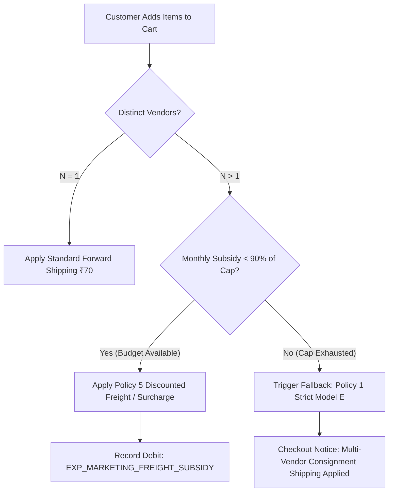

# ATEEVRA Phase M2-14 — OD-01 Multi-Vendor Shipping Subsidy Stress Test & Scenario Matrix
## Exhaustive Multi-Vendor Freight Multiplication, Cash Burn Modeling & Subsidy Cap Analysis

**Document ID:** `LOG-M2-14-OD-01-MULTI-VENDOR-SUBSIDY-STRESS-TEST`  
**Governance Authority:** Phase M2-14 Central Policy Blueprint & Master Decision Register  
**Decision Reference:** Owner Decision OD-01 (Pricing & Forward Shipping Model) & OD-07 (Settlement Framework)  
**Parent Policies:** [`POL-OD-02-01`](policies/OD-02-01-RETURN-COST-RESERVE.md) & [`POL-OD-02-06`](policies/OD-02-06-PRICING-BOUND-CONFLICTS.md)  
**Governance Status:** `STRICTLY DOCUMENTATION & COMMERCIAL ANALYSIS ONLY — ZERO IMPLEMENTATION`  
**Decision Status:** `OD-01 UNAPPROVED — PROVISIONAL DIRECTION FOR OWNER EVALUATION ONLY`  
**Commercial Parameter Status:** `MULTI-VENDOR SHIPPING POLICY EXPLICITLY UNDECIDED`  
**Audit Date:** 2026-11-04  

---

## 1. Executive Summary & The Multi-Vendor Friction Dilemma

In an integrated direct-to-consumer store with a centralized distribution center, an order containing 4 items is picked, packed, and dispatched in a single parcel via one 3PL consignment ($1 \times ₹70.00$).

In ATEEVRA's decentralized marketplace, independent merchants operate their own facilities across India (e.g., Merchant 1 in Jaipur, Merchant 2 in Surat, Merchant 3 in Bengaluru, Merchant 4 in Delhi NCR). When a customer places a single order containing items from $N$ distinct merchants, 3PL carriers must perform $N$ independent warehouse pickups, separate surface/air line-haul transits, and distinct last-mile delivery dispatches.

$$\mathbf{\text{Logistics Incurred by ATEEVRA}} = N \times ₹70.00 \text{ per order}$$

This creates an unavoidable commercial conflict between customer conversion friction and platform liquidity solvency:
1. **Full Pass-Through ($N \times ₹70.00$):** Eliminates platform logistics risk entirely, but imposes visible shipping friction (e.g., ₹280.00 freight on a 4-vendor cart), precipitating high cart abandonment (25%–40% industry baseline).
2. **Flat Shipping (₹70.00 per basket):** Provides a seamless single-brand customer experience, but forces ATEEVRA to absorb $(N - 1) \times ₹70.00$ in cash deficits, resulting in negative operating contributions on mixed-merchant baskets.
3. **Merchant Deductions:** Preserves platform solvency and customer conversion, but penalizes low-ticket merchants whose margins are eroded by mandatory logistics deductions.
4. **Subsidized Surcharges / Promotional Free Shipping:** Balances friction and solvency, but requires strict budget caps to avoid uncontrolled working capital depletion.

This document presents a rigorous stress test of five multi-vendor shipping policies across 1, 2, 3, and 4 merchants, models monthly subsidy cash-burn across order scale (500 to 5,000 orders/month), and evaluates the operational governance of promotional freight caps.

---

## 2. Comprehensive 5-Policy Comparative Evaluation (1 to 4 Vendors)

### Baseline Evaluation Parameters
- **Order Basket Value:** ₹1,500.00 gross customer cart
- **Platform Facilitation Fee:** 10.00% illustrative baseline ($\text{Gross Fee} = ₹150.00$)
- **Payment Gateway MDR:** 2.00% of customer collection
- **Forward Freight Rate:** ₹70.00 per individual vendor consignment (contracted 3PL standard)

```
========================================================================================================================
MULTI-VENDOR SHIPPING POLICY RECONCILIATION SCHEDULE (BASELINE ₹1,500 BASKET | 10% FEE = ₹150.00)
========================================================================================================================
Merchants | Policy Description & Mechanism        | 3PL Freight | Customer | Merchant | Platform | Net Platform
in Basket |                                       | Outflow (-) | Paid (+) | Deducted | Subsidy  | Contribution
----------+---------------------------------------+-------------+----------+----------+----------+-------------
1 VENDOR  | Policy 1: Model E Pass-Through (₹70)  |     -₹70.00 |  +₹70.00 |    ₹0.00 |    ₹0.00 |  +₹118.60   
(Baseline)| Policy 2: Flat Basket Shipping (₹70)  |     -₹70.00 |  +₹70.00 |    ₹0.00 |    ₹0.00 |  +₹118.60   
          | Policy 3: Merchant-Borne Freight (₹70)|     -₹70.00 |    ₹0.00 |  -₹70.00 |    ₹0.00 |  +₹120.00   
          | Policy 4: Free Shipping >₹1,199       |     -₹70.00 |    ₹0.00 |    ₹0.00 |  -₹70.00 |   +₹50.00   
          | Policy 5: Staged Surcharge (₹70+₹50)  |     -₹70.00 |  +₹70.00 |    ₹0.00 |    ₹0.00 |  +₹118.60   
----------+---------------------------------------+-------------+----------+----------+----------+-------------
2 VENDORS | Policy 1: Model E Pass-Through (₹140) |    -₹140.00 | +₹140.00 |    ₹0.00 |    ₹0.00 |  +₹117.20   
(2 pkgs)  | Policy 2: Flat Basket Shipping (₹70)  |    -₹140.00 |  +₹70.00 |    ₹0.00 |  -₹70.00 |   +₹48.60   
          | Policy 3: Merchant-Borne Freight (₹70)|    -₹140.00 |    ₹0.00 | -₹140.00 |    ₹0.00 |  +₹120.00   
          | Policy 4: Free Shipping >₹1,199       |    -₹140.00 |    ₹0.00 |    ₹0.00 | -₹140.00 |   -₹20.00*  
          | Policy 5: Staged Surcharge (₹70+₹50)  |    -₹140.00 | +₹120.00 |    ₹0.00 |  -₹20.00 |   +₹97.60   
----------+---------------------------------------+-------------+----------+----------+----------+-------------
3 VENDORS | Policy 1: Model E Pass-Through (₹210) |    -₹210.00 | +₹210.00 |    ₹0.00 |    ₹0.00 |  +₹115.80   
(3 pkgs)  | Policy 2: Flat Basket Shipping (₹70)  |    -₹210.00 |  +₹70.00 |    ₹0.00 | -₹140.00 |   -₹21.40*  
          | Policy 3: Merchant-Borne Freight (₹70)|    -₹210.00 |    ₹0.00 | -₹210.00 |    ₹0.00 |  +₹120.00   
          | Policy 4: Free Shipping >₹1,199       |    -₹210.00 |    ₹0.00 |    ₹0.00 | -₹210.00 |   -₹90.00*  
          | Policy 5: Staged Surcharge (₹70+₹50)  |    -₹210.00 | +₹170.00 |    ₹0.00 |  -₹40.00 |   +₹76.60   
----------+---------------------------------------+-------------+----------+----------+----------+-------------
4 VENDORS | Policy 1: Model E Pass-Through (₹280) |    -₹280.00 | +₹280.00 |    ₹0.00 |    ₹0.00 |  +₹114.40   
(4 pkgs)  | Policy 2: Flat Basket Shipping (₹70)  |    -₹280.00 |  +₹70.00 |    ₹0.00 | -₹210.00 |   -₹91.40*  
          | Policy 3: Merchant-Borne Freight (₹70)|    -₹280.00 |    ₹0.00 | -₹280.00 |    ₹0.00 |  +₹120.00   
          | Policy 4: Free Shipping >₹1,199       |    -₹280.00 |    ₹0.00 |    ₹0.00 | -₹280.00 |  -₹160.00*  
          | Policy 5: Staged Surcharge (₹70+₹50)  |    -₹280.00 | +₹220.00 |    ₹0.00 |  -₹60.00 |   +₹55.60   
========================================================================================================================
```
*\*Negative contribution figures indicate orders operating at a cash loss.*

---

## 3. Mathematical & Operational Breakdown by Policy

### Policy 1: Model E Per-Consignment Pass-Through ($N \times ₹70.00$)
- **Customer Charge:** $\text{Shipping Fee} = N \times ₹70.00$.
- **Merchant Impact:** ₹0 logistics deduction. Merchant receives full product entitlement net of platform facilitation fee and taxes.
- **Platform Economics:**
  $$\text{Net Contribution} = \text{Gross Fee (₹150)} - \text{MDR on Collection} + (\text{Customer Shipping} - \text{3PL Freight})$$
  Because $\text{Customer Shipping} = \text{3PL Freight} = N \times ₹70.00$, the logistics line-item is perfectly neutral. The only variation arises from MDR on the shipping component ($2\% \times [N \times ₹70]$), yielding +₹118.60 (1 vendor), +₹117.20 (2 vendors), +₹115.80 (3 vendors), and +₹114.40 (4 vendors).
- **Viability:** 100% financially risk-free. High customer checkout friction.

### Policy 2: Flat Basket Shipping (₹70.00 Flat to Customer)
- **Customer Charge:** Flat ₹70.00 regardless of vendor count ($N \ge 1$).
- **Platform Absorption:** ATEEVRA absorbs $(N - 1) \times ₹70.00$.
  - 1 Vendor: Subsidy = ₹0.00 $\rightarrow$ Contribution = +₹118.60
  - 2 Vendors: Subsidy = ₹70.00 $\rightarrow$ Contribution = +₹48.60
  - 3 Vendors: Subsidy = ₹140.00 $\rightarrow$ Contribution = **-₹21.40 (Cash Loss)**
  - 4 Vendors: Subsidy = ₹210.00 $\rightarrow$ Contribution = **-₹91.40 (Severe Cash Loss)**
- **Viability:** Catastrophic margin erosion on multi-vendor baskets. A 3-vendor order erases the entire 10% platform fee and burns ₹21.40 of capital.

### Policy 3: Merchant-Borne Logistics (₹70.00 Deducted from Each Merchant)
- **Customer Charge:** ₹0.00 ("Free Delivery" advertised platform-wide).
- **Merchant Realization:** Each merchant pays ₹70.00 forward shipping from their payout:
  $$\text{Merchant Payout}_i = \text{Product Price}_i - \text{Platform Fee}_i - \text{TCS}_i - \text{TDS}_i - ₹70.00$$
- **Platform Economics:** Platform collects ₹150.00 fee, incurs ₹30.00 MDR, nets +₹120.00 across all vendor combinations.
- **Merchant Friction:** High resistance from low-AOV vendors. On a ₹350 item, a ₹70 freight debit represents 20.0% of product price, rendering merchant onboarding unviable.

### Policy 4: Conditional Free Shipping (> ₹1,199.00 Threshold)
- **Customer Charge:** ₹0.00 on carts $\ge ₹1,200.00$. ATEEVRA absorbs all consignments ($N \times ₹70.00$).
- **Platform Economics:**
  - 1 Vendor: Platform pays ₹70.00 freight $\rightarrow$ Contribution = +₹50.00
  - 2 Vendors: Platform pays ₹140.00 freight $\rightarrow$ Contribution = **-₹20.00 (Cash Loss)**
  - 3 Vendors: Platform pays ₹210.00 freight $\rightarrow$ Contribution = **-₹90.00 (Cash Loss)**
  - 4 Vendors: Platform pays ₹280.00 freight $\rightarrow$ Contribution = **-₹160.00 (Severe Cash Loss)**
- **Viability:** While sustainable for single-merchant orders, unconstrained multi-vendor free shipping results in direct losses on 100% of mixed carts exceeding ₹1,199.

### Policy 5: Staged Surcharge (₹70.00 Base + ₹50.00 per Additional Vendor)
- **Customer Charge:** $₹70.00 + (N - 1) \times ₹50.00$.
  - 1 Vendor: ₹70.00 (Customer pays 100% of freight)
  - 2 Vendors: ₹120.00 (Customer pays ₹120, ATEEVRA subsidizes ₹20)
  - 3 Vendors: ₹170.00 (Customer pays ₹170, ATEEVRA subsidizes ₹40)
  - 4 Vendors: ₹220.00 (Customer pays ₹220, ATEEVRA subsidizes ₹60)
- **Platform Economics:**
  - 1 Vendor: Subsidy = ₹0 $\rightarrow$ Contribution = +₹118.60
  - 2 Vendors: Subsidy = ₹20 $\rightarrow$ Contribution = +₹97.60
  - 3 Vendors: Subsidy = ₹40 $\rightarrow$ Contribution = +₹76.60
  - 4 Vendors: Subsidy = ₹60 $\rightarrow$ Contribution = +₹55.60
- **Viability:** Maintains positive operating contribution across all vendor counts while discounting extra vendor shipping by 28.6% (₹50 vs ₹70) to soften checkout friction.

---

## 4. Empirical Order Distribution & Scale Sensitivity Matrix

### Vendor Distribution Baseline
Based on multi-brand lifestyle marketplace benchmarks:
- **1-Vendor Carts:** 70.0% ($w_1 = 0.70$) — 0 extra consignments
- **2-Vendor Carts:** 20.0% ($w_2 = 0.20$) — 1 extra consignment
- **3-Vendor Carts:** 8.0% ($w_3 = 0.08$) — 2 extra consignments
- **4-Vendor Carts:** 2.0% ($w_4 = 0.02$) — 3 extra consignments

### Consignment Multiplication Metrics
$$\mathbf{\text{Expected Extra Consignments per Order } (\bar{C}_{\text{extra}})} = (0.70 \times 0) + (0.20 \times 1) + (0.08 \times 2) + (0.02 \times 3) = \mathbf{0.420 \text{ consignments}}$$
$$\mathbf{\text{Expected Total Consignments per Order } (\bar{C}_{\text{total}})} = (0.70 \times 1) + (0.20 \times 2) + (0.08 \times 3) + (0.02 \times 4) = \mathbf{1.420 \text{ consignments}}$$

### Monthly Platform Subsidy Burn Across Scale (₹)

```
========================================================================================================================
MONTHLY MULTI-VENDOR LOGISTICS SUBSIDY EXPOSURE SCHEDULE
========================================================================================================================
Monthly Order Volume | Policy 1 (Model E)| Policy 2 (Flat ₹70)| Policy 3 (Merchant)| Policy 4 (Free >1.2k)| Policy 5 (Staged)
                     | Subsidy: ₹0/ord   | Subsidy: ₹29.40/ord| Subsidy: ₹0/ord    | Subsidy: ₹99.40/ord  | Subsidy: ₹8.40/ord
---------------------+-------------------+--------------------+--------------------+----------------------+------------------
500 Orders / Month   |             ₹0.00 |         ₹14,700.00 |              ₹0.00 |           ₹49,700.00 |        ₹4,200.00
1,000 Orders / Month |             ₹0.00 |         ₹29,400.00 |              ₹0.00 |           ₹99,400.00 |        ₹8,400.00
2,500 Orders / Month |             ₹0.00 |         ₹73,500.00*|              ₹0.00 |          ₹2,48,500.00*|       ₹21,000.00
5,000 Orders / Month |             ₹0.00 |        ₹1,47,000.00*|              ₹0.00 |          ₹4,97,000.00*|       ₹42,000.00
========================================================================================================================
```
*\*Asterisked cells exceed the illustrative ₹50,000.00 monthly promotional subsidy cap.*

### Key Mathematical Findings:
1. **Policy 2 (Flat ₹70):** Generates an average monthly drain of **₹29.40 per order**. At 2,500 orders/month, the cash burn reaches **₹73,500.00/month**, breaching a ₹50,000 cap by 47.0%. At 5,000 orders/month, it burns **₹1,47,000.00/month**.
2. **Policy 4 (Conditional Free Shipping):** If all orders exceed the ₹1,199 threshold, the platform absorbs **₹99.40 per order** in freight. At 1,000 orders/month, the subsidy burn reaches **₹99,400.00/month** (almost double the ₹50k cap). At 5,000 orders/month, it burns **₹4,97,000.00/month** (~₹60 Lakhs annualized).
3. **Policy 5 (Staged Surcharge):** Generates an average subsidy burn of only **₹8.40 per order** ($0.42 \times ₹20.00$). At 5,000 orders/month, the total monthly burn is **₹42,000.00**, remaining fully within the illustrative ₹50,000 cap while preserving positive unit economics on 100% of orders.

---

## 5. The Illustrative ₹50,000 Monthly Subsidy Cap: Operational Governance

> [!IMPORTANT]
> The ₹50,000.00 monthly subsidy figure is an **unapproved illustrative planning proposal**. It does NOT constitute an approved financial budget or an executive business decision. The Project Owner must explicitly review, adjust, and approve any operational subsidy pool.

If the Project Owner adopts a subsidized multi-vendor model (Policy 2, 4, or 5), the following operational control engine is recommended for architectural design:



### Architectural Enforcement Rules:
1. **Ledger Isolation:** Every subsidized rupee must be booked to `EXP_MARKETING_FREIGHT_SUBSIDY` and never netted against 3PL clearing accounts (`CLEARING_LOGISTICS_3PL`).
2. **Automated Budget Guardrails:**
   - **At 80% Cap Utilization (₹40,000):** Platform issues automated alert to Operations and Commercial Leads.
   - **At 90% Cap Utilization (₹45,000):** System switches checkout algorithm to fallback **Policy 1 (Model E Pass-Through)** for all subsequent multi-vendor carts in the calendar month.
   - **Day 1 Reset:** The subsidy meter resets to ₹0.00 on the 1st of each calendar month.
3. **Exclusion from Settlement Netting:** Merchants must never be debited or credited for platform-level promotional freight subsidies.

---

## 6. Strategic Evaluation Matrix for Project Owner

```
+------------------------------------------------------------------------------------------------------------------------+
| STRATEGIC POLICY TRADEOFF MATRIX                                                                                      |
+--------------------------+-------------------+--------------------+------------------------+---------------------------+
| Policy Candidate         | Customer Friction | Merchant Onboarding| Platform Solvency Risk | Scaling Viability         |
+--------------------------+-------------------+--------------------+------------------------+---------------------------+
| Policy 1: Model E Pass   | HIGH (₹70 × N)    | OPTIMAL (₹0 debit) | ZERO (100% neutral)    | UNLIMITED (100% solvency) |
| Policy 2: Flat ₹70 Basket| OPTIMAL (₹70 flat)| OPTIMAL (₹0 debit) | HIGH (Loss >2 vendors) | FAILS >1,700 orders/mo    |
| Policy 3: Merchant-Borne | OPTIMAL (Free)    | SEVERE RESISTANCE  | ZERO (100% neutral)    | HINDERS MERCHANT GROWTH   |
| Policy 4: Free >₹1,199   | ZERO FRICTION     | OPTIMAL (₹0 debit) | CATASTROPHIC CASH BURN | FAILS >500 orders/mo      |
| Policy 5: Staged Surcharge| MODERATE (₹70+₹50)| OPTIMAL (₹0 debit) | MINIMAL (Controlled)   | SUSTAINABLE >5,000 orders |
+--------------------------+-------------------+--------------------+------------------------+---------------------------+
```

---

## 7. Governance Sign-Off & Status Confirmation

1. **OD-01 Remains UNAPPROVED:** Neither Policy 1, 2, 3, 4, nor 5 is selected or approved. This stress test provides decision-support modeling for the Project Owner.
2. **Multi-Vendor Policy Remains UNDECIDED:** The commercial shipping allocation for multi-vendor baskets is an open owner decision.
3. **OD-02 Policy Invariant:** No modifications are made to `POL-OD-02-01` through `POL-OD-02-06`. All return, courier damage, and customer refund policies remain locked at v1.0.0.
4. **Zero Implementation:** No code, database columns, checkout APIs, or Medusa configurations have been altered.
