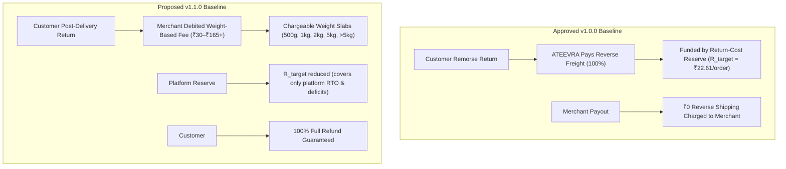

# ATEEVRA M2-14 — Controlled Policy Revision: OD-02 Baseline v1.1.0-PROPOSED

**Document Reference:** `DOC-M214-OD02-REV-V110`  
**Parent Blueprint:** [`ATEEVRA-MARKETPLACE-FINANCIAL-COMMERCIAL-POLICY-BLUEPRINT.md`](ATEEVRA-MARKETPLACE-FINANCIAL-COMMERCIAL-POLICY-BLUEPRINT.md)  
**Governing Approved Baseline:** OD-02 Policy Suite v1.0.0 (`OD-02-01` through `OD-02-06`)  
**Proposed Revision Baseline:** Version `1.1.0-PROPOSED`  
**Owner Direction Reference:** OD-02 (Refund Financial Liability) & OD-15 (Cancellation, Return, RTO & Accountability)  
**Current Governance Status:** `OWNER DIRECTION RECORDED — PROPOSED POLICY REVISION (PENDING OWNER RATIFICATION)`  
**Audit Date:** 2026-11-04  

---

## 1. Governance Context & Policy Integrity Protocol

> [!IMPORTANT]
> **PRESERVATION OF APPROVED v1.0.0 BASELINE:**
> The six approved policy documents (`OD-02-01` through `OD-02-06`) constitute the formally accepted v1.0.0 baseline of ATEEVRA. In strict adherence to marketplace governance protocols, those approved documents **ARE NOT SILENTLY OVERWRITTEN**.
> 
> This document establishes a **formal, controlled policy revision specification (v1.1.0-PROPOSED)**. It comprehensively documents the operational rationale, mathematical transformations, legal modifications, and commercial deltas between v1.0.0 and v1.1.0-PROPOSED. Until the Project Owner explicitly executes formal ratification, v1.0.0 remains the legally binding baseline.

---

## 2. Executive Summary of Strategic Shifts

| Policy Domain | Approved Baseline (v1.0.0) | Proposed Revision (v1.1.0-PROPOSED) | Rationale & Commercial Impact |
| :--- | :--- | :--- | :--- |
| **POL-OD-02-01 (Return-Cost Reserve)** | ATEEVRA absorbed 100% of reverse freight on remorse returns via an internal Return-Cost Reserve ($R_{\text{target}} \approx ₹22.61$). | **Merchant absorbs reverse shipping** on post-delivery customer returns via weight-dependent slabs (₹30 to ₹165+). | Eliminates severe platform reverse-freight cash drain; dramatically lowers required platform reserve target; aligns merchant incentives with catalog accuracy. |
| **POL-OD-02-02 (Prepaid vs COD Pricing)** | COD fee funded both RTO freight and general return reserve. | **RTO reverse freight remains ₹0 for merchants** (platform-funded); customer returns shifted to merchants. | COD fee structure specifically isolates doorstep refusal risk without double-charging merchants for customer returns. |
| **POL-OD-02-03 (Gateway Fee Allocation)** | Platform absorbs gateway MDR on refunds; merchant receives net payout. | Reconciles MDR across new cancellation boundaries (EV-06, EV-07, EV-08); confirms zero platform facilitation fee on cancellations. | Preserves 100% customer refund guarantee while clarifying platform operational loss treatment on pre-dispatch cancellations. |
| **POL-OD-02-04 (Courier Damage Liability)** | Governs 3PL courier transit loss vs merchant packaging liability. | Adds rigorous **weight dispute and electronic reweighing workflow** to prevent carrier over-billing. | Protects merchants from inaccurate volumetric billing by 3PL partners on reverse-logistics legs. |
| **POL-OD-02-05 (COD RTO Funding)** | Platform COD RTO funding pool absorbed all failed delivery freight. | **Reaffirms ₹0 reverse shipping for merchants on genuine RTOs**; isolates packaging drag (₹39–₹79) as merchant operational loss. | Clear separation between genuine RTO (failed delivery) and post-delivery returns (customer accepted then returned). |
| **POL-OD-02-06 (Pricing Bound Conflicts)** | Ensured platform fees do not cause negative merchant settlement. | Integrates **provisional penalties (₹25 cancel / ₹50 late)** and contractual set-off netting mechanisms. | Provides legal and accounting safeguards ensuring penalties and reverse fees are netted against rolling settlement reserves. |

---

## 3. Detailed Comparative Audit Across the Six Policy Areas

### 3.1 POL-OD-02-01: Return-Cost Reserve vs. Weight-Based Merchant Reverse Shipping

- **Mathematical Delta:**
  - In v1.0.0: The required reserve per order was:
    $$R_{\text{target, v1.0}} = P_{\text{ret}} \times C_{\text{rev}} = 15\% \times ₹65.00 = ₹9.75 \text{ (remorse)} + \text{COD RTO provisions} \approx ₹22.61$$
  - In v1.1.0-PROPOSED: Because the merchant pays reverse freight $C_{\text{rev, merchant}} \in [₹30, ₹165+]$, the platform's direct reverse freight liability on delivered returns drops to **₹0.00**.
  - The revised platform reserve $R_{\text{target, v1.1}}$ needs to cover only:
    $$R_{\text{target, v1.1}} = P_{\text{RTO}} \times C_{\text{rev, RTO}} + P_{\text{deficit}} \times \text{Deficit Margin} \approx ₹6.50 \text{ to } ₹8.25 \text{ per order}$$
  - **Capital Efficiency Gain:** Unlocks substantial working capital and lowers the platform facilitation fee hurdle rate.

---

### 3.2 POL-OD-02-02: Prepaid vs. COD Pricing & RTO Mitigation

- **v1.0.0 Baseline:** Established differential pricing or explicit COD handling fees (₹40–₹60) to counteract elevated COD return and RTO rates.
- **v1.1.0-PROPOSED Alignment:**
  - Customer post-delivery returns on COD orders are now charged to the merchant under the weight slabs ([`POL-M2-14-01`](policies/POL-M2-14-01-CUSTOMER-RETURNS-AND-REVERSE-SHIPPING.md)).
  - However, **COD Doorstep Refusals (RTO)** are NOT charged to the merchant ([`POL-M2-14-02`](policies/POL-M2-14-02-RTO-AND-FAILED-DELIVERY.md)).
  - Therefore, the **COD fee collected from the customer remains essential** to fund the two-way freight (forward + reverse) absorbed by ATEEVRA on failed deliveries.
  - Recommended COD Fee: **₹49.00 to ₹59.00** per COD shipment, preserving liquidity in the COD RTO Funding Pool.

---

### 3.3 POL-OD-02-03: Gateway Fee Allocation & Cancellation Economics

- **v1.0.0 Baseline:** Governed payment gateway fee (MDR ~1.8%) absorption on customer refunds, establishing that the platform absorbs MDR on remorse returns.
- **v1.1.0-PROPOSED Alignment:**
  - **Merchant-Initiated Cancellations (`CAN-MRCH-01`):** Platform earns ₹0 facilitation fee and absorbs payment gateway MDR refund losses (~₹18 on ₹1,000 order). The **₹25.00 provisional penalty** levied on the merchant directly offsets this platform loss, preserving platform solvency.
  - **Customer Pre-Dispatch Cancellations (`CAN-CUST-01`):** Platform earns ₹0 facilitation fee and absorbs payment gateway MDR (~₹18). Merchant is charged ₹0.
  - **Post-Delivery Customer Returns:** 100% full customer refund. Reverse freight recovered from merchant via weight slab.

---

### 3.4 POL-OD-02-04: Courier Damage Liability & Weight Verification

- **v1.0.0 Baseline:** Allocated damage liability: courier pays if damage occurred in transit (with proof); merchant pays if due to substandard internal packaging.
- **v1.1.0-PROPOSED Addition:**
  - Adds Section 5 of [`POL-M2-14-01`](policies/POL-M2-14-01-CUSTOMER-RETURNS-AND-REVERSE-SHIPPING.md): **Reweighing and Weight Dispute Mechanism**.
  - Integrated 3PL courier volumetric calculations ($L \times W \times H / 5000$) must be matched against merchant product catalog master dimensions.
  - If a carrier bills a return at a higher weight slab, merchant has 48 hours to trigger automated dimension verification against historical dispatch scans.

---

### 3.5 POL-OD-02-05: COD RTO Funding & Separation from Customer Returns

- **v1.0.0 Baseline:** Grouped failed deliveries and customer returns into a single reverse-logistics risk pool.
- **v1.1.0-PROPOSED Clarification:**
  - **Definitive Boundary:**
    - If the customer **never accepted delivery** (doorstep refusal, non-contactable, incorrect address): It is **RTO (`POL-M2-14-02`)**. The merchant pays **₹0 reverse shipping**.
    - If the customer **accepted delivery** and subsequently initiated a return request: It is a **Customer Return (`POL-M2-14-01`)**. The merchant pays **weight-based reverse shipping**.
  - Merchant packaging consumables and labor (₹39–₹79) in RTO are recognized as merchant operational drag, not reimbursed.

---

### 3.6 POL-OD-02-06: Pricing Bound Conflicts & Contractual Netting

- **v1.0.0 Baseline:** Addressed conflicts between platform fee bounds, merchant payout minimums, and MRP caps.
- **v1.1.0-PROPOSED Enhancement:**
  - Introduces formal **Contractual Netting Authority** under Sections 10, 73, and 74 of the Indian Contract Act, 1872.
  - Ensures that when an order incurs penalties (₹25 cancel, ₹50 late) or reverse-shipping debits (₹30–₹165+), the negative balance is lawfully set-off against:
    1. The specific order's gross payout.
    2. Other concurrent orders in the merchant's weekly settlement cycle.
    3. The merchant's rolling settlement reserve.
  - Prohibits negative settlement carryovers exceeding 30 days without activating account health sanctions under [`POL-M2-14-06`](policies/POL-M2-14-06-MERCHANT-ACCOUNT-HEALTH-AND-ENFORCEMENT.md).

---

## 4. Governance Status & Next Steps

1. **Ratification Requirement:** This document represents the Project Owner's recorded directions and architectural synthesis. It will replace OD-02 v1.0.0 upon explicit owner sign-off.
2. **System Implementation Hold:** No coding, database schema migration, or billing engine automation is permitted until formal ratification is granted.
3. **Traceability:** Cross-referenced in [`POLICY-REGISTER.md`](../POLICY-REGISTER.md) and [`M2-14-OWNER-DECISION-REGISTER.md`](../../M2-14-OWNER-DECISION-REGISTER.md).
