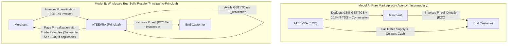

# ATEEVRA Phase M2-14 — OD-05 Statutory Tax Withholding Errata, Notification Analysis & Professional Validation Framework

**Document ID:** `ERR-M2-14-OD-05-TAX`  
**Governance Authority:** Phase M2-14 Central Policy Blueprint & Master Decision Register  
**Scope:** Mandatory Tax Assumption Rate Corrections, Statutory Base Analysis, Wholesale vs Marketplace Structural Analysis, and CA/Legal Validation Framework for Owner Decision OD-05  
**Audit Execution Mode:** STRICTLY READ-ONLY AUDIT & GOVERNANCE PLANNING  
**Active Phase:** Phase M2-14 (Payments, Refunds, Returns and Exchanges)  
**Implementation Authorization Status:** `PLANNING ONLY — IMPLEMENTATION NOT AUTHORIZED`  
**Decision Status:** `PENDING TAX/CA REVIEW` (Explicitly Unapproved)  
**Companion Documents:**
- [`docs/mvp2/m2-14/blueprint/M2-14-OD-01-TO-OD-13-INVENTORY-AUDIT.md`](file:///C:/Users/Shubham/OneDrive/Desktop/ecom_mvp/docs/mvp2/m2-14/blueprint/M2-14-OD-01-TO-OD-13-INVENTORY-AUDIT.md)
- [`docs/mvp2/m2-14/blueprint/M2-14-DEPENDENCY-MAP.md`](file:///C:/Users/Shubham/OneDrive/Desktop/ecom_mvp/docs/mvp2/m2-14/blueprint/M2-14-DEPENDENCY-MAP.md)
- [`docs/mvp2/m2-14/blueprint/M2-14-DOCUMENTATION-STATUS-MATRIX.md`](file:///C:/Users/Shubham/OneDrive/Desktop/ecom_mvp/docs/mvp2/m2-14/blueprint/M2-14-DOCUMENTATION-STATUS-MATRIX.md)
- [`docs/mvp2/m2-14/M2-14-OWNER-DECISION-REGISTER.md`](file:///C:/Users/Shubham/OneDrive/Desktop/ecom_mvp/docs/mvp2/m2-14/M2-14-OWNER-DECISION-REGISTER.md)

---

## 1. Executive Summary & Mandatory Errata Notice

During the Phase M2-14 Master Documentation Inventory Audit ([`M2-14-OD-01-TO-OD-13-INVENTORY-AUDIT.md`](file:///C:/Users/Shubham/OneDrive/Desktop/ecom_mvp/docs/mvp2/m2-14/blueprint/M2-14-OD-01-TO-OD-13-INVENTORY-AUDIT.md)), Owner Decision OD-05 (Statutory Tax Withholding) was documented using historical statutory rates:
- GST Section 52 Tax Collected at Source (TCS) described as **1.0%**; and
- Income Tax Section 194-O Tax Deducted at Source (TDS) described as **1.0%**.

> [!CAUTION]
> **MANDATORY CORRECTION OF HISTORICAL TAX ASSUMPTIONS:**  
> The 1.0% GST TCS and 1.0% Income Tax TDS rates are **historical statutory figures** that have been formally superseded by official Government of India gazette notifications and parliamentary enactments during 2024. They must **NOT** be treated as current implementation parameters.
> 
> Furthermore, this document does **NOT** constitute formal legal, accounting, or tax advice. All statutory interpretations and proposed ledger formulas remain **PENDING PROFESSIONAL CHARTERED ACCOUNTANT (CA) AND LEGAL COUNSEL VALIDATION**.

---

## 2. Official Statutory Provisions, Amending Enactments & Effective Dates

### 2.1. GST Tax Collected at Source (TCS) — Section 52(1) CGST Act, 2017

#### Official Regulatory Sources
- **Principal Statute:** Section 52(1) of the Central Goods and Services Tax (CGST) Act, 2017, read with State/Union Territory GST Acts and Section 20 of the Integrated Goods and Services Tax (IGST) Act, 2017.
- **Principal Notification:** Notification No. 52/2018–Central Tax, dated 20 September 2018 (originally notifying 0.5% CGST + 0.5% SGST, or 1.0% IGST).
- **Amending Notification:** **CBIC Notification No. 15/2024–Central Tax, dated 10 July 2024** (published in the Gazette of India, Extraordinary, Part II, Section 3, Sub-section (i)).
- **GST Council Authority:** Recommendations of the 53rd GST Council Meeting held on 22 June 2024 at New Delhi.

#### Verified Rate Reduction & Timeline
- **Historical Rate (Prior to 10 July 2024):** 1.0% total:
  - Intra-state supplies: 0.5% CGST + 0.5% SGST/UTGST;
  - Inter-state supplies: 1.0% IGST.
- **Revised Statutory Rate (Effective 10 July 2024 onwards):** **0.5% total**:
  - Intra-state supplies: **0.25% CGST + 0.25% SGST/UTGST**;
  - Inter-state supplies: **0.50% IGST**.
- **Effective Date:** **10 July 2024** (date of publication in the Official Gazette). For transactions occurring between 1 July 2024 and 9 July 2024, the 1.0% rate applied; from 10 July 2024 onwards, the reduced 0.5% rate applies.
- **Statutory Purpose:** To reduce working capital blockage and ease liquidity friction for small digital suppliers selling through electronic commerce operators (ECOs).

---

### 2.2. Income Tax Tax Deducted at Source (TDS) — Section 194-O Income-tax Act, 1961

#### Official Regulatory Sources
- **Principal Statute:** Section 194-O of the Income-tax Act, 1961 (inserted by the Finance Act, 2020).
- **Amending Statute:** **Finance (No. 2) Act, 2024** (Act No. 15 of 2024), enacted by the Parliament of India in August 2024.
- **Legislative Amendment:** Clause 62 of the Finance (No. 2) Bill, 2024, amending Section 194-O(1) by substituting the words *"one per cent."* with the words *"0.1 per cent."*.

#### Verified Rate Reduction & Timeline
- **Historical Rate (Prior to 1 October 2024):** 1.0% of the gross amount of sales of goods or provision of services.
- **Revised Statutory Rate (Effective 1 October 2024 onwards):** **0.1%** (one-tenth of one percent) of the gross amount of sales of goods or provision of services.
- **Effective Date:** **1 October 2024**.
- **Statutory Purpose:** To rationalize TDS rates across digital commerce, aligning e-commerce transactions with Section 194Q / 206C(1H) levels and unlocking seller working capital.

---

## 3. Statutory Transaction Base, Returns, Deductions, Thresholds & Reporting

### 3.1. GST TCS Under Section 52(1)

#### Taxable Base Definition
Section 52(1) mandates collection on the **"net value of taxable supplies"**:
$$\text{Net Value of Taxable Supplies} = \sum \text{Taxable Supplies} - \sum \text{Taxable Returns}$$
- **Inclusions:** Aggregate gross value of all taxable goods and services supplied through the electronic commerce operator by registered suppliers during the calendar month.
- **Exclusions:**
  1. Taxes charged under GST (CGST, SGST, IGST, Compensation Cess). TCS is calculated strictly on the taxable base *excluding* GST.
  2. Services notified under Section 9(5) of the CGST Act (e.g., passenger transport, accommodation, housekeeping where the ECO is liable to pay tax directly).
  3. Exempt, nil-rated, and non-taxable supplies.
- **Treatment of Returns and Cancellations:** Returns and cancellations occurring during the same month reduce the net taxable base. If taxable returns exceed supplies in a given month (resulting in a negative net value), the negative amount cannot be refunded as cash by the tax department but carries forward to reduce the taxable base in subsequent months.

#### Statutory Thresholds & Exemptions
- **No Monetary De-Minimis Threshold:** Unlike Income Tax TDS, Section 52 TCS has **no ₹5 lakh threshold**. Every rupee of taxable supply made through the operator by a registered person is subject to TCS.
- **Composition Dealers:** Prohibited from supplying goods through an e-commerce operator requiring TCS under Section 52.
- **Unregistered Small Sellers:** Under CBIC Notification No. 34/2023–Central Tax (effective 1 October 2023), persons with turnover below threshold limits (₹40L for goods / ₹20L for services) are permitted to supply goods intra-state through an ECO without GST registration, subject to obtaining an Enrolment ID on the GST portal. ECOs are not required to deduct TCS on supplies made by enrolled unregistered persons.

#### Reporting & Compliance Obligations
- **Monthly Return:** Electronic filing of **Form GSTR-8** by the **10th day of the month succeeding** the calendar month of collection.
- **Deposit of Tax:** TCS amounts must be deposited into the Government treasury via PMT-06 electronic cash ledger by the 10th of the succeeding month.
- **Auto-Population & Matching:** Supplies and returns reported in Form GSTR-8 auto-populate Table 4 of the merchant's **Form GSTR-2B / GSTR-2A** and Table 12 of **Form GSTR-1**, enabling merchants to claim cash ledger credits. Discrepancies between the merchant's GSTR-1 and the operator's GSTR-8 trigger automated GST Portal matching notices.

---

### 3.2. Income Tax TDS Under Section 194-O

#### Taxable Base Definition
Section 194-O(1) mandates deduction on the **"gross amount of sales of goods or provision of services"**:
- **Gross Facilitated Amount:** The entire sale price of goods or services facilitated by the ECO.
- **Deemed Payment Provision:** Under Section 194-O(1) Explanation, any payment made directly by a purchaser to an e-commerce participant (e.g., cash on delivery collected by 3PL or payment directly to merchant) is deemed to be an amount credited or paid by the ECO to the participant.
- **GST Inclusions / Exclusions:** As per CBDT Circular No. 17/2020 (dated 29 September 2020), where tax is deducted at the time of credit to the account of the payee, if the GST component included in the invoice is indicated separately, TDS under Section 194-O is deductible on the amount credited **without including such GST component**.

#### Statutory Thresholds & Exemptions
- **Individual and HUF Exemption:** Under Section 194-O(2), no deduction shall be made if:
  1. The e-commerce participant is an **Individual** or **Hindu Undivided Family (HUF)**; **AND**
  2. The gross amount of sales/services during the financial year does **not exceed ₹5,00,000**; **AND**
  3. The participant has furnished their **Permanent Account Number (PAN)** or **Aadhaar number** to the operator.
- **Non-Individual Participants (Companies, LLPs, Partnerships):** The ₹5,00,000 exemption threshold **does NOT apply**. Deduction at 0.1% applies from rupee one.
- **Non-Furnishing of PAN (Section 206AA):** If an e-commerce participant fails to furnish PAN or Aadhaar, the deduction rate escalates from 0.1% to **5.0%** (Section 206AA rate for Section 194-O).
- **Specified Persons (Section 206AB - Non-filers):** Higher rates apply if the merchant is a "specified person" who has not filed income tax returns for the relevant assessment year and aggregate TDS/TCS exceeded ₹50,000.

#### Reporting & Compliance Obligations
- **Deposit of Tax:** Monthly challan payment via Challan ITNS 281 by the **7th day of the succeeding month** (except March, which is payable by 30 April).
- **Quarterly Returns:** Electronic filing of **Form 26Q** on a quarterly basis (Q1: 31 July, Q2: 31 October, Q3: 31 January, Q4: 31 May).
- **TDS Certificates:** Quarterly issuance of **Form 16A** to merchants within 15 days of the due date for filing quarterly returns.

---

## 4. Crucial Structural Tax Analysis: Wholesale/Resale (Mode 1) vs Marketplace Intermediary

A profound architectural question arises from ATEEVRA's proposed Mode 1 Wholesale Realization Model:

> **Core Tax Dilemma:**  
> If ATEEVRA operates on a Wholesale Buy-Sell / Resale model where the merchant agrees to a fixed wholesale realization ($P_{\text{realization}}$) and ATEEVRA resells to the customer at $P_{\text{sell}}$, **is ATEEVRA legally an "Electronic Commerce Operator" facilitating third-party supplies, or a principal merchant purchasing and reselling goods?**

### 4.1. Model A — Pure Marketplace Intermediary (Agency Framework)
- **Legal Form:** Merchant is the legal vendor of record. The merchant issues a B2C GST Tax Invoice directly to the end customer for $P_{\text{sell}}$. ATEEVRA acts as an intermediary facilitating the transaction and billing the merchant a platform fee / commission with 18% GST.
- **Tax Consequences:**
  - Section 52 GST TCS (0.5%) **unequivocally applies** on the net taxable supply.
  - Section 194-O Income Tax TDS (0.1%) **unequivocally applies** on gross facilitated sales.
  - Form GSTR-8 must be filed monthly.

### 4.2. Model B — Wholesale Buy-Sell / Resale (Principal-to-Principal Framework)
- **Legal Form:** The merchant sells the product to ATEEVRA at the wholesale realization price $P_{\text{realization}}$ under a B2B arrangement. The merchant issues a B2B Tax Invoice addressed to ATEEVRA (with GST). ATEEVRA then takes legal title (even if flash-transferred) and issues a B2C Tax Invoice addressed to the customer for $P_{\text{sell}}$.
- **Tax Consequences:**
  - **Section 52 GST TCS Does NOT Apply:** ATEEVRA is purchasing and reselling goods on its own account as a principal, not facilitating a supply made *by* another person through its digital platform. ATEEVRA claims Input Tax Credit (ITC) on the merchant's B2B tax invoice.
  - **Section 194-O IT TDS Does NOT Apply:** ATEEVRA is a buyer of goods, not an e-commerce operator facilitating sales of third parties.
  - **Section 194Q IT TDS May Apply:** Under Section 194Q of the Income-tax Act, any buyer whose gross turnover exceeded ₹10 Crores in the preceding financial year and purchases goods from a resident seller exceeding ₹50 Lakhs in the financial year must deduct TDS at **0.1% on the value exceeding ₹50 Lakhs**.
  - **FDI / E-Commerce Policy Exposure:** Under the Consolidated FDI Policy of India, foreign-funded e-commerce marketplaces are strictly prohibited from exercising ownership or control over inventory (inventory-based model). If ATEEVRA accepts FDI, Model B is legally impermissible.

### 4.3. Model C — Contractual Floor Settlement within Marketplace Framework
- **Legal Form:** Legal form of Model A is preserved (merchant is vendor of record, issuing tax invoice to consumer for $P_{\text{sell}}$). However, by bilateral commercial agreement, the merchant agrees that their net entitlement is pegged to $P_{\text{realization}}$, and the spread $(P_{\text{sell}} - P_{\text{realization}})$ is treated as a variable marketplace facilitation fee.
- **Tax Consequences:**
  - Section 52 TCS (0.5%) and Section 194-O TDS (0.1%) apply to the merchant's customer-facing sale.
  - ATEEVRA must issue a commercial tax invoice to the merchant for the facilitation fee $(P_{\text{sell}} - P_{\text{realization}})$ plus 18% GST (SAC 998371 / 998599), and the merchant may claim ITC if GST registered.

---

## 5. Unresolved Questions Requiring Formal Chartered Accountant / Legal Counsel Written Opinion

Before any database schema, settlement formula, or automated tax deduction cron job is authored in Phase M2-14, the following legal and tax questions must be submitted to qualified Indian professional advisors:

1. **Structural Classification Confirmation:** Does ATEEVRA's proposed Mode 1 Fixed Realization Model legally constitute an Electronic Commerce Operator relationship under Section 2(45) and Section 52 of the CGST Act, 2017, or a principal-to-principal buy-sell arrangement?
2. **Tax Deduction Invoicing Base:** If Model C is adopted, is Section 194-O TDS calculated on the customer invoice price $P_{\text{sell}}$ or the merchant realization $P_{\text{realization}}$?
3. **Threshold Monitoring Architecture:** Must ATEEVRA implement real-time PAN-based cumulative financial year turnover tracking in the PostgreSQL database to automate the ₹5,00,000 threshold exemption for Individual/HUF merchants under Section 194-O(2)?
4. **GST Credit Note Handling for Returns:** When a remorse or damaged return occurs under OD-02, what is the exact statutory timeline and protocol under Section 34 of the CGST Act for issuing GST Credit Notes, and how does this synchronize with Form GSTR-8 downward reporting?
5. **Non-PAN Penalty Rates:** How should the settlement ledger handle merchants who fail PAN verification under Section 206AA (escalation to 5% TDS) or Section 206AB?
6. **FDI / Consumer Protection Compliance:** Does setting dynamic customer prices while pegging merchant payouts to $P_{\text{realization}}$ violate Rule 5(3)(b) of the Consumer Protection (E-Commerce) Rules, 2020 (prohibition against price manipulation)?

---

## 6. Official Recommendation & Governance Status

- **Status of OD-05:** **STRICTLY PRESERVED AS `PENDING TAX/CA REVIEW`**.
- **No Implementation Authorization:** Application software, Prisma schemas, and financial ledgers shall **NOT** implement automated tax deduction algorithms until the Project Owner reviews the formal written CA opinion addressing the questions in Section 5.
- **Interim Settlement Mode:** In the interim, if manual or offline batch settlements occur, they must adhere to the **verified revised rates** (0.5% GST TCS effective 10 July 2024; 0.1% IT TDS effective 1 October 2024), subject to merchant threshold verification.
