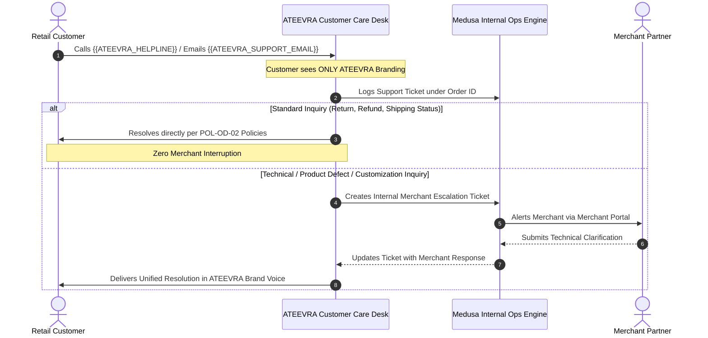

# ATEEVRA Policy: OD-14 — Merchant Identity Privacy & Customer-Facing Branding Policy
## Comprehensive Governance Policy for Merchant Personal Data Masking, Unified Platform Branding & Centralized Customer Care

**Policy ID:** `POL-OD-14-01`  
**Policy Name:** Merchant Identity Privacy, Customer-Facing Branding & Centralized Support Governance  
**Owner Decision Reference:** OD-14 (Merchant Identity Privacy & Branding Architecture)  
**Parent Blueprint:** [`ATEEVRA-MARKETPLACE-FINANCIAL-COMMERCIAL-POLICY-BLUEPRINT.md`](ATEEVRA-MARKETPLACE-FINANCIAL-COMMERCIAL-POLICY-BLUEPRINT.md)  
**Related Policies:** [`POL-OD-02-01`](policies/OD-02-01-RETURN-COST-RESERVE.md) through [`POL-OD-02-06`](policies/OD-02-06-PRICING-BOUND-CONFLICTS.md)  
**Governance Status:** `OWNER DIRECTION RECORDED — FORMAL OD-14 APPROVAL PENDING`  
**Current Policy Version:** `1.0.0-DRAFT`  
**Effective Date:** Pending Formal Owner Decision & Pre-Implementation Legal Review  
**Audit Date:** 2026-11-04  

---

## 1. Executive Summary & Purpose

This policy establishes the operational, commercial, and technical standards governing how merchant identity, contact information, and platform branding are presented across all customer-facing touchpoints of the ATEEVRA marketplace.

The objective of this policy is threefold:
1. **Merchant Personal Privacy:** To guarantee that merchant owners, proprietors, artisans, and their employees are protected from public exposure of their personal telephone numbers, personal email addresses, and private residential premises;
2. **Unified Brand Experience:** To ensure that retail customers experience a seamless, trustworthy, and premium marketplace backed by ATEEVRA's centralized customer care, logistics, and dispute guarantees;
3. **Statutory Transparency:** To maintain 100% compliance with Indian e-commerce disclosure regulations (Consumer Protection (E-Commerce) Rules, 2020 and CGST Act, 2017) by accurately disclosing the merchant's registered business entity and GSTIN as the seller of record, without misrepresenting ATEEVRA as the product seller.

---

## 2. Owner-Approved Policy Directives

> **RECORDED OWNER DIRECTION FOR OD-14:**
> 
> 1. **Complete Shielding of Personal Contact Data:** The platform shall strictly conceal merchant proprietors' personal mobile numbers, personal email addresses, and residential premises from customers across all digital storefronts, physical packaging, and transaction documents.
> 2. **Statutory Commercial Disclosures Only:** The platform shall display only legally mandated commercial information regarding the seller of record, specifically: registered legal entity name, registered business/commercial address, and GSTIN.
> 3. **ATEEVRA Centralized Customer Care:** ATEEVRA's central helpline (`{{ATEEVRA_HELPLINE}}`) and customer support email (`{{ATEEVRA_SUPPORT_EMAIL}}`) shall serve as the exclusive, primary customer-facing contact channel for all pre-sale inquiries, order tracking, returns, exchanges, refunds, and complaints.
> 4. **Unified Platform Branding:** All customer-facing order confirmations, transaction notifications, packing slips, packaging elements, and digital customer journeys shall carry prominent ATEEVRA branding.
> 5. **Prevention of Direct Contact:** Merchants are strictly prohibited from initiating unmonitored direct customer contact, inserting marketing solicitations into packages, or conducting off-platform transaction settlements.
> 6. **Internal Operational Availability:** Complete operational data (including merchant warehouse pickup addresses, dispatch contacts, and banking details) shall remain accessible internally to authorized ATEEVRA operations personnel under strict Role-Based Access Control (RBAC).

**Governance Invariant:**  
This document records the Project Owner's explicit policy direction. It is classified as **`OWNER DIRECTION RECORDED — FORMAL OD-14 APPROVAL PENDING`**. It does not constitute final owner sign-off and does not authorize software implementation.

---

## 3. Touchpoint-by-Touchpoint Branding & Privacy Specifications

The platform shall enforce the following privacy and branding rules across every customer touchpoint:

```
========================================================================================================================
CUSTOMER-FACING TOUCHPOINT PRIVACY & BRANDING RULES
========================================================================================================================
Touchpoint             | Customer-Visible Branding & Content       | Strictly Masked / Prohibited Content
-----------------------+-------------------------------------------+----------------------------------------------------
1. Product Listings &  | - ATEEVRA storefront navigation & brand.  | - Merchant personal phone numbers.
   Search Results      | - Merchant Brand / Trade Name.            | - Merchant personal email addresses.
                       | - Product title, images, shelf price.     | - Warehouse or residential addresses.
-----------------------+-------------------------------------------+----------------------------------------------------
2. Product Detail Page | - Prominent ATEEVRA UI/UX styling.        | - Proprietor's personal phone or mobile.
   (PDP)               | - "Sold by: [Registered Business Name]".  | - Personal Gmail/Yahoo/Hotmail addresses.
                       | - Registered commercial city & state.     | - Residential addresses of artisans/proprietors.
                       | - Brand story & craft heritage.           | - Direct merchant contact hyperlinks.
                       | - "Customer Support by ATEEVRA".          | - Merchant website or external store links.
-----------------------+-------------------------------------------+----------------------------------------------------
3. Cart & Checkout     | - ATEEVRA unified checkout header.        | - Merchant direct contact details.
   Review Screens      | - Itemized line items grouped by vendor.  | - Dispatch hub street addresses.
                       | - "Seller: [Registered Legal Entity]".    | - Merchant internal vendor IDs.
                       | - ATEEVRA buyer protection guarantees.    | 
-----------------------+-------------------------------------------+----------------------------------------------------
4. Order Confirmation  | - Branded ATEEVRA transaction header.     | - Merchant phone numbers or email addresses.
   Emails & Receipts   | - Unique ATEEVRA Order ID.                | - Unmediated merchant direct messaging links.
                       | - Support anchor: {{ATEEVRA_SUPPORT_EMAIL}}|
                       | - Support helpline: {{ATEEVRA_HELPLINE}}. |
-----------------------+-------------------------------------------+----------------------------------------------------
5. Statutory B2C Tax   | - Supplier Block: Merchant Legal Name,    | - Merchant personal mobile numbers.
   Invoices            |   Registered Commercial Address, GSTIN.   | - Merchant personal residential address.
                       | - Facilitator Block: ATEEVRA Platform.    | - Merchant personal bank account/IFSC details.
                       | - Customer Care Footer: ATEEVRA Helpline. | - (ATEEVRA must NOT replace merchant as supplier).
-----------------------+-------------------------------------------+----------------------------------------------------
6. Physical Packing    | - Standardized ATEEVRA packing slip.      | - Merchant promotional flyers or discount cards.
   Slips & Packaging   | - Unified ATEEVRA adhesive tape/boxes.    | - Handwritten seller notes with personal numbers.
                       | - ATEEVRA return policy & QR code.        | - External social media or direct order QR codes.
-----------------------+-------------------------------------------+----------------------------------------------------
7. 3PL Shipping Labels | - Shipper: "[Merchant Name] c/o ATEEVRA,  | - Merchant's private residential street address.
   & Outer Packaging   |   [Logistics Fulfillment Routing Code]".  | - Merchant's personal mobile phone number.
                       | - Contact Phone: {{ATEEVRA_LOGISTICS_IVR}}| - Merchant proprietor personal names.
-----------------------+-------------------------------------------+----------------------------------------------------
8. Return / Exchange   | - ATEEVRA Return Merchandise Auth (RMA).  | - Direct return to merchant residential address.
   Documentation       | - Return routed to ATEEVRA Hub or Hub ID. | - Merchant personal contact details on reverse AWB.
                       | - Tracking via ATEEVRA Customer Portal.   | 
-----------------------+-------------------------------------------+----------------------------------------------------
9. SMS & WhatsApp      | - Sender ID: "ATEVRA" (DLT registered).   | - Unmonitored merchant personal WhatsApp numbers.
   Transactional Pushes| - Standardized automated tracking copy.   | - Direct vendor customer service chat links.
                       | - Replies route to ATEEVRA Support Bot.   |
========================================================================================================================
```

---

## 4. Merchant Personal Information Protection Rules

### Rule 1: Mandatory Segregation of Personal vs. Commercial Data
During merchant onboarding (governed by Phase M2-13), the onboarding workflow must collect and strictly distinguish between two tiers of address and contact information:
1. **Commercial / Statutory Data (Customer-Facing & Statutory Tax Use):**
   - Registered Business / Company Name (as registered with MCA or GSTN);
   - Registered Commercial Address (as recorded on GST Certificate / Shop & Establishment License);
   - Business Customer Support Email (or default to ATEEVRA support if merchant operates without dedicated customer staff);
   - Merchant GSTIN and State Code.
2. **Personal / Operational Data (Internal Platform & Logistics Use Only):**
   - Personal Name of Proprietor / Managing Director / Authorized Signatory;
   - Personal Mobile Phone Number and Alternate Emergency Contact;
   - Personal Email Address;
   - Residential Premises Address;
   - Warehouse / Workshop Physical Pickup Location (for 3PL driver dispatch);
   - Settlement Bank Account Number, Account Holder Name, and IFSC Code;
   - Permanent Account Number (PAN) and Identity Proof (Aadhaar/Passport).

### Rule 2: Absolute Masking of Residential Addresses
Where an artisan, sole proprietor, or partnership firm has registered its business from a residential premises (e.g., flat number, residential apartment complex):
- The platform shall display the geographic location at the **City, State, and PIN Code level** on storefront profile pages (e.g., *"Jaipur, Rajasthan — 302001"*).
- On the statutory B2C tax invoice, the address registered on the merchant's GST Certificate must appear to satisfy Section 31 of the CGST Act, 2017. However, personal phone numbers and personal emails must remain completely excluded from the invoice template.

### Rule 3: Prevention of Accidental Disclosures
1. **Media Screening:** Catalog imagery containing embedded telephone numbers, personal WhatsApp badges, or personal watermarks shall be rejected by catalog moderators.
2. **Text Scanning:** Product description and specifications fields shall be screened by automated regex filters to block 10-digit mobile numbers and email addresses.
3. **Packaging Audits:** Merchant compliance teams shall conduct random spot-checks of merchant parcels at 3PL carrier hubs to enforce the ban on unauthorized personal inserts, business cards, and direct contact flyers.

---

## 5. ATEEVRA Centralized Customer Support Architecture



### Rule 4: Sole Customer Care Anchor
1. **Primary Contact:** All customer communications must cite ATEEVRA's centralized helpline (`{{ATEEVRA_HELPLINE}}`) and support email (`{{ATEEVRA_SUPPORT_EMAIL}}`).
2. **Zero Merchant Phone Disclosure:** At no point during pre-purchase, transit, delivery, return, or dispute escalation shall a customer support agent provide a customer with the merchant's private telephone number.
3. **Three-Way Calling Prohibition:** Customer support agents are strictly prohibited from bridging three-way calls between a customer and a merchant. All escalations must occur asynchronously via internal ticketing.

### Rule 5: Grievance Redressal Architecture
In compliance with Rule 5(1) of the Consumer Protection (E-Commerce) Rules, 2020:
- ATEEVRA shall appoint a centralized **Consumer Grievance Officer**.
- The name, designation, and contact portal of the Grievance Officer shall be displayed prominently on the ATEEVRA storefront:
  - Grievance Portal: `{{ATEEVRA_GRIEVANCE_PORTAL}}`
  - Grievance Email: `{{ATEEVRA_GRIEVANCE_EMAIL}}`
  - Acknowledgement SLA: Within 48 hours of receipt.
  - Resolution SLA: Within 30 days of receipt.
- The Grievance Officer serves as the single point of escalation for all marketplace consumers, shielding individual merchants from formal consumer forum complaints resulting from delivery or platform-level service failures.

---

## 6. Anti-Disintermediation & Fair Competition Governance

### Rule 6: Prohibition of Direct Customer Solicitation
Merchants executing the Merchant Master Services Agreement (MSA) agree to the following commercial invariants:
1. **No Solicitation Inserts:** Merchants shall not place marketing materials, coupons, discount vouchers, personal business cards, or invitations to purchase off-platform inside customer shipments.
2. **No Direct Commercial Outreach:** Merchants who obtain customer shipping names or delivery addresses via 3PL manifests are strictly prohibited from using that information for marketing, direct WhatsApp promotions, or private order solicitations.
3. **Contractual Penalties:** Verified violations of this rule shall result in:
   - *First Offense:* Formal compliance warning and mandatory packaging inspection;
   - *Second Offense:* 14-day catalog suspension and forfeiture of platform promotional privileges;
   - *Repeated Offense:* Immediate merchant termination, catalog de-listing, and potential indemnification claims under the Merchant MSA.

---

## 7. Placeholder Governance & Brand Integrity Invariant

To maintain governance integrity across all documentation:
- **No Fictitious Details:** No mock telephone numbers, fake email addresses, or dummy office addresses shall be committed to documentation.
- **Mandatory Configuration Placeholders:**
  - Customer Helpline: `{{ATEEVRA_HELPLINE}}`
  - Support Email: `{{ATEEVRA_SUPPORT_EMAIL}}`
  - Logistics IVR: `{{ATEEVRA_LOGISTICS_IVR}}`
  - Grievance Email: `{{ATEEVRA_GRIEVANCE_EMAIL}}`
  - Grievance Officer Name: `{{ATEEVRA_GRIEVANCE_OFFICER_NAME}}`
  - Corporate Registered Office: `{{ATEEVRA_REGISTERED_OFFICE}}`
- **Owner Configuration Mandate:** Actual operational values shall be configured in environment parameters by the Project Owner prior to staging or production launch.

---

## 8. Governance Status & Invariants Confirmation

1. **OD-14 Status:** `OWNER DIRECTION RECORDED — FORMAL OD-14 APPROVAL PENDING`.
2. **OD-01 Seller of Record Integrity:** Preserved 100%. Merchants remain sellers of record; tax invoices reflect merchant supplier details.
3. **OD-02 Baseline Integrity:** Return liability, courier damage absorption, and customer refund policies (`POL-OD-02-01` to `POL-OD-02-06`) remain locked at Version 1.0.0.
4. **Execution Restriction:** Strictly documentation and analysis. Zero software code, schema, API, or configuration changes have been executed.
