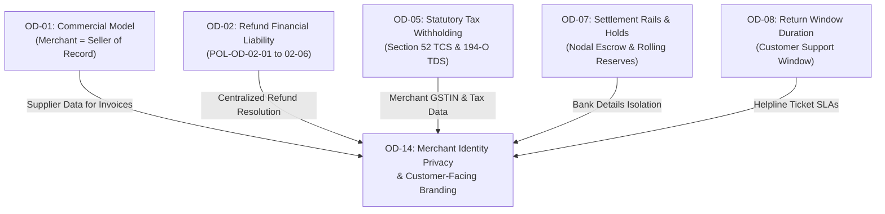

# ATEEVRA Phase M2-14 — OD-14 Implementation Traceability & Technical Dependency Matrix
## Architectural Blueprints, Cross-Decision Dependencies & Pre-Implementation Technical Guardrails

**Document ID:** `TRC-M2-14-OD-14-IMPLEMENTATION-TRACEABILITY`  
**Governance Authority:** Phase M2-14 Central Policy Blueprint & Master Decision Register  
**Decision Reference:** Owner Decision OD-14 (Merchant Identity Privacy & Branding Architecture)  
**Parent Policy:** [`POL-OD-14-01`](M2-14-OD-14-CUSTOMER-FACING-BRANDING-POLICY.md)  
**Related Decisions:** OD-01 (Commercial Model), OD-02 (Refunds), OD-05 (TCS/TDS), OD-07 (Settlements), OD-08 (Return Window)  
**Commerce Core:** Medusa v2.19.0 (`@medusajs/payment`, `@medusajs/order`, `@medusajs/inventory`, `@medusajs/admin`)  
**Governance Status:** `OWNER DIRECTION RECORDED — FORMAL OD-14 APPROVAL PENDING`  
**Execution Mode:** `STRICTLY DOCUMENTATION & PLANNING ONLY — ZERO APPLICATION IMPLEMENTATION`  
**Audit Date:** 2026-11-04  

---

## 1. Executive Summary & Purpose

This document provides the definitive technical traceability and dependency blueprint for Owner Decision OD-14 (Merchant Identity Privacy & Customer-Facing Branding).

It establishes:
1. **Architectural Touchpoint Mapping:** How merchant privacy masking and ATEEVRA-controlled branding integrate across Medusa v2 services, storefront components, notification workers, and logistics adapters;
2. **Cross-Decision Dependency Mapping:** Tracing interconnections between OD-14 and prior Owner Decisions (OD-01, OD-02, OD-05, OD-07, OD-08);
3. **Subsystem Integration Requirements:** Identifying technical requirements across Merchant Onboarding (M2-13), Invoicing, Catalog, Logistics, Customer Support, and Admin RBAC;
4. **Pre-Implementation Verification Gates:** Checklists that must be satisfied before application code, database migrations, or API changes may be authorized.

---

## 2. Subsystem Architectural Traceability Matrix

The table below maps the required OD-14 privacy and branding behaviors to specific Medusa v2 architectural components and subsystem modules:

```
=================================================================================================================================
SUBSYSTEM ARCHITECTURAL TRACEABILITY MATRIX
=================================================================================================================================
Subsystem Module       | Affected Files / Services (Proposed)      | Required OD-14 Technical Behavior
-----------------------+-------------------------------------------+-------------------------------------------------------------
1. Merchant Onboarding | `apps/backend/src/modules/merchant/`      | Segregate `commercial_address` from `residential_address`;
   (M2-13 Integration) | `merchant_profile.entity.ts`              | separate `business_support_phone` from `personal_phone`.
                       | `merchant_onboarding.workflow.ts`         | Collect explicit DPDP Act privacy consent during KYC.
-----------------------+-------------------------------------------+-------------------------------------------------------------
2. Storefront Catalog  | `apps/storefront/src/modules/products/`   | Display Merchant Brand & Registered Entity Name on PDP.
   & PDP Engine        | `templates/product-details.tsx`           | Inject {{ATEEVRA_HELPLINE}} as support contact.
                       | `components/seller-info-card.tsx`         | Strip personal phone/email/residential address from props.
-----------------------+-------------------------------------------+-------------------------------------------------------------
3. Checkout & Cart     | `apps/backend/src/workflows/order/`       | Ensure checkout line-item vendor metadata surfaces only
   Orchestration       | `create-order.ts`                         | legal business name. Storefront checkout review displays
                       | `packages/order-service/`                 | "Fulfilled & Protected by ATEEVRA".
-----------------------+-------------------------------------------+-------------------------------------------------------------
4. Tax Invoice & PDF   | `apps/backend/src/services/pdf-invoice/`  | Supplier block prints Merchant Legal Entity, Registered
   Generation Service  | `invoice-template.hbs`                    | Commercial Address, and GSTIN (OD-01 Seller of Record).
                       | `tax-invoice-generator.service.ts`        | Customer Care footer prints {{ATEEVRA_HELPLINE}} & email.
-----------------------+-------------------------------------------+-------------------------------------------------------------
5. 3PL Logistics &     | `apps/backend/src/modules/logistics/`     | Thermal label "Shipper" field prints: "[Merchant Name]
   Label Generation    | `providers/delhivery.service.ts`          | c/o ATEEVRA Logistics Hub, [Routing Code]".
                       | `providers/shiprocket.service.ts`         | Shipper Phone field overridden with {{ATEEVRA_LOGISTICS_IVR}}.
-----------------------+-------------------------------------------+-------------------------------------------------------------
6. Notification Engine | `apps/backend/src/subscribers/`           | All transaction emails (SendGrid), SMS (Gupshup), and
   (Email/SMS/WhatsApp)| `order-placed.subscriber.ts`              | WhatsApp templates carry unified ATEEVRA branding.
                       | `templates/email/order-confirmation.html` | Replies route strictly to {{ATEEVRA_SUPPORT_EMAIL}}.
-----------------------+-------------------------------------------+-------------------------------------------------------------
7. Admin UI & RBAC     | `apps/backend/src/api/admin/merchants/`   | Standard admin views mask mobile numbers (`+91 98XXX X1234`).
   Security Layer      | `merchant.validator.ts`                   | Unmasking requires `CAN_VIEW_MERCHANT_PII` privilege and
                       | `middlewares/rbac-masking.middleware.ts`  | creates immutable record in `audit_log_events`.
-----------------------+-------------------------------------------+-------------------------------------------------------------
8. Server Telemetry &  | `apps/backend/src/utils/logger.ts`        | Winston / Pino logging interceptor redacts 10-digit phone,
   Logging Subsystem   | `interceptors/pii-redactor.interceptor.ts`| PAN, Aadhaar, and personal email patterns from server logs.
=================================================================================================================================
```

---

## 3. Cross-Decision Dependency Mapping

OD-14 interacts directly with multiple existing Owner Decisions within the Phase M2-14 framework:



### 3.1. Dependency on OD-01 (Commercial Revenue Architecture)
- **Hard Architectural Constraint:** OD-14 is strictly bound by OD-01's business-model direction: **Merchants are sellers of record**.
- **Impact:** OD-14 cannot simply mask all seller information by pretending ATEEVRA is the seller. OD-14 must selectively mask *personal* data while faithfully disclosing *commercial statutory* data (legal entity, registered commercial address, GSTIN) on invoices and PDPs.

### 3.2. Dependency on OD-02 (Refund Financial Liability & Policies)
- **Operational Constraint:** Under [`POL-OD-02-04`](policies/OD-02-04-COURIER-DAMAGE-LIABILITY.md) (Courier Damage) and [`POL-OD-02-01`](policies/OD-02-01-RETURN-COST-RESERVE.md) (Returns), ATEEVRA guarantees customer protection and absorbs incident friction.
- **Impact:** OD-14 centralizes customer support within ATEEVRA so that refund decisions, return pickups, and courier damage claims are managed without exposing merchants to contentious customer negotiations.

### 3.3. Dependency on OD-05 (Statutory Tax Withholding)
- **Data Isolation Constraint:** Section 52 GST TCS and Section 194-O IT TDS require capturing merchant PAN, GSTIN, and business turnover.
- **Impact:** OD-14 ensures that while tax authorities receive full PAN and turnover data via GSTR-8 and Form 26Q filings, customer-facing invoices display only the statutory GSTIN, suppressing merchant PAN and personal tax identification.

### 3.4. Dependency on OD-07 (Payout Rails & Settlement)
- **Financial Privacy Constraint:** Merchant payout processing requires capturing bank account numbers, IFSC codes, and beneficiary names.
- **Impact:** OD-14 RBAC rules categorize merchant bank details as `RESTRICTED_FINANCE_DATA`, ensuring zero visibility across storefront APIs, customer receipts, or general admin support screens.

---

## 4. Pre-Implementation Verification Gates

Before any technical implementation of OD-14 may begin, the following six verification gates must be cleared:

```
=================================================================================================================================
PRE-IMPLEMENTATION VERIFICATION GATES FOR OD-14
=================================================================================================================================
Gate ID  | Verification Scope                        | Success Criteria                                    | Status
---------+-------------------------------------------+-----------------------------------------------------+-------------
GATE-01  | Project Owner Formal Approval             | Formal executive sign-off approving OD-14 policy.   | PENDING
---------+-------------------------------------------+-----------------------------------------------------+-------------
GATE-02  | Corporate Legal Review                    | Written legal opinion confirming Rule 5(2) Consumer | PENDING
         |                                           | Protection compliance via centralized helpline.     |
---------+-------------------------------------------+-----------------------------------------------------+-------------
GATE-03  | CA / Tax Invoicing Review                 | Written CA sign-off confirming B2C tax invoice      | PENDING
         |                                           | satisfies Section 31 CGST Act without ATEEVRA PII.  |
---------+-------------------------------------------+-----------------------------------------------------+-------------
GATE-04  | DPDP Act Privacy Assessment               | Data protection impact assessment (DPIA) completed  | PENDING
         |                                           | for merchant proprietor personal contact data.      |
---------+-------------------------------------------+-----------------------------------------------------+-------------
GATE-05  | 3PL Shipping Label SLA Execution          | Written carrier agreement (Delhivery/Shiprocket)    | PENDING
         |                                           | confirming shipper phone override with IVR number.  |
---------+-------------------------------------------+-----------------------------------------------------+-------------
GATE-06  | Contact Placeholder Provisioning          | Project Owner supplies actual production numbers:   | PENDING
         |                                           | {{ATEEVRA_HELPLINE}}, {{ATEEVRA_SUPPORT_EMAIL}}, etc.|
=================================================================================================================================
```

---

## 5. Governance Status & Boundary Confirmation

1. **OD-14 Status:** `OWNER DIRECTION RECORDED — FORMAL OD-14 APPROVAL PENDING`.
2. **OD-01 Seller of Record Integrity:** Preserved 100%. Direct merchant sales model remains the commercial foundation.
3. **OD-02 Policy Baseline Invariant:** Policies `POL-OD-02-01` to `POL-OD-02-06` remain locked at Version 1.0.0.
4. **Execution Restriction:** Strictly documentation, traceability mapping, and architectural specification. Zero software code, database migrations, Medusa modules, or APIs have been created or modified.
