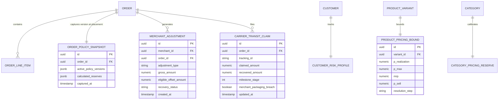

# ATEEVRA Marketplace — Policy-to-Implementation Traceability Matrix

**Document ID:** `TRC-M2-14-TRACEABILITY`  
**Governance Authority:** Phase M2-14 Central Policy Blueprint  
**Parent Blueprint:** [`ATEEVRA-MARKETPLACE-FINANCIAL-COMMERCIAL-POLICY-BLUEPRINT.md`](ATEEVRA-MARKETPLACE-FINANCIAL-COMMERCIAL-POLICY-BLUEPRINT.md)  
**Policy Register:** [`POLICY-REGISTER.md`](POLICY-REGISTER.md)  
**Last Updated:** 2026-11-03

---

## 1. Executive Summary & Architecture Boundary Principles

This document establishes the bidirectional traceability connecting high-level business policies to their future technical implementation modules, database models, event handlers, and test specifications.

### Strict Architectural Boundaries (As Established by ADR-001 & `ARCHITECTURE.md`):
1. **Medusa Commerce Engine (`apps/backend`):**  
   The authoritative commerce system of record for all order lifecycles, payments, customer carts, line-item ownership, fulfillments, returns, exchanges, and financial transactions.
2. **Strapi Headless CMS (`apps/cms`):**  
   The editorial marketing content layer. Strapi hosts marketing landing pages, policy FAQs, return instructions, and SEO copy. **Strapi NEVER stores orders, transactions, pricing calculations, or merchant settlement data.**
3. **Storefront & Merchant Portal (`apps/storefront`):**  
   The Next.js App Router presentation layer and selective BFF proxy. It displays prices, captures user actions, and submits mutations to Medusa.
4. **PostgreSQL Database:**  
   The durable ACID storage layer hosting `medusa_db` and `strapi_db`. All financial ledgers, policy snapshots, and idempotency records reside in `medusa_db`.
5. **Redis In-Memory Store:**  
   Dedicated strictly to caching (`cache:*`), session rate limiting (`ratelimit:*`), and ephemeral OTP storage (`otp:*`). **Redis must NEVER serve as the durable financial source of truth.**

> [!CAUTION]
> **Implementation Phasing Notice:**  
> This traceability document outlines **future technical requirements** for Phase M2-14. It clearly distinguishes existing architectural primitives from proposed new schemas and modules. **No code, database migrations, or API changes are authorized by this document.**

---

## 2. Existing Baseline vs. Proposed Future Implementation

| Architectural Domain | Existing Repository Baseline | Proposed Future M2-14 Implementation |
| :--- | :--- | :--- |
| **Merchant Scoping** | Scoped products via `merchant_product` link; orders display gross line-item sum (`unitPrice * qty`). | Scoped returns, line-item cancellations, and settlement adjustment records. |
| **Payment Processing** | Razorpay mock returning `{ status: 'refunded' }`; webhook handler returns `not_supported`. | Authoritative Razorpay API integration with idempotent webhook processing and refund status tracking. |
| **COD Workflow** | `ReturnEngine` validates UPI/IFSC regex in-memory; returns `status: 'pending'`. | Durable PostgreSQL payout records, SMS/WhatsApp OTP verification, and doorstep attempt tracking. |
| **Financial Ledger** | Zero seller balance adjustment tables; zero settlement deduction tables in PostgreSQL. | Dedicated `marketplace_ledger_entry` and `settlement_batch` tables supporting double-entry bookkeeping. |
| **Policy Snapshots** | Orders save standard line-item snapshots; no policy versioning attached to orders. | Explicit `policy_snapshot` JSON column in `Order` linking every order to active policy versions at checkout. |

---

## 3. Comprehensive Traceability Matrix

| Policy ID & Name | Business Rules & Financial Model | Architectural Component & Layer | Proposed Schema / Entity Models | Triggering Financial & Operational Events | Verification Test Suite References |
| :--- | :--- | :--- | :--- | :--- | :--- |
| **POL-OD-02-01** Return-Cost Reserve | - Category-specific reserve % - Separate prepaid vs COD risk - Telemetry capture from Day 1 - Managerial pricing buffer | **Medusa Backend** `apps/backend/src/modules/pricing` (Future Pricing Engine Extension) | `category_pricing_reserve` - `category_id` - `prepaid_reserve_pct` - `cod_reserve_pct` - `version`, `effective_dates` | - `order.placed` - `return.requested` - `return.received` - `settlement.reconciled` | - `TEST-UNIT-RESERVE-01` - `TEST-ARITH-RESERVE-02` - `TEST-TELEMETRY-LOG-03` |
| **POL-OD-02-02** Prepaid vs COD Pricing | - Identical $P_{\text{sell}}$ across rails - Zero customer COD surcharge - Platform absorbs carrier fee (~₹40) - Separate channel contribution | **Storefront & Medusa** `apps/storefront/src/app/checkout` `apps/backend/src/modules/payment` | `order.payment_method` `order_financial_channel` - `is_cod` - `collection_fee_absorbed` - `net_channel_contrib` | - `cart.payment_method_selected` - `order.placed` - `order.delivered` - `payment.captured` | - `TEST-UI-PRICE-INVARIANT-01` - `TEST-INT-COD-EXPENSE-02` - `TEST-REPORT-SPLIT-03` |
| **POL-OD-02-03** Gateway Fee Allocation | - Platform absorbs gateway MDR - Zero seller MDR debit - Realization liability separated - Distinct reverse freight debit | **Medusa Backend** `apps/backend/src/modules/settlement` (Future Settlement Module) | `merchant_adjustment` - `merchant_id` - `order_id` - `adj_type` (`REVERSE_FREIGHT`) - `mdr_debited: 0.00` | - `return.inspected_merchant_fault` - `refund.gateway_submitted` - `settlement_batch.generated` | - `TEST-UNIT-MDR-ABSORB-01` - `TEST-LEDGER-SEPARATION-02` - `TEST-SETTLE-OFFSET-03` |
| **POL-OD-02-04** Courier Damage Liability | - Customer refunded immediately - Platform absorbs unrecovered loss - No auto-seller debit on denial - 6-milestone recovery lifecycle | **Medusa Backend & Portal** `apps/backend/src/modules/dispute` `apps/storefront/src/app/admin/claims` | `carrier_transit_claim` - `claim_id` - `tracking_id` - `claimed_amt`, `recovered_amt` - `seller_fault_proven: bool` - `milestone_status` (1–6) | - `return.carrier_damage_reported` - `carrier_claim.submitted` - `carrier_claim.reimbursed` - `carrier_claim.denied` | - `TEST-WORKFLOW-MILESTONE-01` - `TEST-PROTECT-MERCHANT-02` - `TEST-BAD-DEBT-WRITEOFF-03` |
| **POL-OD-02-05** COD RTO Funding | - Platform absorbs -₹170 failure - Mandatory SMS/WhatsApp OTP - Max order value cap (₹5,000) - Repeat-RTO customer safeguard | **Medusa & BFF Proxy** `apps/backend/src/modules/risk` `apps/storefront/src/lib/checkout` | `customer_risk_profile` - `customer_id` - `consecutive_rto_count` - `cod_blocked_until` `order_rto_incident` | - `checkout.otp_requested` - `checkout.otp_verified` - `order.delivery_failed_rto` - `merchant.restock_confirmed` | - `TEST-RISK-CAP-ENFORCE-01` - `TEST-OTP-AUTH-GATE-02` - `TEST-RTO-CASH-DRAIN-03` |
| **POL-OD-02-06** Pricing-Bound Conflicts | - Never violate $P_{\max}$ or MRP - 4-step resolution order:   1. Compress markup   2. Renegotiate realization   3. Renegotiate $P_{\max}$   4. Suspend/reject SKU | **Medusa Backend & Portal** `apps/backend/src/modules/pricing` `apps/storefront/src/app/merchant/catalog` | `product_pricing_bound` - `variant_id` - `p_realization`, `p_max` - `mrp`, `p_sell` - `resolution_state` - `compressed_margin_amt` | - `product.created` - `product.updated` - `pricing_engine.evaluated` - `sku.suspended_unviable` | - `TEST-MRP-HARD-CEILING-01` - `TEST-4STEP-HIERARCHY-02` - `TEST-NO-SILENT-OVERRIDE-03` |

### 3.2 Proposed Policy Revisions Traceability (Baseline v1.1.0-PROPOSED)

| Policy ID & Name | Business Rules & Financial Model | Architectural Component & Layer | Proposed Schema / Entity Models | Triggering Financial & Operational Events | Verification Test Suite References |
| :--- | :--- | :--- | :--- | :--- | :--- |
| **POL-M2-14-01** Customer Returns & Weight Reverse Fee | - Merchant debited weight fee (₹30–₹165+) - 100% full customer refund - Volumetric weight reweighing - 7-day default return window | **Medusa Backend & Portal** `apps/backend/src/modules/return` `apps/backend/src/modules/settlement` | `merchant_return_fee` - `return_id`, `merchant_id` - `chargeable_weight_grams` - `weight_tier`, `fee_amount` - `gst_rate: 18%` | - `return.requested` - `carrier.pickup_scan` - `carrier.reweighed` - `settlement.debited` | - `TEST-RETURN-WEIGHT-SLAB-01` - `TEST-CUST-REFUND-FULL-02` - `TEST-WEIGHT-DISPUTE-03` |
| **POL-M2-14-02** RTO & Failed Delivery Allocation | - ₹0 reverse fee to merchant on genuine RTO - Platform absorbs RTO freight via COD fees/reserve - Merchant packaging drag (₹39–₹79) | **Medusa Logistics Engine** `apps/backend/src/modules/fulfillment` `apps/backend/src/modules/risk` | `order_rto_disposition` - `order_id`, `rto_reason` - `courier_scan_history` - `merchant_reverse_fee: 0.00` - `platform_rto_cost` | - `delivery.failed_ndr` - `carrier.rto_initiated` - `carrier.rto_delivered` - `inventory.restocked` | - `TEST-RTO-ZERO-MERCH-FEE-01` - `TEST-RTO-REASON-CODE-02` - `TEST-RTO-PACK-DRAG-03` |
| **POL-M2-14-03** Merchant Cancellation Penalty | - Provisional ₹25 penalty per order - ₹0 platform facilitation fee earned - Order Cancellation Rate (OCR) impact - Outage & fraud appeals | **Medusa Backend & Admin** `apps/backend/src/modules/order` `apps/backend/src/modules/merchant` | `merchant_penalty_ledger` - `penalty_id`, `merchant_id` - `penalty_type: CANCELLATION` - `amount: 25.00` - `appeal_status` | - `order.cancelled_by_merchant` - `order.auto_cancelled_sla` - `penalty.appealed` - `penalty.settled` | - `TEST-CANCEL-PENALTY-25-01` - `TEST-ZERO-PLAT-FEE-02` - `TEST-OCR-METRIC-CALC-03` |
| **POL-M2-14-04** Late Dispatch SLA Penalty | - Provisional ₹50 late penalty - SLA: 24–48h cut-off - First physical pickup scan proof - Courier missed pickup exception | **Medusa Logistics Engine** `apps/backend/src/modules/fulfillment` `apps/backend/src/modules/merchant` | `dispatch_sla_tracking` - `order_id`, `sla_due_at` - `ready_for_pickup_at` - `first_carrier_scan_at` - `penalty_amount: 50.00` | - `manifest.generated` - `carrier.first_scan` - `sla.breached` - `dispute.lodged` | - `TEST-LATE-DISPATCH-50-01` - `TEST-SCAN-VS-LABEL-02` - `TEST-CARRIER-EXC-03` |
| **POL-M2-14-05** Customer Pre-Dispatch Cancellation | - ₹0 merchant fee, ₹0 penalty, ₹0 rev ship - 100% full customer refund - Packaging drag tracked internally - Pre-pickup boundary | **Medusa Backend & Storefront** `apps/backend/src/modules/order` `apps/storefront/src/app/account` | `order_cancellation_log` - `order_id` - `cancelled_by: CUSTOMER` - `lifecycle_milestone: PRE_DISPATCH` - `merchant_penalty: 0.00` | - `order.cancel_requested` - `carrier_awb.voided` - `refund.processed_100` - `stock.unreserved` | - `TEST-PRE-DISPATCH-ZERO-FEE-01` - `TEST-PRE-DISPATCH-REFUND-02` - `TEST-STOCK-RESTORE-03` |
| **POL-M2-14-06** Account Health & Enforcement | - 8 operational KPIs tracked - 5 progressive enforcement stages - T+14 payout hold & reserve withhold - Natural justice & 5-day appeal | **Merchant Portal & Risk** `apps/backend/src/modules/risk` `apps/storefront/src/app/merchant/health` | `merchant_health_scorecard` - `merchant_id`, `scorecard_date` - `ocr_val`, `ldr_val`, `drr_val` - `enforcement_stage (1-5)` - `probation_until` | - `daily_metrics.aggregated` - `health.stage_escalated` - `merchant.appealed` - `contract.suspended` | - `TEST-HEALTH-5STAGE-01` - `TEST-METRIC-THRESHOLDS-02` - `TEST-APPEAL-WORKFLOW-03` |

---

## 4. Proposed Database Entity Relationship Blueprint

---

## 5. Security & Permission Boundaries

1. **Deny by Default:**  
   Merchant users can only query adjustments and claims where `merchant_id == session.merchant_id`. Client-supplied IDs are never trusted.
2. **Super Admin Privilege Separation:**  
   Only Super Admin with `FINANCIAL_OFFICER` role may approve bad-debt write-offs or execute manual settlement batch offsets.
3. **Audit Trail Completeness:**  
   Every state transition in `carrier_transit_claim` and `merchant_adjustment` must record `actor_id`, `actor_role`, `previous_state`, `new_state`, and `timestamp`.
