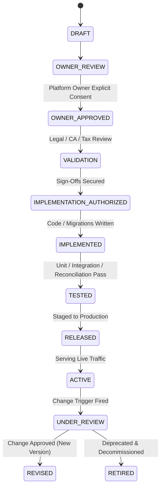

# ATEEVRA Marketplace — Master Commercial & Financial Policy Register

**Document ID:** `REG-M2-14-POLICIES`  
**Governance Authority:** Phase M2-14 Central Policy Blueprint  
**Parent Blueprint:** [`ATEEVRA-MARKETPLACE-FINANCIAL-COMMERCIAL-POLICY-BLUEPRINT.md`](ATEEVRA-MARKETPLACE-FINANCIAL-COMMERCIAL-POLICY-BLUEPRINT.md)  
**Governance Audit & Roadmap References:**
- Inventory Audit: [`M2-14-OD-01-TO-OD-13-INVENTORY-AUDIT.md`](M2-14-OD-01-TO-OD-13-INVENTORY-AUDIT.md)
- Dependency Map: [`M2-14-DEPENDENCY-MAP.md`](M2-14-DEPENDENCY-MAP.md)
- Status Matrix: [`M2-14-DOCUMENTATION-STATUS-MATRIX.md`](M2-14-DOCUMENTATION-STATUS-MATRIX.md)
- Completion Roadmap: [`M2-14-DOCUMENTATION-COMPLETION-ROADMAP.md`](M2-14-DOCUMENTATION-COMPLETION-ROADMAP.md)  
**Last Updated:** 2026-11-03  
**Current State:** 6 Approved Initial Policies (OD-02-01 through OD-02-06); All Other OD Decisions Preserved in Prior Statuses

---

## 1. Executive Summary & Document Purpose

The Master Policy Register serves as the centralized index and status authority for all commercial, financial, refund, pricing, and settlement policies across the ATEEVRA multi-merchant marketplace.

This register:
1. Formally catalogs the six initial owner-approved policies derived from Owner Decision OD-02 (`POL-OD-02-01` through `POL-OD-02-06`).
2. Rigorously preserves the exact unapproved governance statuses of OD-01 (Pricing Model) and OD-03 through OD-13.
3. Provides unambiguous bidirectional traceability between high-level owner decisions, operational policy specifications, and technical implementation blueprints.

---

## 2. Master Policy Status Summary Table

### 2.1 Approved Policies (OD-02 v1.0.0 Baseline)

| Policy ID | Policy Title | Owner Decision Ref | Current Version | Governance Status | Effective Date | Review Cycle | Dedicated Policy Document |
| :--- | :--- | :---: | :---: | :---: | :---: | :---: | :--- |
| **POL-OD-02-01** | Return-Cost Reserve Calibration Architecture | OD-02 | `1.0.0` | `OWNER APPROVED — INITIAL POLICY BASELINE` | Initial Baseline | Monthly (Q1) / Quarterly | [`policies/OD-02-01-RETURN-COST-RESERVE.md`](policies/OD-02-01-RETURN-COST-RESERVE.md) |
| **POL-OD-02-02** | Unified Product Pricing Across Prepaid and COD Channels | OD-02 | `1.0.0` | `OWNER APPROVED — INITIAL POLICY BASELINE` | Initial Baseline | Quarterly | [`policies/OD-02-02-PREPAID-COD-PRICING.md`](policies/OD-02-02-PREPAID-COD-PRICING.md) |
| **POL-OD-02-03** | Platform Absorption of Gateway MDR on Merchant-Fault Returns | OD-02 | `1.0.0` | `OWNER APPROVED — INITIAL POLICY BASELINE` | Initial Baseline | Semi-Annual | [`policies/OD-02-03-GATEWAY-FEE-ALLOCATION.md`](policies/OD-02-03-GATEWAY-FEE-ALLOCATION.md) |
| **POL-OD-02-04** | Customer Protection & Evidence-Based Liability for Carrier Damage | OD-02 | `1.0.0` | `OWNER APPROVED — INITIAL POLICY BASELINE` | Initial Baseline | Quarterly | [`policies/OD-02-04-COURIER-DAMAGE-LIABILITY.md`](policies/OD-02-04-COURIER-DAMAGE-LIABILITY.md) |
| **POL-OD-02-05** | COD RTO Funding & Automated Customer Risk Controls | OD-02 | `1.0.0` | `OWNER APPROVED — INITIAL POLICY BASELINE` | Initial Baseline | Monthly | [`policies/OD-02-05-COD-RTO-FUNDING.md`](policies/OD-02-05-COD-RTO-FUNDING.md) |
| **POL-OD-02-06** | Merchant Pricing-Bound Governance & Conflict Hierarchy | OD-02 | `1.0.0` | `OWNER APPROVED — INITIAL POLICY BASELINE` | Initial Baseline | Quarterly | [`policies/OD-02-06-PRICING-BOUND-CONFLICTS.md`](policies/OD-02-06-PRICING-BOUND-CONFLICTS.md) |

### 2.2 Proposed Policy Revisions (OD-15 & OD-02 Baseline v1.1.0-PROPOSED)

| Policy ID | Policy Title | Owner Decision Ref | Current Version | Governance Status | Effective Date | Review Cycle | Dedicated Policy Document |
| :--- | :--- | :---: | :---: | :---: | :---: | :---: | :--- |
| **POL-M2-14-01** | Customer Returns After Delivery & Weight-Based Reverse Shipping | OD-02 / OD-15 | `1.1.0-PROPOSED` | `OWNER DIRECTION RECORDED — PROPOSED POLICY REVISION` | Pending Ratification | Quarterly | [`policies/POL-M2-14-01-CUSTOMER-RETURNS-AND-REVERSE-SHIPPING.md`](policies/POL-M2-14-01-CUSTOMER-RETURNS-AND-REVERSE-SHIPPING.md) |
| **POL-M2-14-02** | RTO & Failed Delivery Allocation | OD-02 / OD-15 | `1.1.0-PROPOSED` | `OWNER DIRECTION RECORDED — PROPOSED POLICY REVISION` | Pending Ratification | Monthly | [`policies/POL-M2-14-02-RTO-AND-FAILED-DELIVERY.md`](policies/POL-M2-14-02-RTO-AND-FAILED-DELIVERY.md) |
| **POL-M2-14-03** | Merchant-Initiated Cancellations & Accountability Penalty | OD-08 / OD-15 | `1.1.0-PROPOSED` | `OWNER DIRECTION RECORDED — PROPOSED POLICY REVISION` | Pending Ratification | Monthly | [`policies/POL-M2-14-03-MERCHANT-CANCELLATION-PENALTY.md`](policies/POL-M2-14-03-MERCHANT-CANCELLATION-PENALTY.md) |
| **POL-M2-14-04** | Merchant Dispatch SLA & Late-Dispatch Accountability Penalty | OD-08 / OD-15 | `1.1.0-PROPOSED` | `OWNER DIRECTION RECORDED — PROPOSED POLICY REVISION` | Pending Ratification | Monthly | [`policies/POL-M2-14-04-MERCHANT-DISPATCH-SLA-LATE-PENALTY.md`](policies/POL-M2-14-04-MERCHANT-DISPATCH-SLA-LATE-PENALTY.md) |
| **POL-M2-14-05** | Customer-Initiated Cancellation Before Dispatch | OD-02 / OD-15 | `1.1.0-PROPOSED` | `OWNER DIRECTION RECORDED — PROPOSED POLICY REVISION` | Pending Ratification | Quarterly | [`policies/POL-M2-14-05-CUSTOMER-PRE-DISPATCH-CANCELLATION.md`](policies/POL-M2-14-05-CUSTOMER-PRE-DISPATCH-CANCELLATION.md) |
| **POL-M2-14-06** | Merchant Account Health & Progressive Enforcement Framework | OD-08 / OD-15 | `1.1.0-PROPOSED` | `OWNER DIRECTION RECORDED — PROPOSED POLICY REVISION` | Pending Ratification | Monthly | [`policies/POL-M2-14-06-MERCHANT-ACCOUNT-HEALTH-AND-ENFORCEMENT.md`](policies/POL-M2-14-06-MERCHANT-ACCOUNT-HEALTH-AND-ENFORCEMENT.md) |

---

## 3. Preservation of Unapproved Owner Decisions (OD-01, OD-03 to OD-15)

To ensure zero governance drift, the following decisions remain strictly in their prior statuses as defined in [`../M2-14-OWNER-DECISION-REGISTER.md`](../M2-14-OWNER-DECISION-REGISTER.md):

| ID | Title | Summary Scope | Current Governance Status | Governing Document |
| :--- | :--- | :--- | :--- | :--- |
| **OD-01** | Marketplace Commercial Revenue Architecture & Platform Fee Model | Marketplace Facilitation Platform (Merchants as Sellers of Record; platform fee options pending selection; zero wholesale buy-sell) | **OWNER DIRECTION RECORDED — PENDING FEE SELECTION & PROFESSIONAL VALIDATION** | [`../decisions/M2-14-OD-01-PRICING-MODEL-ANALYSIS.md`](../decisions/M2-14-OD-01-PRICING-MODEL-ANALYSIS.md) |
| **OD-03** | Coupon Allocation & Splitting | Order-level coupon financing in mixed carts | **PENDING OWNER DECISION** | [`../M2-14-OWNER-DECISION-REGISTER.md#od-03`](../M2-14-OWNER-DECISION-REGISTER.md#od-03) |
| **OD-04** | Shipping Revenue Allocation | 3PL shipping revenue retention vs seller credit | **PENDING OWNER DECISION** | [`../M2-14-OWNER-DECISION-REGISTER.md#od-04`](../M2-14-OWNER-DECISION-REGISTER.md#od-04) |
| **OD-05** | Statutory Tax Withholding | Sec 52 GST TCS (1%) and Sec 194-O IT TDS (1%) | **PENDING TAX/CA REVIEW** | [`../M2-14-OWNER-DECISION-REGISTER.md#od-05`](../M2-14-OWNER-DECISION-REGISTER.md#od-05) |
| **OD-06** | Exchange Price Differences | Equal-value swaps vs automated price-delta billing | **PENDING OWNER DECISION** | [`../M2-14-OWNER-DECISION-REGISTER.md#od-06`](../M2-14-OWNER-DECISION-REGISTER.md#od-06) |
| **OD-07** | Merchant Settlement & Payout Rails | Deferred bank payouts to MVP-3; escrow hold window | **PENDING OWNER DECISION** | [`../M2-14-OWNER-DECISION-REGISTER.md#od-07`](../M2-14-OWNER-DECISION-REGISTER.md#od-07) |
| **OD-08** | Return Window Duration | Customer return eligibility window (7 vs 14 days) | **OWNER DIRECTION RECORDED: 7-DAY DEFAULT (POL-M2-14-01) — PENDING RATIFICATION** | [`policies/POL-M2-14-01-CUSTOMER-RETURNS-AND-REVERSE-SHIPPING.md`](policies/POL-M2-14-01-CUSTOMER-RETURNS-AND-REVERSE-SHIPPING.md) |
| **OD-09** | Exchange Reservation Timing | Inventory hold duration under PostgreSQL lock | **PENDING OWNER DECISION** | [`../M2-14-OWNER-DECISION-REGISTER.md#od-09`](../M2-14-OWNER-DECISION-REGISTER.md#od-09) |
| **OD-10** | Exchange Cancellation Rights | Customer self-service cancellation cutoff milestone | **PENDING OWNER DECISION** | [`../M2-14-OWNER-DECISION-REGISTER.md#od-10`](../M2-14-OWNER-DECISION-REGISTER.md#od-10) |
| **OD-11** | Non-Returned Item Handling | Inspection gates prior to replacement dispatch | **PENDING OWNER DECISION** | [`../M2-14-OWNER-DECISION-REGISTER.md#od-11`](../M2-14-OWNER-DECISION-REGISTER.md#od-11) |
| **OD-12** | Repeated Fulfillment Failures | Replacement RTO handling and termination threshold | **PENDING OWNER DECISION** | [`../M2-14-OWNER-DECISION-REGISTER.md#od-12`](../M2-14-OWNER-DECISION-REGISTER.md#od-12) |
| **OD-13** | Failed Exchange Conversion | Stockout conversion to refund: automated vs review | **PENDING OWNER DECISION** | [`../M2-14-OWNER-DECISION-REGISTER.md#od-13`](../M2-14-OWNER-DECISION-REGISTER.md#od-13) |
| **OD-14** | Merchant Identity Privacy & Customer-Facing Branding | Conceal personal phone/email/residential address; preserve statutory seller details; route customer care via ATEEVRA | **OWNER DIRECTION RECORDED — FORMAL OD-14 APPROVAL PENDING** | [`M2-14-OD-14-CUSTOMER-FACING-BRANDING-POLICY.md`](M2-14-OD-14-CUSTOMER-FACING-BRANDING-POLICY.md) |
| **OD-15** | Cancellation, Return, RTO & Merchant Accountability Framework | Master operational policy suite covering weight-based return fees, ₹0 RTO fees, provisional penalties, and progressive enforcement | **OWNER DIRECTION RECORDED — PROPOSED POLICY REVISION (PENDING OWNER RATIFICATION)** | [`M2-14-CANCELLATION-RETURN-RTO-CLASSIFICATION-MATRIX.md`](M2-14-CANCELLATION-RETURN-RTO-CLASSIFICATION-MATRIX.md) |

> [!IMPORTANT]
> The approval of policies `POL-OD-02-01` through `POL-OD-02-06` does NOT alter the pending status of OD-01, OD-03 through OD-13, or OD-14. Each decision requires its own explicit, independent owner approval and validation sign-off.

---

## 4. Governance Status Taxonomy & Lifecycle Rules

Every policy in the ATEEVRA marketplace moves through formal lifecycle states:

1. **`DRAFT`:** Policy proposal authored by engineering, finance, or operations teams.
2. **`OWNER REVIEW`:** Submitted to the platform owner for commercial and strategic evaluation.
3. **`OWNER APPROVED — INITIAL POLICY BASELINE`:** Owner grants explicit approval for the business policy baseline. **Implementation is NOT authorized.** Professional validations remain mandatory.
4. **`VALIDATION`:** Under review by legal counsel, chartered accountants, and tax advisors.
5. **`IMPLEMENTATION AUTHORIZED`:** All mandatory sign-offs obtained; owner issues explicit authorization to begin code and schema modifications.
6. **`IMPLEMENTED`:** Code, schema migrations, and API integrations developed in repository.
7. **`TESTED`:** Automated tests, arithmetic checks, and idempotency validations executed and passing.
8. **`RELEASED`:** Deployed to staging and production infrastructure.
9. **`ACTIVE`:** Currently governing live transactions and customer checkout flows.
10. **`UNDER REVIEW`:** Operational metrics or market changes trigger formal policy re-evaluation.
11. **`REVISED`:** Superseded by a newer approved policy version (previous version remains immutable).
12. **`RETIRED`:** Formally decommissioned.

---

## 5. Document Authority & Hierarchy

To resolve any potential future ambiguities or conflicting statements across documentation:

1. **Tier 1 (Strategic & Approval Authority):** [`../M2-14-OWNER-DECISION-REGISTER.md`](../M2-14-OWNER-DECISION-REGISTER.md) is the master governance index recording what has or has not been approved by the platform owner.
2. **Tier 2 (Operational & Commercial Blueprint Authority):** [`ATEEVRA-MARKETPLACE-FINANCIAL-COMMERCIAL-POLICY-BLUEPRINT.md`](ATEEVRA-MARKETPLACE-FINANCIAL-COMMERCIAL-POLICY-BLUEPRINT.md) and this **Policy Register** are the authoritative source of truth for approved policy rules, mathematical formulas, financial accounting treatment, and testing requirements.
3. **Tier 3 (Granular Policy Specifications):** The individual policy documents in `policies/` contain the in-depth business rules and operational workflows for each specific policy.
4. **Tier 4 (Technical Architecture Decisions):** Architecture Decision Records (ADRs) define technical implementations and must conform to the approved policy blueprints.
5. **Tier 5 (Phase Implementation Plans):** Execution plans (`M2-14-EXECUTION-PLAN.md`) govern engineering task sequencing and testing gates.
6. **Tier 6 (Source Code & Database Schemas):** Application code and database migrations must strictly implement the rules specified in Tier 2 and Tier 3 documents.

> [!CAUTION]
> If a conflict is discovered between an implementation plan or source code and this Policy Blueprint, the Policy Blueprint governs. The conflict must be formally reported and resolved through the Change Control protocol.
