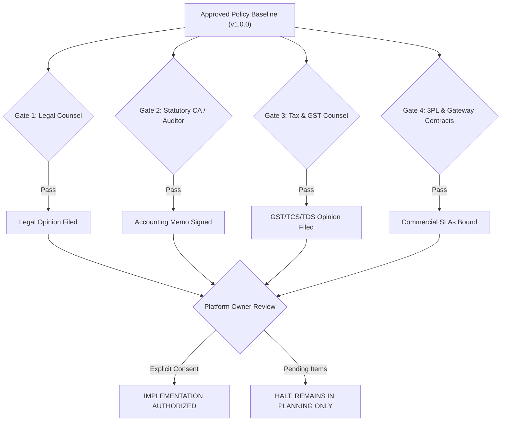

# ATEEVRA Marketplace — Policy Validation, Professional Gating & Acceptance Framework

**Document ID:** `VAL-M2-14-ACCEPTANCE`  
**Governance Authority:** Phase M2-14 Central Policy Blueprint  
**Parent Blueprint:** [`ATEEVRA-MARKETPLACE-FINANCIAL-COMMERCIAL-POLICY-BLUEPRINT.md`](ATEEVRA-MARKETPLACE-FINANCIAL-COMMERCIAL-POLICY-BLUEPRINT.md)  
**Policy Register:** [`POLICY-REGISTER.md`](POLICY-REGISTER.md)  
**Last Updated:** 2026-11-03

---

## 1. Executive Summary & Quality Gate Principles

Prior to authorizing any technical code development, database migrations, or production deployment for Phase M2-14, all approved policies must pass through formal **Professional Validation Gates** and **Technical Acceptance Suites**.

This document defines:
1. The four mandatory professional sign-off gates (Legal, Statutory Audit, Tax/GST, and Logistics SLAs).
2. The complete testing architecture required to verify arithmetic, idempotency, boundary conditions, and transition protection.
3. The formal sign-off checklist required before Phase M2-14 can transition from `PLANNING ONLY` to `IMPLEMENTATION AUTHORIZED`.

---

## 2. Mandatory Professional Validation Gates

### Gate 1: Legal Counsel & Consumer Protection Review
- **Mandatory Deliverable:** Formal written Legal Opinion from ATEEVRA's external corporate legal counsel.
- **Specific Verification Points:**
  1. *E-Commerce Rules Compliance:* Verify that dynamic pricing and platform gross markup comply with Rule 5(3)(b) of the Consumer Protection (E-Commerce) Rules, 2020 (prohibition against unfair price manipulation).
  2. *Non-Discriminatory Pricing:* Confirm that charging the same product price across prepaid and COD checkout complies with Rule 5(3)(a).
  3. *Legal Metrology Compliance:* Confirm that the pricing engine's hard ceiling ($P_{\text{sell}} \le \text{MRP}$) complies strictly with the Legal Metrology (Packaged Commodities) Rules, 2011.
  4. *Merchant Agreement Terms:* Verify that the standard Merchant Agreement legally empowers ATEEVRA to:
     - Cancel pending merchant payables upon customer returns.
     - Offset authorized reverse freight debits from future settlement batches.
     - Withhold merchant payouts during the escrow review window.
  5. *Title & Risk in Goods:* Confirm that custody transfers during 3PL transit and return inspection comply with the Indian Sale of Goods Act, 1930.

### Gate 2: Statutory Auditor & Chartered Accountant (CA) Review
- **Mandatory Deliverable:** Signed Technical Accounting Memorandum from ATEEVRA's statutory audit firm.
- **Specific Verification Points:**
  1. *Ledger Presentation:* Confirm that the Return-Cost Reserve is treated as an internal managerial cost allocation, and determine whether balance sheet provisioning under Ind AS 37 is required.
  2. *Receivables & Bad Debt:* Review the accounting treatment for uncollectible merchant receivables (bad debt write-offs) under Ind AS 109.
  3. *Payable Cancellation:* Validate that pre-settlement returns correctly record payable voidance rather than gross banking entries.
  4. *Insurance Claims:* Validate accounting for pending carrier transit claims under *Other Current Assets*.

### Gate 3: Tax & GST Counsel Review
- **Mandatory Deliverable:** Formal Written GST and Direct Tax Advisory Opinion.
- **Specific Verification Points:**
  1. *Payment Gateway MDR & Refund Rails:*
     - Review SAC 997159 GST treatment on electronic payout rail fees.
     - Confirm conditions for claiming Input Tax Credit (ITC) under Section 16(2) of the CGST Act (valid Section 31 tax invoice, GSTR-2B reflection, and non-applicability of Section 17(5) blocked credits).
  2. *GST on Reverse Logistics:* Validate GST invoicing requirements when ATEEVRA debits contractual reverse freight to merchants.
  3. *Statutory Tax Withholding Coordination (OD-05):* Confirm how Sec 52 GST TCS (1%) and Sec 194-O IT TDS (1%) apply to net merchant settlements.

### Gate 4: 3PL Courier & Payment Aggregator Commercial SLAs
- **Mandatory Deliverable:** Countersigned Master Services Agreements (MSAs) and Rate Cards.
- **Specific Verification Points:**
  1. *Carrier Transit Damage Liability:* Confirm contractual carrier claim liability caps (e.g. ₹600 cap, ₹400 cap, or uncapped invoice value) and claim filing windows.
  2. *Failed Delivery & RTO Billing:* Validate forward freight (₹70), doorstep attempt fees (₹30), and RTO return freight (₹70) schedules.
  3. *Payment Aggregator Refund Charges:* Confirm contractual MDR retention terms on partial and full refunds with Razorpay.

---

## 3. Technical Testing Architecture & Acceptance Suites

Before any technical release of Phase M2-14, the engineering team must execute the following automated test suites:

### Suite 1: Mathematical & Financial Arithmetic Suite
- `TEST-ARITH-01 (Prepaid Retained Baseline):`  
  Assert $+1,000.00 - 800.00 - 70.00 - 23.60 = \mathbf{+₹106.40}$ exactly.
- `TEST-ARITH-02 (COD Retained Baseline):`  
  Assert $+1,000.00 - 800.00 - 70.00 - 40.00 = \mathbf{+₹90.00}$ exactly.
- `TEST-ARITH-03 (Prepaid Expected Unit Contribution - Method A & B):`  
  Assert Method A probability outcome sum matches Method B ($+106.40 - 30.15$) = **+₹76.25** to 4 decimal places.
- `TEST-ARITH-04 (COD Expected Unit Contribution - Method A & B):`  
  Assert Method A probability outcome sum matches Method B ($+90.00 - 59.04$) = **+₹30.96** to 4 decimal places.
- `TEST-ARITH-05 (Gross Cash Drain Reconciliations):`  
  Assert Prepaid gross cash drain is ₹16.85 and COD gross cash drain is ₹38.78; assert neither is labeled as an incremental return reserve.

### Suite 2: Pricing-Bound & Hard Ceiling Guard Suite
- `TEST-BOUND-01 (Statutory MRP Invariant):`  
  Execute 1,000 synthetic price calculations across random spreads; assert $P_{\text{sell}} \le \text{MRP}$ in 100.0% of cases.
- `TEST-BOUND-02 (Merchant Price Ceiling Invariant):`  
  Execute random calculations; assert $P_{\text{sell}} \le P_{\max}$ in 100.0% of cases.
- `TEST-BOUND-03 (4-Step Resolution Hierarchy Execution):`  
  - Given spread with viable compressed margin $\rightarrow$ assert Step 1 applies ($P_{\text{sell}} = P_{\max}$, status `ACTIVE_COMPRESSED`).
  - Given unviable spread with merchant declining Step 2/3 $\rightarrow$ assert Step 4 applies (SKU status `SUSPENDED_UNVIABLE`).

### Suite 3: Transition Protection & Historical Policy Snapshot Suite
- `TEST-SNAPSHOT-01 (Order Snapshot Immutability):`  
  1. Create synthetic Order 1 under Policy v1.0.0 (Return reserve = 15%, COD fee = ₹0).
  2. Deploy mock Policy v2.0.0 to database (Return reserve = 20%, COD fee = ₹50).
  3. Create synthetic Order 2 under Policy v2.0.0.
  4. Trigger return, refund, and settlement for Order 1.
  5. **Assert:** Order 1 settlement and refund evaluate strictly against v1.0.0 rules (zero COD fee, 15% reserve baseline).
  6. **Assert:** Order 2 evaluates against v2.0.0 rules.

### Suite 4: Idempotency & Concurrency Suite
- `TEST-IDEMP-01 (Duplicate Razorpay Refund Webhook):`  
  Simulate 10 concurrent HTTP POST requests with identical Razorpay webhook event ID (`event_id: "evt_123"`). Assert exactly ONE refund ledger transaction is written to PostgreSQL; remaining 9 return HTTP 200 with zero state mutation.
- `TEST-LOCK-02 (PostgreSQL Advisory Locks on Settlement Batches):`  
  Spawn 5 concurrent settlement worker processes attempting to offset the same merchant receivable. Assert PostgreSQL advisory lock serializes execution; assert receivable is deducted exactly once without double-offsetting.

### Suite 5: Operational Exceptions & Accountability Suite (v1.1.0-PROPOSED)
- `TEST-SLAB-01 (Weight-Based Reverse Slabs):`  
  Verify that returned items at 400g, 850g, 1.8kg, 4.2kg, and 6.5kg map strictly to ₹30, ₹50, ₹80, ₹120, and ₹165+ slabs respectively, exclusive of 18% GST.
- `TEST-RTO-02 (Zero Reverse Fee on Genuine RTO):`  
  Assert that when an order transitions to `RTO_DELIVERED`, the merchant reverse-shipping debit is strictly ₹0.00, and 100% of customer prepaid funds are refunded.
- `TEST-PENALTY-03 (Merchant Cancellation & Late Dispatch Debits):`  
  Assert that `CANCELLED_BY_MERCHANT` posts a ₹25.00 debit to `merchant_penalty_ledger`, and dispatch after SLA posts a ₹50.00 debit, both netted from settlement balances.
- `TEST-SCAN-04 (First Physical Carrier Scan Enforcement):`  
  Assert that label printing does NOT halt the SLA timer; timer halts exclusively upon integrated 3PL electronic pickup webhook.
- `TEST-PRE-DISPATCH-05 (Pre-Dispatch Customer Cancellation):`  
  Assert that customer cancellation prior to carrier scan results in ₹0 merchant penalty, ₹0 reverse shipping, and zero negative OCR impact.

---

## 4. Release Readiness Acceptance Checklist

Prior to production release, the following checklist must be completed and signed:

| Item # | Verification Requirement | Responsible Party | Status |
| :---: | :--- | :---: | :---: |
| 1 | Formal Written Legal Opinion Filed (E-Commerce Rules & Legal Metrology) | Legal Counsel | `PENDING` |
| 2 | Statutory Accounting Memorandum Signed (Ledger, Reserves & Write-Offs) | Statutory CA / Auditor | `PENDING` |
| 3 | GST & Input Tax Credit Advisory Opinion Filed | Tax Advisor | `PENDING` |
| 4 | 3PL Carrier MSAs & Rate Cards Signed (Delhivery, Shiprocket) | Head of Logistics | `PENDING` |
| 5 | Payment Gateway MSA Signed (Razorpay MDR & Refund Schedules) | Head of Finance | `PENDING` |
| 6 | Automated Test Suites 1–4 Passing (100% Green on CI/CD Pipeline) | Lead QA / Engineering | `PENDING` |
| 7 | Policy Snapshot Immutability Verified on Staging | Solution Architect | `PENDING` |
| 8 | Platform Owner Formal Implementation Authorization Issued | Platform Owner | `PENDING` |

> [!CAUTION]
> **Implementation Blocker Notice:**  
> Until all eight checklist items are marked `COMPLETED` and signed off, Phase M2-14 remains in **PLANNING ONLY** status. No production release or unapproved code execution is permitted.
