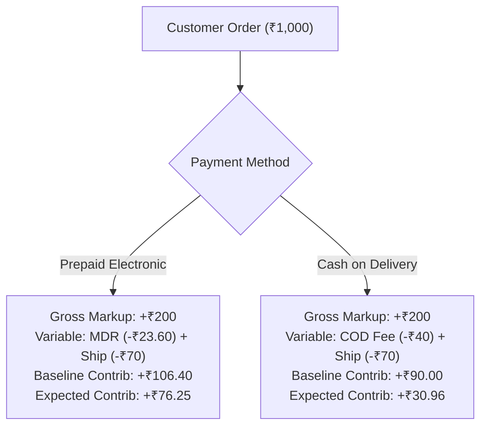

# ATEEVRA Policy: OD-02-02 — Prepaid versus Cash on Delivery (COD) Pricing Consistency

**Policy ID:** `POL-OD-02-02`  
**Policy Name:** Unified Product Pricing Across Prepaid and COD Payment Channels  
**Owner Decision Reference:** OD-02 (Sub-Decision OD-02-02)  
**Approval Status:** `OWNER APPROVED — INITIAL POLICY BASELINE`  
**Current Version:** `1.0.0`  
**Effective Date:** Initial Baseline (Mandatory Validation Gates Apply Before Production)  
**Parent Blueprint:** [`../ATEEVRA-MARKETPLACE-FINANCIAL-COMMERCIAL-POLICY-BLUEPRINT.md`](../ATEEVRA-MARKETPLACE-FINANCIAL-COMMERCIAL-POLICY-BLUEPRINT.md)  
**Policy Register:** [`../POLICY-REGISTER.md`](../POLICY-REGISTER.md)

---

## 1. Executive Summary & Purpose

This policy governs the relationship between payment methods (Prepaid electronic payments vs. Cash on Delivery) and customer-facing product selling prices ($P_{\text{sell}}$).

The core objective is to deliver a frictionless, trustworthy, and transparent customer experience by presenting identical product pricing regardless of payment method, while establishing rigorous financial controls and separate channel contribution tracking within ATEEVRA's financial reporting.

---

## 2. Owner-Approved Decision

> **APPROVED INITIAL POLICY: SAME PRODUCT SELLING PRICE**
> 
> 1. ATEEVRA shall maintain a **strictly consistent product selling price ($P_{\text{sell}}$) across both prepaid and Cash on Delivery (COD)** checkout methods.
> 2. The platform shall **initially absorb all COD-specific operating costs** (including 3PL carrier COD cash collection fees, doorstep attempt fees, and RTO risk provisions) provided that the overall unit economics remain positive.
> 3. The platform shall **NOT introduce an automatic customer-facing COD fee, cash surcharge, or handling fee** at initial launch.
> 4. Any future introduction of a customer-facing COD convenience fee or differential pricing requires an independent business policy review, formal owner approval, and comprehensive legal and statutory tax validation under Indian consumer protection and payment regulations.
> 5. ATEEVRA's financial reporting engine must maintain **strictly separate contribution margin and incident reporting for prepaid and COD channels**.

---

## 3. Governance and Approval Status

- **Status:** `OWNER APPROVED — INITIAL POLICY BASELINE`
- **Governance Invariants:**
  - This policy constitutes an owner-approved commercial policy baseline.
  - Approval does NOT authorize Phase M2-14 technical code or schema changes.
  - Gated on statutory review: Rule 5(3)(a) of Consumer Protection (E-Commerce) Rules, 2020 (prohibition against unfair price discrimination) and payment aggregator contractual guidelines.
  - Any future change to charge a customer COD fee must be submitted as a formal Change Request under [`../POLICY-CHANGELOG.md`](../POLICY-CHANGELOG.md).

---

## 4. Rationale & Commercial Justification

1. **Conversion Optimization & Customer Trust:**  
   In Indian direct-to-consumer (D2C) fashion ecommerce, unexpected checkout surcharges (such as an added ₹50 or ₹99 "COD fee" on the final payment screen) cause severe cart abandonment (typically 15%–25% abandonment spikes). Presenting a clean, uniform selling price builds customer trust and aligns with modern premium brand expectations.
2. **Economic Viability Under Markup Model:**  
   Under the baseline illustrative unit economics ($P_{\text{sell}} = ₹1,000$, $P_{\text{realization}} = ₹800$, Gross Markup = $+₹200$):
   - Prepaid retained orders deliver **+₹106.40 baseline contribution** (Expected unit contribution: **+₹76.25**).
   - COD retained orders deliver **+₹90.00 baseline contribution** (Expected unit contribution: **+₹30.96** after factoring 18% RTO and post-delivery returns).  
   Because the expected COD contribution remains solidly positive (+₹30.96 per placed order), ATEEVRA's unit economics support absorbing COD friction without penalizing customers.
3. **Regulatory Safety:**  
   Maintaining identical product pricing avoids potential regulatory scrutiny under Indian consumer protection laws regarding hidden fees, deceptive pricing, or discriminatory pricing practices at checkout.

---

## 5. Scope & Applicability

- **In Scope:**  
  - All consumer-facing product detail pages (PDP), cart calculations, and checkout pricing across the ATEEVRA web storefront and mobile applications.
  - All payment methods accepted by ATEEVRA (UPI, Credit/Debit Cards, NetBanking, Wallets, and COD).
  - Financial ledger tracking separating prepaid and COD revenues, costs, and contribution margins.
- **Out of Scope:**  
  - Merchant payout realization (merchants receive identical realization regardless of how the customer pays).
  - B2B bulk orders or wholesale purchases (if introduced in future phases).

---

## 6. Business Rules & Operational Specifications

### Rule 1: Single Shelf Selling Price Invariant
The checkout engine must enforce that the line-item selling price ($P_{\text{sell}}$) of every SKU in the cart is strictly invariant to payment method selection:
$$P_{\text{sell}}(\text{Prepaid}) \equiv P_{\text{sell}}(\text{COD})$$
Switching from UPI to COD during checkout must never mutate the subtotal or apply an automatic surcharge.

### Rule 2: Platform Absorption of Direct COD Carrier Surcharges
When an order is placed via COD, the direct carrier cash collection fee charged by the 3PL partner (illustrative baseline: ₹40.00 or 1.5%–2% of order value) is booked as a platform variable operating expense ($C_{\text{variable, COD}}$). It is never passed through as a customer fee and never deducted from merchant realization.

### Rule 3: Separate Financial Channel Reporting
The reporting engine must track the following metrics independently for Prepaid and COD cohorts:
1. Placed order volume and Gross Merchandise Value (GMV).
2. Delivered and retained order rate ($P_{\text{success}}$).
3. Doorstep refusal / RTO rate ($P_{\text{RTO}}$).
4. Post-delivery return rate ($P_{\text{return}}$).
5. Channel-specific contribution margin per order.
6. Cash drain per placed order.

### Rule 4: Prerequisites for Any Future COD Surcharge
If cohort data indicates that COD unit economics in a specific category turn negative ($\mathbb{E}[\text{Contribution}_{\text{COD}}] < 0$), introducing a customer COD fee requires:
- Written business case submitted by Finance.
- Legal opinion confirming compliance with Indian consumer protection regulations.
- Formal sign-off and approval by the platform owner.

---

## 7. Preconditions and Exceptions

### Preconditions
- The customer must have a verified Indian shipping address within an active 3PL COD serviceable pincode.
- The order must satisfy ATEEVRA's COD eligibility controls (see [`OD-02-05-COD-RTO-FUNDING.md`](OD-02-05-COD-RTO-FUNDING.md)).

### Exceptions
- **Ineligible COD Pincodes:** If a pincode is marked non-COD by 3PL partners, COD is disabled at checkout; the customer must use prepaid payment methods. Product price remains unchanged.
- **High-Value Cap Exclusion:** Orders exceeding platform COD caps (e.g. ₹5,000) require prepaid payment.

---

## 8. Stakeholder Impacts

| Stakeholder | Direct Impact |
| :--- | :--- |
| **Customer** | Complete pricing clarity. No surprise fees on final checkout. Equal product pricing across all payment methods. |
| **Merchant** | Zero exposure to payment method friction. Payout realization is identical whether the customer pays via UPI or cash. |
| **ATEEVRA Platform** | Absorbs COD carrier collection fees (~₹40) and RTO risk within platform gross markup (+₹200). Blended contribution remains profitable. |
| **3PL Partner** | Settles cash collection according to standard commercial remittance SLA (e.g. T+2 post-delivery cash deposit). |

---

## 9. Comparative Financial Impact Analysis (₹1,000 Order)

| Financial Dimension | Prepaid Channel | Cash on Delivery (COD) Channel | Channel Delta |
| :--- | :---: | :---: | :---: |
| **Customer Product Price** | ₹1,000.00 | ₹1,000.00 | ₹0.00 *(Unified)* |
| **Customer COD Surcharge** | ₹0.00 | ₹0.00 | ₹0.00 *(No Fee)* |
| **Merchant Realization** | ₹800.00 | ₹800.00 | ₹0.00 *(Protected)* |
| **Platform Gross Markup** | +₹200.00 | +₹200.00 | ₹0.00 |
| **Channel Operating Expense** | -₹23.60 *(Payment MDR)* | -₹40.00 *(COD Collection)* | -₹16.40 |
| **Forward Freight** | -₹70.00 | -₹70.00 | ₹0.00 |
| **Baseline Retained Contribution** | **+₹106.40** | **+₹90.00** | -₹16.40 |
| **Expected Unit Contribution ($\mathbb{E}$)** | **+₹76.25** | **+₹30.96** | **-₹45.29** |

*Key Takeaway:* While COD earns ₹45.29 less expected contribution per order due to RTO and collection expenses, it remains substantially profitable (+₹30.96), justifying platform absorption to capture massive Indian COD market demand.

---

## 10. Required Evidence and Audit Trails

1. **Storefront Price Verification Log:** Continuous automated synthetic tests asserting that checkout total does not change when toggling payment methods.
2. **Payment Allocation Ledger:** Every captured order records: `order_id`, `payment_method`, `gross_price`, `carrier_collection_fee_absorbed`, `payment_gateway_fee_absorbed`.
3. **Channel Contribution Monthly Dashboard:** Automated reporting of realized contribution margin split by payment channel.

---

## 11. Dispute & Escalation Procedures

- **Customer Inquiries Regarding COD Surcharges:** Customer service scripts must confirm that ATEEVRA charges zero extra fees for COD.
- **3PL Disputed Collection Invoices:** If carrier invoices reflect higher collection fees than contractually agreed, Logistics Operations reconciles via the 3PL billing dispute workflow.

---

## 12. Accounting and Reconciliation Considerations

- **Revenue Recognition:** Total recognized revenue is $P_{\text{sell}}$ regardless of payment rail.
- **Cost of Sales / Direct Operating Expenses:**
  - Prepaid gateway MDR is booked under *Bank Charges & Payment Processing Expenses*.
  - COD cash collection fees are booked under *3PL Fulfillment & Logistics Expenses*.
- **Cash Remittance Reconciliation:** COD cash collected by courier delivery agents must be reconciled against nodal bank account remittances within contractually defined settlement windows (T+2 to T+4 days).

---

## 13. Dependencies & Open Questions

- **Dependencies:**
  - 3PL courier API integration for pincode serviceability and cash remittance tracking.
  - Risk controls defined in [`OD-02-05-COD-RTO-FUNDING.md`](OD-02-05-COD-RTO-FUNDING.md).
- **Open Questions:**
  - Pincode-level COD enablement matrix (which pincodes have unacceptably high RTO history).

---

## 14. Review Frequency & Change Triggers

- **Quarterly Review:** Comprehensive review of COD blended contribution margins by Category and Logistics Leads.
- **Triggers for Policy Review:**
  - Blended COD contribution margin falls below +₹15.00 per order across any category.
  - Overall marketplace COD RTO rate exceeds 22% over a consecutive 60-day period.

---

## 15. Controlled Revision Notice: Baseline v1.1.0-PROPOSED Addendum

> [!NOTE]
> **GOVERNANCE STATUS: OWNER DIRECTION RECORDED — PROPOSED POLICY REVISION (PENDING OWNER RATIFICATION)**  
> Pursuant to Project Owner directions issued on 2026-11-04 regarding Cancellation, Return, RTO & Merchant Accountability (OD-15), a controlled policy revision (`v1.1.0-PROPOSED`) has been formulated:
> - **Superceding Policy Reference:** [`POL-M2-14-02-RTO-AND-FAILED-DELIVERY.md`](POL-M2-14-02-RTO-AND-FAILED-DELIVERY.md) and [`M2-14-OD-02-REVISED-POLICY-BASELINE-V1-1-0.md`](../M2-14-OD-02-REVISED-POLICY-BASELINE-V1-1-0.md).
> - **Key Proposed Change:** Confirms that COD RTO reverse freight continues to be absorbed by ATEEVRA via COD handling fees and reserve, with ₹0 reverse shipping charged to merchants for genuine failed deliveries.
> - **Legal Baseline:** This document (`POL-OD-02-02` v1.0.0) remains the approved baseline until formal Owner Ratification is executed.
