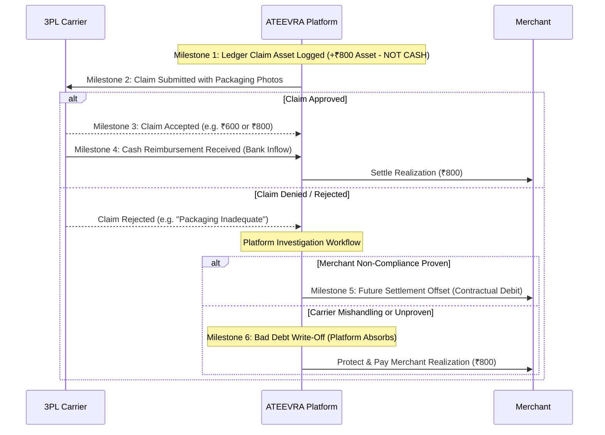

# ATEEVRA Policy: OD-02-04 — Courier Damage Allocation & Carrier Claim Rejection Governance

**Policy ID:** `POL-OD-02-04`  
**Policy Name:** Customer Protection and Evidence-Based Liability for In-Transit Carrier Damage  
**Owner Decision Reference:** OD-02 (Sub-Decision OD-02-04)  
**Approval Status:** `OWNER APPROVED — INITIAL POLICY BASELINE`  
**Current Version:** `1.0.0`  
**Effective Date:** Initial Baseline (Mandatory Validation Gates Apply Before Production)  
**Parent Blueprint:** [`../ATEEVRA-MARKETPLACE-FINANCIAL-COMMERCIAL-POLICY-BLUEPRINT.md`](../ATEEVRA-MARKETPLACE-FINANCIAL-COMMERCIAL-POLICY-BLUEPRINT.md)  
**Policy Register:** [`../POLICY-REGISTER.md`](../POLICY-REGISTER.md)

---

## 1. Executive Summary & Purpose

When goods in transit suffer physical damage or destruction during 3PL logistics handling, ATEEVRA immediately refunds or replaces the item for the customer. ATEEVRA then files an insurance or transit claim against the responsible 3PL logistics provider.

This policy governs the financial and operational handling of unresolved courier-damage claims—specifically when a 3PL carrier denies, rejects, or caps an insurance claim. It establishes rigorous customer protection and ensures that carrier claim rejection does not arbitrarily penalize merchants without factual, verified evidence of packaging non-compliance.

---

## 2. Owner-Approved Decision

> **APPROVED INITIAL POLICY: CUSTOMER PROTECTION WITH EVIDENCE-BASED LIABILITY**
> 
> 1. ATEEVRA shall **immediately protect and refund eligible customers** according to the approved platform return and refund policy upon verification of damaged delivery.
> 2. ATEEVRA shall **initially fund and absorb unresolved courier-damage cases** where carrier transit insurance claims are denied, delayed, or capped by 3PL partners.
> 3. A 3PL carrier's rejection of an insurance claim **must NEVER automatically transfer financial liability or result in a settlement debit to the merchant**.
> 4. Financial liability may be allocated to a merchant **ONLY where verified, documented evidence establishes that the merchant failed to comply with platform packaging, cushioning, or dispatch guidelines**, and applicable merchant contractual agreements explicitly support that allocation.
> 5. The platform must **durably preserve and log all dispute evidence, packaging photos, courier claim submissions, insurer decisions, accepted amounts, actual recovered cash, and formal rejection reasons**.
> 6. ATEEVRA Operations shall establish **documented, auditable investigation and dispute-resolution workflows** for all transit damage incidents.

---

## 3. Governance and Approval Status

- **Status:** `OWNER APPROVED — INITIAL POLICY BASELINE`
- **Governance Invariants:**
  - This policy constitutes an owner-approved operational and commercial baseline.
  - Approval does NOT authorize Phase M2-14 technical code or schema changes.
  - Carrier claim processing depends on external 3PL contracts and transit liability limits.
  - Payout protection for compliant merchants is an explicit platform commitment.
  - Any future revision to default liability rules requires formal change control under [`../POLICY-CHANGELOG.md`](../POLICY-CHANGELOG.md).

---

## 4. Rationale & Commercial Justification

1. **Protecting Customer Satisfaction:**  
   Customers who receive damaged goods must not be trapped in tripartite disputes between the marketplace, courier, and seller. Prompt refunding or replacement is vital for brand integrity and customer retention.
2. **Fairness to Compliant Merchants:**  
   3PL courier partners frequently attempt to reject legitimate transit damage claims by asserting boilerplate "insufficient packaging" clauses. If ATEEVRA were to pass carrier rejections automatically to merchants, merchants would bear financial losses for carrier mishandling (such as water damage, vehicular crushing, or warehouse drop impacts) over which they had zero control.
3. **Evidence-Based Accountability:**  
   Holding merchants liable only upon factual proof of packaging failure establishes a fair standard, incentivizes compliance with packaging guidelines, and prevents unfair chargebacks that damage seller recruitment and retention.
4. **Statistical Manageability:**  
   In-transit carrier damage occurs at an expected probability of approximately 0.5% of shipments. Absorbing unresolved claims within platform gross markup and the Return-Cost Reserve is manageable and sustainable for ATEEVRA.

---

## 5. Scope & Applicability

- **In Scope:**  
  - All orders where goods suffer physical damage, destruction, liquid contamination, or partial pilferage during transit under 3PL courier custody (forward or reverse transit).
  - All claims filed by ATEEVRA against 3PL partners (Delhivery, Shiprocket, Bluedart, etc.).
  - Merchant payout settlements for damaged goods.
- **Out of Scope:**  
  - Manufacturing defects existing prior to courier pickup (governed by [`OD-02-03-GATEWAY-FEE-ALLOCATION.md`](OD-02-03-GATEWAY-FEE-ALLOCATION.md)).
  - Customer-inflicted damage post-delivery (governed by standard return dispute inspection rules).

---

## 6. Business Rules & Operational Workflows

### Rule 1: Immediate Customer Resolution
Upon receipt of customer unboxing photographs or video demonstrating transit damage within the return window:
1. Customer Support verifies package condition (e.g. crushed box, torn polybag, damaged item).
2. Customer is issued an immediate refund of 100% of $P_{\text{sell}}$ (or equal-value replacement dispatched).

### Rule 2: Six Operational Milestones for Courier & Merchant Recovery
To maintain absolute accounting integrity, the platform must never record speculative cash or treat claims as settled prematurely. The lifecycle follows six explicit milestones:

1. **Milestone 1 — Ledger Adjustment Logged:** Accounting asset logged under `COURIER_CLAIM_PENDING`. **Zero cash moves.**
2. **Milestone 2 — Claim Submitted:** Formal claim submitted to 3PL with tracking ID, manifest, weight logs, and customer damage photos.
3. **Milestone 3 — Claim Accepted:** 3PL approves claim amount (full or partial/capped).
4. **Milestone 4 — Cash Reimbursement Received:** Actual bank deposit from 3PL credited to ATEEVRA nodal/current account. Only now does cash improve.
5. **Milestone 5 — Future Settlement Offset Completed:** Deducted from future merchant payout batches **only if merchant fault is factually proven**.
6. **Milestone 6 — Receivable Written Off:** Platform absorbs loss if claim is rejected and merchant was compliant.

### Rule 3: Reconciled Financial Scenarios (₹1,000 Order, ₹800 Realization)

| Scenario / Case | Customer Refund | Merchant Paid? | 3PL Claim Received | Platform Cash Impact | Platform Economic Impact | Lost Contribution |
| :--- | :---: | :---: | :---: | :---: | :---: | :---: |
| **Case 3.A: Full 3PL Recovery (+₹800)** | -₹1,000 | Yes (-₹800) | **+₹800.00** | **-₹183.60** | **-₹183.60** | **₹290.00** |
| **Case 3.B.1: 3PL Cap Payout (+₹600)** | -₹1,000 | Yes (-₹800) | **+₹600.00** | **-₹383.60** | **-₹383.60** | **₹490.00** |
| **Case 3.B.2: 60% Expected Recovery (+₹360)**| -₹1,000 | Yes (-₹800) | **+₹360.00** | **-₹623.60** | **-₹623.60** | **₹730.00** |
| **Case 3.B.3: Partial Cap Payout (+₹400)** | -₹1,000 | Yes (-₹800) | **+₹400.00** | **-₹583.60** | **-₹583.60** | **₹690.00** |
| **Case 3.C.1: Claim Denied (Compliant Merchant)** | -₹1,000 | Yes (-₹800) | **₹0.00** | **-₹983.60** | **-₹983.60** | **₹1,090.00** |
| **Case 3.C.2: Carrier Proves Packaging Breach** | -₹1,000 | Canceled (₹0) | **₹0.00** | **-₹183.60** | **-₹102.60** | **₹209.00** |

*Note on Case 3.C.1:* In Case 3.C.1, ATEEVRA protects the compliant merchant and disburses ₹800 realization despite the courier rejection. The platform absorbs the entire cash drain of **-₹983.60** (-₹1,000 refund - ₹70 forward freight - ₹23.60 gateway fee - ₹800 merchant payout + ₹1,000 checkout inflow = -₹893.60 net operating cash; gross incident cash outflow before original inflow = -₹1,893.60).

---

## 7. Preconditions and Exceptions

### Preconditions
- Order must have been picked up by an authorized ATEEVRA integrated 3PL carrier.
- Damage must be reported by the customer within 48 hours of carrier delivery confirmation.

### Exceptions
- **Merchant Non-Compliance Exception (Case 3.C.2):** Merchant liability is enforced **only if**:
  1. High-resolution photographic evidence proves merchant used unapproved packaging (e.g. single-layer polybag for fragile glassware); AND
  2. The dispatch weight/dimension materially violated shipping standards; AND
  3. The Merchant Dispute Panel formally approves the liability transfer.

---

## 8. Stakeholder Impacts

| Stakeholder | Direct Impact |
| :--- | :--- |
| **Customer** | Complete protection. Fast refund or replacement without participating in carrier claims. |
| **Merchant** | Full protection against carrier mishandling. Realization is honored unless gross packaging violation is proven. |
| **ATEEVRA Platform** | Acts as commercial guarantor, absorbing residual risk (Case 3.C.1) while pursuing carrier recoveries. |
| **3PL Carrier** | Held accountable to contractual transit insurance terms and service level agreements. |

---

## 9. Required Evidence and Dispute Workflows

For every courier damage incident, the following evidence packet must be compiled in Medusa / PostgreSQL:
1. `customer_damage_photos`: Minimum 3 photos showing outer parcel, shipping label, and internal item damage.
2. `carrier_pod_record`: Electronic Proof of Delivery noting parcel condition.
3. `merchant_dispatch_manifest`: Verified weight and packaging type logged at dispatch.
4. `carrier_claim_reference`: Formal claim tracking ticket with 3PL.
5. `dispute_resolution_log`: Detailed notes of investigation outcome signed by Platform Operations Lead.

---

## 10. Dispute & Escalation Procedures

- **Escalation Path:** If a merchant objects to a packaging non-compliance determination (Case 3.C.2), the case escalates to the **Platform Operations Review Board** (consisting of Head of Logistics, Head of Merchant Relations, and Legal Counsel).
- **Timeframe:** The merchant has 7 business days from notification to submit dispatch security video or packaging proof.

---

## 11. Accounting and Reconciliation Considerations

- **Ledger Classification:** Claims filed with carriers are recorded as *Other Current Assets: Insurance Claims Receivable*.
- **Write-Off Procedure:** If a claim is denied and the platform absorbs the loss, the asset is derecognized via *Operating Loss: Transit Damage Write-Off*.
- **Tax Implication:** Recoveries from carriers are non-taxable compensatory receipts; no GST is chargeable on insurance settlements.

---

## 12. Dependencies & Open Questions

- **Dependencies:**
  - Standardized ATEEVRA Merchant Packaging Guidelines document.
  - 3PL carrier Master Services Agreements (MSAs) detailing transit liability caps.
- **Open Questions:**
  - Whether ATEEVRA should procure an umbrella third-party transit insurance policy to cover carrier liability caps beyond standard 3PL coverage.

---

## 13. Review Frequency & Change Triggers

- **Quarterly Review:** Review of carrier claim win rates, average recovery percentages, and dispute frequencies.
- **Triggers for Policy Review:**
  - Carrier claim approval rate drops below 50% across any 3PL partner.
  - Transit damage incident rate exceeds 1.5% of total marketplace shipments in any quarter.

---

## 14. Controlled Revision Notice: Baseline v1.1.0-PROPOSED Addendum

> [!NOTE]
> **GOVERNANCE STATUS: OWNER DIRECTION RECORDED — PROPOSED POLICY REVISION (PENDING OWNER RATIFICATION)**  
> Pursuant to Project Owner directions issued on 2026-11-04 regarding Cancellation, Return, RTO & Merchant Accountability (OD-15), a controlled policy revision (`v1.1.0-PROPOSED`) has been formulated:
> - **Superceding Policy Reference:** [`POL-M2-14-01-CUSTOMER-RETURNS-AND-REVERSE-SHIPPING.md`](POL-M2-14-01-CUSTOMER-RETURNS-AND-REVERSE-SHIPPING.md) and [`M2-14-OD-02-REVISED-POLICY-BASELINE-V1-1-0.md`](../M2-14-OD-02-REVISED-POLICY-BASELINE-V1-1-0.md).
> - **Key Proposed Change:** Introduces formal 3PL courier reweighing and volumetric dispute mechanisms to protect merchants from erroneous reverse-freight over-billing on returned parcels.
> - **Legal Baseline:** This document (`POL-OD-02-04` v1.0.0) remains the approved baseline until formal Owner Ratification is executed.
