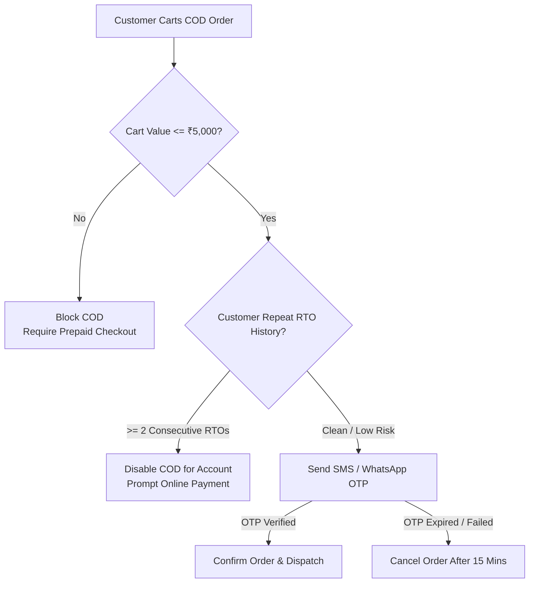

# ATEEVRA Policy: OD-02-05 — Cash on Delivery (COD) Return-to-Origin (RTO) Funding & Risk Governance

**Policy ID:** `POL-OD-02-05`  
**Policy Name:** Platform Absorption of COD RTO Expenses and Automated Customer Risk Controls  
**Owner Decision Reference:** OD-02 (Sub-Decision OD-02-05)  
**Approval Status:** `OWNER APPROVED — INITIAL POLICY BASELINE`  
**Current Version:** `1.0.0`  
**Effective Date:** Initial Baseline (Mandatory Validation Gates Apply Before Production)  
**Parent Blueprint:** [`../ATEEVRA-MARKETPLACE-FINANCIAL-COMMERCIAL-POLICY-BLUEPRINT.md`](../ATEEVRA-MARKETPLACE-FINANCIAL-COMMERCIAL-POLICY-BLUEPRINT.md)  
**Policy Register:** [`../POLICY-REGISTER.md`](../POLICY-REGISTER.md)

---

## 1. Executive Summary & Purpose

In Indian ecommerce, Cash on Delivery orders suffer significant failure rates when customers refuse acceptance at the doorstep or cannot be contacted by delivery personnel. The parcel is consequently flagged as Return to Origin (RTO) and returned to the merchant's warehouse dock.

This policy governs the financial absorption of COD RTO logistics expenses and establishes the operational risk mitigation controls required to prevent abuse without prematurely penalizing genuine customers.

---

## 2. Owner-Approved Decision

> **APPROVED INITIAL POLICY: ATEEVRA FUNDS COD RTO INITIALLY**
> 
> 1. ATEEVRA shall **initially absorb all logistics expenses resulting from COD customer doorstep refusal and RTO**.
> 2. The platform shall **NOT automatically penalize, blacklist, or charge customers for an isolated failed delivery**.
> 3. The platform must establish **rigorous, documented COD eligibility and risk controls**, including:
>    - Mandatory **SMS / WhatsApp OTP verification** prior to COD order confirmation.
>    - Configurable **maximum order-value caps** for COD checkout (e.g. ₹5,000 max).
>    - Automated **customer repeat-RTO monitoring and risk scoring**.
> 4. The financial engine must maintain **strictly separate COD RTO financial accounting and loss reporting**.
> 5. Any future introduction of customer-facing cancellation penalties, RTO shipping fees, or restricted payment terms requires a **separate, owner-approved policy revision and formal legal review**.

---

## 3. Governance and Approval Status

- **Status:** `OWNER APPROVED — INITIAL POLICY BASELINE`
- **Governance Invariants:**
  - Establishes the binding initial policy baseline approved by the platform owner.
  - Does NOT authorize Phase M2-14 technical code or schema changes.
  - Requires technical verification of Medusa checkout flows and SMS OTP providers before production rollout.
  - Customer risk controls must comply with Indian IT laws and Digital Personal Data Protection (DPDP) Act, 2023.
  - Changes to RTO thresholds must be logged under [`../POLICY-CHANGELOG.md`](../POLICY-CHANGELOG.md).

---

## 4. Rationale & Commercial Justification

1. **Market Reality of COD in India:**  
   Cash on Delivery accounts for 60%–75% of ecommerce apparel transactions in Tier-2 and Tier-3 Indian cities. Attempting to charge customers upfront or penalizing them for courier scheduling failures (e.g. courier fake delivery attempts) causes severe churn and brand damage.
2. **Preserving Merchant Trust:**  
   Merchants will not sell on ATEEVRA if they are forced to pay reverse freight on parcels refused by customers they never interacted with. Absorbing RTO within platform gross markup protects merchant margins and ensures robust catalog supply.
3. **Preventive Controls over Punitive Fees:**  
   Empirical ecommerce data shows that proactive friction (OTP verification, address quality validation, NDR call centers) reduces RTO by 30%–45%, which is far more commercially effective than attempting to collect penalty fees from delinquent customers after the fact.

---

## 5. Scope & Applicability

- **In Scope:**  
  - All orders placed using Cash on Delivery where delivery fails due to customer refusal, customer unavailability, unreachable phone, or wrong address.
  - Out-of-pocket reverse logistics charges billed by 3PL logistics partners (forward freight, attempt fees, RTO return freight).
  - Risk engine rules for COD checkout eligibility.
- **Out of Scope:**  
  - Post-delivery remorse returns (governed by [`OD-02-01-RETURN-COST-RESERVE.md`](OD-02-01-RETURN-COST-RESERVE.md)).
  - Prepaid pre-dispatch cancellations (governed by standard refund rules).

---

## 6. Business Rules & Financial Accounting Treatment

### Rule 1: Breakdown of Failed Delivery Logistics Costs
When a COD order suffers doorstep refusal / RTO, ATEEVRA incurs three direct logistics components:
1. **Forward Freight:** Carrier delivers parcel to destination hub: **-₹70.00**.
2. **Doorstep Verification / Delivery Attempt Fee:** Carrier charges for physical delivery attempt: **-₹30.00** (typically ₹20–₹40; carrier percentage collection fee of ₹40.00 is waived because zero cash was collected).
3. **RTO Reverse Return Freight:** Carrier transports unopened parcel back to merchant warehouse: **-₹70.00** (typically ₹50–₹70).
4. **Total Net Failed Delivery Cash Impact:** $-70 - 30 - 70 = \mathbf{-₹170.00}$ (or up to **-₹180.00** if attempt fee is ₹40).

### Rule 2: Complete Merchant and Customer Protection
- **Zero Merchant Debt:** The merchant payable ($P_{\text{realization}} = ₹800$) is canceled. **Zero merchant realization is paid, but zero debt is charged to the merchant.** Unopened goods are returned to merchant custody and restocked to inventory after QC scan.
- **Zero Customer Charge:** The customer is not invoiced or debited. Zero customer refund occurs because zero cash was collected.
- **Platform Absorption:** ATEEVRA absorbs the full **-₹170.00 cash outlay**, funded entirely through the Return-Cost Pricing Reserve embedded within gross platform markup.

### Rule 3: Expected Unit Economics Reconciliation (COD Model)

$$\mathbb{E}[\text{COD Contribution}] = \sum_{k} P_k \times C_k$$

| Outcome Node | Probability ($P_k$) | Platform Contribution ($C_k$) | Probability-Weighted Contribution |
| :--- | :---: | :---: | :---: |
| **Successful Retained Delivery** | 77.49% | +₹90.00 | **+₹69.7410** |
| **Doorstep Refusal / RTO** | 18.00% | -₹170.00 | **-₹30.6000** |
| **Post-Delivery Remorse Return** | 3.28% | -₹203.40 | **-₹6.6715** |
| **Post-Delivery Merchant Fault** | 1.23% | -₹122.40 | **-₹1.5055** |
| **Total Placed COD Orders** | **100.00%** | — | **+₹30.9640 $\approx$ +₹30.96** |

- **Lost Contribution on RTO:** Baseline retained contribution (+₹90.00) minus failure outcome (-₹170.00) = **₹260.00 lost contribution per RTO event**.
- **Probability-Weighted RTO Lost Contribution:** $0.18 \times ₹260.00 = \mathbf{₹46.80 \text{ per placed COD order}}$.

### Rule 4: Mandatory COD Eligibility & Risk Controls

To control RTO rates within the modeled 18% ceiling, the platform checkout engine must enforce three mandatory gates:

1. **Gate 1 — Order Value Cap:** COD is strictly restricted to orders with total value $\le ₹5,000$. Orders exceeding ₹5,000 require prepaid payment.
2. **Gate 2 — Mandatory OTP Verification:** Checkout requires entry of a 6-digit cryptographic OTP sent via SMS/WhatsApp to the customer's verified mobile number. Unverified orders are automatically canceled after 15 minutes.
3. **Gate 3 — Repeat RTO Safeguard:** If a customer profile accumulates **2 or more consecutive RTO orders** without a successful delivery, COD is automatically disabled for that account for 90 days. The customer must use prepaid payment methods.

---

## 7. Preconditions and Exceptions

### Preconditions
- Shipping address must be verified via pincode serviceability database.
- 3PL carrier must support Non-Delivery Report (NDR) tracking and re-attempt workflows.

### Exceptions
- **Courier Fake Attempts (Courier Fraud):** If a carrier delivery agent falsely marks an order "Customer Refused" without visiting the address or making customer contact (verified via carrier GPS and call logs), ATEEVRA Operations disputes the attempt fee and RTO freight with the 3PL carrier.

---

## 8. Stakeholder Impacts

| Stakeholder | Direct Impact |
| :--- | :--- |
| **Customer** | Friction-free COD access with standard OTP confirmation. No penalties for genuine delivery issues. |
| **Merchant** | Zero freight liability on refused orders. Stock returned directly to seller warehouse for restocking. |
| **ATEEVRA Platform** | Systematically budgets and absorbs -₹170 per RTO event; maintains positive +₹30.96 unit contribution. |
| **3PL Partner** | Paid forward, attempt, and reverse freight per commercial agreement. Must provide GPS/telephony proof on NDRs. |

---

## 9. Required Evidence and Audit Trails

1. **RTO Event Log:** Every RTO transaction records: `order_id`, `carrier_tracking_id`, `rto_reason_code`, `forward_freight_billed`, `attempt_fee_billed`, `rto_freight_billed`, `merchant_restock_confirmation_timestamp`.
2. **NDR Verification Audit:** Call log records between courier dispatch and customer demonstrating genuine attempt.
3. **Customer RTO Profile Table:** Tracking customer phone number, successful deliveries, and RTO events.

---

## 10. Dispute & Escalation Procedures

- **Carrier Fake Attempt Disputes:** Handled weekly by Logistics Operations. Debits for false attempts are clawed back from carrier freight invoices.
- **Customer COD Blacklisting Appeals:** Customers may contact Customer Support to request manual review and reset of their COD eligibility if delivery failures were caused by courier error.

---

## 11. Accounting and Reconciliation Considerations

- **Ledger Classification:** RTO logistics charges are booked directly under *Operating Expenses: Failed Delivery & RTO Logistics Costs*.
- **Inventory Restocking Accounting:** Inventory counts in Medusa are incremented upon merchant dock scan (`physical_status = 'restocked'`). Zero financial balance sheet asset mutation occurs since merchant retains legal title.

---

## 12. Dependencies & Open Questions

- **Dependencies:**
  - SMS / WhatsApp Gateway integration for OTP delivery (e.g. Twilio, Gupshup, Exotel).
  - 3PL courier automated NDR webhook pipeline.
- **Open Questions:**
  - Whether to implement an outbound IVR (Interactive Voice Response) confirmation call for orders above ₹3,000.

---

## 13. Review Frequency & Change Triggers

- **Monthly Review:** Review of platform-wide COD RTO percentage by Logistics and Finance Leads.
- **Triggers for Policy Action:**
  - Marketplace-wide COD RTO rate exceeds 20.0% for 30 consecutive days.
  - A specific category or geographic region experiences RTO rates exceeding 30.0%.

---

## 14. Controlled Revision Notice: Baseline v1.1.0-PROPOSED Addendum

> [!NOTE]
> **GOVERNANCE STATUS: OWNER DIRECTION RECORDED — PROPOSED POLICY REVISION (PENDING OWNER RATIFICATION)**  
> Pursuant to Project Owner directions issued on 2026-11-04 regarding Cancellation, Return, RTO & Merchant Accountability (OD-15), a controlled policy revision (`v1.1.0-PROPOSED`) has been formulated:
> - **Superceding Policy Reference:** [`POL-M2-14-02-RTO-AND-FAILED-DELIVERY.md`](POL-M2-14-02-RTO-AND-FAILED-DELIVERY.md) and [`M2-14-OD-02-REVISED-POLICY-BASELINE-V1-1-0.md`](../M2-14-OD-02-REVISED-POLICY-BASELINE-V1-1-0.md).
> - **Key Proposed Change:** Explicitly codifies the distinction between RTO (failed delivery; ₹0 reverse shipping to merchant) and customer returns after delivery (merchant debited weight fee), keeping RTO fully platform-absorbed.
> - **Legal Baseline:** This document (`POL-OD-02-05` v1.0.0) remains the approved baseline until formal Owner Ratification is executed.
