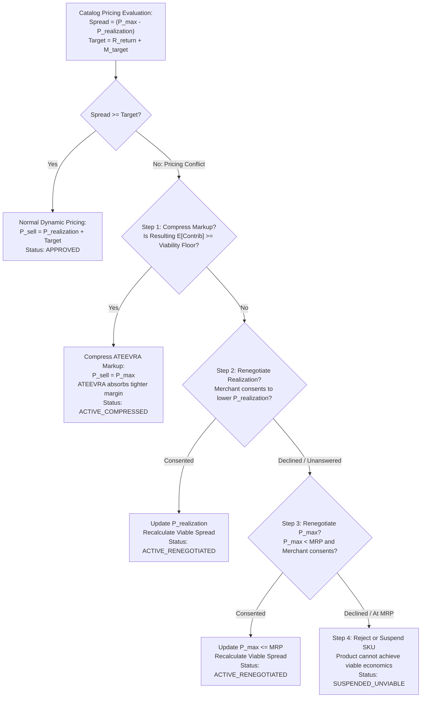

# ATEEVRA Policy: OD-02-06 — Pricing-Bound Conflicts & Resolution Hierarchy

**Policy ID:** `POL-OD-02-06`  
**Policy Name:** Merchant Pricing-Bound Governance, Conflict Resolution Hierarchy, and MRP Compliance  
**Owner Decision Reference:** OD-02 (Sub-Decision OD-02-06)  
**Approval Status:** `OWNER APPROVED — INITIAL POLICY BASELINE`  
**Current Version:** `1.0.0`  
**Effective Date:** Initial Baseline (Mandatory Validation Gates Apply Before Production)  
**Parent Blueprint:** [`../ATEEVRA-MARKETPLACE-FINANCIAL-COMMERCIAL-POLICY-BLUEPRINT.md`](../ATEEVRA-MARKETPLACE-FINANCIAL-COMMERCIAL-POLICY-BLUEPRINT.md)  
**Policy Register:** [`../POLICY-REGISTER.md`](../POLICY-REGISTER.md)

---

## 1. Executive Summary & Purpose

Under ATEEVRA's dynamic markup model, the customer shelf selling price ($P_{\text{sell}}$) is determined by adding platform variable operating costs, return-cost reserve buffers, and platform target margins to the merchant's fixed product realization ($P_{\text{realization}}$).

In certain scenarios, the merchant-approved customer price ceiling ($P_{\max}$) or the statutory Maximum Retail Price (MRP) provides insufficient margin spread to cover both the required return-cost reserve ($R_{\text{return}}$) and ATEEVRA's target markup ($M_{\text{target}}$):
$$(P_{\max} - P_{\text{realization}}) < R_{\text{return}} + M_{\text{target}}$$

This policy governs how pricing-bound conflicts must be resolved, establishing an inviolable rule that merchant-approved pricing limits must never be violated silently, defining an explicit 4-step resolution hierarchy, and maintaining absolute statutory compliance with Indian Legal Metrology and consumer protection laws.

---

## 2. Owner-Approved Decision

> **APPROVED INITIAL POLICY: NEVER SILENTLY VIOLATE MERCHANT-APPROVED PRICING LIMITS**
> 
> 1. The platform pricing engine shall **NEVER silently override, bypass, or exceed merchant-approved pricing limits ($P_{\max}$)** or statutory MRP.
> 2. When a pricing-bound conflict arises, the platform must execute the following **mandatory 4-step resolution order**:
>    - **Step 1: Compress ATEEVRA Gross Markup** — ATEEVRA absorbs the deficit by compressing its gross markup, provided the resulting expected unit contribution remains commercially viable ($\mathbb{E}[\text{Contribution}] > \text{Viability Floor}$).
>    - **Step 2: Renegotiate Merchant Realization** — Seek explicit, auditable merchant consent to lower $P_{\text{realization}}$, widening the commercial spread.
>    - **Step 3: Renegotiate Approved Pricing Limits** — Seek explicit, auditable merchant consent to increase $P_{\max}$, strictly subject to statutory MRP limits under the Legal Metrology Act.
>    - **Step 4: Reject or Suspend the SKU** — If viable unit economics cannot be achieved through Steps 1–3, the SKU must be rejected during onboarding or suspended from active catalog display.
> 3. The platform shall **NOT automatically introduce mandatory merchant return co-payments or forced return subsidies** to bridge pricing deficits.
> 4. The platform must maintain a **strict conceptual and operational distinction between statutory package MRP and internal merchant-approved pricing ceilings ($P_{\max}$)**. No platform rule or pricing algorithm may authorize setting $P_{\text{sell}} > \text{MRP}$.

---

## 3. Governance and Approval Status

- **Status:** `OWNER APPROVED — INITIAL POLICY BASELINE`
- **Governance Invariants:**
  - Establishes the binding initial policy baseline approved by the platform owner.
  - Does NOT authorize Phase M2-14 technical code or schema changes.
  - Statutory Legal Metrology (Packaged Commodities) Rules, 2011, and Consumer Protection (E-Commerce) Rules, 2020, Rule 5(3)(b) (prohibition against price manipulation) remain mandatory legal validation gates.
  - Any future change to the resolution hierarchy must be submitted as a formal Change Request under [`../POLICY-CHANGELOG.md`](../POLICY-CHANGELOG.md).

---

## 4. Rationale & Commercial Justification

1. **Brand Protection & Legal Safety:**  
   Selling a product above statutory MRP is a criminal violation under the Legal Metrology Act, 2009, in India. Furthermore, silently breaching merchant-approved price ceilings destroys merchant trust and risks legal action for contractual breach.
2. **Transparent Commercial Partnership:**  
   Merchants establish $P_{\max}$ to ensure price parity with their other retail channels (Amazon, Myntra, brand website). Overriding $P_{\max}$ alienates premium sellers and causes them to pull catalog listings.
3. **Disciplined Unit Economics:**  
   Automated markup compression without safeguards can lead to negative-margin transactions. Enforcing an explicit 4-step hierarchy ensures that ATEEVRA only compresses markup when unit economics remain positive, and suspends unviable SKUs rather than bleeding platform cash.

---

## 5. Scope & Applicability

- **In Scope:**  
  - Dynamic pricing calculation for all active SKUs in the ATEEVRA catalog.
  - Merchant catalog onboarding workflows in the Merchant Portal.
  - Super Admin pricing moderation and margin threshold monitoring.
- **Out of Scope:**  
  - Temporary promotional discount vouchers financed entirely by platform marketing budgets (governed by OD-03).

---

## 6. Business Rules & Resolution Hierarchy

### Rule 1: The Inviolable Pricing Boundary Invariant
For every active SKU, the dynamic pricing engine must enforce the hard mathematical boundary:
$$P_{\text{realization}} \le P_{\text{sell}} \le P_{\max} \le \text{Statutory Package MRP}$$

Under zero circumstances may $P_{\text{sell}}$ exceed $P_{\max}$ or MRP.

### Rule 2: Distinction Between MRP and $P_{\max}$
1. **Statutory Package MRP:** The maximum retail price printed on the physical product packaging, mandatory under the Legal Metrology (Packaged Commodities) Rules, 2011. This is a legal ceiling.
2. **Merchant-Approved Customer Ceiling ($P_{\max}$):** The maximum customer price approved by the merchant in the Merchant Portal or contract. Typically $P_{\max} \le \text{MRP}$ (e.g. MRP is ₹1,499, but merchant sets $P_{\max} = ₹1,199$ to maintain omnichannel price parity).

### Rule 3: The Mandatory 4-Step Resolution Execution Flow

#### Detailed Step Execution Rules:
- **Step 1 (Platform Margin Compression):**  
  If the spread $(P_{\max} - P_{\text{realization}})$ is insufficient to achieve the standard platform margin target but still yields an Expected Unit Contribution above the Category Viability Floor ($V_{\text{floor}}$, an open pre-production business parameter, e.g. illustrative $\ge +₹25.00$ per placed order), ATEEVRA sets $P_{\text{sell}} = P_{\max}$ and absorbs the lower markup.
- **Step 2 (Merchant Realization Renegotiation):**  
  If Step 1 yields contribution below the floor, the system triggers an automated or manual Merchant Outreach Notification proposing a revised $P_{\text{realization}}$. The merchant must explicitly accept in the Merchant Portal.
- **Step 3 (Price Ceiling Renegotiation):**  
  If the merchant refuses to lower realization but $P_{\max} < \text{MRP}$, the merchant may consent to increase $P_{\max}$ up to statutory MRP. Explicit merchant approval is logged.
- **Step 4 (SKU Suspension / Rejection):**  
  If Steps 1, 2, and 3 fail to produce viable economics, the SKU status is transitioned to `SUSPENDED_UNVIABLE`. The product is hidden from storefront search and collections.

### Rule 4: Prohibition of Forced Merchant Return Co-Payments
The platform must NOT unilaterally debit merchants for return subsidies or force mandatory "return co-pay" deductions without explicit, separately negotiated contractual terms.

---

## 7. Preconditions and Exceptions

### Preconditions
- The merchant must submit verified $P_{\text{realization}}$, $P_{\max}$, and statutory MRP during product creation.
- Super Admin product moderation must verify that $P_{\text{realization}} \le P_{\max} \le \text{MRP}$.

### Exceptions
- **Flash Sales & Promotional Campaigns:** If a merchant voluntarily participates in an official platform sale event, temporary promotional boundaries may apply via an audited event agreement.

---

## 8. Stakeholder Impacts

| Stakeholder | Direct Impact |
| :--- | :--- |
| **Customer** | Complete protection against above-MRP price gouging. Fair, competitive pricing within merchant ceilings. |
| **Merchant** | Full control over pricing boundaries. Guaranteed that prices will never exceed approved $P_{\max}$ without consent. |
| **ATEEVRA Platform** | Protects profit margins through disciplined automated gating. Avoids selling unviable products at a loss. |
| **Regulators** | 100% compliance with Indian Legal Metrology and Consumer Protection regulations. |

---

## 9. Concrete Resolution Examples

### Example A: Successful Step 1 Compression
- $P_{\text{realization}} = ₹850.00$, $P_{\max} = ₹1,000.00$, $\text{MRP} = ₹1,299.00$.
- Available Spread: $₹1,000 - ₹850 = ₹150.00$.
- Standard Target Markup: $R_{\text{return}} (₹35) + M_{\text{target}} (₹165) = ₹200.00$ (Deficit = ₹50).
- *Resolution:* ATEEVRA compresses markup to ₹150.00. Expected unit contribution is evaluated: $+₹56.40$ (Prepaid) / $+₹18.50$ (COD). Both exceed the ₹15.00 viability floor. SKU is approved and active at $P_{\text{sell}} = ₹1,000.00$.

### Example B: Step 4 Suspension Triggered
- $P_{\text{realization}} = ₹950.00$, $P_{\max} = ₹1,000.00$, $\text{MRP} = ₹1,000.00$.
- Available Spread: $₹1,000 - ₹950 = ₹50.00$.
- Direct variable fulfillment costs = ₹93.60 (Prepaid) / ₹110.00 (COD).
- Available spread (₹50) fails even to cover forward freight (₹70) and payment processing.
- Step 1 fails ($\mathbb{E}[\text{Contribution}] < 0$).
- Merchant declines Step 2 (refuses to lower $P_{\text{realization}}$).
- Step 3 is legally impossible ($P_{\max} = \text{MRP} = ₹1,000.00$).
- *Resolution:* System executes Step 4. SKU is suspended (`SUSPENDED_UNVIABLE`).

---

## 10. Required Evidence and Audit Trails

1. **Pricing Moderation Audit Table:** Persisted in PostgreSQL logging: `product_id`, `variant_id`, `p_realization`, `p_max`, `mrp`, `p_sell`, `resolution_step_applied`, `margin_compressed_amt`, `merchant_consent_timestamp`.
2. **Storefront Price Invariant Guard:** Continuous automated synthetic tests ensuring zero SKUs have $P_{\text{sell}} > P_{\max}$ or $P_{\text{sell}} > \text{MRP}$.

---

## 11. Dispute & Escalation Procedures

- **Merchant Pricing Disagreements:** If a merchant objects to SKU suspension under Step 4, they may request a review with the Category Manager to renegotiate fulfillment subsidies or realization terms.

---

## 12. Accounting and Reconciliation Considerations

- **Gross Margin Reporting:** Finance dashboards must record compressed margins separately to track the portfolio cost of Step 1 markup compressions.

---

## 13. Dependencies & Open Questions

- **Dependencies:**
  - Technical configuration schema for Category Viability Floors in PostgreSQL / Medusa pricing engine.
  - Legal sign-off on Consumer Protection (E-Commerce) Rules, 2020, Rule 5(3)(b) compliance.
- **Open Pre-Production Business Parameter: Category Viability Floor ($V_{\text{floor}}$):**
  - *Definition:* The absolute minimum expected unit contribution ($\mathbb{E}[\text{Contribution}]$) per placed order below which ATEEVRA will NOT compress gross markup under Step 1, triggering Step 2/3 renegotiation or Step 4 suspension instead.
  - *Mandatory Calibration Requirements:*
    1. **Required Input Providers:** Category Leads (merchandising) and Commercial Finance (P&L controllers).
    2. **Required Financial Assumptions to Evaluate:** Category historical return/RTO rates, average order values (AOV), category forward and reverse freight tariffs, gateway payment processing costs, and the minimum acceptable platform net profit contribution after corporate overheads.
    3. **Mandatory Owner Approval:** Written sign-off and approval by the Platform Owner is mandatory prior to loading any numerical viability floor into production pricing configuration.
    4. **Anti-Silent Enactment Invariant:** Under zero circumstances may an uncalibrated, unapproved, hardcoded, or arbitrary default category viability floor silently become an active production rule.

---

## 14. Review Frequency & Change Triggers

- **Quarterly Review:** Audit of suspended SKUs and compressed-margin SKUs by Category Leads and Head of Commercial.

---

## 15. Controlled Revision Notice: Baseline v1.1.0-PROPOSED Addendum

> [!NOTE]
> **GOVERNANCE STATUS: OWNER DIRECTION RECORDED — PROPOSED POLICY REVISION (PENDING OWNER RATIFICATION)**  
> Pursuant to Project Owner directions issued on 2026-11-04 regarding Cancellation, Return, RTO & Merchant Accountability (OD-15), a controlled policy revision (`v1.1.0-PROPOSED`) has been formulated:
> - **Superceding Policy Reference:** [`POL-M2-14-06-MERCHANT-ACCOUNT-HEALTH-AND-ENFORCEMENT.md`](POL-M2-14-06-MERCHANT-ACCOUNT-HEALTH-AND-ENFORCEMENT.md) and [`M2-14-OD-02-REVISED-POLICY-BASELINE-V1-1-0.md`](../M2-14-OD-02-REVISED-POLICY-BASELINE-V1-1-0.md).
> - **Key Proposed Change:** Integrates provisional penalties (₹25 cancel, ₹50 late) and reverse-shipping debits into the pricing bound and contractual set-off netting framework.
> - **Legal Baseline:** This document (`POL-OD-02-06` v1.0.0) remains the approved baseline until formal Owner Ratification is executed.
