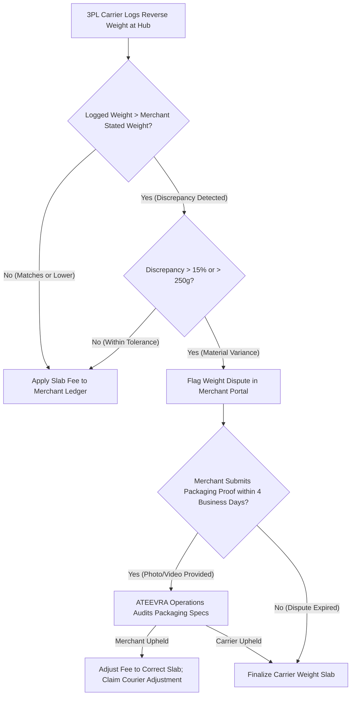

# ATEEVRA Policy: POL-M2-14-01 — Customer Returns After Delivery & Weight-Based Merchant Reverse-Shipping Allocation

**Policy ID:** `POL-M2-14-01`  
**Policy Name:** Customer Returns After Delivery & Weight-Based Merchant Reverse-Shipping Allocation  
**Owner Decision Reference:** OD-02 (Refund Financial Liability) & OD-15 (Cancellation, Return, RTO & Accountability)  
**Parent Blueprint:** [`../ATEEVRA-MARKETPLACE-FINANCIAL-COMMERCIAL-POLICY-BLUEPRINT.md`](../ATEEVRA-MARKETPLACE-FINANCIAL-COMMERCIAL-POLICY-BLUEPRINT.md)  
**Related Policies:** [`OD-02-01-RETURN-COST-RESERVE.md`](OD-02-01-RETURN-COST-RESERVE.md), [`OD-02-03-GATEWAY-FEE-ALLOCATION.md`](OD-02-03-GATEWAY-FEE-ALLOCATION.md), [`POL-M2-14-02-RTO-AND-FAILED-DELIVERY.md`](POL-M2-14-02-RTO-AND-FAILED-DELIVERY.md)  
**Current Governance Status:** `OWNER DIRECTION RECORDED — PROPOSED POLICY REVISION (PENDING OWNER RATIFICATION)`  
**Baseline Policy Version:** `1.1.0-PROPOSED` (Supercedes OD-02 v1.0.0 100% platform-absorbed remorse return reverse freight)  
**Effective Date:** Subject to Formal Owner Ratification & 3PL Courier Tariff Contract Execution  
**Audit Date:** 2026-11-04  

---

## 1. Executive Summary & Purpose

When a customer accepts physical delivery of a shipment and subsequently initiates a product return within the applicable return eligibility window, the reverse-logistics process incurs freight, handling, and inspection costs.

Under the previous approved baseline (`POL-OD-02-01` Version 1.0.0), ATEEVRA absorbed 100% of reverse-logistics freight on customer remorse returns through an internal platform-funded Return-Cost Reserve ($R_{\text{target}} \approx ₹22.61$).

Under this **Owner-Directed Policy Baseline (POL-M2-14-01)**:
1. **Merchant-Side Financial Allocation:** The financial liability for reverse shipping on customer returns after delivery is allocated to the **Merchant** who fulfilled the order.
2. **Weight-Based Slabs:** The reverse-shipping fee charged to the merchant is determined dynamically based on the package's **chargeable weight**.
3. **Customer Transparency & Protection:** The customer continues to receive an **uncompromised 100% full refund** of the product price paid, with **ZERO hidden return-shipping deductions**. The reverse-shipping fee is strictly an internal merchant-side commercial settlement debit, not a consumer charge.
4. **Default 7-Day Window:** Customer return eligibility defaults to **7 calendar days from carrier delivery confirmation**, subject to statutory consumer protection rights and category-specific hygiene exceptions.

---

## 2. Owner-Approved Policy Directives

> **OWNER POLICY BASELINE — CUSTOMER RETURNS AFTER DELIVERY:**
> 
> 1. When a customer accepts delivery and initiates a return within the applicable return window, the **merchant is debited a reverse-shipping fee** in their settlement ledger.
> 2. Reverse-shipping charges must be **weight-dependent**, reflecting the physical or volumetric weight of the merchandise returned.
> 3. The platform establishes an indicative weight slab schedule ranging from **₹30.00 to ₹165.00+**, subject to actual 3PL carrier contracted tariffs.
> 4. The customer-facing refund must **NEVER suffer a reverse-shipping deduction**. The customer receives a 100% full refund of the product purchase price.
> 5. The return window defaults to **7 calendar days** post-delivery confirmation, preserving statutory exceptions (defects, non-conforming goods).
> 6. Reverse-shipping fees must be formally invoiced to the merchant as a B2B logistics recovery, exclusive of applicable 18% GST.
> 7. A transparent **weight dispute and courier reweighing mechanism** must be provided to protect merchants against inaccurate 3PL weight capture.

---

## 3. Indicative Weight-Based Reverse-Shipping Fee Schedule

The table below sets forth the owner-directed indicative reverse-shipping fee slabs for customer returns after successful delivery:

```
========================================================================================================================
WEIGHT-BASED MERCHANT REVERSE-SHIPPING FEE SCHEDULE (INDICATIVE STARTING BENCHMARK)
========================================================================================================================
Weight Slab Category     | Chargeable Package Weight Range | Indicative Reverse Fee (₹)| Statutory GST (18%) | Total Merchant Debit
-------------------------+---------------------------------+---------------------------+---------------------+---------------------
Slab 1 (Light Apparel)   | Up to 500 g                     |                    ₹30.00 |               ₹5.40 |               ₹35.40
Slab 2 (Standard Fashion)| Above 500 g to 1.0 kg           |                    ₹50.00 |               ₹9.00 |               ₹59.00
Slab 3 (Footwear/Heavy)  | Above 1.0 kg to 2.0 kg          |                    ₹80.00 |              ₹14.40 |               ₹94.40
Slab 4 (Bulky / Multi)   | Above 2.0 kg to 5.0 kg          |                   ₹120.00 |              ₹21.60 |              ₹141.60
Slab 5 (Oversized / Bulk)| Above 5.0 kg                    |        ₹165.00 + ₹35/addl kg* |     18% on base fee | Base + 18% GST
========================================================================================================================
```
*\*Important Commercial Parameter Notice:*
- These figures represent an **indicative owner-directed starting structure**, NOT verified commercial carrier tariffs.
- Slabs must be calibrated against actual negotiated 3PL rate cards (Delhivery, Shiprocket, Bluedart) prior to production activation.
- All base fees are **exclusive of 18% GST**. The merchant receives an official B2B debit note / tax invoice allowing Input Tax Credit (ITC) claim under Section 16(2) of the CGST Act, 2017.

---

## 4. Chargeable Weight Calculation: Dead Weight vs. Volumetric Weight

To prevent commercial deficits caused by bulky, lightweight fashion packaging (e.g., winter jackets, lehengas, hats), 3PL carriers bill logistics based on **Chargeable Weight**:

$$\mathbf{\text{Chargeable Weight}} = \max\left(\text{Actual Dead Weight (kg)}, \quad \text{Volumetric Weight (kg)}\right)$$

### 4.1. Volumetric Weight Formula (Standard E-Commerce Air & Surface Express)
$$\mathbf{\text{Volumetric Weight (kg)}} = \frac{\text{Length (cm)} \times \text{Width (cm)} \times \text{Height (cm)}}{\mathbf{5000}}$$

*(Note: Certain surface logistics carriers utilize a divisor of 4,000 or 4,500; the standard 5,000 divisor applies unless courier contract specifies otherwise).*

### 4.2. Concrete Category Weight Calculations
1. **Silk Saree / Scarf (Polybag Packaging):**
   - Dead Weight: 350 g (0.35 kg)
   - Dimensions: $25\text{ cm} \times 20\text{ cm} \times 3\text{ cm} \rightarrow \text{Volumetric} = \frac{1500}{5000} = 0.30\text{ kg}$
   - Chargeable Weight: $\max(0.35, 0.30) = 0.35\text{ kg}$ $\rightarrow$ **Slab 1 (Up to 500 g): ₹30.00 base fee**.
2. **Designer Anarkali Gown (Box Packaging):**
   - Dead Weight: 1.10 kg
   - Dimensions: $40\text{ cm} \times 30\text{ cm} \times 12\text{ cm} \rightarrow \text{Volumetric} = \frac{14400}{5000} = 2.88\text{ kg}$
   - Chargeable Weight: $\max(1.10, 2.88) = \mathbf{2.88\text{ kg}}$ $\rightarrow$ **Slab 4 (2.0 to 5.0 kg): ₹120.00 base fee**.
   - *Operational Finding:* Volumetric expansion pushes the shipment from Slab 3 to Slab 4. Merchant packaging optimization is critical.

---

## 5. Weight Dispute, Reweighing & Courier Adjustment Mechanism

3PL courier partners frequently log inaccurate weight measurements at automated scanner hubs (e.g., optical sensor errors, packaging overhangs). To protect merchants against unfair reverse-shipping overcharges:



### 5.1. Operational Dispute Rules
1. **Automated Discrepancy Flag:** If the 3PL reverse bill weight exceeds the merchant's declared outbound product weight by more than **15% or 250 grams**, the platform automatically creates an open `WEIGHT_DISPUTE_PENDING` ticket.
2. **Dispute Window:** The merchant has **4 business days** from reverse delivery to upload packaging dimensions, box photos, and standard product weight proof via the Merchant Portal.
3. **Provisional Hold:** The incremental reverse-shipping fee between the declared slab and the carrier slab is held in `ESCROW_WEIGHT_DISPUTE_RESERVE` and not debited until adjudication concludes.
4. **Courier Reconciliation:** If ATEEVRA Operations upholds the merchant's claim, ATEEVRA files a formal weight dispute against the 3PL carrier under the Master Logistics SLA.

---

## 6. Return Eligibility Window: Default 7 Days & Statutory Exceptions

### 6.1. The 7-Day Default Rule
In accordance with owner direction, the platform-wide default customer return window is established as:
$$\mathbf{\text{Default Customer Return Window}} = \mathbf{7 \text{ Calendar Days from Physical Delivery Confirmation}}$$
- The return window countdown begins at 00:00:00 on the calendar day following confirmed delivery (`status = 'delivered'`).
- Self-service return initiation closes automatically at 23:59:59 on the 7th calendar day.

### 6.2. Statutory & Quality Exceptions
The 7-day default is subject to mandatory legal and category exceptions:
1. **Defective / Non-Conforming Products (Merchant Fault):** Under the Consumer Protection Act, 2019, if a product suffers from a latent manufacturing defect, incorrect sizing against merchant size chart, or wrong item shipped, return eligibility extends up to **14 calendar days**. In this case, the return is classified as `MERCHANT_FAULT_RETURN` (governed by `POL-OD-02-03`).
2. **Category Hygiene Exclusions:** Under Consumer Protection (E-Commerce) Rules, categories involving personal hygiene (intimate apparel, swimwear, unsealed cosmetics) are **strictly non-returnable**, unless delivered damaged, tampered, or expired.
3. **Special Luxury / Designer Tiers:** Selected haute-couture categories may specify an explicit 48-hour return window, clearly displayed on the Product Detail Page (PDP).

---

## 7. Customer Experience & Transparency Safeguards

1. **Zero Customer-Facing Reverse Deductions:** The customer-facing refund workflow must never show a deduction for reverse shipping. If a customer paid ₹1,500.00 for an apparel item, the refund credited to their bank/card must be exactly **₹1,500.00**.
2. **Prohibition of "Restocking Fees":** ATEEVRA does not permit merchants to levy arbitrary "handling charges" or "restocking fees" on retail customers.
3. **Visibility on Merchant Statements:** On merchant payout statements, reverse-shipping fees must appear as distinct, transparent line items referencing the specific `order_id` and `return_id`, accompanied by a downloadable GST tax invoice.

---

## 8. Governance & Policy Evolution Status

1. **Reconciliation with OD-02 v1.0.0:** This policy amends the historical `POL-OD-02-01` baseline by shifting remorse return reverse-freight liability from platform reserve absorption to the merchant, significantly reducing platform cash drain.
2. **Approval Status:** Classified as **`OWNER DIRECTION RECORDED — PROPOSED POLICY REVISION (PENDING OWNER RATIFICATION)`**.
3. **Execution Restriction:** Strictly documentation and financial specification. Zero application code, Medusa modules, or database migrations are authorized.
