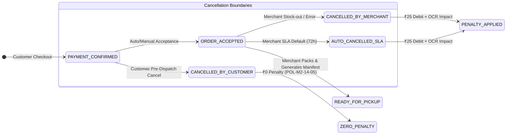
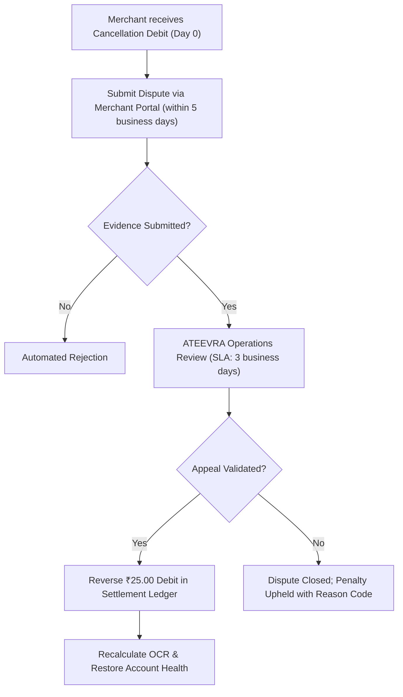

# ATEEVRA Policy: POL-M2-14-03 — Merchant-Initiated Cancellations & Accountability Penalty

**Policy ID:** `POL-M2-14-03`  
**Policy Name:** Merchant-Initiated Cancellations & Accountability Penalty  
**Owner Decision Reference:** OD-08 (Merchant Lifecycle & SLA Governance) & OD-15 (Cancellation, Return, RTO & Accountability)  
**Parent Blueprint:** [`../ATEEVRA-MARKETPLACE-FINANCIAL-COMMERCIAL-POLICY-BLUEPRINT.md`](../ATEEVRA-MARKETPLACE-FINANCIAL-COMMERCIAL-POLICY-BLUEPRINT.md)  
**Related Policies:** [`POL-M2-14-04-MERCHANT-DISPATCH-SLA-LATE-PENALTY.md`](POL-M2-14-04-MERCHANT-DISPATCH-SLA-LATE-PENALTY.md), [`POL-M2-14-05-CUSTOMER-PRE-DISPATCH-CANCELLATION.md`](POL-M2-14-05-CUSTOMER-PRE-DISPATCH-CANCELLATION.md), [`POL-M2-14-06-MERCHANT-ACCOUNT-HEALTH-AND-ENFORCEMENT.md`](POL-M2-14-06-MERCHANT-ACCOUNT-HEALTH-AND-ENFORCEMENT.md)  
**Current Governance Status:** `OWNER DIRECTION RECORDED — PROPOSED POLICY REVISION (PENDING OWNER RATIFICATION)`  
**Baseline Policy Version:** `1.1.0-PROPOSED`  
**Effective Date:** Subject to Formal Owner Ratification & Merchant Agreement Addendum Execution  
**Audit Date:** 2026-11-04  

---

## 1. Executive Summary & Purpose

When a customer places an order on the ATEEVRA marketplace and the order is confirmed, the customer enters into an agreement with the merchant as the seller of record for the timely supply of the contracted goods. When a merchant unilaterally cancels an order after confirmation due to out-of-stock inventory, pricing errors, or operational inability to fulfill, it creates substantial customer dissatisfaction, damages marketplace reputation, and imposes administrative overhead on ATEEVRA's customer support and payment operations.

To establish operational discipline, protect consumer trust, and compensate the platform for administrative friction, this policy establishes:
1. A **provisional financial penalty of ₹25.00** per merchant-initiated cancellation.
2. A formal definition of the **order acceptance milestone** triggering penalty liability.
3. The principle that **zero platform facilitation fees** are earned by ATEEVRA on cancelled orders.
4. Direct linkage between merchant cancellations and **Merchant Account Health** scoring.
5. A defined **appeals and exception mechanism** for force majeure, platform outages, and fraudulent buyers.
6. Statutory GST, contract law, and financial ledger settlement mechanics.

---

## 2. Owner-Approved Policy Directives

> **OWNER POLICY BASELINE — MERCHANT-INITIATED CANCELLATIONS:**
> 
> 1. A merchant who cancels a confirmed customer order due to inventory stock-outs, fulfillment inability, internal pricing errors, or operational failure is subject to a **provisional financial penalty of ₹25.00 per cancelled order**.
> 2. The penalty attaches immediately upon the transition of an order from `CONFIRMED / ACCEPTED` to `CANCELLED_BY_MERCHANT` (or automated platform cancellation following SLA breach).
> 3. **Zero Platform Facilitation Fee:** ATEEVRA does NOT earn or retain any marketplace facilitation fee on cancelled orders. The customer receives a **100% full refund** of the transaction amount.
> 4. The ₹25.00 penalty is **debited directly from the merchant's settlement balance** in accordance with the contractual set-off provisions of the Merchant Agreement.
> 5. Every merchant cancellation directly impairs the merchant's **Order Cancellation Rate (OCR)** and feeds into progressive enforcement tiers under [`POL-M2-14-06`](POL-M2-14-06-MERCHANT-ACCOUNT-HEALTH-AND-ENFORCEMENT.md).
> 6. Merchants are entitled to an **exception and appeal process** for cancellations resulting from documented platform infrastructure outages, verified customer fraud, or declared force majeure events.

---

## 3. Order Lifecycle Milestones & Penalty Trigger Boundaries

The financial liability for a merchant-initiated cancellation is determined by clear order lifecycle boundaries:

### 3.1 Qualifying Cancellation Events (Penalty Applicable)

The ₹25.00 provisional penalty applies to:
- **`CAN-MRCH-01` (Out of Stock):** Merchant cannot fulfill because physical inventory is exhausted or damaged in storage.
- **`CAN-MRCH-02` (Pricing Error):** Merchant listed incorrect pricing or discount and refuses to fulfill at the displayed price.
- **`CAN-MRCH-03` (Listing / Catalog Mismatch):** Merchant cannot fulfill because the item ordered does not match listed specifications.
- **`CAN-MRCH-04` (Unresponsive Merchant):** Merchant fails to mark the order ready for dispatch within the maximum SLA threshold (72 hours), triggering automatic platform cancellation.
- **`CAN-MRCH-05` (Operational Inability):** Merchant requests platform support to cancel the order on their behalf due to internal operational constraints.

### 3.2 Non-Qualifying Events (Zero Merchant Penalty)

The ₹25.00 penalty does NOT apply to:
- Customer-initiated cancellations prior to carrier pickup (governed by [`POL-M2-14-05`](POL-M2-14-05-CUSTOMER-PRE-DISPATCH-CANCELLATION.md)).
- Orders cancelled by ATEEVRA Trust & Safety due to confirmed buyer payment fraud or velocity anomalies.
- Orders where delivery is cancelled by the courier due to pin-code unserviceability not identified at checkout.
- Verified platform system failure (e.g., inventory synchronization service downtime).

---

## 4. Financial, Tax & Ledger Accounting Treatment

### 4.1 Liquidated Damages vs. Service Fee (GST Analysis)

Under Indian Goods and Services Tax jurisprudence:
1. **Circular No. 178/10/2022-GST (August 3, 2022):** The Central Board of Indirect Taxes and Customs (CBIC) clarified that liquidated damages, penalties, and forfeiture amounts paid for breach of contract do not constitute consideration for a supply of service ("agreeing to tolerate an act") where there is no independent agreement to tolerate breach. Penalties designed to enforce discipline or deter non-performance are damages, not taxable supplies.
2. **Provisional Accounting Position:** The ₹25.00 merchant cancellation charge is classified as **Liquidated Damages / Operational Compensation for Contractual Default**. 
3. **Statutory Tax Reservation:** Pending formal written opinion from ATEEVRA's tax and accounting counsel:
   - If classified strictly as contractual liquidated damages under Circular 178/10/2022-GST: **GST is 0% (Non-taxable breach recovery)**.
   - If conservative tax counsel advises treating the fee as an administrative cancellation processing charge: **18% GST (₹4.50) is applicable**, making the gross debit ₹29.50.
   - *Baseline Model Assumption:* The provisional model records the penalty as ₹25.00 pure liquidated damages debit. Tax counsel sign-off is mandatory prior to live production configuration.

### 4.2 Customer Refund Protection

Under all merchant-initiated cancellation scenarios:
$$\text{Customer Refund} = 100\% \times \text{Customer Gross Payment}$$
The customer receives full reimbursement to their original payment source. Neither payment gateway fees nor administrative charges are deducted from the customer.

### 4.3 Double-Entry Ledger Mechanics

When a merchant cancellation (`CAN-MRCH-01` through `05`) is logged:

| Ledger Account | Debit (₹) | Credit (₹) | Description |
| :--- | :---: | :---: | :--- |
| **Merchant Settlement Escrow (Payable)** | ₹25.00 | — | Settlement deduction against merchant pending payout balance |
| **Platform Penalty & Breach Recovery Income** | — | ₹25.00 | Internal income compensating platform operational and support overhead |

If the merchant has zero pending settlement balance:
- The ₹25.00 is posted as an **Unsettled Merchant Debit Balance (Receivable)**.
- It is automatically netted against future order settlements under the contractual set-off clause.
- If the negative balance persists beyond 30 days, merchant account restriction protocols under [`POL-M2-14-06`](POL-M2-14-06-MERCHANT-ACCOUNT-HEALTH-AND-ENFORCEMENT.md) are activated.

---

## 5. Exceptions, Disputes & Merchant Appeal Workflow

ATEEVRA provides an equitable, audited appeal process to protect merchants from penalties arising from circumstances outside their control.

### 5.1 Permitted Grounds for Appeal

1. **Documented Platform Infrastructure Outage:** ATEEVRA order intake or merchant portal API experienced downtime verified by the platform engineering status log.
2. **Suspected / Confirmed Buyer Fraud:** Merchant identified malicious customer behavior (e.g., suspicious bulk ordering) and reported it to ATEEVRA before cancelling.
3. **Logistics Service Interruption:** Courier partner pickup service in the merchant's pin code was suspended due to strikes, civil disruption, or natural disaster.
4. **Third-Party API Desynchronization:** Verified failure in certified third-party ERP/inventory integration plugin attributable to platform API breaking change.

### 5.2 Appeal Workflow & SLAs

- **Dispute Window:** Merchant must lodge appeal within **5 business days** of penalty logging.
- **Review SLA:** ATEEVRA Operations must rule on appeal within **3 business days**.
- **Remedy:** If upheld, ₹25.00 is credited to the merchant's next settlement, and the cancellation event is removed from OCR calculation.

---

## 6. Account Health Scoring Linkage

Merchant cancellations directly govern the **Order Cancellation Rate (OCR)** metric:

$$\text{OCR} = \left( \frac{\sum \text{Eligible Merchant Cancellations}}{\sum \text{Total Accepted Orders}} \right) \times 100$$

- Evaluated across rolling **30-day** and **90-day** measurement windows.
- Performance Thresholds:
  - **Healthy (Green):** $\text{OCR} < 1.0\%$
  - **Advisory (Yellow):** $1.0\% \le \text{OCR} \le 2.5\%$
  - **Critical Breach (Red):** $\text{OCR} > 2.5\%$
- Breaches of OCR trigger escalating actions under [`POL-M2-14-06`](POL-M2-14-06-MERCHANT-ACCOUNT-HEALTH-AND-ENFORCEMENT.md), ranging from mandatory catalog reduction to settlement reserve withholding and account suspension.

---

## 7. Governance, Implementation & Traceability Restrictions

1. **Zero Code / Schema Changes:** This document is strictly an operational policy and commercial baseline. No database tables, schemas, automated penalty calculation jobs, or merchant portal UI changes may be developed until formal Owner Ratification is completed.
2. **Legal Review Requirement:** Final merchant agreement phrasing must incorporate an enforceable liquidated damages clause conforming to Section 73 & 74 of the Indian Contract Act, 1872.
3. **Traceability:** Cross-referenced in [`POLICY-REGISTER.md`](../POLICY-REGISTER.md) and tracked in [`M2-14-OWNER-DECISION-REGISTER.md`](../../M2-14-OWNER-DECISION-REGISTER.md).
